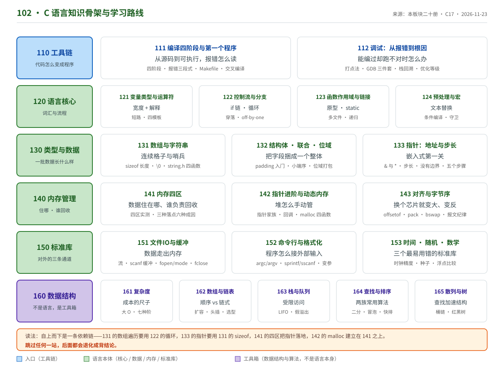

# 102 C 语言全貌

> **一句话定位**：C 是一门"看得见内存"的编译型语言——离硬件足够近又足够通用，是嵌入式几十年的母语；本板块二十册，从跑起第一个程序立到数据结构与算法。

## 读图

- **110 工具链**：管"代码怎么变成能跑的程序"，以及跑不对时怎么倒着查回来。
- **120 语言核心**：管表达式与流程——类型、运算符、分支循环、函数、宏。
- **130 类型与数据组织**：管"一批数据长什么样"——数组、结构体、指针。
- **140 内存管理**：管"数据住在哪、谁负责回收"——四区、动态内存、对齐与字节序。
- **150 标准库与IO**：管程序与外界的三条通道——文件、命令行、时间与数学。
- **160 数据结构与算法**：不是语言本身，但全部用 C 实现——复杂度、链表、栈队列、查找排序、散列与树。

## 下一篇

从 [111 编译四阶段与第一个程序](110-工具链/111-编译四阶段与第一个程序.md) 开始；册清单、学习路径与板块分界见 [README](README.md)。
