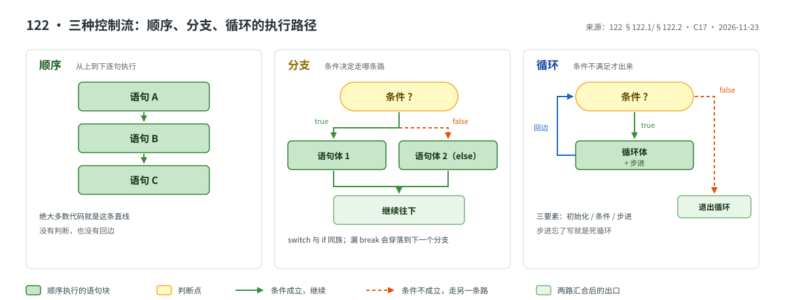
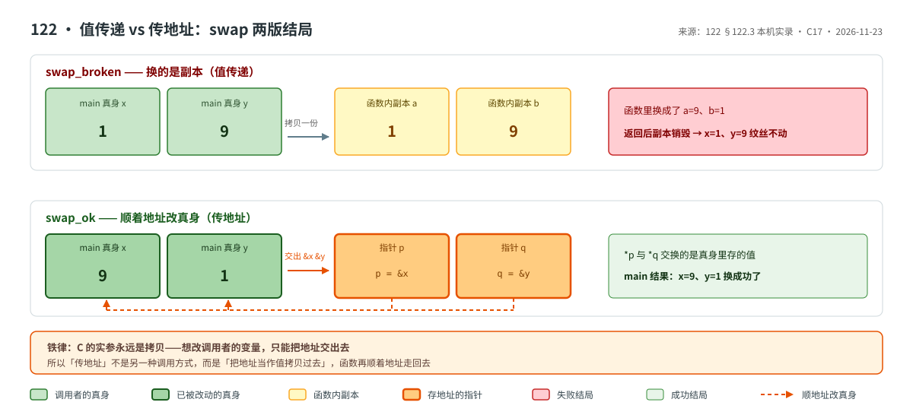

# 122 控制流与分支

> **解决**：让程序会"选"和"转"——if 链与 switch 两种分支武器、三种循环形态、以及 off-by-one 这个循环第一大坑；末尾补上函数初见，把前面所有代码块收进一个可复用的壳里。  
> **范围**：if / else if 链与悬空 else · switch 与穿落 · for/while/do-while · continue 与 break · off-by-one · 函数初见与"实参永远是拷贝"。  
> **口径**：C17；输出均为本机实录（Windows x64 + GCC 16.2.0）；break/continue 只影响**本层**循环，不跨层。  
> **更新**：2026-11-23  
> **本册导读** ── 必会三点：① 悬空 else 绑定**最近**的 if（`-Wdangling-else` 会提醒）② switch 的穿落是机制不是错误，漏 break 才是错 ③ 实参永远是拷贝——想改真身必须交地址 ｜ 跟做时长：约 2.5 小时 ｜ 前置：121（类型与运算符）。  
> **标记**：★ = 必会节（啃透必会三点就能过）；○ = 拓展节（时间多再扫）。

## 目录

| 节 | 内容 |
|---|---|
| 122.1 | 分支：if 链与 switch 穿落 ★ |
| 122.2 | 循环：三种形态与 off-by-one ★ |
| 122.3 | 函数初见：实参永远是拷贝 ★ |
| 122.4 | 坑表 |
| 122.5 | 检查清单（自测 6 题 + 动手任务 3 件） |

---

## 122.1 分支：if 链与 switch 穿落 ★

**定义**：分支让程序按条件走不同路径。C 只有两种武器：**if 链**（任意条件均可，能表达区间）与 **switch**（只能比"等于常量"，但跳转表快、可读性好）。选谁不靠喜好，看判据是"区间"还是"等值"。

**完整示例**（`branch.c`）——五档成绩用 if 链，外加一个故意写歪的悬空 else：

```c
#include <stdio.h>

static const char *grade_if(int score)
{
    if (score >= 90)
        return "A";
    else if (score >= 80)
        return "B";
    else if (score >= 70)
        return "C";
    else if (score >= 60)
        return "D";
    else
        return "F";
}

static void dangling(int a)
{
    if (a > 0)
        if (a > 10)
            printf("a>10\n");
    else
        printf("else 跟谁走？a=%d\n", a);
}

int main(void)
{
    int scores[] = {95, 85, 72, 60, 59};
    for (int i = 0; i < 5; i++)
        printf("%d -> %s\n", scores[i], grade_if(scores[i]));
    dangling(5);
    return 0;
}
```

**跟做**：`gcc -Wall branch.c -o branchdemo.exe` → `.\branchdemo.exe`。**预期输出（本机实录，警告在前）**：

```text
branch.c: In function 'dangling':
branch.c:19:8: warning: suggest explicit braces to avoid ambiguous 'else' [-Wdangling-else]
   19 |     if (a > 0)
      |        ^
95 -> A
85 -> B
72 -> C
60 -> D
59 -> F
else 跟谁走？a=5
```

**三处必看的机制**：① if 链**从上往下短路**：`score=72` 在第一个条件就假、第二个也假、第三个命中，后面不再判——所以顺序必须**从大到小**，写反了 95 会先命中 `>=60` 得 D；② **悬空 else**：`dangling(5)` 时 a>0 为真、进了内层 `a>10` 为假，于是打印了 else——**else 绑定的是最近的 if（内层的那个）**，不是外层；`-Wdangling-else` 就是在提醒你"这段代码读起来有歧义，加括号"；③ 缩进**不改变**语义——把 else 缩进到与 `if (a>0)` 对齐，它仍然绑内层。

**switch 与穿落**（`grade.c`）：

```c
int score = 85;
switch (score / 10) {
    case 10:
    case 9:  printf("A\n"); break;
    case 8:  printf("B\n"); break;
    case 7:  printf("C\n"); break;
    case 6:  printf("D\n"); break;
    default: printf("F\n"); break;
}
```

**跟做**：编译运行 → **预期输出（本机实录）**：`B`（85 的十分位是 8）。

**穿落实验**（`grade_nb.c`，故意漏掉 case 8 的 break）：

```c
switch (score / 10) {
    case 8: printf("B\n");
    case 7: printf("C\n"); break;
    default: printf("F\n");
}
```

**预期输出（本机实录，score=85）**：

```text
B
C
```

**机制**：没有 break，执行完 case 8 **穿落**进 case 7——打了 B 又打了 C。这也是 `case 10:` 空体接 `case 9:` 能共享 A 档的原理：**穿落是机制不是错误，漏写才是错误**。

**两把武器怎么选**：

| 判据 | 用 if 链 | 用 switch |
|---|---|---|
| 比区间（`>= 60`） | ✅ 唯一选择 | ❌ 做不到 |
| 比等值（状态码、命令字） | 可以但冗长 | ✅ 可读、编译器可做跳转表 |
| 分支数 | 2~4 个 | 4 个以上、值密集 |
| 多值共享一支 | 用 `\|\|` 拼 | 空 case 叠加（§122.1 的 case 10/9） |

**试一试**：① 把 if 链顺序倒过来（先判 `>= 60`），95 分会变成 D——亲手验证"顺序有语义"；② 把 score 改成 65（case 6 有 break）与 59（default）各跑一遍；③ 删掉 default 看 55 分时输出什么（什么都不输出——silent，这就是 default 必写的理由）。

## 122.2 循环：三种形态与 off-by-one ★

**完整示例**（`loops.c`）：

```c
#include <stdio.h>

int main(void)
{
    int sum = 0;
    for (int i = 1; i <= 100; i++)      /* for: 次数已知 */
        sum += i;
    printf("1+2+...+100 = %d\n", sum);

    int n = 3;
    while (n > 0) {                     /* while: 先判后做 */
        printf("countdown %d\n", n);
        n--;
    }

    for (int i = 1; i <= 10; i++) {
        if (i % 2 == 0) continue;       /* 跳过偶数 */
        if (i > 7) break;               /* 到 9 就收工 */
        printf("odd=%d ", i);
    }
    printf("\n");

    int i = 0;                          /* off-by-one 对比 */
    printf("i<3 goes: ");
    for (i = 0; i < 3; i++) printf("%d ", i);
    printf("| i<=3 goes: ");
    for (i = 0; i <= 3; i++) printf("%d ", i);
    printf("\n");
    return 0;
}
```

**跟做**：`gcc -Wall loops.c -o loops.exe` → `.\loops.exe`。**预期输出（本机实录）**：

```text
1+2+...+100 = 5050
countdown 3
countdown 2
countdown 1
odd=1 odd=3 odd=5 odd=7
i<3 goes: 0 1 2 | i<=3 goes: 0 1 2 3
```

**三处必看的机制**：① **三种形态各管一段**：`for` 用于次数已知、`while` 用于"先判后做"、`do-while` 用于"至少做一次"（读配置、重试这类场景）；② `i<3` 打 3 个数、`i<=3` 打 4 个——**差一错误**肉眼可见，写循环先回答"第一次 i 是几、最后一次是几"；③ `continue` 跳过本轮（偶数消失）、`break` 终止**本层**（到 9 停）——嵌套循环里 break 只退一层，退多层要加标志或 goto。

**off-by-one 的三秒查法**（本库通用）：拿最边界的两个输入各跑一次——长度 0 和长度 1。`for (i = 0; i <= len; i++)` 在 len=0 时会多跑一次；`for (i = 0; i < len; i++)` 才正确。**数组遍历一律 `< len`，不要 `<=`**（越界实证见 131 §131.1）。

**`while (1)` 不是错误**：裸机固件的主循环就是 `while (1) { ... }`——程序不退出，事件靠中断插进来（「300 操作系统原理」331 讲中断，500 板块 553 讲硬件怎么把程序推下去）。

**试一试**：① 把第一个循环改成 `i++` 漏写（死循环）——**在终端按 Ctrl+C 救场**（这就是你第一次体验"打断程序"）；② 把 `do-while` 版本写出来：先打印再判断 `n-- > 0`，对比 n=0 时 while 与 do-while 的输出差异（一个 0 次、一个 1 次）。

顺序、分支、循环三种控制流的执行路径，一图收拢（循环的红回边就是"反复执行"的来源）：



## 122.3 函数初见：实参永远是拷贝 ★

> **本节只立一个事实**：C 的实参永远是**拷贝**，函数里怎么改都动不了调用者的变量。函数的四种形态、原型、作用域、递归归 123；"怎么让函数改到真身"（传地址）需要 `*` 与 `&`，归 133 §133.2。本节之所以放在这里，是因为不讲清"拷贝"这条，后面的一切传参都会想歪。

**完整示例**（`swap.c`）——失败版与成功版同文件对比：

```c
#include <stdio.h>

void swap_broken(int a, int b)      /* 值传递：换的是拷贝 */
{
    int t = a; a = b; b = t;
}

void swap_ok(int *a, int *b)        /* 传地址 */
{
    int t = *a; *a = *b; *b = t;
}

int main(void)
{
    int x = 1, y = 9;
    swap_broken(x, y);
    printf("after swap_broken: x=%d y=%d   (unchanged!)\n", x, y);
    swap_ok(&x, &y);
    printf("after swap_ok:     x=%d y=%d\n", x, y);
    return 0;
}
```

**跟做**：`gcc -Wall swap.c -o swap.exe` → `.\swap.exe`。**预期输出（本机实录）**：

```text
after swap_broken: x=1 y=9   (unchanged!)
after swap_ok:     x=9 y=1
```

**机制**：C 的实参永远是**拷贝**——`swap_broken` 里换的是副本，函数返回副本即焚，所以 x、y 纹丝不动。`swap_ok` 之所以成功，靠的不是"传值更用力"，而是它拿到的**不是变量的值、而是变量的地址**（`&x`），函数再顺着这个地址找到真身去改（`*a`）。`&` 与 `*` 是 133 §133.1~133.2 的全部主题，本节只需带走一句结论：**想改真身，就得交地址**。

这一点也解释了后面两册的分工：123 讲函数怎么组织逻辑（形态、原型、作用域、递归），133 讲地址怎么交出去。两处看到"传参"不要以为是两套东西——是同一件事的两半。

两版的内存流画成图——左边的交换发生在副本上，右边琥珀箭头才是"改真身"：



**试一试**：① 给 `swap_ok` 里加一行 `printf("inside: a=%p b=%p\n", (void*)a, (void*)b);`——打印出来的就是 main 里 x、y 的地址（`%p` 格式）；② 把 `swap_ok` 的两个参数改成 `int a, int b` 却保留 `*a = ...` 的写法，看编译器怎么拒绝你（`invalid type argument of unary '*'`）。

## 122.4 坑表

| # | 现象 | 原因 | 解法 |
|---|---|---|---|
| 1 | if 链判错档位 | 顺序反了，宽条件抢先命中 | 区间判断从大到小（或从小到大）单向排列（§122.1） |
| 2 | else 走进了不该进的分支 | 悬空 else 绑最近的 if | 内层加 `{}`；开 `-Wall` 看 `-Wdangling-else`（§122.1 实录） |
| 3 | switch 打了两个档 | 漏 break 穿落 | 每支 break + default 兜底（§122.1 实录） |
| 4 | switch 里声明的变量报错 | 穿落会跳过初始化，作用域跨 case | 用 `{}` 把该 case 包起来，或把声明提到 switch 外 |
| 5 | 循环多打一个数 | off-by-one | 数组一律 `i < len`；先想首末取值（§122.2） |
| 6 | 死循环退不出来 | 条件永真 / 循环变量没变 | Ctrl+C 救场；检查 `i++` 是否漏写（§122.2） |
| 7 | `while (n--)` 少跑一次 | 后置递减是先判后用 | 用 `while (n > 0) { ...; n--; }` 写清楚 |
| 8 | 函数里改了参数，外面没变 | 实参是拷贝（值传递） | 要改真身传地址（§122.3 实录） |
| 9 | 嵌套循环里 break 只退一层 | break 作用域是本层 | 加标志位或用 goto（谨慎）；重构成函数内 return |

## 122.5 检查清单（自测 6 题 + 动手任务 3 件）

**自测**：

| # | 问题 | 自测标准 |
|---|---|---|
| 1 | if 链与 switch 各自的适用判据 | 区间用 if；等值用 switch（§122.1 表） |
| 2 | 悬空 else 绑定哪个 if | 最近的（内层）那个；`-Wdangling-else` 会警告 |
| 3 | 穿落的机制与危害 | 执行进下一支；漏 break 才是错 |
| 4 | `i<3` 与 `i<=3` 分别打几个数 | 3 个与 4 个——off-by-one 的原始现场 |
| 5 | break 与 continue 的差别 | 断整层 vs 跳本轮 |
| 6 | swap 两版的差别 | 拷贝 vs 地址 |

**动手任务**：① branch.c 跑通并圈出悬空 else 那行的输出，再给内层补上 `{}` 重跑，确认输出**不变**（证明语义没变、只是去掉了歧义）；② loops.c 的三种循环各改写一次（把 for 改成 while、while 改成 do-while），保留两份输出对比 n=0 时的行为差异；③ 复现 grade_nb 的穿落输出（B、C 两行），再用 `{}` 与 break 修好它。

> 下一篇：《123 函数作用域与链接》——把代码块收进函数：四种形态、原型、三层作用域、static 与递归。
