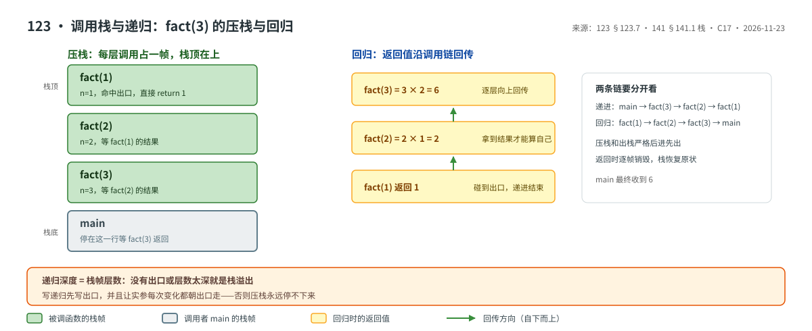

# 123 函数作用域与链接

> **解决**：从"会调别人的库函数"到"自己组织逻辑"——函数四种形态与三种调用、原型声明、作用域三分类、static 与 extern、递归方法论；本册所有输出均为本机实录（GCC 16.2.0，见 111）。  
> **范围**：函数四形态 · 原型声明 · return 三问 · 作用域与生命周期 · static · extern 多文件 · 递归。  
> **口径**：C17；编译器行为以 GCC 16.2.0 实测为准；调试手段（断点、栈回溯）统一在 112，本册只讲"代码怎么组织"。  
> **更新**：2026-11-23  
> **本册导读** ── 必会三点：① 实参永远是**拷贝**（122 §122.3 已实证）；想让函数改到真身必须交地址，那是 133 §133.2 的内容 ② 作用域三分类与默认值：全局（含 static）有零值、局部是垃圾值 ③ static 三效：延寿、默认零值、文件私有——以及"返回局部地址必死"（ret_addr 段错误实录） ｜ 跟做时长：约 3 小时 ｜ 前置：122（控制流与函数初见）。  
> **标记**：★ = 必会节；○ = 拓展节。

## 目录

| 节 | 内容 |
|---|---|
| 123.1 | 函数：封装、四种形态与三种调用 ★ |
| 123.2 | 函数原型：先声明后调用 ★ |
| 123.3 | return 三问 ○ |
| 123.4 | 作用域与生命周期：三类、就近与默认零值 ★ |
| 123.5 | static：延寿、状态保留与文件私有 ★ |
| 123.6 | extern 与多文件工程 ○ |
| 123.7 | 递归：找规律找出口 ○ |
| 123.8 | 坑表 |
| 123.9 | 检查清单（自测 6 题 + 动手任务 4 件） |

---

## 123.1 函数：封装、四种形态与三种调用 ★

**定义**：函数是封装特定功能、可反复调用的代码块。按"有无返回值 × 有无形参"分四类；调用方式三种——直接调用、输出调用、赋值调用（**推荐**，结果存进变量可继续用）。形参约束实参的**类型、个数、顺序**，与名字无关。

**完整示例**（`func_demo.c`）：

```c
#include <stdio.h>

/* 1. 无返回值无形参 */
void say_hello(void)
{
    printf("hello!\n");
}

/* 2. 无返回值有形参 */
void greet(const char *name, int times)
{
    for (int i = 0; i < times; i++)
        printf("hi, %s\n", name);
}

/* 3. 有返回值无形参 */
int get_answer(void)
{
    return 42;
}

/* 4. 有返回值有形参 */
int add(int a, int b)
{
    return a + b;
}

int main(void)
{
    say_hello();                               /* 直接调用 */
    greet("tom", 2);                           /* 直接调用 */
    printf("answer = %d\n", get_answer());     /* 输出调用 */
    int sum = add(3, 5);                       /* 赋值调用（推荐） */
    printf("sum = %d\n", sum);
    return 0;
}
```

**跟做**：`gcc -Wall func_demo.c -o func_demo.exe` → `.\func_demo.exe`。**预期输出（本机实录）**：

```text
hello!
hi, tom
hi, tom
answer = 42
sum = 8
```

**三处必看的机制**：① 无返回值函数（void）**只能直接调用**——没有结果可接；有返回值函数三种调用都合法，但只有赋值调用把结果留住；② `add(3, 5)` 调用时实参**拷贝**给形参——函数里改 `a`、`b` 不影响外面（122 §122.3 已实证；要改真身须交地址，原理见 133 §133.2）；③ 形参列表写 `(void)` 明确无形参；`()` 是旧式写法、语义是"未指定"（声明里会丢参数检查，C17 已列为过时特性）——一律写 `(void)`（111 §111.7 的 Makefile 工程里函数已经开始多文件分布）。

**试一试**：① 加第五个函数 `int max2(int a, int b)` 返回较大值，用赋值调用接住；② 故意 `add(3)`（实参个数不符）看编译器怎么说。

## 123.2 函数原型：先声明后调用 ★

**定义**：函数原型（prototype）= 去掉函数体和大括号的**声明**，`返回值类型 函数名(形参列表);`。被调函数定义在调用者**上方**可以不写原型；定义在**下方**必须先写原型——否则新编译器直接**报错**（不再只是警告）。

**完整示例**（`proto_demo.c`）：

```c
#include <stdio.h>

int add(int a, int b); /* 函数原型：声明在前，定义在后 */

int main(void)
{
    printf("add = %d\n", add(2, 3));
    return 0;
}

int add(int a, int b) /* 定义在 main 之后：有原型就无警告 */
{
    return a + b;
}
```

**跟做**：编译运行。**预期输出（本机实录）**：干净通过，输出 `add = 5`。删掉第 3 行原型再编译：

```text
no_proto.c: In function 'main':
no_proto.c:7:26: error: implicit declaration of function 'add' [-Wimplicit-function-declaration]
    7 |     printf("add = %d\n", add(2, 3));
      |                          ^~~
```

**三处必看的机制**：① 旧教材常说"没原型会有**警告**"——GCC 14 起升级为**错误**（C 标准早已废除隐式声明），别背旧结论，以你本机编译器为准；② 原型是给编译器看的"名片"：先递名片（声明），见面（定义）可以晚点；③ 多文件工程里原型集中住在**头文件**里（124 §124.5 的头文件守卫），这就是 `#include <stdio.h>` 能让你直接调 printf 的原因。

**试一试**：① 把 proto_demo 的原型与定义都搬到 main 下方、原型删掉，复现 error；② 给 `add` 原型故意写错返回类型（`double add(...)`），看报错指向哪一行。

## 123.3 return 三问 ○

**三问三答**：

| # | 问题 | 答案 |
|---|---|---|
| 1 | void 函数里能用 return 吗 | 能——只起"结束函数"作用，后面**不能**带值 |
| 2 | 一个函数能有多个 return 吗 | 能——单次调用**只执行一个**，谁先命中谁生效 |
| 3 | 想一次返回多个结果怎么办 | `return 1,2,3` 不行（逗号表达式只留最后一个）——要么**返回值 + 指针形参带出**，要么返回结构体（132 §132.1）；要返回地址必守 §123.5 的延寿纪律 |

**机制**：`return` 一执行，函数立刻结束、栈帧出栈（141 §141.1）——多个 return 的函数（如 §123.7 递归的出口与规律两分支）路径要自己画清楚。返回**值**是拷贝（安全），返回局部变量**地址**是悬空（必死，见 §123.5 实录）。

**试一试**：写 `int sign(int x)`，正数返回 1、负数返回 -1、零返回 0——三个 return 一条路径一个，测试 -5、0、7 三个入参。

## 123.4 作用域与生命周期：三类、就近与默认零值 ★

**定义**：作用域（scope）决定一个名字在哪可见：**全局**（整个程序）、**局部**（函数内）、**块级**（大括号内）。同名时**就近原则**生效——块级遮局部、局部遮全局。生命周期与作用域同序：块级 < 局部 < 全局；**只有全局与 static 成员有默认零值**，局部/块级是垃圾值。

**完整示例**（`scope_demo.c`）：

```c
#include <stdio.h>

int x = 1; /* 全局作用域：默认零值，随程序生死 */

void shadow(void)
{
    int x = 2; /* 局部作用域：遮住全局的 x */
    {
        int x = 3; /* 块级作用域：遮住局部的 x */
        printf("block x = %d\n", x);
    }
    printf("local x = %d\n", x);
}

void zero_demo(void)
{
    int local; /* 局部：无默认值（垃圾值） */
    printf("global x = %d (默认零值)\n", x);
    printf("local    = %d (垃圾值)\n", local);
}

int main(void)
{
    shadow();
    printf("global x = %d (就近原则，函数内的遮蔽不影响外面)\n", x);
    printf("---------\n");
    zero_demo();
    return 0;
}
```

**跟做**：编译运行。**预期输出（本机实录，含 -Wall 警告）**：

```text
scope_demo.c: In function 'zero_demo':
scope_demo.c:19:5: warning: 'local' is used uninitialized [-Wuninitialized]
   19 |     printf("local    = %d (垃圾值)\n", local);
      |     ^~~~~~~~~~~~~~~~~~~~~~~~~~~~~~~~~~~~~~~~~
scope_demo.c:17:9: note: 'local' was declared here
   17 |     int local; /* 局部：无默认值（垃圾值） */
block x = 3
local x = 2
global x = 1 (就近原则，函数内的遮蔽不影响外面)
---------
global x = 1 (默认零值)
local    = 32758 (垃圾值)
```

**三处必看的机制**：① 三个 `x` 互不干扰，各层读到**最近**的那层——函数返回后函数内的 `x` 全部死亡，全局的 `x=1` 原样还在；② 全局 `x` 出生即 0（全局静态区的默认零值），局部 `local` 这次是 32758——**垃圾值每次运行可能不同**，用它等于抽签；③ 生命周期：块级变量随大括号出栈死亡、局部随函数出栈死亡、全局随程序死亡（141 §141.1 的栈与数据段在这里对上号）。

**试一试**：① 把 `zero_demo` 里的 `int local;` 改成 `static int local;`——输出变 0 且多次调用保留（§123.5 的伏笔）；② 在 shadow 的块级里加一句 `x = 99;`，猜猜改的是哪个 x，跑程序验证。

## 123.5 static：延寿、状态保留与文件私有 ★

**定义**：static 修饰谁，谁就"搬家"到全局静态区，获得三效：① **延寿**——随程序加载、随程序死亡；② **默认零值**；③ **文件私有**——static 的全局变量/函数只属于本文件，别的文件 extern 也拿不到。修饰局部变量时最反直觉：**每次调用不再重新出生，跨调用保留状态**。

**完整示例**（`static_demo.c`）：

```c
#include <stdio.h>

void fn(void)
{
    int n = 10; /* 栈上：每次调用都重新出生 */
    printf("fn    : n = %d\n", n);
    n++;
}

void fn_static(void)
{
    static int n = 10; /* 去全局静态区：跨调用保留，且默认零值 */
    printf("fn_st : n = %d\n", n);
    n++;
}

int main(void)
{
    fn();
    fn_static();
    printf("---------\n");
    fn();
    fn_static();
    return 0;
}
```

**跟做**：编译运行。**预期输出（本机实录）**：

```text
fn    : n = 10
fn_st : n = 10
---------
fn    : n = 10
fn_st : n = 11
```

**番外实验**（`ret_addr.c`）⚠️——"函数不能返回局部变量地址"三结论一次看清（本实验故意制造悬空指针并解引用，会崩）：

```c
#include <stdio.h>

int *bad_ret(void)
{
    int a = 100;
    return &a; /* 局部变量出栈即亡：返回悬空地址 */
}

int val_ret(void)
{
    int a = 100;
    return a; /* 返回值：拷贝，没问题 */
}

int *ok_ret(void)
{
    static int a = 100; /* static 延寿：去全局静态区 */
    return &a;
}

int main(void)
{
    printf("val_ret = %d\n", val_ret());
    printf("*ok_ret = %d\n", *ok_ret());
    int *p = bad_ret(); /* 危险：p 悬空 */
    printf("*p = %d (悬空指针, 值不可信)\n", *p);
    return 0;
}
```

**跟做**：编译运行。**预期输出（本机实录，含 -Wall 警告——警告本身就是判决书）**：

```text
ret_addr.c: In function 'bad_ret':
ret_addr.c:6:12: warning: function returns address of local variable [-Wreturn-local-addr]
    6 |     return &a; /* 局部变量出栈即亡：返回悬空地址 */
      |            ^~
Segmentation fault
```

**三处必看的机制**：① `static_demo` 两函数同代码不同命：普通 `n` 每次调用都从 10 出生、加完即焚；static `n` 第二次调用从 **11** 接着走——状态保留实测；② `ret_addr` 返回局部地址后解引用，本机**段错误直接崩溃**（连 printf 的缓冲输出都随进程一起丢了——缓冲机制 151 §151.1 展开）——返回**值**没问题（拷贝）、返回局部**地址**必死、要返回地址就 `static` 延寿；③ static 局部变量是"函数的记忆"，嵌入式里做事件计数、状态机保持很常见——但它也记住你上次没清理的意外。

**试一试**：① static_demo 里给 `fn_static` 再加 `static int a;`（不初始化），打印它——默认零值实测；② 把 ret_addr 的 `*p` 那行换成写值 `*p = 5;`，重跑看崩溃是否依旧。

## 123.6 extern 与多文件工程 ○

**定义**：extern 是"**声明**这里要用别处定义的东西"——只递名片不盖房。多文件工程里：变量/函数定义在 file01，file02 用 `extern` 声明后即可使用；**static 成员 extern 也拿不到**（文件私有）。链接时把多个 .o 绑在一起（111 §111.6 的链接阶段）。

**完整示例**（`file01.c` + `file02.c`）：

```c
/* file01.c */
#include <stdio.h>

int a = 100;
const double PI = 3.1415;
static char chs[] = "secret"; /* static：只属于本文件，外界拿不到 */

void func(void)
{
    printf("function func\n");
}
```

```c
/* file02.c */
#include <stdio.h>

extern int a;         /* 声明：a 在别的文件里 */
extern double PI;
extern void func(void);

int main(void)
{
    printf("a = %d, PI = %.2f\n", a, PI);
    func();
    return 0;
}
```

**跟做**：两个文件放同一目录 → `gcc -Wall file01.c file02.c -o multi.exe`（多文件一次编译，Makefile 是它的工程化版本）→ `.\multi.exe`。**预期输出（本机实录，含 -Wall 警告——chs 定义了没用上，警告本身就是"文件私有"的提醒）**：

```text
file01.c:5:13: warning: 'chs' defined but not used [-Wunused-variable]
a = 100, PI = 3.14
function func
```

**三处必看的机制**：① extern 只**声明**不分配内存——定义（分配）只能有一处，声明可以多处（术语表"声明 vs 定义"一对）；② 试在 file02 里 `extern char chs[];` 并打印——链接期直接 `undefined reference to 'chs'`（本机实录）：**static 的文件私有是链接器在执法**；③ 头文件 + `#ifndef` 守卫（124 §124.5）是 extern 声明的工程化住址。

**试一试**：① 复现 chs 的 undefined reference（真实链接错误文本见上）；② 把 file01 的 `int a` 也加 static，看 file02 的 `extern int a` 报什么错。

## 123.7 递归：找规律找出口 ○

**定义**：递归 = 函数体内调用自己（main 不可以）。**递归不是循环**：递进（规律）+ 回归（出口）两段行程。好递归两条件：有**规律**（n 的问题能化成 n−1 的问题）、有**出口**（最小的 n 直接有答案）。写递归五步：找规律 → 找出口 → 定义函数 → **先写出口** → 再写规律（实参变化要朝出口方向走）。

**完整示例**（`fact_demo.c`）：

```c
#include <stdio.h>

long fact(int n)
{
    if (n <= 1) /* 出口：回归 */
        return 1;
    return n * fact(n - 1); /* 规律：n! = n * (n-1)!，递进 */
}

int main(void)
{
    for (int i = 1; i <= 10; i++)
        printf("%d! = %ld\n", i, fact(i));
    return 0;
}
```

**跟做**：编译运行。**预期输出（本机实录）**：

```text
1! = 1
2! = 2
3! = 6
4! = 24
5! = 120
6! = 720
7! = 5040
8! = 40320
9! = 362880
10! = 3628800
```

**三处必看的机制**：① `fact(5)` 在纸上画展开：5×fact(4)→4×fact(3)→3×fact(2)→2×fact(1)，fact(1) 命中出口 `n<=1` 返回 1，再逐层回归相乘——每层都是一次真实的函数调用、一层栈帧（141 §141.1，配图 §123.7 上方就是这条链）；② 递归深度过深 → **栈溢出**（StackOverflow）——函数没出口或次数太大时；③ `long` 存不下 13! 就该换 `long long`——返回类型与数据规模要一起想（121 §121.1 的宽度）。

把 fact(3) 的压栈与回归画成图——左边是"递进"时栈帧一层层叠上来，右边是"回归"时返回值逐层传回去：



**试一试**：① 写 `int sum(int n)` 递归求 1+2+…+n（五步法走一遍）；② 故意把出口条件写成 `if (n < 0)`，传 n=5 看它冲出多远（提前想好 Ctrl+C）；③ 经典递归题两道（出口+规律各一）：**斐波那契** `fib(n) = fib(n-1) + fib(n-2)`，出口 `fib(1)=fib(2)=1`，打印前 10 项（1 1 2 3 5 8 13 21 34 55）；**猴子吃桃**——猴子第一天摘了若干桃子，当天吃一半多一个，此后每天如此，第 10 天只剩 1 个：反向递推 `x(n) = 2*(x(n+1)+1)`，出口 `x(10)=1`，求第一天摘了几个（1534）。

## 123.8 坑表

| # | 现象 | 原因 | 解法 |
|---|---|---|---|
| 1 | 调用下方函数报 `implicit declaration` **error** | 新 GCC 已废除隐式声明（旧教材说"警告"过时了） | 写函数原型，或把定义放上方（§123.2 实录） |
| 2 | 返回局部地址 → 段错误崩溃 | 局部变量出栈即亡，地址悬空 | 返回值拷贝，或 `static` 延寿（§123.5 实录） |
| 3 | 函数里改了形参，外面没变 | 实参是拷贝（值传递） | 要改真身传地址（122 §122.3） |
| 4 | 全局变量的值"莫名"变了 | 局部同名遮蔽之外的误改 | 全局少用；改名见名知意（111 §111.4） |
| 5 | `undefined reference to 'chs'` | extern 访问别文件的 static 成员 | static 文件私有，链接器执法（§123.6 实录） |
| 6 | 递归没反应/程序崩 | 没出口或深度过大 → 栈溢出 | 先写出口；深度大改循环 |
| 7 | static 局部变量"记着"上次的值 | 延寿是特性也是副作用 | 要跨调用保留才用 static |

## 123.9 检查清单（自测 6 题 + 动手任务 4 件）

**自测**：

| # | 问题 | 自测标准 |
|---|---|---|
| 1 | 函数四类与 void 函数的调用方式 | 有无返回值 × 有无形参；void 只能直接调用 |
| 2 | 为什么需要函数原型 | 定义在下方先递名片；新 GCC 无原型直接 error |
| 3 | 实参形参匹配看什么 | 类型/个数/顺序，与变量名无关 |
| 4 | 三类作用域的生命周期与默认值 | 块级 < 局部 < 全局；只有全局与 static 有零值 |
| 5 | static 三效 | 延寿 / 默认零值 / 文件私有 |
| 6 | 好递归两条件 | 规律（递进）+ 出口（回归） |

**动手任务**：① func_demo 加 `max2` 函数（赋值调用接住结果）——产出物：程序 + 运行输出；② 用 112 的 GDB 方法（`break fn_static` + `next` + `print n`）在 static_demo 上跑两轮，记录每次停下时 n 的值——产出物：变量值记录（两个函数各两轮）；③ 五步法写递归 `sum(n)` —— 产出物：程序 + `sum(100)=5050` 的输出；④ 猴子吃桃递归版（§123.7 试一试 ③）——产出物：程序 + `第一天桃子数量:1534` 的输出。

> 下一篇：《124 预处理与宏》——编译之前先做一遍文本手术：宏替换、条件编译与头文件守卫。
