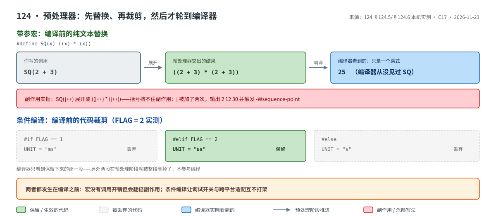

# 124 预处理与宏

> **解决**：看懂编译之前那道"文本手术"——预处理器把 `#include` 摊平、把宏替换掉、按条件裁剪代码，然后在编译器开工前消失。宏的括号法则、副作用陷阱、条件编译与头文件守卫，四件事决定你后面所有工程代码的骨架。  
> **范围**：预处理器四件事 · 宏与括号法则 · 带参宏 vs 函数的副作用实测 · `#` 与 `##` 运算符 · 条件编译 · 头文件守卫与两种 `#include`。  
> **口径**：C17；`gcc -E -P` 展开结果为本机实录（GCC 16.2.0）；条件编译的平台宏（`_WIN32`）由编译器预定义，具体取值查编译器文档。  
> **更新**：2026-11-23  
> **本册导读** ── 必会三点：① 宏是**纯文本替换**，参数和整体都要加括号（`2+3` 会算成 11）② 带副作用的参数喂宏会执行两次（`SQ(j++)` 实测）③ 头文件守卫 `#ifndef/#define/#endif` 防重复包含 ｜ 跟做时长：约 2 小时 ｜ 前置：121（类型与运算符）、123（函数与多文件）。  
> **标记**：★ = 必会节（啃透必会三点就能过）；○ = 拓展节（时间多再扫）。

## 目录

| 节 | 内容 |
|---|---|
| 124.1 | 预处理器做了什么：编译前的四件事 ★ |
| 124.2 | 宏：文本替换与括号法则 ★ |
| 124.3 | 带参宏 vs 函数：副作用实测 ★ |
| 124.4 | `#` 与 `##`：字符串化与拼接 ○ |
| 124.5 | 条件编译：按开关裁剪代码 ★ |
| 124.6 | 头文件工程：守卫与两种 include ★ |
| 124.7 | 坑表 |
| 124.8 | 检查清单（自测 6 题 + 动手任务 3 件） |

---

## 124.1 预处理器做了什么：编译前的四件事 ★

**定义**：预处理器是编译器的**前置文本处理器**——它不认识类型、不懂语法，只做四件文本层面的活，做完就退场，编译器看到的是处理后的纯 C 代码。

| # | 做的事 | 触发写法 | 效果 |
|---|---|---|---|
| 1 | **文件包含** | `#include <stdio.h>` | 把头文件内容**原地摊平**成代码 |
| 2 | **宏替换** | `#define` | 把名字按文本换掉 |
| 3 | **条件编译** | `#if` / `#ifdef` / `#endif` | 按开关**删掉**整段代码 |
| 4 | **行控制** | `#line` / `__LINE__` | 维护"当前文件与行号"的记账 |

**关键认知**：这四件事都**不是 C 语句**——结尾不加分号，也不受函数作用域约束。宏从定义行起对后面所有文本生效，与它在哪个函数里定义无关。

**完整示例**（`pp.c`）——看宏怎么被替换：

```c
#define LIMIT 5
#define SQ(x) ((x) * (x))
int main(void)
{
    int a = LIMIT;
    int b = SQ(LIMIT);
    return a + b;
}
```

**跟做**：`gcc -E -P pp.c`（`-E` 只跑到预处理，`-P` 去掉行标记）。**预期输出（本机实录）**：

```text
int main(void)
{
    int a = 5;
    int b = ((5) * (5));
    return a + b;
}
```

**三处必看的机制**：① `LIMIT` 真的被替换成 `5`，`SQ(LIMIT)` 被替换成 `((5) * (5))`——**预处理器只认文本**，它不知道 x 是 int；② `#define` 那两行本身消失了——它们不产生任何代码；③ 换成 `#include <stdio.h>` 再 `gcc -E` 会看到**上千行**，因为 stdio.h 被原地摊平（111 §111.5 实测 1041 行）——这就是"一条 include 让文件变长"的全部原因。

**试一试**：① 把 `SQ(x)` 的定义改成 `x * x` 再 `gcc -E -P` 看展开结果，你会看到 `5 * 5`——表面上结果还对，直到参数是 `2+3`（§124.2）；② `gcc -E pp.c | head -20`（不加 `-P`）看行标记 `# 1 "pp.c"` 的形态，编译器报错时的"文件:行"就靠它。

## 124.2 宏：文本替换与括号法则 ★

**定义**：宏（macro）是用 `#define` 定义的**名字 → 文本**替换规则。带参宏看起来像函数，但它**没有调用**——展开是纯文本粘贴，因此运算符优先级会重新结合。

**完整示例**（`macro.c`）——危险版与安全版并排：

```c
#include <stdio.h>

#define SQ_BAD(x)  x * x          /* dangerous: no parens */
#define SQ_OK(x)   ((x) * (x))    /* safe: parens everywhere */

int main(void)
{
    printf("SQ_BAD(2+3) = %d   <- 2+3*2+3 = 11, NOT 25!\n", SQ_BAD(2+3));
    printf("SQ_OK(2+3)  = %d\n", SQ_OK(2+3));
#ifdef DEBUG
    printf("DEBUG build\n");
#else
    printf("release build (DEBUG not defined)\n");
#endif
    return 0;
}
```

**跟做**：`gcc -Wall macro.c -o macro.exe` → `.\macro.exe`。**预期输出（本机实录）**：

```text
SQ_BAD(2+3) = 11   <- 2+3*2+3 = 11, NOT 25!
SQ_OK(2+3)  = 25
release build (DEBUG not defined)
```

**机制**：宏是**纯文本替换**——`SQ_BAD(2+3)` 展开成 `2+3*2+3`，先乘后加得 11。

**括号法则**（背下来，嵌入式宏的黄金法则）：

> **每个参数加括号，整个表达式加括号。**

| 写法 | 展开 `x=2+3` | 结果 |
|---|---|---|
| `#define SQ(x) x * x` | `2+3 * 2+3` | 11 ❌ |
| `#define SQ(x) (x * x)` | `(2+3 * 2+3)` | 11 ❌（只加外层没用） |
| `#define SQ(x) ((x) * (x))` | `((2+3) * (2+3))` | 25 ✅ |

**为什么第二行也错**：`(x * x)` 只保证了整体是一个表达式，但 `x` 本身是 `2+3`，粘进 `x * x` 后仍是 `2+3 * 2+3`——**参数位置的括号不能省**。

**试一试**：把 `SQ_OK` 的内层括号去掉（改成 `(x * x)`）再用 `SQ_OK(2+3)` 测试——还是 25 吗？（答案：11）；再把 `2+3` 换成 `(2+3)` 调用，看结果如何"侥幸"变成 25——**侥幸不是正确**。

## 124.3 带参宏 vs 函数：副作用实测 ★

**定义**：带参宏没有函数调用的开销（没有压栈、没有跳转），代价是**参数被原样粘贴多次**——所以带副作用的参数（`i++`、`i--`、函数调用）会被执行多次。

**完整示例**（`sq_side.c`）——同一个"求平方"，函数版与宏版喂同样的 `i++`：

```c
#include <stdio.h>

#define SQ(x) (x) * (x) /* 宏：纯文本替换 */

int func(int i) /* 函数：参数先求值再拷贝 */
{
    return i * i;
}

int main(void)
{
    /* 函数版：i++ 求值一次，i 逐个走 1..5 */
    int i = 1;
    printf("函数版: ");
    while (i <= 5)
    {
        printf("%d ", func(i++));
    }
    printf("\n");

    /* 宏版：SQ(i++) 展开成 (i++)*(i++)，副作用执行两次 */
    int j = 1;
    printf("宏版  : ");
    while (j <= 5)
    {
        printf("%d ", SQ(j++));
    }
    printf("\n");
    return 0;
}
```

**跟做**：`gcc -Wall sq_side.c -o sq_side.exe` → `.\sq_side.exe`。**预期输出（本机实录，警告在前）**：

```text
sq_side.c:26:27: warning: operation on 'j' may be undefined [-Wsequence-point]
   26 |         printf("%d ", SQ(j++));
      |                           ^
函数版: 1 4 9 16 25 
宏版  : 2 12 30 
```

**读法**：函数版 `func(i++)` 参数求值**一次**，i 从 1 走到 5，输出 1/4/9/16/25；宏版 `SQ(j++)` 展开成 `(j++)*(j++)`——**副作用执行两次**，输出 2/12/30 且只跑了三轮（每轮 j 加 2）。`-Wsequence-point` 警告在说：同一个表达式里两次修改 j，这本身是未定义行为。

**怎么选**（三条可执行的判断）：

| 场景 | 选宏 | 选函数 |
|---|---|---|
| 参数是常量/简单变量（`SQ(5)`） | ✅ 无开销 | 也行 |
| 参数可能带副作用（`SQ(i++)`） | ❌ 绝对不要 | ✅ 参数只求值一次 |
| 需要类型检查 | ❌ 宏没有类型 | ✅ 编译器能查 |
| 需要泛型（对 int/float 都工作） | ✅ 文本替换天然泛型 | ❌ 要写多个或 _Generic |
| 高频小操作（位运算、MIN/MAX） | ✅ 常见于内核与驱动 | 也可以，现代编译器会内联 |

**现代结论**：函数有 `static inline` 之后，宏的性能优势基本消失——**能用函数就别用宏**，宏留给"必须看文本"的场景（条件编译、字符串化、泛型包装、日志宏）。

**试一试**：① 宏版 SQ 里把 `j++` 改成 `++j` 再跑——前后置在双副作用下的输出又不一样（这正是"不要给宏喂副作用"的原因）；② 给宏和函数各加一次 `printf("called\n")`，看宏版会不会打两次。

## 124.4 `#` 与 `##`：字符串化与拼接 ○

**定义**：两个只在宏里合法的运算符——`#` 把参数**变成字符串字面量**（不做任何求值），`##` 把两个记号**粘成一个记号**。它们是写日志宏、断言宏、批量变量名的工具。

**完整示例**（`macro2.c`）——字符串化、拼接、调试定位宏一次看全：

```c
#include <stdio.h>

#define STR(x)      #x              /* 字符串化：把参数变成字符串字面量 */
#define CAT(a, b)   a##b            /* 拼接：把两个记号粘成一个 */
#define WHERE()     printf("at %s:%d in %s()\n", __FILE__, __LINE__, __func__)

#define CHECK(cond) do { \
    if (!(cond)) \
        printf("CHECK failed: %s at line %d\n", #cond, __LINE__); \
    } while (0)

int main(void)
{
    printf("STR(2+3) = %s\n", STR(2+3));

    int CAT(my, Var) = 7;           /* 展开成 int myVar = 7; */
    printf("CAT(my,Var) = %d\n", myVar);

    WHERE();
    CHECK(1 == 1);
    CHECK(1 == 2);
    return 0;
}
```

**跟做**：`gcc -Wall macro2.c -o macro2demo.exe` → `.\macro2demo.exe`。**预期输出（本机实录）**：

```text
STR(2+3) = 2+3
CAT(my,Var) = 7
at macro2.c:19 in main()
CHECK failed: 1 == 2 at line 21
```

**三处必看的机制**：① `STR(2+3)` 得字符串 **`"2+3"`** 而不是 `"5"`——`#` 拒绝求值，它要的就是源码原样（这正让断言能打印"是哪一句条件失败了"）；② `CAT(my,Var)` 拼出 `myVar`，于是 `int CAT(my,Var) = 7;` 就是 `int myVar = 7;`；③ `__FILE__`、`__LINE__`、`__func__` 是预处理器/编译器提供的"当前位置"，`CHECK` 宏靠它们把失败定位到行——**这就是断言宏能报出准确行号的原因**。

**`do { ... } while (0)` 为什么包一层**：宏体里有多条语句时，直接写 `{ ... }` 会与调用处的 `if/else` 打架：
`if (x) CHECK(a); else ...` 展开后 else 会绑错。`do {} while (0)` 让宏体成为一个**单条语句**，且末尾不带分号也能用。

**试一试**：① 把 `CHECK` 的 `do {} while (0)` 去掉只留花括号，然后在 `if (1) CHECK(0); else printf("else\n");` 里用一次，看 else 怎么跑；② 加一条 `printf("line=%d\n", __LINE__);` 在不同位置各写一次，确认它随位置变化。

## 124.5 条件编译：按开关裁剪代码 ★

**定义**：条件编译让同一份源码按"宏是否有定义/值是多少"**删掉**部分代码——它发生在预处理阶段，被删掉的代码**不进编译**，连语法错误都不会报（这正是 `#if 0` 比注释好用的原因）。

**完整示例**（`cond_demo.c`）——`#if/#elif/#else` 多路开关、`#if 0` 整体丢弃、平台宏：

```c
#include <stdio.h>

/* 条件编译：同一份代码按平台/开关裁剪 */
#define FLAG 2

#ifndef UNIT /* 命令行 -DUNIT 抢先定义时，下面三处源码定义整体让位 */
#if FLAG == 1
  #define UNIT "ms"
#elif FLAG == 2
  #define UNIT "us"
#else
  #define UNIT "s"
#endif
#endif

#if 0
这段代码被预处理器整体丢弃——比注释更适合临时禁用大段代码
#endif

#ifdef UNIT
int main(void)
{
#if _WIN32 /* Windows 平台宏由编译器预定义 */
    printf("running on Windows, unit=%s\n", UNIT);
#else
    printf("running on other OS, unit=%s\n", UNIT);
#endif
    return 0;
}
#else
int main(void) { return 0; }
#endif
```

**跟做**：`gcc -Wall cond_demo.c -o cond_demo.exe` → `.\cond_demo.exe`。**预期输出（本机实录）**：`running on Windows, unit=us`——`#elif FLAG == 2` 分支生效。

**四组常用指令**（区别要分清）：

| 写法 | 判什么 | 典型用途 |
|---|---|---|
| `#ifdef X` / `#ifndef X` | 宏**是否定义**（不看值） | 头文件守卫、功能开关 |
| `#if X` | 宏的**值**是否为真（未定义按 0） | 版本号、数值开关 |
| `#if defined(X)` | 等价 `#ifdef`，但能与 `&&` `\|\|` 组合 | 多条件组合判断 |
| `#if 0 ... #endif` | 恒假 | 临时禁用大段代码（可嵌套、可含注释） |

**跨平台怎么用**：`_WIN32`、`__linux__`、`__arm__` 这类**编译器预定义宏**是平台识别的标准入口——同一份驱动代码在 Windows 上走一套、在 ARM 板子上走另一套，靠的就是它们。

**命令行定义**（不改源码切换行为）：`gcc -DDEBUG main.c` 等价于在文件开头写 `#define DEBUG`。发布版与调试版共用一份源码时这是标准做法。

**试一试**：① 把 `#define FLAG 2` 改成 1、改成 3、再整行删掉，各跑一次看三个分支的切换；② 把 `_WIN32` 分支里的 printf 换成 `#error "not windows"`，体会"条件编译能当场停机"；③ 用 `gcc -DUNIT='"ns"' cond_demo.c` 在命令行改单位——UNIT 的源码定义包在 `#ifndef UNIT` 里，`-D` 抢先定义后源码定义让位，输出 unit=ns；删掉 `#ifndef UNIT`/`#endif` 两行再跑，会看到 `'UNIT' redefined` 警告且单位仍是 us——这就是重定义规则（后者为准）。

## 124.6 头文件工程：守卫与两种 include ★

**定义**：头文件（.h）存**声明**（函数原型、宏、类型），供多个源文件共享。它有两个必须解决的问题：**重复包含**（同一文件被间接包含两次 → 重复定义）与**查找路径**（编译器去哪找这个文件）。

**问题复现**（`conf.h` 没有守卫，被 `main_bad.c` 包含两次）：

```c
/* conf.h */
int g_limit = 10;
```

```c
/* main_bad.c */
#include <stdio.h>
#include "conf.h"
#include "conf.h"
int main(void) { printf("limit=%d\n", g_limit); return 0; }
```

**跟做**：`gcc -Wall main_bad.c -o bad.exe`。**预期输出（本机实录）**：

```text
In file included from main_bad.c:3:
conf.h:1:5: error: redefinition of 'g_limit'
    1 | int g_limit = 10;
      |     ^~~~~~~
In file included from main_bad.c:2:
conf.h:1:5: note: previous definition of 'g_limit' with type 'int'
    1 | int g_limit = 10;
      |     ^~~~~~~
```

**修复**——加守卫三件套（`conf_guard.h`）：

```c
#ifndef CONF_GUARD_H
#define CONF_GUARD_H
int g_limit = 10;
#endif
```

**跟做**：`gcc -Wall main_good.c -o good.exe` → `.\good.exe`。**预期输出（本机实录）**：`limit=10`——第二次包含被 `#ifndef` 挡在门外，不再重复定义。

**三处必看的机制**：① 守卫变量名必须**全局唯一**，惯例是"文件名大写 + `_H`"；② `#pragma once` 是更简洁的替代（所有主流编译器都支持，但不是 C 标准），本库统一用 `#ifndef` 三件套以保证可移植；③ **头文件里不要放定义**（`int g_limit = 10;` 是定义）——正确做法是头文件写 `extern int g_limit;` 声明，定义放某个 .c 里（123 §123.6 讲了这个坑的链接期版本）。

**两种 `#include` 的区别**：

| 写法 | 查找顺序 | 用途 |
|---|---|---|
| `#include <stdio.h>` | 只搜**系统/编译器**的头文件目录 | 标准库、第三方库 |
| `#include "conf.h"` | **先搜源文件所在目录**，找不到再按系统路径搜 | 自己的工程头文件 |

**分目录组织**：把头文件放 `inc/`、源码放 `src/` 时，用相对路径 `#include "../inc/conf.h"`，或编译时加 `-I../inc` 指定搜索目录——**这是 Makefile 里 `CFLAGS += -Iinc` 的全部含义**（111 §111.7 的工程化版本）。

**试一试**：① 把 `conf.h` 里的 `int g_limit = 10;` 改成 `extern int g_limit;`，另建 `conf.c` 写定义，用 `gcc main_good.c conf.c -o good2.exe` 编译——体会"声明与定义分离"；② 故意把守卫的 `#define CONF_GUARD_H` 写错成 `#define CONF_GUARD`，看 `#ifndef` 是否还能挡住（答案：挡不住，因为判的和定义的不是同一个名字）。

宏替换与条件编译都发生在编译之前——预处理器做完这两件事，编译器才开工：



## 124.7 坑表

| # | 现象 | 原因 | 解法 |
|---|---|---|---|
| 1 | 宏算错（25 变 11） | 参数没加括号 | 每参数+整体都加括号（§124.2 实录） |
| 2 | 宏参数 `i++` 结果跳号 | 文本替换导致副作用执行两次 | 带副作用的表达式不要喂宏（§124.3 实录） |
| 3 | `if (x) MACRO(); else` 的 else 跑错 | 宏体多条语句没包成单语句 | `do { ... } while (0)`（§124.4） |
| 4 | 头文件重复包含报"重复定义" | 没有守卫 | `#ifndef/#define/#endif` 三件套（§124.6 实录） |
| 5 | 多个 .c 链接时 `multiple definition` | 头文件里放了定义而非声明 | 头文件写 `extern`，定义放某个 .c（§124.6） |
| 6 | `#if 0` 里的代码语法错也不报 | 预处理阶段整段被删除，不进编译 | 这是特性不是 bug；恢复时留意 |
| 7 | `#ifdef DEBUG` 没生效 | 只在源码里找，没在命令行加 `-DDEBUG` | 编译时 `gcc -DDEBUG`（§124.5） |
| 8 | 命令行 `-DUNIT="ms"` 展开异常 | 引号被 shell 吃掉 | 写成 `-DUNIT='"ms"'`（§124.5 试一试） |
| 9 | 宏名与变量名冲突 | 宏无作用域，从定义行起全文生效 | 宏名全大写（111 §111.4 命名规范） |

## 124.8 检查清单（自测 6 题 + 动手任务 3 件）

**自测**：

| # | 问题 | 自测标准 |
|---|---|---|
| 1 | 预处理器做哪四件事 | 文件包含、宏替换、条件编译、行控制 |
| 2 | 宏的黄金法则 | 每参数加括号、整体加括号（11 vs 25 实录） |
| 3 | 为什么 `SQ(j++)` 会跳号 | 文本替换让 `j++` 出现两次（2/12/30 实录） |
| 4 | `#` 与 `##` 各做什么 | 字符串化 vs 记号拼接（`"2+3"` 实录） |
| 5 | `#ifdef` 与 `#if` 的区别 | 看是否定义 vs 看值是否为真 |
| 6 | 头文件守卫三件套 | `#ifndef / #define / #endif`（redefinition 实录） |

**动手任务**：① `macro.c` 用 `-DDEBUG` 编译一次，对比两种输出，把两条命令与两份输出一起留档；② 给 §124.4 的 `CHECK` 宏补一个 `else` 分支打印 "ok"，跑 `CHECK(1==1)` 与 `CHECK(1==2)` 各一次，证明宏在 if/else 里不会跑歪；③ 造一组 `inc/conf.h` + `src/main.c`，用 `-Iinc` 编译成功，再故意删守卫复现 redefinition，把两条报错都贴进笔记。

> 下一篇：《131 数组与字符串》——一组同类型数据怎么装进连续格子：`sizeof` 长度公式、`\0` 哨兵与 string.h 四函数。
