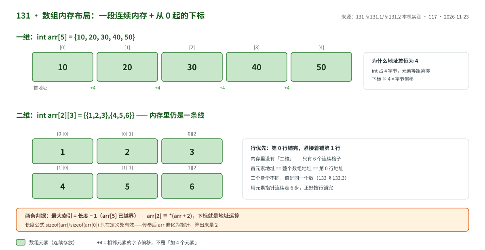
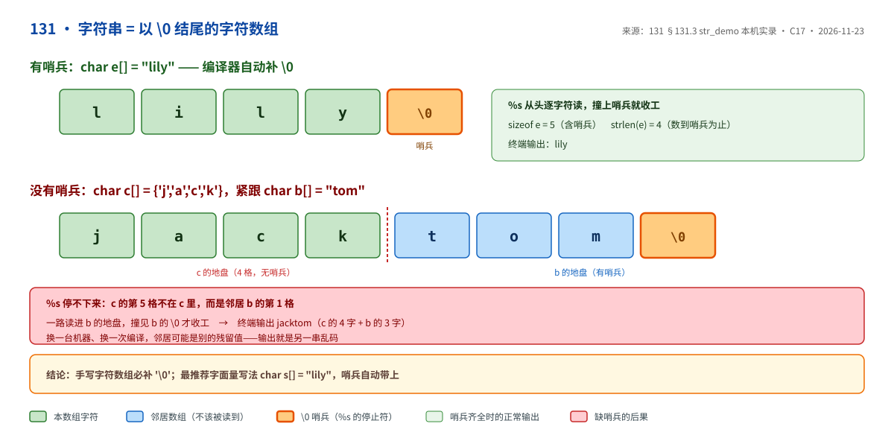
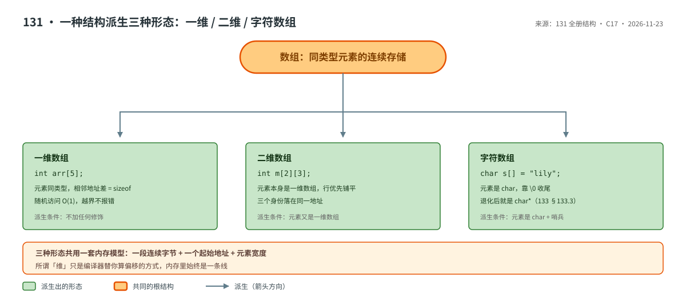

# 131 数组与字符串

> **解决**：把一组同类型数据装进一个容器——连续格子、下标访问、以 `\0` 结尾的字符串，以及 `sizeof` 这个"只在你出生的地方管用"的长度公式。  
> **范围**：一维数组与 `sizeof` 长度公式 · 二维数组的三种长度公式 · `\0` 哨兵与四种字符串写法 · `string.h` 四函数（strlen/strcmp/strcat/strcpy）。  
> **口径**：C17；`sizeof` 与地址差值为本机实录（Windows x64 + GCC 16.2.0），地址每次运行会变，看**差值**；VLA 为 C99 可选特性，嵌入式规范常禁用。  
> **更新**：2026-11-23  
> **本册导读** ── 必会三点：① 数组没有 `length`，长度靠 `sizeof arr / sizeof arr[0]` 现算，且**只在定义处有效** ② 字符串就是末尾带 `\0` 的 char 数组，没 `\0` 会一路读下去 ③ `strcpy`/`strcat` 不检查目标容量——越界写的头号来源 ｜ 跟做时长：约 2.5 小时 ｜ 前置：122（循环）、121（类型与 sizeof）。  
> **标记**：★ = 必会节（啃透必会三点就能过）；○ = 拓展节（时间多再扫）。

## 目录

| 节 | 内容 |
|---|---|
| 131.1 | 数组：同类型数据的连续格子 ★ |
| 131.2 | 二维数组：每个元素又是一个一维数组 ○ |
| 131.3 | 字符串：以 `\0` 结尾的字符数组 ★ |
| 131.4 | string.h 四函数 ★ |
| 131.5 | 坑表 |
| 131.6 | 检查清单（自测 6 题 + 动手任务 3 件） |

---

## 131.1 数组：同类型数据的连续格子 ★

**定义**：数组是一组同类型数据的连续容器。三条约束：**元素类型一致**、**长度与首地址定义后不可变**、**没有 `length` 属性**——长度靠 `sizeof` 现算。

**完整示例**（[code/131/arr_demo.c](../code/131/arr_demo.c)）：

```c
#include <stdio.h>

int main(void)
{
    // 动态初始化：程序员定类型和长度，值是内存里的垃圾值
    int raw[3];
    printf("raw[0] = %d (垃圾值, 每次运行可能不同)\n", raw[0]);

    // 静态初始化：程序员定每个值，长度由计算机自动算
    int arr[] = {10, 20, 30, 40, 50};

    // 查长度：sizeof 公式（C 数组没有 .length 属性）
    int length = sizeof arr / sizeof arr[0];
    printf("length = %d\n", length);

    // 查元素、改元素
    printf("arr[2] = %d\n", arr[2]);
    arr[2] = 99;
    printf("改后 arr[2] = %d\n", arr[2]);

    // 遍历
    for (int i = 0; i < length; i++)
    {
        printf("arr[%d] = %d\n", i, arr[i]);
    }
    return 0;
}
```

**跟做**：`cd code/131` → `gcc -Wall arr_demo.c -o arr_demo.exe` → `.\arr_demo.exe`。**预期输出（本机实录，警告在前）**：

```text
arr_demo.c: In function 'main':
arr_demo.c:7:5: warning: 'raw' is used uninitialized [-Wuninitialized]
    7 |     printf("raw[0] = %d (垃圾值, 每次运行可能不同)\n", raw[0]);
      |     ^~~~~~~~~~~~~~~~~~~~~~~~~~~~~~~~~~~~~~~~~~~~~~~~~~~~~~~~~~
raw[0] = 0 (垃圾值, 每次运行可能不同)
length = 5
arr[2] = 30
改后 arr[2] = 99
arr[0] = 10
arr[1] = 20
arr[2] = 99
arr[3] = 40
arr[4] = 50
```

**三处必看的机制**：① `raw[0] = 0` **不是"未初始化等于 0"**——它是栈上残留，本机这次恰好是 0，下次可能是任意值（`-Wall` 已经警告了，别被这个 0 骗）；② **长度公式 `sizeof arr / sizeof arr[0]`**：总字节数除以单元素字节数，`5 * 4 / 4 = 5`——这是 C 里唯一的"数组长度"，且**只在本作用域有效**（传参后失效，见坑表第 3 条）；③ 下标从 0 起，最大索引 = 长度 − 1，`arr[2]` 是第 3 个元素。

**数组在内存里长什么样**——五个 int 紧挨着排，`&arr[1]` 恰好比 `&arr[0]` 大 4：



**越界不报错**（这是 C 最贵的"自由"）：`arr[5]`、`arr[-1]` 编译通过、运行照常退出——C 不做边界检查，边界只能自己管（越界的严重后果与实地取证见 141 §141.2、112 §112.6）。

**变长数组**（VLA，C99 可选）：`int user[n]` 的长度到运行期才定，但声明时不能初始化、可能栈溢出，嵌入式规范常禁用，优先静态长度或 malloc。完整示例 [code/131/vla_demo.c](../code/131/vla_demo.c)，本机实录（输入 4）：

```text
请输入数组长度: user 长度 = 4, user[3] = 3
arr 长度 = 3
```

**试一试**：① 把 `raw[3]` 改成 `int raw[3] = {0};` 再跑，警告消失——显式初始化是消除"垃圾值"的唯一可靠办法；② 把 `length` 那行挪进一个自定义函数里 `printf`（把 `arr` 传进去），看结果从 5 变成 2（64 位下 8 字节指针 ÷ 4）——亲眼看到"长度公式失效"。

## 131.2 二维数组：每个元素又是一个一维数组 ○

**定义**：`int arr[2][3]` 不是"2 行 3 列的表格"，而是「**2 个元素，每个元素是 `int[3]`**」。所以 `arr[i]` 是第 i 行的**地址**（一个 `int[3]`），`arr[i][j]` 才是值。

**完整示例**（[code/131/arr2d_demo.c](../code/131/arr2d_demo.c)）：

```c
#include <stdio.h>

int main(void)
{
    // 二维数组：每个元素又是一维数组（2 行 3 列）
    int arr[][3] = {1, 2, 3, 4, 5, 6};

    // 三种查长度公式
    int total = sizeof arr / sizeof arr[0][0];    // 元素总数
    int rows  = sizeof arr / sizeof arr[0];       // 一维数组个数（行）
    int cols  = sizeof arr[0] / sizeof arr[0][0]; // 每个一维数组的元素数（列）
    printf("total=%d rows=%d cols=%d\n", total, rows, cols);

    // 双重 for 遍历
    for (int i = 0; i < rows; i++)
    {
        for (int j = 0; j < cols; j++)
        {
            printf("arr[%d][%d] = %d\n", i, j, arr[i][j]);
        }
    }
    return 0;
}
```

**跟做**：`gcc -Wall arr2d_demo.c -o arr2d_demo.exe` → `.\arr2d_demo.exe`。**预期输出（本机实录，警告在前）**：

```text
arr2d_demo.c: In function 'main':
arr2d_demo.c:6:20: warning: missing braces around initializer [-Wmissing-braces]
    6 |     int arr[][3] = {1, 2, 3, 4, 5, 6};
      |                    ^
total=6 rows=2 cols=3
arr[0][0] = 1
arr[0][1] = 2
arr[0][2] = 3
arr[1][0] = 4
arr[1][1] = 5
arr[1][2] = 6
```

**三处必看的机制**：① **三个公式各数各的**：除以 `arr[0]` 数行（2）、除以 `arr[0][0]` 数总数（6）、`arr[0]` 再除 `arr[0][0]` 数列（3）——记住口径，别混；② **`arr[1] = ...` 编译报错**：行是地址，地址不可改；改元素用 `arr[1][j]`；③ 拍平写法 `{1,2,3,4,5,6}` 能跑但报 `missing braces`——大括号没有表达"方阵"结构，嵌套写 `{{1,2,3},{4,5,6}}` 才是正形（警告不是错，但它提示你可读性有损）。

**内存里它是一条线**（[code/131/arr2d_flat.c](../code/131/arr2d_flat.c)，本机实录）：

```text
ptr = 00000073095ffbb0
p1  = 00000073095ffbb0
p2  = 00000073095ffbb0
按一维方式连续读 6 个: 1 2 3 4 5 6 
&arr[0] = 00000073095ffbb0
&arr[1] = 00000073095ffbbc
```

**读法**：指向整个数组、指向第一行、指向首元素这三个身份不同的指针落在**同一地址**；`&arr[1]` 与 `&arr[0]` 差 12 字节（一行 3 个 int）——二维只是"步长不同的一维"，内存里没有"行"这种东西。

**试一试**：① 把初始化改成嵌套写法 `{{1,2,3},{4,5,6}}`，确认警告消失、输出不变；② 写 `printf("%zu\n", sizeof arr[1]);` 看它是 12——证明 `arr[1]` 是"一个 int[3]"而不是一个 int。

## 131.3 字符串：以 `\0` 结尾的字符数组 ★

**定义**：C 没有 string 类型。`char s[] = "lily"` 就是 `{'l','i','l','y','\0'}` 的缩写——`\0` 是**哨兵**，告诉 `%s` 与所有 `str*` 函数"读到哪停"。

**四种写法与一个陷阱**（[code/131/str_demo.c](../code/131/str_demo.c)）：

```c
#include <stdio.h>
#include <string.h>

int main(void)
{
    char a[] = {'a', 'b', 'c', 'd', '\0'}; // 手写哨兵：没问题但麻烦
    char b[4] = {'t', 'o', 'm'};           // 指定长度须 > 字符个数：自动补 \0
    char c[] = {'j', 'a', 'c', 'k'};       // 没有 \0：危险
    char d[] = {"lucy"};                   // 没问题不推荐
    char e[] = "lily";                     // 最推荐

    printf("a=%s b=%s d=%s e=%s\n", a, b, d, e);
    printf("c=%s  <- 无 \\0, 输出连到内存中下一个 \\0 才停\n", c);

    char s[] = "How are you!";
    printf("sizeof s = %zu (含 \\0)\n", sizeof s);
    printf("strlen(s) = %zu (有效字符)\n", strlen(s));
    return 0;
}
```

**跟做**：`gcc -Wall str_demo.c -o str_demo.exe` → `.\str_demo.exe`。**预期输出（本机实录）**：

```text
a=abcd b=tom d=lucy e=lily
c=jacktom  <- 无 \0, 输出连到内存中下一个 \0 才停
sizeof s = 13 (含 \0)
strlen(s) = 12 (有效字符)
```

**三处必看的机制**：① `c` 打印出 **`jacktom`**——`%s` 只拿到起始地址、不知道终点，一路读到撞上 `b` 末尾的 `\0` 才停。**换编译器或换声明顺序，这里就是别的垃圾值**（141 §141.2 把这类错误归成六种成因）；② **`sizeof` 与 `strlen` 量的不是同一个东西**：`"How are you!"` 的 `sizeof` 是 **13**（含哨兵的总格子）、`strlen` 是 **12**（有效字符）——遍历的边界用 `strlen`，分配空间用 `sizeof`；③ `char b[4] = {'t','o','m'}` 长度大于字符数，编译器自动补 `\0`——但**长度等于字符数时就不补了**，这正是 `c` 出事的写法。

字符串的安全边界怎么丢的——`%s` 从首地址往后走，直到撞见 `\0`，撞不上就一路读过界：



**字符串三种形态其实是同一个结构的三种派生**：**一段连续字节 + 一个起始地址 + 元素宽度**，差别只在「元素是什么、叠了几层」——一维数组是「元素 = int」，二维数组是「元素 = 一行 int」，字符串是「元素 = char，末尾多一个 `\0`」：



**试一试**：① 把 `char c[] = {'j','a','c','k'};` 改成 `char c[] = "jack";` 再跑，`c=jack` 干净收尾——一个字符的差别；② 用 `printf("%zu\n", sizeof c);` 分别量两种写法的 `c`，看 4 与 5 的差别。

## 131.4 string.h 四函数 ★

**四个函数一句话**：`strlen` 数有效字符、`strcmp` 比内容、`strcat` 拼尾巴、`strcpy` 全覆盖——**后两个都改第一个参数指向的那块内存**。

**完整示例**（[code/131/strfunc_demo.c](../code/131/strfunc_demo.c)）：

```c
#include <stdio.h>
#include <string.h>

int main(void)
{
    char buf[20] = "hello";
    char src[] = "world";

    // strlen：有效字符个数，忽略 \0
    printf("strlen(\"%s\") = %zu\n", buf, strlen(buf));

    // strcmp：返回 0 说明内容一致
    printf("strcmp(buf, \"hello\") = %d\n", strcmp(buf, "hello"));
    printf("strcmp(buf, \"world\") = %d\n", strcmp(buf, "world"));

    // strcat：把 src 拼接到 buf 尾部（受影响的是 buf）
    strcat(buf, " ");
    strcat(buf, src);
    printf("strcat 后: %s\n", buf);

    // strcpy：用 src 覆盖 buf（受影响的还是 buf）
    strcpy(buf, src);
    printf("strcpy 后: %s\n", buf);
    return 0;
}
```

**跟做**：`gcc -Wall strfunc_demo.c -o strfunc_demo.exe` → `.\strfunc_demo.exe`。**预期输出（本机实录）**：

```text
strlen("hello") = 5
strcmp(buf, "hello") = 0
strcmp(buf, "world") = -1
strcat 后: hello world
strcpy 后: world
```

**四函数的判据与风险**：

| 函数 | 返回什么 | 判成功的写法 | 风险 |
|---|---|---|---|
| `strlen(s)` | 有效字符数（不含 `\0`） | 直接当长度用 | `s` 没有 `\0` 时读过界 |
| `strcmp(a, b)` | 0 = 相等；非 0 = 不等（正负表示大小方向） | `strcmp(a,b) == 0` | 比较**区分大小写**；别写成 `if (strcmp(...))` |
| `strcat(dst, src)` | dst 的首地址 | 看 dst 内容 | **不检查 dst 容量**，装不下就越界写 |
| `strcpy(dst, src)` | dst 的首地址 | 看 dst 内容 | 同上，且会覆盖 dst 原有内容 |

**三处必看的机制**：① `strcmp` 返回 **0 才相等**，判断写 `strcmp(a,b) == 0`——非 0 只表示不等及方向，具体数值因实现而异（本机给 −1，别依赖）；② `strcat`/`strcpy` **都不检查目标容量**：`char buf[6] = "hello"` 再 `strcpy(buf, "world!")` 就是越界写（141 §141.2 的重灾区）；③ **拼接前先算账**：目标容量 ≥ `strlen(dst) + strlen(src) + 1`（末尾那个 `\0` 也要一格）。

**更安全的替代**（知识陈述，本节不做实测）：`strncpy`/`strncat`/`snprintf` 能限制长度，但 `strncpy` 不保证补 `\0`、`strncat` 的 n 是"最多再追加多少"——用 `snprintf(buf, sizeof buf, "%s%s", a, b)` 一次算清容量更少踩坑（152 §152.3 会用它做格式化输出）。

**试一试**：① 把 `strcmp(buf, "world")` 改成 `strcmp(buf, "World")` 再跑，看返回值变成负数（大小写不同就不等）；② 把 `buf` 改成 `char buf[8] = "hello"` 再拼 `" world"`（共 11 字符 + `\0`）——会发生越界写，程序可能照常退出（这就是 C 的"不报错"）；给 `buf` 后面多建一个数组打印，看看它有没有被污染。

## 131.5 坑表

| # | 现象 | 原因 | 解法 |
|---|---|---|---|
| 1 | 无 `\0` 数组打印出 `jacktom` | 缺哨兵，`%s` 越界读 | 用字面量写法或手写 `\0`（§131.3 实录） |
| 2 | `scanf("%s")` 空格后内容丢失 | `%s` 遇空格即停 | 整行用 `fgets(str, sizeof str, stdin)`（151 §151.1） |
| 3 | 数组传参后求长度得 8 | 数组名退化成指针，`sizeof` 量的是指针宽度 | 长度作为独立形参传入（§131.1 试一试 ②） |
| 4 | `arr[5]`、`arr[-1]` 能编译能跑 | C 不做越界检查 | 最大索引 = 长度 − 1；一律 `i < len` |
| 5 | `arr[1] = ...` 编译报错 | 行是地址，不可改 | 改 `arr[1][j]`（§131.2） |
| 6 | strcat/strcpy 后程序诡异崩溃 | 目标容量不足，越界写 | 先算 `strlen(dst)+strlen(src)+1`（§131.4） |
| 7 | 二维拍平初始化报 `missing-braces` | 大括号不表达方阵结构 | 嵌套写 `{{1,2,3},{4,5,6}}`（§131.2 实录） |
| 8 | `int raw[3];` 打印出 0 | 栈上残留恰好是 0，不是"默认值" | 显式初始化 `= {0}`（§131.1 实录） |

## 131.6 检查清单（自测 6 题 + 动手任务 3 件）

**自测**：

| # | 问题 | 自测标准 |
|---|---|---|
| 1 | 数组的三条约束是什么 | 类型一致、长度与首地址不可变、没有 length 属性 |
| 2 | 长度公式为什么只能在定义处用 | 传参后数组名退化成指针，`sizeof` 得 8 |
| 3 | `"hello"` 的 `sizeof` 与 `strlen` 各是多少 | 6 与 5——差的那个是 `\0` |
| 4 | 字符串缺 `\0` 会出现什么现象 | `%s` 一路读过界直到撞见任意 `\0`（`jacktom` 实录） |
| 5 | `strcmp` 怎么判断相等 | `strcmp(a,b) == 0`；非 0 只是不等 |
| 6 | 二维数组三种长度公式 | 除以 `arr[0]` 数行、除以 `arr[0][0]` 数总数、`arr[0]/arr[0][0]` 数列 |

**动手任务**：① 跑 [code/131/arr_demo.c](../code/131/arr_demo.c)，把"改一个元素"改成循环给所有元素 +1，保留输出；② 写 3×3 矩阵对角线求和（用嵌套初始化），产出程序与结果（应为 15，用 1..9 填充）；③ 复现 `jacktom` 越界读，再把它修好（改成字面量写法），把两份输出一起留档。

> 下一篇：《132 结构体、联合与位域》——把不同类型的字段捆成一个整体，顺带看清"对齐"是怎么偷偷占你内存的。
