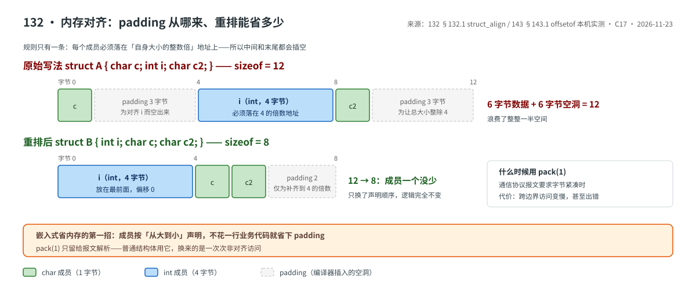

# 132 结构体、联合与位域

> **解决**：补齐嵌入式 C 的组织层——用 struct/union/位域把数据"摆进内存"；对齐 padding、小端序、位域回绕三个反直觉点均本机实录。  
> **范围**：struct 与内存对齐（入门） · union 与字节序 · 位域 · 枚举与 typedef。  
> **口径**：C17；对齐/位域布局以本机 GCC 16.2.0 实测为准（标准只保证部分行为，跨平台以文档为准）。  
> **更新**：2026-11-23  
> **本册导读** ── 必会三点：① struct 的内存对齐（padding 会"偷空间"）② union=同一格子的两种解释（小端序实拍）③ 位域按位打包但按底层类型占空间 ｜ 跟做时长：约 2 小时 ｜ 前置：131（数组与 `sizeof` 长度公式）。  
> **标记**：★ = 必会节（啃透必会三点就能过）；○ = 拓展节（时间多再扫）。

## 目录

| 节 | 内容 |
|---|---|
| 132.1 | struct 与内存对齐 ★ |
| 132.2 | union：同一格子的两种解释 ★ |
| 132.3 | 位域：按位打包的成员 ★ |
| 132.4 | 枚举与 typedef ○ |
| 132.5 | 坑表 |
| 132.6 | 检查清单（自测 6 题 + 动手任务 3 件） |

---

## 132.1 struct 与内存对齐 ★

**定义**：struct 把多个不同类型的变量**打包成一个整体**——成员在内存里按声明顺序连续存放。但"连续"不等于"紧贴"：**内存对齐**（编译器把每种成员放到"自己宽度的整数倍"地址上，牺牲空隙换访问速度）会往中间塞空隙——这个空隙叫 **padding**。

**完整示例**（`struct_align.c`）：

```c
#include <stdio.h>

struct A { char c;  int i;  char c2; };        /* natural alignment */
struct B { int i;   char c;  char c2; };       /* same members, reordered */
#pragma pack(push, 1)
struct C { char c;  int i;  char c2; };        /* packed: no padding */
#pragma pack(pop)

int main(void)
{
    struct A a; struct B b; struct C c;
    printf("sizeof A(char,int,char) = %zu\n", sizeof a);
    printf("  offset c = %zu, i = %zu, c2 = %zu\n",
           (size_t)((char*)&a.c - (char*)&a), (size_t)((char*)&a.i - (char*)&a),
           (size_t)((char*)&a.c2 - (char*)&a));
    printf("sizeof B(int,char,char) = %zu   <- same members, reordered\n", sizeof b);
    printf("sizeof C packed(1)      = %zu   <- padding removed\n", sizeof c);
    return 0;
}
```

**跟做**：`gcc -Wall struct_align.c -o struct_align.exe` → `.\struct_align.exe`。**预期输出（本机实录）**：

```text
sizeof A(char,int,char) = 12
  offset c = 0, i = 4, c2 = 8
sizeof B(int,char,char) = 8   <- same members, reordered
sizeof C packed(1)      = 6   <- padding removed
```

**三处必看的机制**：① 同样三个成员（1+4+1=6 字节），struct A 占 **12 字节**——c(偏移0) 与 i 之间塞了 3 字节 padding、c2 后又补 3 字节（对齐规则：int 必须住在 4 的倍数地址上）；② **只把成员按"从大到小"重排（struct B），就从 12 缩到 8**——不付任何代价的优化，嵌入式内存紧张时是白捡的；③ `#pragma pack(1)` 强制紧贴（6 字节），但代价是成员可能跨地址边界访问变慢——通信协议报文解析用它，普通数据结构别用。

**对齐两准则**：每个成员的偏移量是其自身大小的整数倍、结构体总大小是最大成员大小的整数倍。这两条怎么纸上算、`offsetof` 怎么量、`#pragma pack` 怎么压，全部在 143 §143.1 展开——本册只需记住一句：**成员顺序就是内存布局**。

**试一试**：给 struct A 再加一个 `double d;` 放最后，重跑看 sizeof（8 字节成员会改变整体对齐要求）。

对齐、padding 与重排收益画成一张图——红块就是被浪费的字节：



## 132.2 union：同一格子的两种解释 ★

**定义**：union 的所有成员**共享同一块内存**——大小等于最大成员。它不是"多个值"，而是**同一串二进制的多种解释**——正是「C语言」121 §121.1"类型 = 宽度 + 解释"的工具化。

**完整示例**（`union_view.c`）：

```c
#include <stdio.h>

union view {
    int          i;                /* read as 32-bit int */
    unsigned char b[4];           /* read as 4 bytes */
};

int main(void)
{
    union view v;
    v.i = 0x12345678;             /* same 4 bytes, two interpretations */
    printf("as int       : 0x%X\n", v.i);
    printf("as bytes[0..3]: %02X %02X %02X %02X  (little-endian: LSB first)\n",
           v.b[0], v.b[1], v.b[2], v.b[3]);
    return 0;
}
```

**跟做**：编译运行。**预期输出（本机实录）**：

```text
as int       : 0x12345678
as bytes[0..3]: 78 56 34 12  (little-endian: LSB first)
```

**读法**：写入 0x12345678，按字节读出来是 **78 56 34 12**——最低有效字节在最低地址，这就是**小端序（little-endian）**的本机实拍（字节序名词见「计算机体系结构」00 术语表，这里亲眼看）。**嵌入式用途**：拆寄存器值看字节、通信协议收到的字节流重组为 int——union 是嵌入式"字节级思考"的标准工具。

**试一试**：把 `v.i` 改成 `0x00000001` 再看字节——`01 00 00 00`，确认"低位在低地址"；再把 union 加一个 `short s;` 成员打印，体会"union 大小 = 最大成员"；用**指定初始化器**给非首成员赋值：`union view v2 = {.b = {0x78, 0x56, 0x34, 0x12}};`（C99 起支持 `.成员` 指定写法，不指定成员时只能初始化首成员 `union view v3 = {5};`）。

## 132.3 位域：按位打包的成员 ★

**定义**：位域（bit field）让 struct 的成员按**位**分配宽度——硬件寄存器常按位定义字段（[3:0] 是一个功能、[7:4] 是另一个），位域是 C 对这种布局的直接表达。

**完整示例**（`bitfield.c`）：

```c
#include <stdio.h>

struct flags {
    unsigned mode  : 3;           /* 0..7   */
    unsigned enable: 1;           /* 0..1   */
    unsigned speed : 4;           /* 0..15  */
};

int main(void)
{
    struct flags f = {0};
    printf("sizeof flags = %zu byte(s)\n", sizeof f);
    f.mode = 7; f.enable = 1; f.speed = 15;
    printf("mode=%u enable=%u speed=%u\n", f.mode, f.enable, f.speed);
    f.mode = 8;                    /* overflow: 3 bits can hold 0..7 */
    printf("after mode=8 -> mode=%u  (wraps like uint8_t did!)\n", f.mode);
    return 0;
}
```

**跟做**：编译运行。**预期输出（本机实录，含编译器警告——警告本身就是教材）**：

```text
bitfield.c:15:14: warning: unsigned conversion from 'int' to 'unsigned char:3' changes value from '8' to '0' [-Woverflow]
sizeof flags = 4 byte(s)
mode=7 enable=1 speed=15
after mode=8 -> mode=0  (wraps like uint8_t did!)
```

**三处机制**：① 3+1+4=8 位，但 sizeof 是 **4 字节**——位域按**声明的底层类型**作存储单元（本例都是 unsigned，即 int 宽度的 4 字节单元），想真省到 1 字节要声明 unsigned char 位域；② `f.mode = 8` 超出 3 位容量，编译器**警告**且运行回绕成 0——和 types.c 的 `uint8_t 255+1` 是同一种回绕；③ **边界与风险**：位域的跨字节布局由实现定义——映射硬件寄存器时，正式工程优先用"掩码+移位"（「C语言」121 §121.3 模板），位域用于纯软件的状态打包。

**试一试**：把 `mode` 宽度改成 2（能存 0..3），赋值 7 再看警告与回绕值。

## 132.4 枚举与 typedef ○

**定义**：枚举（enum）= 把"取值有限的一类事物"定义成类型——枚举项是命名的整数常量，默认从 0 递增、可自定义值。typedef = 给类型**取别名**——`typedef 类型 别名;`，别名与原类型完全等价，嵌入式头文件里 `u8`、`uint8_t`（§2.1）都是它的产物。

**完整示例**（`enum_typedef.c`）：

```c
#include <stdio.h>

/* 枚举：值有限的类型，默认从 0 递增 */
typedef enum
{
    LED_OFF,
    LED_ON,
    LED_BLINK
} LedState;

/* typedef：给类型取别名，嵌入式惯用法 */
typedef unsigned char u8;

void show(LedState s)
{
    switch (s) /* switch 表达式可以是枚举变量 */
    {
    case LED_OFF:
        printf("LED off\n");
        break;
    case LED_ON:
        printf("LED on\n");
        break;
    case LED_BLINK:
        printf("LED blink\n");
        break;
    }
}

int main(void)
{
    LedState st = LED_ON;
    show(st);
    printf("LED_OFF=%d LED_ON=%d LED_BLINK=%d\n", LED_OFF, LED_ON, LED_BLINK);

    u8 v = 200; /* 别名当类型用，与 unsigned char 完全等价 */
    printf("sizeof(u8) = %zu, sizeof v = %zu\n", sizeof(u8), sizeof v);
    return 0;
}
```

**跟做**：编译运行。**预期输出（本机实录）**：

```text
LED on
LED_OFF=0 LED_ON=1 LED_BLINK=2
sizeof(u8) = 1, sizeof v = 1
```

**三处必看的机制**：① `LED_OFF=0 LED_ON=1`——枚举项默认从 0 递增，写 `enum {A = 10, B, C}` 则 B=11、C=12（自定义起点后继续递增）；② 枚举 + switch 是状态机的标准搭配（122 §122.1 的穿落示例在此闭环）——switch 的控制表达式必须是**整型**（char/short/int/long 等与枚举均可，浮点不行），比裸数字 0/1/2 可读性高一个量级；③ typedef 只做**改名不做新类型**：`sizeof(u8)` 与 `sizeof(unsigned char)` 同为 1。与 struct 的类比：struct/enum 描述"一类事物"（图纸），具体变量是"对象"（实例）——从面向对象语言转来的读者用这个直觉入门即可。

**试一试**：① 给枚举加自定义值 `LED_SLOW = 10` 放最后，打印三个值验证；② `sizeof(u8)` 写成 `sizeof u8` 会编译报错——**sizeof 类型名必须加括号**（表达式不用），记住这个差别；③ typedef 也能给**指针与数组类型**起别名：`typedef char *String;`（`String s = "hi";` 一眼看出是字符串指针）、`typedef int FiveInt[5];`（`FiveInt arr = {1,2,3,4,5};` 等价 `int arr[5]`）、`typedef int (*ArrPtr)[3];`（数组指针别名，142 §142.3 的格式从此不用手写）。

## 132.5 坑表

| # | 现象 | 原因 | 解法 |
|---|---|---|---|
| 1 | struct 大小比成员之和大 | 内存对齐 padding（A=12 实录） | 成员按"从大到小"重排；需要紧贴才用 pack(1) |
| 2 | 跨平台读 struct 字节不对 | 对齐与字节序实现相关 | 通信解析用 pack(1)+显式转换，不直接强转内存 |
| 3 | union 读成员值"错乱" | 共享内存本就如此 | 写 A 读 B 是"换解释"，不是 bug（§132.2 正是靠它工作） |
| 4 | 位域赋值回绕 | 位宽不够（mode=8→0 实录） | 按字段最大值选位宽；开 -Wall 看溢出警告 |
| 5 | `sizeof u8` 编译报错 | sizeof 后跟**类型名**必须加括号 | 写 `sizeof(u8)`；跟表达式才可省括号 |
| 6 | 枚举后面几项值"跳了" | 自定义起点后仍按 +1 递增 | 需要固定值就逐项显式赋值（§132.4） |
| 7 | typedef 后以为有了新类型 | typedef 只是改名，不做类型检查 | 要真正区分类型用 struct 包装（§132.4） |

## 132.6 检查清单（自测 6 题 + 动手任务 3 件）

**自测**：

| # | 问题 | 自测标准 |
|---|---|---|
| 1 | struct A 为什么 12 字节 | 对齐 padding；会画 0/4/8 偏移图（实录） |
| 2 | 怎么白捡省内存 | 成员从大到小重排（12→8 实录） |
| 3 | union 的本质 | 同一块内存的多种解释（小端序实拍） |
| 4 | 位域溢出时发生什么 | 回绕+警告（mode=8→0 实录） |
| 5 | union 的大小由谁决定 | 最大成员的大小（§132.2） |
| 6 | 枚举项默认从几开始、能否自定义 | 从 0 递增；可 `= 10` 自定义，其后继续 +1（§132.4） |
| 6 | 联合与结构体的差别 | 共享同一块内存 vs 各占各的格子（§132.2） |

**动手任务**：① struct_align.c 跑通，把三个 sizeof 抄进笔记并画 A 的内存布局图；② union_view 跑通，再做 0x00000001 实验，把四个字节的十六进制抄下来；③ bitfield.c 把 `mode` 宽度改成 2 后复现回绕，留下警告原文与运行输出。

> 下一篇：《133 指针：地址、步长与解引用》——所有"为什么是 12 字节"的答案，都藏在地址这一层。
