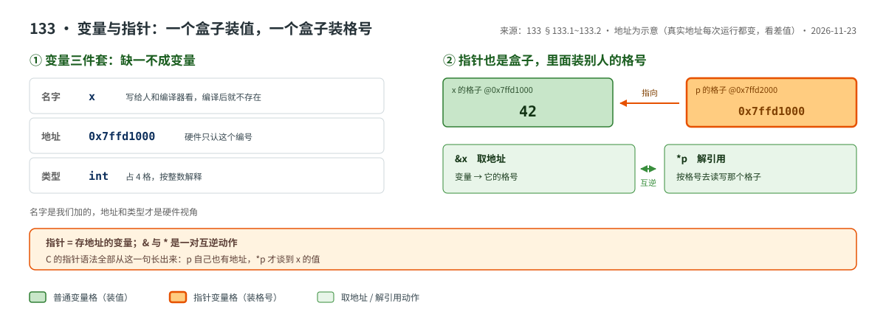
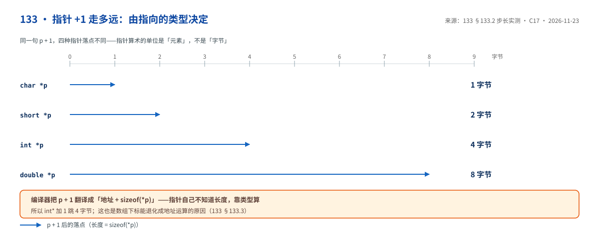
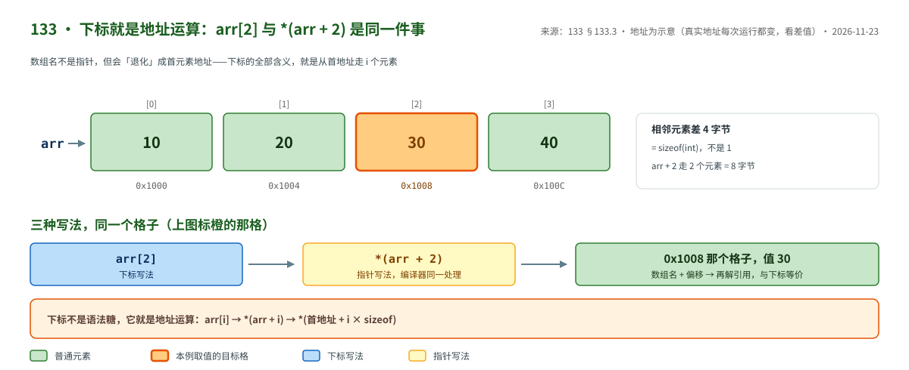
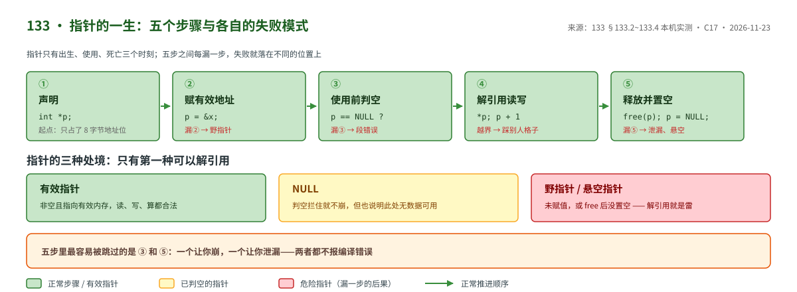

# 133 指针：地址、步长与解引用

> **解决**：嵌入式第一关——把"变量"拆成"名字 + 地址 + 类型"三件，用 `&` 取地址、`*` 顺着地址取值，理解指针的**步长**由指向的类型决定，以及"指针没有边界"这件事为什么是万恶之源。  
> **范围**：编址与地址 · `&` 与 `*` · 指针宽度与步长 · 数组下标即地址运算 · 指针没有边界 · 指针一生的五个步骤。  
> **口径**：C17；地址为本机实录（Windows x64 + GCC 16.2.0），**每次运行都会变，看差值不看绝对值**；解引用无效指针是未定义行为，实测崩溃只代表本机表现。  
> **更新**：2026-11-23  
> **本册导读** ── 必会三点：① 相邻两个 int 的地址差恰好 4，差值就是 `sizeof`——"格子编号"不是比喻 ② 指针 `+1` 前进多少由**指向的类型**决定（`int*` 走 4、`char*` 走 1）③ 指针**没有边界**，`%s` 与数组下标都不会替你刹车 ｜ 跟做时长：约 3 小时 ｜ 前置：131（数组与 sizeof）、122 §122.3（实参是拷贝）。  
> **标记**：★ = 必会节（啃透必会三点就能过）；○ = 拓展节（时间多再扫）。

## 目录

| 节 | 内容 |
|---|---|
| 133.1 | 内存是一排编址的字节 ★ |
| 133.2 | 指针：存地址的变量与步长 ★ |
| 133.3 | 一个地址能走多远：下标与无边界 ★ |
| 133.4 | 指针的一生：五个步骤与失败模式 ○ |
| 133.5 | 坑表 |
| 133.6 | 检查清单（自测 6 题 + 动手任务 3 件） |

---

## 133.1 内存是一排编址的字节 ★

**定义**：内存是一排从 0 开始编号的字节格子，编号就是**地址**。变量 = 名字 + 地址 + 类型：名字给编译器看，地址才是硬件真相。`&x` 取地址，`*p` 顺着地址取值。

**完整示例**（[code/133/addr.c](../code/133/addr.c)）：

```c
#include <stdio.h>

int main(void)
{
    int    x = 42;
    int    arr[3] = {10, 20, 30};
    char   c = 'A';
    int   *p = &x;

    printf("addr of x       = %p\n", (void*)&x);
    printf("addr of x+field = %p  (next int is +4)\n", (void*)(&x + 1));
    printf("addr of arr[0]  = %p\n", (void*)&arr[0]);
    printf("addr of arr[1]  = %p  (int array step = %zu)\n", (void*)&arr[1], sizeof(int));
    printf("addr of arr[2]  = %p\n", (void*)&arr[2]);
    printf("addr of c       = %p\n", (void*)&c);
    printf("p = %p, *p = %d\n", (void*)p, *p);
    printf("arr[1] via index  = %d ; via *(arr+1) = %d\n", arr[1], *(arr + 1));
    return 0;
}
```

**跟做**：`cd code/133` → `gcc -Wall addr.c -o addr.exe` → `.\addr.exe`。**预期输出（本机实录）**：

```text
addr of x       = 00000071509ff954
addr of x+field = 00000071509ff958  (next int is +4)
addr of arr[0]  = 00000071509ff948
addr of arr[1]  = 00000071509ff94c  (int array step = 4)
addr of arr[2]  = 00000071509ff950
addr of c       = 00000071509ff947
p = 00000071509ff954, *p = 42
arr[1] via index  = 20 ; via *(arr+1) = 20
```

**三处必看的机制**：① **相邻 int 的地址差恰好 4**（`arr[0]→arr[1]→arr[2]` 是 48/4c/50，`x` 与 `x+1` 差 4）——差值就是 `sizeof(int)`，"格子编号"不是比喻；② **`p` 里存的就是 x 的地址**（`p == &x`），`*p` 顺着它读出 42；③ **`arr[1]` 与 `*(arr+1)` 结果相同**——下标就是地址运算的语法糖，数组名在表达式里退化成首元素地址。

`char c` 的地址 `...947` 是个奇数、且刚好夹在数组前面——**编译器按类型对齐分配**：char 只占 1 字节，可以落在任意位置，而 int 必须落在 4 的倍数上（对齐的完整规则在 143 §143.1）。

**试一试**：① 把 `x` 与 `arr` 的声明顺序对调，重跑看地址怎么变（栈布局会变，但"同类相邻、差值是 sizeof"这条规律不变）；② 打印 `(void*)(&x - 1)` 与 `(void*)(&x + 1)`，算出两个差值的绝对值——都是 4，说明指针加减法**自带乘 sizeof**。

## 133.2 指针：存地址的变量与步长 ★

**定义**：指针就是**存地址的变量**。它指向的类型决定**步长**：`int*` 加 1 前进 4 字节、`char*` 加 1 前进 1 字节；但**指针自己的宽度与指向什么无关**——64 位平台恒为 8 字节。



**完整示例**（`step.c`）——同一块内存，用两种指针走，步长不同：

```c
#include <stdio.h>

int main(void)
{
    int arr[3] = {10, 20, 30};
    int *pi = arr;            /* 指向 int */
    char *pc = (char *)arr;   /* 同一地址，按字节走 */

    printf("pi   = %p, pi+1   = %p  (差 %d)\n",
           (void*)pi, (void*)(pi + 1), (int)((char*)(pi + 1) - (char*)pi));
    printf("pc   = %p, pc+1   = %p  (差 %d)\n",
           (void*)pc, (void*)(pc + 1), (int)((pc + 1) - pc));
    printf("*(pi+1) = %d\n", *(pi + 1));
    printf("sizeof(pi) = %zu, sizeof(pc) = %zu\n", sizeof pi, sizeof pc);
    return 0;
}
```

**跟做**：`gcc -Wall step.c -o step.exe` → `.\step.exe`。**预期输出（本机实录）**：

```text
pi   = 000000a5e73ffa80, pi+1   = 000000a5e73ffa84  (差 4)
pc   = 000000a5e73ffa80, pc+1   = 000000a5e73ffa81  (差 1)
*(pi+1) = 20
sizeof(pi) = 8, sizeof(pc) = 8
```

**三处必看的机制**：① `pi+1` 走 **4**、`pc+1` 走 **1**——同一个地址、同一个 `+1`，步长由**指向的类型**决定（`int*` 加 1 = 跳过一个 int）；② `*(pi+1)` 得 20，正是 `arr[1]`——这不是巧合，`arr[1]` 的编译结果就是 `*(arr+1)`；③ `sizeof(pi)` 与 `sizeof(pc)` **都是 8**——指针自己的宽度与指向什么无关，64 位平台恒为 8（32 位平台是 4）。

指针 `+1` 到底走多远——`int*` 跨过 4 个字节到下一个 int，`char*` 只挪一格：



**为什么"想改真身必须交地址"**：122 §122.3 的 `swap` 已经证明"实参是拷贝"。本节补上后半句：**地址交出去之后，函数凭什么能改到真身**——因为它拿到的是真身的格号，顺着格号写就是写真身。

**两条纪律**（先记结论，原理在 133.4）：
- **不用就置 `NULL`**：解引用 NULL 必崩，但崩得可定位；野指针崩得毫无规律。
- **解引用前先问"这个地址有效吗"**。

**试一试**：① 把 `(char*)arr` 改成 `(char*)&arr[1]`，确认 `pc` 起点后移 4 字节；② 用 `pc` 逐字节打印 `arr[0]` 的 4 个字节（`printf("%02X ", (unsigned char)pc[i])`）——你会看到 10 的十六进制 `0A 00 00 00`，这就是 132 §132.2 小端序在同一块内存上的再次现身。

## 133.3 一个地址能走多远：下标与无边界 ★

**定义**：数组下标就是"从首地址走 i 个元素"，走得准，所以安全；指针**没有边界概念**——`%s` 只拿到起始地址、不知道终点，只能读到撞上 `\0` 为止。**"没有边界"是指针的常态**，这是本节要带走的第一件事。

数组下标 = 地址运算，画出来就是一张"从首地址数格子"的图：



**完整示例**（[code/133/strdemo.c](../code/133/strdemo.c)）——三种"没有边界"的现场：

```c
#include <stdio.h>
#include <string.h>

int main(void)
{
    char s[] = "hi";               /* h i NUL -> 3 bytes */
    char buf[3] = {'A', 'B', 'C'}; /* NO NUL sentinel! */
    char *t = "hi";                /* read-only literal */
    (void)t;                       /* strcpy(t, "x"); <- 若执行就是写只读区：雷 */

    printf("sizeof s = %zu, strlen(s) = %zu\n", sizeof s, strlen(s));
    printf("s[2] is NUL? -> %d\n", s[2] == 0);
    printf("printing buf (8 raw bytes) -> ");
    for (int i = 0; i < 8; i++) {
        unsigned char ch = (unsigned char)buf[i];
        putchar((ch >= 32 && ch < 127) ? ch : '.');
    }
    printf("   <- ABC plus stack garbage, random each run\n");
    return 0;
}
```

**跟做**：`gcc -Wall strdemo.c -o strdemo.exe` → `.\strdemo.exe`。**预期输出（本机实录）**：

```text
sizeof s = 3, strlen(s) = 2
s[2] is NUL? -> 1
printing buf (8 raw bytes) -> ABChi...   <- ABC plus stack garbage, random each run
```

**三处必看的机制**：① `sizeof s = 3` 而 `strlen(s) = 2`——多出来的一格就是哨兵 `\0`，`s[2] is NUL? -> 1` 直接证明了它的位置；② `buf` 只有 3 个字符、没有哨兵，**循环读 8 个字节编译器不拦、运行不崩**，后 5 个是栈上残留（本机这次读到 `hi`，说明隔壁正好放着 `s`）——这是**越界读**；③ `char *t = "hi"` 指向**只读区**：`strcpy(t, "x")` 这句写只读内存，执行必崩（注释里标着"雷"，解除注释就会被 112 §112.4 的方法定位到）。

**为什么"没有边界"这件事必须刻在脑子里**：`%s`、`strlen`、`strcpy`、数组下标——**它们全都只拿到一个起始地址**，没有一个知道终点在哪。C 把"边界"这件事完全交给程序员，所以边界纪律不是好习惯，是**唯一的安全带**：

| 场景 | 谁负责刹车 | 不刹车的后果 |
|---|---|---|
| `arr[i]` | 程序员（`i < len`） | 越界读写相邻变量或栈帧 |
| `%s` / `strlen` | 数据里的 `\0` | 一路读到撞见任意 `\0`（`jacktom` 现场见 131 §131.3） |
| `strcpy` / `strcat` | 程序员（目标容量够不够） | 越界写，可能踩到返回值或栈帧 |
| 指针 `+1` 越界后解引用 | 程序员 | 未定义行为，可能崩、可能静默改坏数据 |

**`s` 与 `t` 长得像、本质不同**（这是本节最该带走的一句）：

```c
char s[] = "hi";      /* 栈上 3 个格子，可写 */
char *t = "hi";       /* 指针，指向只读字面量区 */
strcpy(t, "x");       /* 未定义行为：写只读区，必崩 */
```

- **`s` 是可写的 3 个格子，`t` 只是指向只读区的一个地址**；声明形式差一个 `[]`，内存归属完全不同。
- **`sizeof` 量数组得总格子数（3），量指针得指针宽度（8）**。这就是"函数里 `sizeof(buf)` 从 3 变 8"的全部原因（142 §142.2 会再遇到）。

**试一试**：① 把 `buf` 的循环上限从 8 改成 3，输出就只剩 `ABC`——修好之后你才知道那 5 个字符确实是"读出来的"，不是"打印出来的"；② 解开 `strcpy(t, "x")` 那行注释，用 112 的方法跑一次 GDB，看它崩在哪——**只读区的写保护是操作系统在执法**。

## 133.4 指针的一生：五个步骤与失败模式 ○

**定义**：指针从出生到死亡只有五个步骤，每一步漏掉的后果各不相同。这一节把 133.1~133.3 的散点串成一条线，也是 141 讲内存错误时的对照表。

| 步 | 做什么 | 正确写法 | 漏掉的后果 |
|---|---|---|---|
| 1 | **声明** | `int *p;` | — |
| 2 | **初始化** | `int *p = &x;` 或 `= NULL;` | 野指针：解引用时崩或改坏随机内存 |
| 3 | **判空** | `if (p != NULL)` | 空指针解引用：必崩在地址 0 |
| 4 | **解引用** | `*p = 42;` | 地址无效 → 段错误（112 §112.4） |
| 5 | **失效处理** | `free(p); p = NULL;` | 悬空指针 / 重复释放 / 泄漏（141 §141.2 六种成因） |

指针从出生到死亡只有五个步骤，每一步漏掉的后果各不相同：



**三处必看的机制**：① **第 2 步是最便宜的一步**——声明即赋值（或置 NULL）能消灭"野指针"这一整类问题，而它的成本只是一个 `= NULL`；② **第 4 步之前要判空**，但判空只解决"明确的空"，不解决"地址非法"——野指针与非 NULL 的非法地址仍然需要后面 141 的工具；③ **第 5 步的 `p = NULL` 不是洁癖**——`free` 之后 p 仍指着那块已归还的内存（悬空指针），再解引用就是 UB，而"置 NULL"让下一次误用立刻崩在地址 0，**可定位**。

**嵌入式视角：寄存器也是地址**（一句话版，细节归 141 §141.3）：外设寄存器被摆在地址空间的固定编号上，`*(volatile unsigned int *)0x40020000 |= (1u << 3);` 这种写法就是"顺着地址操作硬件"——指针在嵌入式不是"高级技巧"，是日常工作语言。

**试一试**：① 把上表五步抄成一张检查卡，然后回头审 133.3 的 `strdemo.c`——找出它违反的是第几步（提示：`buf` 没有哨兵，属于"数据不完整"，而循环读 8 个属于第 4 步越界）；② 写一个函数，参数是 `int *p`，函数内先 `if (p == NULL) return -1;` 再解引用，然后在 main 里分别传 `NULL` 与有效地址各调一次，看两种返回。

## 133.5 坑表

| # | 现象 | 原因 | 解法 |
|---|---|---|---|
| 1 | 段错误且位置随机 | 野指针（声明未初始化） | 声明即置值或置 NULL（§133.4 第 2 步） |
| 2 | 字符串打印带乱码 | 缺 `\0` 哨兵 | 手工组字符串必补 `\0`（§133.3 实录） |
| 3 | 函数里 `sizeof(buf)` 是 8 | 数组传参退化成指针 | 长度另传参数（§133.3、142 §142.2） |
| 4 | 修改 `char *t = "hi"` 崩溃 | 字面量在只读区，写保护由 OS 执法 | 改用 `char s[] = "hi"`（§133.3 实录） |
| 5 | `p + 1` 跳的字节数跟想的不一样 | 步长由指向的类型决定 | 按字节走用 `char*`，按下标走用数组（§133.2 实录） |
| 6 | `sizeof` 量指针得 8，量数组得总字节 | 数组名退化为指针后只剩 8 字节 | 在定义处算好长度再传（§133.3） |
| 7 | 越界却无任何报错 | C 不做边界检查 | 边界纪律（`i < len`）；金丝雀或 GDB（112 §112.6） |

## 133.6 检查清单（自测 6 题 + 动手任务 3 件）

**自测**：

| # | 问题 | 自测标准 |
|---|---|---|
| 1 | 变量、地址、指针三者是什么关系 | 名字 + 格号 + 装格号的变量（§133.1） |
| 2 | 相邻两个 int 的地址差多少？为什么 | 4，等于 sizeof(int) |
| 3 | 指针 `+1` 走多远由什么决定 | 指向的类型（`int*` 4、`char*` 1） |
| 4 | 指针自己的宽度由什么决定 | 平台（64 位 8 字节），与指向什么无关 |
| 5 | `char s[]` 与 `char *t` 的本质差别 | 可写格子 vs 指向只读区的地址 |
| 6 | 指针一生的五个步骤 | 声明 → 初始化 → 判空 → 解引用 → 失效处理 |

**动手任务**：① 跑 [code/133/addr.c](../code/133/addr.c)，把三个 `arr` 地址的差值抄下来（应各差 4）；② 跑 `step.c`，把 `pi+1` 与 `pc+1` 的差值写成一句话结论（步长由类型决定）；③ 复现 [code/133/strdemo.c](../code/133/strdemo.c) 的 `ABChi...`，再把循环上限改成 3 修好它，两份输出一起留档。

> 下一篇：《141 内存四区与对象生命周期》——指针指向的东西住在哪：代码段、数据段、栈、堆，以及谁负责回收。
