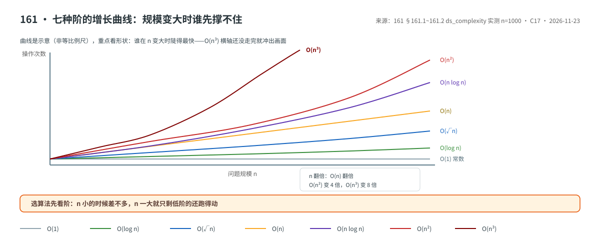

# 161 复杂度：时间与空间

> **解决**：给算法量"成本"的尺子——用大 O 渐进表示法刻画时间开销随问题规模的增长规律（7 种常见阶逐一带代码实测），以及空间复杂度的记账方法；没有这把尺子，"两个算法哪个好"就只能靠感觉；本册所有输出均为本机实测（GCC 16.2.0，n=1000）。  
> **范围**：事前/事后分析 · 大 O 渐进表示 · 7 种时间阶 · 空间复杂度。  
> **口径**：复杂度定义与省略规则以本册口径为准；增长阶梯数字为本机实测（ds_complexity.c，基本操作计数法）。  
> **更新**：2026-11-23  
> **本册导读** ── 必会三点：① 大 O 只看增长趋势：常量阶省略（3n+3→O(n)）、低次阶省略（n²+n→O(n²)）② 七种阶的排序 O(1) < O(log₂n) < O(√n) < O(n) < O(n·log₂n) < O(n²) < O(n³)——本机 n=1000 实测阶梯 1/9/32/1000/9000/100 万/10 亿 ③ 空间复杂度是"额外开了多少格子"：变量 O(1)、辅助数组 O(n)、递归深度 O(n) ｜ 跟做时长：约 2 小时 ｜ 前置：122（循环与函数）、123 §123.7（递归）。  
> **标记**：★ = 必会节；○ = 拓展节。

## 目录

| 节 | 内容 |
|---|---|
| 161.1 | 大 O 渐进：度量方法与省略规则 ★ |
| 161.2 | 七种时间阶：常见场景与代码形态 ★ |
| 161.3 | 空间复杂度：额外格子的账 ★ |
| 161.4 | 坑表 |
| 161.5 | 检查清单（自测 6 题 + 动手任务 3 件） |

---

## 161.1 大 O 渐进：度量方法与省略规则 ★

**定义**：时间复杂度刻画算法效率——口径：**计算一段逻辑在指定问题规模下，每句代码执行次数之和**，用大 O 符号描述其随规模 n 的渐进增长。度量两条路：**事后统计**（真跑一遍计时——受机器/编译器影响，可复现性差）与**事前分析**（数基本操作的执行次数——只跟算法与规模有关，本册方法）。事前分析的相关因素：算法策略、问题规模、数据初始状态、语言、编译器代码质量、机器速度——后四项都该排除，所以只留"算法策略 × 规模"。

**完整示例**（[code/161/ds_complexity.c](../code/161/ds_complexity.c)，七种阶各一个函数，用计数器把"基本操作执行次数"打出来）：

```c
#include <stdio.h>

/* 七种阶的实测演示：n=1000 时各函数的基本操作计数 */
long long c1, c2, c3, c4, c5, c6, c7;

void O1(int n) /* 常量阶：执行次数与 n 无关 */
{
    c1 = 1;
}

void On(int n) /* 线性阶：单层循环 */
{
    for (int i = 0; i < n; i++)
        c2++;
}

void On2(int n) /* 平方阶：双层循环 */
{
    for (int i = 0; i < n; i++)
        for (int j = 0; j < n; j++)
            c3++;
}

void On3(int n) /* 立方阶：三层循环 */
{
    for (int i = 0; i < n; i++)
        for (int j = 0; j < n; j++)
            for (int k = 0; k < n; k++)
                c4++;
}

void Ologn(int n) /* 对数阶：问题规模每次减半 */
{
    while (n > 1)
    {
        n = n / 2;
        c5++;
    }
}

void Onlogn(int n) /* 线性对数阶：n 轮 × 每轮减半 */
{
    for (int i = 0; i < n; i++)
    {
        int m = n;
        while (m > 1)
        {
            m = m / 2;
            c6++;
        }
    }
}

void Osqrt(int n) /* 平方根阶：循环到根号 n */
{
    for (long long i = 0; i * i < n; i++)
        c7++;
}

int main(void)
{
    int n = 1000;
    O1(n); On(n); On2(n); On3(n); Ologn(n); Onlogn(n); Osqrt(n);
    printf("n=%d 时基本操作次数：\n", n);
    printf("O(1)      : %lld\n", c1);
    printf("O(log2n)  : %lld\n", c5);
    printf("O(sqrt n) : %lld\n", c7);
    printf("O(n)      : %lld\n", c2);
    printf("O(nlog2n) : %lld\n", c6);
    printf("O(n^2)    : %lld\n", c3);
    printf("O(n^3)    : %lld\n", c4);
    return 0;
}
```

**跟做步骤**：`cd code/161` → `gcc -Wall ds_complexity.c -o ds_complexity.exe` → `.\ds_complexity.exe`。**预期输出（本机实录）**：

```text
n=1000 时基本操作次数：
O(1)      : 1
O(log2n)  : 9
O(sqrt n) : 32
O(n)      : 1000
O(nlog2n) : 9000
O(n^2)    : 1000000
O(n^3)    : 1000000000
```

**三处必看的机制**：① **阶梯就是复杂度排序的实证**：1 → 9 → 32 → 1000 → 9000 → 100 万 → 10 亿——与阶序 `O(1) < O(log₂n) < O(√n) < O(n) < O(n·log₂n) < O(n²) < O(n³)` 逐一对上；② **两条省略规则落地**：某函数若执行 3n+3 次，记 O(n)（常量省略）；n²+n 记 O(n²)（低次省略）——大 O 只关心**增长趋势**，趋势由最高次项决定；③ **对数阶 9 次的来历**：1000 每次减半共 9 次——1000→500→250→125→62→31→15→7→3→1（"每次排除一半"的算法，二分查找见 164 §164.1）。

**逐句计数实例**（大 O 化简是怎么来的）：

```c
void PlayGame(int n) /* n 为问题规模 */
{
    int i = 1;   /* 执行 1 次 */
    while (i <= n) /* 执行 n + 1 次 */
    {
        /* 循环体执行 n 次 */
        i++;   /* 执行 n 次 */
    }
    /* 结尾打印执行 1 次 */
}
```

逐句相加：`T(n) = 1 + (n+1) + n + n + 1 = 3n + 3`——按省略规则记 **O(n)**。这就是"数基本操作"的完整过程：先逐句数出 f(n)，再取增长最快的项。

**配套图**：七种阶的增长曲线对照见本册配图 010-01。



**试一试**：① 把 n 改成 2000 重跑——O(n) 翻倍到 2000、O(n²) 翻 4 倍到 400 万、O(n³) 翻 8 倍到 80 亿（阶越高，规模翻倍的放大系数越大）；② 手算上面 PlayGame 实例的 `3n+3` 与 `n²+n` 各在 n=10 时执行几次，再用省略规则化简。

## 161.2 七种时间阶：常见场景与代码形态 ★

**定义**：七种阶与它们的"代码长相"一一对应——看到代码形态就能报复杂度：

| 阶 | 代码形态 | 典型算法/场景 |
|---|---|---|
| O(1) | 顺序语句，与 n 无关 | 数组按索引访问、哈希查找（平均） |
| O(log₂n) | 问题规模每次减半 | 二分查找（164 §164.1） |
| O(√n) | 循环到 √n | 判断质数只试到 √n |
| O(n) | 单层循环 | 遍历数组、顺序查找（164 §164.1） |
| O(n·log₂n) | n 轮 × 每轮减半 | 快速排序、归并排序、堆排序 |
| O(n²) | 双层循环 | 冒泡、插入排序（164 §164.3） |
| O(n³) | 三层循环 | 三重组合枚举 |

**机制**：① 上表的对应关系逐条在 §161.1 的实测输出里落了地——双层循环 n² 次就是 O(n²)，"n 轮 × 每轮减半"乘出来 n·log₂n；② **嵌套是乘法、并列是加法**（加法省略取最大项）：`for(i<n){ for(j<n){} }` 是 n×n；`for(i<n){A} for(j<n){B}` 是 n+n=2n→O(n)。

**试一试**：① 写一个"判断 n 是否质数"的函数（试除到 √n），报出它的复杂度并说明为什么不用试到 n；② 把 §161.1 的 On2 改成"外层 n、内层只跑一半（j < n/2）"——总次数 50 万，仍是 O(n²)（常量系数省略）。

## 161.3 空间复杂度：额外格子的账 ★

**定义**：空间复杂度刻画算法**额外占用**的存储量——只算"算法自己新开的"，不算输入数据本身。常见的空间复杂度主要就是 **O(1)** 和 **O(n)** 两种。

**完整示例**（[code/161/ds_space.c](../code/161/ds_space.c)）——递归深度实测：递归的栈帧层数就是它的空间账）：

```c
#include <stdio.h>

/* 递归深度实测：递归的栈空间 = 深度 O(n)，循环版额外空间 O(1) */
long long max_depth = 0;

void recurse(int depth) /* 每层递归在栈上占一帧 */
{
    if (depth > max_depth)
        max_depth = depth;
    if (depth >= 1000) /* 出口：递到 1000 层 */
        return;
    recurse(depth + 1);
}

int main(void)
{
    recurse(1);
    printf("递归到 1000 层: 最大递归深度 = %lld 层（栈空间 O(n)）\n", max_depth);

    for (int i = 0; i < 1000; i++) /* 循环做同样多的步数 */
    {
        /* 循环不占栈帧 */
    }
    max_depth = 0;
    printf("循环做 1000 步: 最大递归深度 = %lld 层（额外空间 O(1)）\n", max_depth);
    return 0;
}
```

**跟做步骤**：`cd code/161` → `gcc -Wall ds_space.c -o ds_space.exe` → `.\ds_space.exe`。**预期输出（本机实录）**：

```text
递归到 1000 层: 最大递归深度 = 1000 层（栈空间 O(n)）
循环做 1000 步: 最大递归深度 = 0 层（额外空间 O(1)）
```

**三处必看的机制**：① **递归的空间账在栈上**：每层递归一帧，1000 层递归 = 1000 帧——深度就是空间复杂度，太深就是栈溢出 StackOverflow（递归 = 函数调自己，123 §123.7 有完整讲解）；② **循环版零栈增长**：同样"做 1000 步"，循环只用固定变量——把递归改循环就是在做空间优化；③ 时间换空间是常态取舍（"愿意牺牲空间来换时间"是常见取舍），嵌入式小内存设备上有时反过来选。

**两种空间形态**（记作 S(n)=O(f(n))，只算**辅助存储**）：

| 形态 | 代码长相 | 记账 |
|---|---|---|
| O(1) 原地工作 | 循环里只用一两个固定变量 | 8 字节常数 → 与 n 无关 |
| O(n) | 开辅助数组 `int arr[n]` | 4n + 8 → 只留 n 项 |

**试一试**：① 报出 011 动态数组扩容那一瞬间的空间复杂度（realloc 新旧两块并存 → O(n)）；② 把 recurse 的出口改成 100000 重跑——10 万层递归是否还活着（对照 123 §123.7 的栈溢出）。

## 161.4 坑表

| # | 现象 | 原因 | 解法 |
|---|---|---|---|
| 1 | 把 O(3n+3) 当成 O(3n) | 常量系数没省略 | 大 O 只留最高次项与系数 1 |
| 2 | 把 O(n²+n) 报成 O(n+n) | 低次项没省略 | 只留最高次项 |
| 3 | 认为 O(log₂n) 的底数必须写清 | 不同底只差常量系数（已省略） | 统一写 O(log n) 即可 |
| 4 | 循环并列报成 O(n²) | 并列是加法（省略后取最大） | 嵌套乘、并列加 |
| 5 | 递归没算栈空间 | 只数了变量没数栈帧 | 递归深度 × 每帧大小计入空间账 |
| 6 | 实测计时和复杂度"对不上" | 事后统计受机器/编译器/数据影响 | 事前数基本操作（本册方法）；计时只做辅助验证 |

## 161.5 检查清单（自测 6 题 + 动手任务 3 件）

**自测**：

| # | 问题 | 自测标准 |
|---|---|---|
| 1 | 大 O 刻画什么 | 基本操作次数随规模 n 的渐进增长 |
| 2 | 两条省略规则 | 常量阶省略（3n+3→n）、低次阶省略（n²+n→n²） |
| 3 | 七种阶从小到大排序 | O(1)<O(log n)<O(√n)<O(n)<O(n log n)<O(n²)<O(n³) |
| 4 | n=1000 时 O(n²) 执行多少次 | 100 万（本机实测）；O(n³) 是 10 亿 |
| 5 | 嵌套与并列的复杂度法则 | 嵌套乘、并列加（加法取最大项） |
| 6 | 递归的空间复杂度怎么来 | 递归深度 = 栈帧层数，太深栈溢出 |

**动手任务**：① ds_complexity 跑通并加 n=2000 的一组输出——产出物：两组阶梯对照；② 写"判断质数（试除到 √n）"并报复杂度（升级自 §161.2 试一试②）——产出物：程序 + 3 个数的判定输出；③ 手算 162 §162.1 动态数组"中间插入"的复杂度并说明（平均搬 n/2 → O(n)）——产出物：纸上推导。

> 下一篇：《162 动态数组与链表》——顺序存储与链式存储两种线性容器，配全套 API 与选型表。
