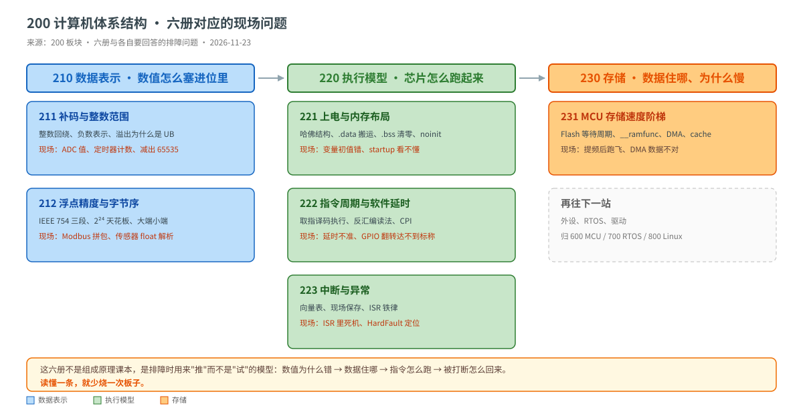

# 202 计算机体系结构全貌

> **一句话定位**：这六册不讲"计算机由什么组成"，只回答一件事——**你在板子上遇到的那些"不讲道理"的现象，底层为什么必然发生**；学完能从"改一行烧一次看现象"变成"推一遍就知道该查哪"。

## 读图

- **210 数据表示**（211 补码 / 212 浮点与字节序）：数值塞进定长位里的代价。整数有回绕和 UB，浮点从出生就在近似，多字节值的字节顺序两边必须约定一致。
- **220 执行模型**（221 上电与布局 / 222 指令周期 / 223 中断）：芯片怎么从复位跑到你的 `main`——变量被搬进 SRAM、指令按周期执行、外部事件强制改 PC。
- **230 存储**（231 速度阶梯）：数据住在哪决定了快慢。Flash 有等待周期、SRAM 没有、DMA 能绕过 CPU、M7 多了 cache 也多了麻烦。

## 怎么读

按 211 → 231 顺序读一遍，是从"数"到"芯"的完整走一遍。但更快的用法是**倒着查**：遇到现象先翻 [201 术语表](201-术语表.md) 的症状反查表，直接跳到对应册的那一节。

## 下一篇

从 [211 补码与整数范围](210-数据表示/211-补码与整数范围.md) 开始——先弄明白机器里的"数"到底是什么。
