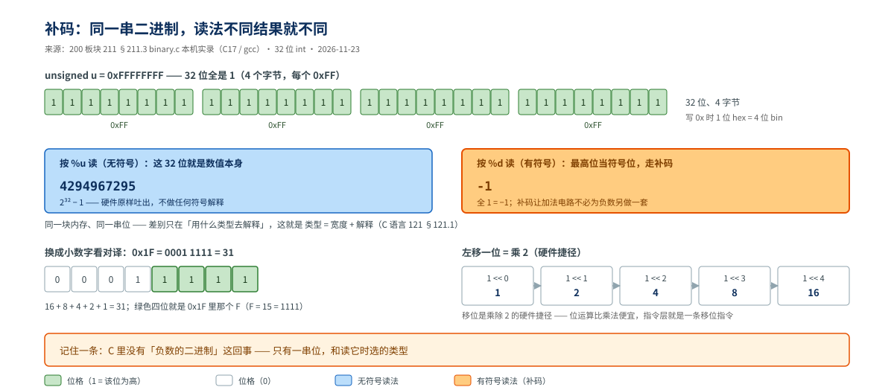

# 211 补码与整数范围

> **解决**：把"机器只认位"这件事落到整数上——为什么负数要用补码、`INT_MAX` 为什么是 2147483647、`INT_MIN` 为什么比它绝对值大 1、溢出到底算什么错。  
> **范围**：二进制与十六进制 · 字长 · 原码/反码/补码三种表示（4 位实测）· 32 位边界与回绕（binary.c）· 有符号溢出的 UB 边界。  
> **口径**：位宽以 32 位 `int` 为主线、64 位 `long long` 只提结论；本机实测 x86-64 + gcc，`int` 为 4 字节。补码规则与平台无关，溢出行为与编译器有关。  
> **更新**：2026-11-23  
> **本册导读** ── 必会三点：① 补码 = 按位取反加一，且让加法电路统一 ② `-2³¹ ~ 2³¹-1`，负数多一个 ③ 有符号溢出是 UB，无符号回绕是良定义 ｜ 跟做时长：约 1 小时 ｜ 前置：C 121（知道类型宽度）。  
> **标记**：★ = 必会节；○ = 拓展节。

## 目录

| 节 | 内容 |
|---|---|
| 211.1 | 机器只认位：二进制、十六进制与字长 ★ |
| 211.2 | 三种表示：原码、反码，以及补码为什么胜出（实验：binary.c 4 位对照） ★ |
| 211.3 | 整数范围从哪来：为什么负数多一个（实验：32 位边界与回绕） ★ |
| 211.4 | 坑表 |
| 211.5 | 检查清单（自测 6 题 + 动手任务 2 件） |

---

## 211.1 机器只认位：二进制、十六进制与字长 ★

**为什么是二进制**：晶体管只有通 / 断两态（400 硬件基础 443 讲 MOS 管怎么当开关）。两态最抗干扰——电压漂一点仍能判成 0 或 1，这就是数字电路比模拟电路耐造的根本原因（500 数字电路 511 从噪声容限角度讲过）。

**十六进制只是缩写**：1 位 hex 精确对应 4 位 bin，不多不少。

| hex | bin | hex | bin |
|---|---|---|---|
| 0 | 0000 | 8 | 1000 |
| 5 | 0101 | F | 1111 |
| 0x1F | 0001 1111 = 31 | 0xFF | 1111 1111 = 255 |

**所以读写二进制一律用 hex**：`0x1F` 比 `00011111` 好数得多，且转换不用算。手工对译的口诀是**一位一位换**，别整串硬算。

**字长（word size）**：CPU 一次处理多少位。它决定三件事——运算宽度、寄存器宽度、地址宽度（`sizeof(void *)` 就是它，C 133 §133.2 有实测：64 位上指针 8 字节，32 位 MCU 上是 4 字节）。32 位机器一个 `int` 正好装进一个寄存器；64 位机器一次能装两个。

**跟做步骤（30 秒）**：把下面 4 个 hex 各对译成 8 位二进制，写在纸上：`0x3C`、`0xA5`、`0x0F`、`0xF0`。

**预期结果**：`0011 1100`、`1010 0101`、`0000 1111`、`1111 0000`。**自评标准**：4 位一组、不跨组借位，四组全对才算会。

**试一试**：任取一个十进制数（比如 200），先转 hex 再转 bin——`200 = 0xC8 = 1100 1000`。走 hex 这条"中间站"比直接十进制转二进制快得多。

## 211.2 三种表示：原码、反码，以及补码为什么胜出（实验：binary.c 4 位对照） ★

**问题**：只有 0 和 1，负号往哪放？

三种历史方案，都试过：

| 方案 | 规则 | 4 位下 -5 是 | 致命缺陷 |
|---|---|---|---|
| 原码（sign-magnitude） | 最高位当符号位，其余是绝对值 | `1101`（符号 1 + 101） | **两个零**（`0000` / `1000`），加法要判符号 |
| 反码（ones' complement） | 负数 = 正数按位取反 | `1010` | **还是两个零**（`0000` / `1111`），且减法要循环进位 |
| 补码（two's complement） | 负数 = 正数按位取反**再加一** | `1011` | **只有一个零**，加法电路不用改 |

**补码胜出的真正原因**：它让"减法"变成"加负数"，**同一套加法电路通吃加减**。硬件上省掉一整套减法器——这不是数学上的优雅，是硅片上的省钱。

### 完整示例（[code/211/binary.c](../code/211/binary.c)——4 位全表）

4 位只有 16 个值，一张表就能看全三种表示的差别：

```c
for (int v = -8; v <= 7; v++) {
    unsigned twos = (unsigned)v & 0xFu;     /* 补码 = 硬件里的位模式 */
    char t[5], s[5], o[5];
    bits4(twos, t);
    if (v >= 0) {
        bits4((unsigned)v, s);              /* 正数：三种表示完全相同 */
        bits4((unsigned)v, o);
    } else if (v > -8) {
        bits4(0x8u | (unsigned)(-v), s);    /* 原码：符号位 1 + 绝对值 */
        bits4((~twos) & 0xFu, o);           /* 反码：补码按位取反 */
    } else {
        s[0] = '-'; s[1] = '-'; s[2] = '\0';/* -8 在原码/反码里表示不出来 */
        o[0] = '-'; o[1] = '-'; o[2] = '\0';
    }
    printf(" %3d |  %s |  %s |  %s\n", v, t, s, o);
}
```

**跟做步骤**：`cd code/211` → `gcc -Wall binary.c -o binary.exe` → `.\binary.exe`。**预期输出（本机实录）**：

```text
  v  | 补码 | 原码 | 反码
-----+------+------+------
  -8 |  1000 |  -- |  --
  -7 |  1001 |  1111 |  0110
  -6 |  1010 |  1110 |  0101
  -5 |  1011 |  1101 |  0100
  -4 |  1100 |  1100 |  0011
  -3 |  1101 |  1011 |  0010
  -2 |  1110 |  1010 |  0001
  -1 |  1111 |  1001 |  0000
   0 |  0000 |  0000 |  0000
   1 |  0001 |  0001 |  0001
   2 |  0010 |  0010 |  0010
   3 |  0011 |  0011 |  0011
   4 |  0100 |  0100 |  0100
   5 |  0101 |  0101 |  0101
   6 |  0110 |  0110 |  0110
   7 |  0111 |  0111 |  0111
```

**三处必看**：

1. **`-1` 的反码是 `0000`** —— 这就是反码的死穴：`0000` 既是 0 也是 -1 的反码，等于**有两个零**。硬件判零要判两次，加法还要处理"循环进位"。补码里 `-1` 是 `1111`，零只有一个。
2. **`-8` 的原码和反码都写不出来**（表里 `--`）—— 4 位原码只能表示 -7~7（符号位占掉一个，绝对值只剩 3 位）。补码能表示 -8~7，**多出一个**。这不是巧合，是 §211.3 要算的那笔账。
3. **正数三种表示完全相同** —— 所以"补码"这个规则只对负数生效，正数照写。这也解释了为什么 `0x7FFFFFFF` 永远是 `INT_MAX`。

**试一试**：把循环改成 `-128 ~ 127`（8 位），`bits4` 换成 `bits8`，你会看到同样的规律在 8 位上重演——**`-1` 反码变成 `0000 0000`，`-128` 原码仍然写不出来**。规律与位宽无关。

## 211.3 整数范围从哪来：为什么负数多一个（实验：32 位边界与回绕） ★

**范围公式**（n 位有符号）：`-2^(n-1) ~ 2^(n-1) - 1`。

代入 n=32：`-2147483648 ~ 2147483647`。**负数比正数多一个**。

**为什么多一个**：位模式一共 2ⁿ 个。补码里 `000…0` 是 0，`100…0`（符号位 1、其余全 0）被规定为最小负数——它没有对应的正数（因为 `-(-2³¹)` 会溢出）。于是正数占 `2^(n-1)-1` 个，负数占 `2^(n-1)` 个，零占 1 个，正好 2ⁿ。

**这也解释了那句老话**："`-INT_MIN` 是未定义行为"——因为 `-(-2147483648)` 需要表示 `+2147483648`，而它超出了正数上限。

### 完整示例（同 `binary.c` 的 32 位部分）

```c
printf("INT_MAX  = %d  (0x%08X)\n", INT_MAX, (unsigned)INT_MAX);
printf("INT_MIN  = %d  (0x%08X)\n", INT_MIN, (unsigned)INT_MIN);
printf("UINT_MAX = %u  (0x%08X)\n", UINT_MAX, UINT_MAX);

int t = INT_MAX;    /* 用变量，避免编译器对常量表达式报 -Woverflow */
printf("INT_MAX + 1 = %d   <- 有符号溢出是 UB，本机回绕到最小值\n", t + 1);
unsigned z = 0;
printf("0u - 1      = %u   <- 无符号回绕是良定义\n", z - 1);
```

**预期输出（本机实录）**：

```text
INT_MAX  = 2147483647  (0x7FFFFFFF)
INT_MIN  = -2147483648  (0x80000000)
UINT_MAX = 4294967295  (0xFFFFFFFF)
INT_MAX + 1 = -2147483648   <- 有符号溢出是 UB，本机回绕到最小值
0u - 1      = 4294967295   <- 无符号回绕是良定义

补码自洽：~(-5) + 1 = 5（应等于 5）
同一串位模式 0xFFFFFFFF：unsigned = 4294967295, int = -1
```



**四处必看**：

1. **`0x7FFFFFFF` 与 `0x80000000`** —— 正数上限的最高位是 0，负数下限的最高位是 1，中间差 1 分钱都不差。这是补码的位模式形状，背下来比背十进制数字有用。
2. **`INT_MAX + 1` 打印出 `INT_MIN`** —— 本机 gcc 在 `-O0` 下就是"按位加、溢出回绕"。但**这是 UB**：换编译器、开 `-O2`、换平台，结果都可能不同（C 121 §121.1 讲过 UB 的纪律，C 112 §112.5 有 `-O2` 让 UB 变脸的实录）。
3. **`0u - 1` 是 `4294967295`** —— 无符号回绕是**标准规定的**，不是"碰巧"。所以`unsigned` 常被拿来当"必然回绕"的工具（哈希、环形缓冲、位运算）。
4. **`~(-5) + 1 = 5`** —— 取反加一正好是取负。这条恒等式是补码的定义，也是 `-x` 在硬件上的实现方式（一条取反 + 一次加一，或者一条 `neg` 指令）。

**试一试**：① 把 `int t = INT_MAX;` 改成 `INT_MAX + 1`（写成常量表达式）重新编译，观察 gcc 报 `-Woverflow` —— **编译器在编译期就能抓到常量溢出，抓不到运行期溢出**；② 用 `long long x = INT_MAX; x = x + 1;` 再打印，看结果变成 2147483648（宽度变了，上限也变了）。

## 211.4 坑表

| # | 现象 | 原因 | 解法 |
|---|---|---|---|
| 1 | `-1` 存进文件读回来是 4294967295 | 用 `%u` / `unsigned` 读，位模式没变但解释变了 | 读写两端类型对齐，或用定宽类型 |
| 2 | 大数相加变成负数 | 有符号溢出（UB） | 换 `unsigned` / `int64_t`，加前置范围检查 |
| 3 | 循环 `for (unsigned i = n; i >= 0; i--)` 死循环 | 无符号永远 ≥ 0，`i--` 到 0 再减就回绕 | 用有符号计数，或写成 `i-- > 0` |
| 4 | `-INT_MIN` 结果怪 | 正数范围装不下 `2³¹` | 先转 `int64_t` 再取负 |
| 5 | `abs(INT_MIN)` 返回负数 | 同上，`abs` 的返回类型装不下 | 用 `llabs` 或先扩宽 |
| 6 | 位运算对负数结果诡异 | 补码 + 符号扩展，右移行为实现定义 | 位操作用 `unsigned`，右移补 0 才可控 |
| 7 | ADC 读数比实际大 16 倍 | 12 位 ADC 左对齐塞进 16 位寄存器，低 4 位是填充 0 | 右移 4 位，或把 ADC 配成右对齐 |
| 8 | 定时器溢出后超时判断永远不成立 | 用有符号比较 `now - start`，回绕后差值为负 | 写成 `(uint32_t)(now - start) < timeout`——无符号减法回绕后差值仍正确 |
| 9 | 同一段判断 PC 上成立、板子上不成立 | 裸 `char` 是否带符号由平台定：x86 默认有符号，ARM 默认无符号 | 存数值一律用 `int8_t` / `uint8_t`，不用裸 `char` |

> 第 8 条是嵌入式最值得记的一条：`uint32_t` 的减法即使跨过溢出点，`(uint32_t)(now - start)` 依旧等于真实经过的 tick 数，所以超时判断可以永远不失效。前提是**差值不跨越一个完整周期**（2³² 个 tick）。

## 211.5 检查清单（自测 6 题 + 动手任务 2 件）

**自测**：

| # | 问题 | 自测标准 |
|---|---|---|
| 1 | 补码的规则 | 按位取反再加一（只对负数生效） |
| 2 | 补码相对原码的两个优势 | 只有一个零；加法电路通吃加减 |
| 3 | n 位有符号的范围 | `-2^(n-1) ~ 2^(n-1)-1`，负数多一个 |
| 4 | 为什么负数多一个 | `100…0` 没有对应正数，`-INT_MIN` 溢出 |
| 5 | 有符号溢出与无符号回绕的差别 | 前者 UB，后者标准规定必然回绕 |
| 6 | `0xFFFFFFFF` 按 int 与被 unsigned 读各是几 | -1 与 4294967295（binary.c 实录） |

**动手任务**：① 跑通 `binary.c`，把 4 位表抄进笔记，标出三个"两个零"的位置；② 做 §211.3 的两个"试一试"，把 `-Woverflow` 的实际警告原文抄下来。

> 下一篇：[212 浮点精度与字节序](212-浮点精度与字节序.md)——整数是精确的，浮点数从出生起就在近似。
