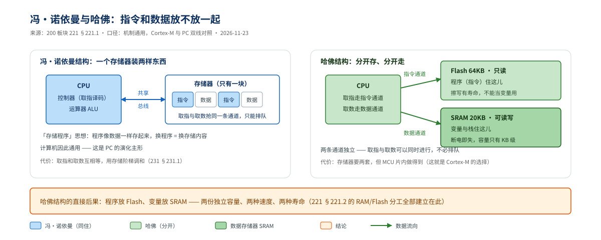

# 221 上电与内存布局

> **解决**：复位键按下之后、`main` 之前，芯片到底做了什么——为什么 `int flag;` 上电就是 0、为什么带初值的全局变量在 Flash 里还要存一份、为什么有些变量复位后居然没被清零。
> **范围**：哈佛与冯诺依曼对"变量住哪"的约束 · `.data` 搬运与 `.bss` 清零（seg.c 实测）· 链接脚本四个符号 · `noinit` 段与冷启动魔数 · map 文件的四个栏目口径。
> **口径**：只讲"结构对写代码的约束"，门电路怎么搭五部件、数据通路怎么连见 500 数字电路 551。本机实测为 x86-64 + Windows PE（段名 `.text/.data/.bss/.rdata`），与 MCU 的 ELF 段名一一对应。
> **更新**：2026-11-23
> **本册导读** ── 必会三点：① 哈佛结构把"程序在 Flash、变量在 SRAM"变成硬约束 ② `.data` 占镜像、`.bss` 不占（实测：4 MB 零数组只让文件涨 530 字节）③ 复位不清零的变量要显式放进 `noinit` 段，并且必须加魔数校验 ｜ 跟做时长：约 1.2 小时 ｜ 前置：212（知道位与字节的表示）。
> **标记**：★ = 必会节；○ = 拓展节。

## 目录

| 节 | 内容 |
|---|---|
| 221.1 | 两条路线：指令和数据放不放一起 ★ |
| 221.2 | 上电到 main：.data 搬运与 .bss 清零（实验：seg.c 看段大小） ★ |
| 221.3 | 链接脚本与 noinit：为什么有些变量复位后没清零 ★ |
| 221.4 | 坑表 |
| 221.5 | 检查清单（自测 6 题 + 动手任务 2 件） |

---

## 221.1 两条路线：指令和数据放不放一起 ★

**冯·诺依曼结构**：指令与数据放**同一个**存储器——"存储程序"思想，换程序 = 换存储内容，计算机因此通用。

**哈佛结构**：指令与数据**分开**存储、分开通道——取指令与取数据可同时进行。

| | 冯·诺依曼 | 哈佛 |
|---|---|---|
| 指令与数据 | 同一存储器 | 分开存储 |
| 通道 | 共享，可能互相等 | 独立，可并行 |
| 现例 | 通用 PC（靠缓存调和） | Cortex-M 级 MCU（片内 Flash + 片内 SRAM） |
| 对写代码的影响 | 几乎无感 | **必须知道变量住哪** |

> **分界**：五部件怎么用门搭出来、数据通路怎么连、瓶颈为什么在总线上——见 **500 数字电路 551**（§551.1 五部件 / §551.2 存储程序 / §551.3 瓶颈 / §551.4 哈佛）。本册只回答一个问题：**这个结构选择，在我的代码上要付什么账。**



**这不是考试概念，是你每天都在踩的坑**：MCU 上程序放 Flash、变量放 SRAM，两边的容量 / 速度 / 寿命**完全不同**。你在 PC 上写 `int g = 42;` 从不问"它在哪"；在 MCU 上这一行要被启动代码搬运一次，搬漏了就出 `g_init` 读到垃圾值的经典故障。

**跟做步骤（观察，2 分钟）**：查你手上那块板子的 datasheet，找两个独立数字——Flash 多少 KB、SRAM 多少 KB（以官方页为准）。**预期结果**：两个分开的数字，就是哈佛结构在你面前的样子。如果是冯·诺依曼结构，只会给你一个"存储器 84 KB"。

## 221.2 上电到 main：.data 搬运与 .bss 清零（实验：seg.c 看段大小） ★

**上电那一刻**：CPU 复位后 PC 指向 Flash 里的启动代码，此时 SRAM 里是**随机值**。启动代码干两件事，然后才跳 `main`：

| 动作 | 对象 | 为什么必须做 |
|---|---|---|
| **搬运**（copy） | 有非零初值的全局 / 静态变量（`.data`） | 初值存在 Flash 里，变量要能改，所以得复制一份到 SRAM |
| **清零**（zero） | 无初值或初值为 0 的全局 / 静态变量（`.bss`） | C 标准要求它们是 0，而 SRAM 上电是随机值 |


**关键推论**：`.bss` 的初值全是 0，**不需要在镜像里存一份**——启动代码清零就行。所以一个 4 MB 的全零大数组，**不会让固件变大**。这条规律在 PC 上同样成立，只是平常看不见。

### 完整示例（[code/221/seg.c](../code/221/seg.c)——同一份源码，三种编译）

```c
int g_init  = 42;      /* .data  ：初值要存进镜像，上电由启动代码搬进 RAM */
int g_zero;            /* .bss   ：全零，镜像里不存，上电清零即可 */
const int g_const = 7; /* .rodata：只读，留在"程序区"不搬走 */

#ifdef WITH_BSS
int big_zero[1 << 20];           /* 4 MB 全零  —— 应只涨 bss，不涨文件 */
#endif
#ifdef WITH_DATA
int big_init[1 << 20] = {1};     /* 4 MB 带初值 —— 应只涨文件，不涨 bss */
#endif
```

**跟做步骤**：`cd code/221`，编三版：

```bash
gcc -Wall seg.c -o seg_base.exe
gcc -Wall -DWITH_BSS  seg.c -o seg_bss.exe
gcc -Wall -DWITH_DATA seg.c -o seg_data.exe
```

**预期输出（本机实录）**——程序跑出来的地址分布（每次运行高位会变，看相对位置）：

```text
g_init  = 42 @ 00007ff69d4e9000
g_zero  = 0 @ 00007ff69d4ed030
g_const = 7 @ 00007ff69d4ea000
local   = 1 @ 000000ce151ff8ac
```

三版的文件大小与段大小：

| 版本 | 文件大小 | `.data` | `.bss` | `.rdata` |
|---|---|---|---|---|
| `seg_base` | **87,331** 字节 | 304 | 2,992 | 3,976 |
| `seg_bss`（+4 MB 零数组） | **87,861** 字节 | 304 | **4,197,328** | 4,008 |
| `seg_data`（+4 MB 带初值） | **4,282,165** 字节 | **4,194,624** | 2,992 | 4,008 |

**四处必看**：

1. **4 MB 零数组只让文件涨了 530 字节**（87,331 → 87,861），而 `.bss` 涨了 4,194,336 字节。这正是"零初始化数据不占镜像"——固件里只留一条"从这里清零 4 MB"的记录。
2. **换成带初值，文件直接涨 4.19 MB**（→ 4,282,165）。初值必须逐字节存在镜像里，上电再搬走。
3. **`local` 的地址和三个全局完全不在一个区**（`000000ce…` vs `00007ff6…`）——栈是运行时才分配的，与镜像无关（C 141 §141.1 的四区在地址上的直接体现）。
4. **`g_const` 落在 `.rdata`**（只读数据），地址与 `.data` 相邻但段不同——`const` 全局不会被搬，它在"程序区"待着。

**试一试**：① 把 `big_zero` 改成 `big_zero[1 << 20] = {1}`，观察它从 `.bss` 跳进 `.data`、文件暴涨——**只改一个字，固件大小差 4 MB**；② 把 `int g_init = 42;` 改成 `int g_init = 0;`，它从 `.data` 掉进 `.bss`——**"初值是不是 0"决定它要不要占 Flash**，这是嵌入式省 Flash 最便宜的一招。

## 221.3 链接脚本与 noinit：为什么有些变量复位后没清零 ★

**链接脚本定规矩**：段放哪个地址、边界在哪，全由链接脚本写死。ARM GCC 工具链的典型符号有四个：

| 符号 | 指向 | 谁用它 |
|---|---|---|
| `_sidata` | `.data` 初值在 **Flash** 里的起始地址 | 搬运的**源** |
| `_sdata` / `_edata` | `.data` 在 **SRAM** 里的起止地址 | 搬运的**目的** |
| `_sbss` / `_ebss` | `.bss` 在 SRAM 里的起止地址 | 清零的范围 |

**启动文件里那两个循环**（Cortex-M 典型形状，符号名随工具链略有差异）就是照着这四个符号写的：

```asm
    ldr  r0, =_sdata        ; 目的
    ldr  r1, =_edata
    ldr  r2, =_sidata       ; 源（Flash）
copy_loop:
    cmp  r0, r1
    ittt  lt
    ldrlt r3, [r2], #4
    strlt r3, [r0], #4
    blt  copy_loop

    ldr  r0, =_sbss         ; 清零范围
    ldr  r1, =_ebss
    movs r3, #0
zero_loop:
    cmp  r0, r1
    itt  lt
    strlt r3, [r0], #4
    blt  zero_loop
    bl   main
```

> **只看结构，不必背指令**：第一段"从 Flash 拷到 SRAM"，第二段"往 SRAM 写 0"，最后 `bl main`。你排查"全局变量初值不对"，就是查这两段有没有被执行、`_sidata` 有没有指对。

**noinit 段：故意不清零**。有些变量**必须跨复位保留**——看门狗复位次数、最后一次错误码、进入 bootloader 前的标志。它们不能放在 `.data`（会被覆盖）也不能放 `.bss`（会被清零），得放进一个"启动代码不碰"的段：

```c
/* GCC / ARM GCC */
__attribute__((section(".noinit"))) uint32_t boot_magic;
__attribute__((section(".noinit"))) uint32_t reset_count;

/* Keil MDK 的等价写法是在分散加载文件里给一段 +NOINIT 属性 */
```

**代价是必须自己判断"这是不是冷启动"**：`noinit` 段在**首次上电时也是随机值**，所以不能直接信它。标准做法是用魔数：

```c
#define BOOT_MAGIC 0x5A5AA5A5u

if (boot_magic == BOOT_MAGIC) {
    reset_count++;              /* 上一次跑过，计数器可信 */
} else {
    boot_magic  = BOOT_MAGIC;   /* 冷启动：随机值，重置 */
    reset_count = 0;
}
```

**map 文件：固件到底占多少**。Keil / IAR 的 map 汇总用四个栏目，含义与 ELF 段一一对应：

| 栏目 | 对应段 | 占 Flash | 占 RAM |
|---|---|---|---|
| Code | `.text`（指令） | 是 | 否 |
| RO-data | `.rodata`（`const`、字符串） | 是 | 否 |
| RW-data | `.data`（有初值的可写变量） | **是**（存初值） | **是**（运行时那份） |
| ZI-data | `.bss`（零初始化变量） | 否 | 是 |

**两个公式**（固件超容量时按它拆账）：

```
占 Flash = Code + RO-data + RW-data
占 RAM   = RW-data + ZI-data
```

**注意 RW-data 被算了两遍**——它在 Flash 里有初值副本、在 RAM 里有运行副本。这就是为什么"我把一个大数组初始化成非零，RAM 没超但 Flash 超了"。

## 221.4 坑表

| # | 现象 | 原因 | 解法 |
|---|---|---|---|
| 1 | 固件莫名超 Flash，代码没多少 | 大数组带非零初值，进了 `.data` | 改成零初始化（进 `.bss`）或运行时填 |
| 2 | 全局变量初值不对 | 启动代码的搬运段被裁掉 / 链接脚本漏了 `_sidata` | 查链接脚本的 `.data` 加载地址与启动文件搬运循环 |
| 3 | 把 Flash 当 RAM 用写变量 | 哈佛结构下 Flash 是只读通道 | 变量放 SRAM，掉电保存显式写 Flash |
| 4 | `const` 大表以为省了 RAM | 确实省了（`.rodata` 不搬），但**没省 Flash** | 要省 Flash 得靠压缩 / 外置存储 |
| 5 | 在 PC 上验证"内存不够"的 bug | PC 有虚拟内存，超了会换页不报错 | 用 MCU 或限制堆大小复现 |
| 6 | 函数指针指向另一块存储区就崩 | 哈佛结构地址空间分裂 | 查该区是否可执行（MPU 配置） |
| 7 | 复位计数第一次读出来是天文数字 | `noinit` 段首次上电是随机值，没校验就用了 | 加魔数判断冷启动，见 §221.3 |
| 8 | RAM 没超但 Flash 超了 | `RW-data` 同时占 Flash 与 RAM | 按 §221.3 两个公式拆账，把非零初值改零初值 |

## 221.5 检查清单（自测 6 题 + 动手任务 2 件）

**自测**：

| # | 问题 | 自测标准 |
|---|---|---|
| 1 | 冯·诺依曼与哈佛的唯一差别 | 指令与数据是否共用存储器 / 通道 |
| 2 | `.data` 与 `.bss` 的分界 | 初值是否全零；全零进 `.bss`，非零进 `.data` |
| 3 | 启动代码在上电后做哪两件事 | 搬 `.data`、清 `.bss`，然后跳 `main` |
| 4 | 4 MB 零数组让固件变大多少 | 约 0（实测：文件只涨 530 字节） |
| 5 | `RW-data` 为什么被算两次 | Flash 存初值，RAM 存运行副本 |
| 6 | `noinit` 变量的第一个坑 | 首次上电是随机值，必须用魔数判断冷启动 |

**动手任务**：① 跑完 §221.2 的三版编译，把文件大小与段大小填进自己的表；② 打开你手上工程的 map 文件，找到 Code / RO / RW / ZI 四个数字，用两个公式算出 Flash 与 RAM 占用，和链接脚本声明的容量对一遍。

> 下一篇：[222 指令周期与软件延时](222-指令周期与软件延时.md)——变量放好了，接下来看 CPU 执行一条 C 语句要几步、为什么软件延时算不准。
