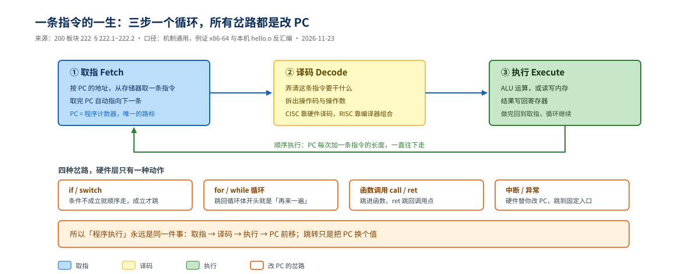
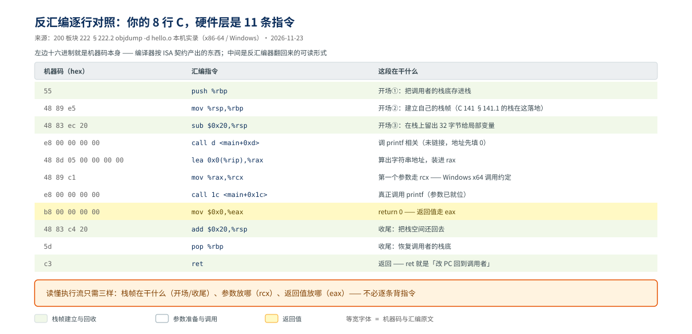

# 222 指令周期与软件延时

> **解决**：一条 C 语句在机器里到底花几步、读反汇编时怎么十行内看懂自己的代码；以及嵌入式最经典的一个误解——`for (i=0;i<1000;i++);` 不是延时，它只是一个"希望编译器别动它"的愿望。
> **范围**：指令周期与 PC · 反汇编逐行读法 · 六种寻址方式的样子（addr_mode.c 实测）· 软件延时为什么算不准（delay_test.c 三档优化实测）· GPIO 翻转速度与中断延迟的账。
> **口径**：指令周期与 PC 的机制通用；反汇编实录为 x86-64（本机 gcc + objdump，Intel 语法），读法同样适用于 Cortex-M 的 `arm-none-eabi-objdump`。MCU 的周期数受 Flash 等待周期与总线影响，只给算法与量级，具体值查芯片手册。
> **更新**：2026-11-23
> **本册导读** ── 必会三点：① 一切跳转都是改 PC（if / 循环 / 调用 / 中断同一套）② objdump 十行内读懂自己的 C，认得 `[rax]` 与 `[rax*4+8]` 的区别 ③ 软件延时在 `-O2` 下会被整段删掉（实测：1000 万次空循环从 0.0041 s 变成 0.0000 s） ｜ 跟做时长：约 1.5 小时 ｜ 前置：C 111 §111.3（有 hello 可反汇编）。
> **标记**：★ = 必会节；○ = 拓展节。

## 目录

| 节 | 内容 |
|---|---|
| 222.1 | 一条指令的一生：取指 → 译码 → 执行 ★ |
| 222.2 | 反汇编逐行：你的 8 行 C 变成了 11 条指令 ★ |
| 222.3 | 软件延时为什么算不准（实验：delay_test.c 三档优化） ★ |
| 222.4 | 坑表 |
| 222.5 | 检查清单（自测 6 题 + 动手任务 2 件） |

---

## 222.1 一条指令的一生：取指 → 译码 → 执行 ★

**定义**：CPU 的本职是一个循环——

1. **取指（fetch）**：按程序计数器（PC）的地址取一条指令；
2. **译码（decode）**：弄清它要干什么（哪个操作、操作数在哪）；
3. **执行（execute）**：ALU 运算，或读写内存；
4. **改 PC**：PC 指向下一条，循环继续。

**PC（程序计数器）**存"下一条指令地址"——这是全册最重要的一句话：**所有岔路在硬件层都是改 PC**。

| C 里的写法 | 硬件层做的事 |
|---|---|
| `if (x) {...}` | 条件成立 → PC 跳到分支目标；不成立 → PC 顺序下一条 |
| `for` / `while` | 循环体末尾改 PC 跳回开头 |
| 函数调用 | 保存返回地址，PC 跳到函数入口 |
| `return` | PC 恢复到返回地址 |
| 中断 | 硬件强制改 PC 到向量表里的入口（见 223） |

**所以"跳转"只有一种**：把 PC 改成别的值。`goto`、`break`、`continue`、函数返回、中断返回，在硬件层没有区别。



**跟做步骤（纸面推理，3 分钟）**：下面这段 C 会改几次 PC？

```c
int sum = 0;
for (int i = 0; i < 3; i++)
    sum += i;
```

**预期结果**：进入循环前 PC 顺序走到 `for`；每轮循环末尾**改 PC 跳回**条件判断（3 次）；条件不成立时顺序往下。总共 **3 次跳回 + 1 次跳出**。**自评标准**：说得出"跳回是改 PC"就算对，不用数到具体指令条数。

**试一试**：把 `for` 改成 `while` 再想一遍——C 层写法变了，硬件层的跳转次数**一模一样**。高级语法是给人和编译器看的，硬件只认改 PC。

## 222.2 反汇编逐行：你的 8 行 C 变成了 11 条指令 ★

### 先认六种寻址方式（读反汇编的最低门槛）

一条指令要干活，得先知道**操作数在哪**。x86 用方括号表示"去内存取"：

| 写法 | 名字 | 含义 | 典型汇编 |
|---|---|---|---|
| `42` | 立即数 | 值就在指令里 | `mov eax,0x2a` |
| `edx` | 寄存器 | 值在寄存器里 | `add eax,edx` |
| `[rip+0x7b57]` | 直接 | 地址写死在指令里 | `mov eax,[rip+0x7b57]` |
| `[rax]` | 间接 | 寄存器里存的是**地址** | `mov eax,[rax]` |
| `[rdx+rax*1]` / `[rax*4+0x0]` | 变址 | 基址 + 下标 × **元素大小** | `lea rdx,[rax*4+0x0]` |
| `[rbp+0x10]` | 偏移 | 基址 + 固定偏移（结构体成员、栈参数） | `mov eax,[rbp+0x10]` |

**`[rax*4+0x0]` 里的 4 就是 `sizeof(int)`** —— 数组下标 `a[i]` 编译成"基址 + i × 元素大小"，因子由编译器按类型填入。这就是 C 133 §133.2 "指针步长"的机器层证据。

**完整示例**（[code/222/addr_mode.c](../code/222/addr_mode.c)）——六个函数各用一种寻址：

```c
int  f_imm(void)        { return 42; }              /* 立即数 */
int  f_reg(int a,int b) { return a + b; }           /* 寄存器 */
int  f_dir(void)        { return g_x; }             /* 全局变量：直接寻址 */
int  f_ind(int *p)      { return *p; }              /* 指针解引用：间接 */
int  f_idx(int i)       { return g_arr[i]; }        /* 数组下标：变址 */
int  f_off(struct S *s) { return s->b; }            /* 结构体成员：偏移 */
```

**跟做步骤**：`cd code/222` → `gcc -O0 -Wall addr_mode.c -o addr_mode.exe` → `objdump -d -Mintel addr_mode.exe`。**预期输出（本机实录，节选）**：

```text
<f_imm>:  mov eax,0x2a               ; 42 直接在指令里
<f_reg>:  add eax,edx                ; 两个寄存器相加
<f_dir>:  mov eax,[rip+0x7b57]       ; 全局变量，地址写死
<f_ind>:  mov eax,[rax]              ; rax 里是地址，去那里取
<f_idx>:  lea rdx,[rax*4+0x0]        ; i × 4（sizeof(int)）
          lea rax,[rip+0x7b1a]       ; 数组基址
          mov eax,[rdx+rax*1]        ; 基址 + 偏移
<f_off>:  mov eax,[rax+0x4]          ; 结构体成员 b 在偏移 4
```

### 再看一份完整的函数

**完整示例**：用 C 111 §111.3 的 `hello.c`——反汇编器把机器码翻回可读形式。

```c
#include <stdio.h>

int main(void)
{
    printf("hello, world\n");
    return 0;
}
```

**跟做步骤**：① 建上面的 `hello.c`；② `gcc -c hello.c -o hello.o`（只编译不链接）；③ `objdump -d hello.o`。

**预期输出（本机实录，节选 main 部分）**：

```text
0000000000000000 <main>:
   0:	55                   	push   %rbp
   1:	48 89 e5             	mov    %rsp,%rbp
   4:	48 83 ec 20          	sub    $0x20,%rsp
   8:	e8 00 00 00 00       	call   d <main+0xd>
   d:	48 8d 05 00 00 00 00 	lea    0x0(%rip),%rax        # 14 <main+0x14>
  14:	48 89 c1             	mov    %rax,%rcx
  17:	e8 00 00 00 00       	call   1c <main+0x1c>
  1c:	b8 00 00 00 00       	mov    $0x0,%eax
  21:	48 83 c4 20          	add    $0x20,%rsp
  25:	5d                   	pop    %rbp
  26:	c3                   	ret
```

**逐行读法**：

| 汇编 | 对应的 C 与含义 |
|---|---|
| `push %rbp` / `mov %rsp,%rbp` / `sub $0x20,%rsp` | main 开场三件套：保存上层栈底、建立自己的栈帧（C 141 §141.1 的"栈"在这落了地） |
| `call ...` | 调用 `__main`（gcc/MinGW 的启动辅助，初始化 C 运行时） |
| `lea 0x0(%rip),%rax` / `mov %rax,%rcx` | 把字符串地址装进 rcx——**Windows x64 约定：第一个参数走 rcx** |
| `call ...` | 调用 printf |
| `mov $0x0,%eax` | `return 0`——返回值走 eax |
| `pop %rbp` / `ret` | 收栈返回——`ret` 从栈顶弹出地址写进 PC，就是"改 PC 回到调用者" |



**三处必看**：

1. **总共 11 条指令** —— 你的 8 行 C 在 ISA 层就这么短。中间那列十六进制（`55`、`48 89 e5`…）**就是机器码本身**，`objdump` 只是替你把字节翻译成助记符。
2. **`call` 后面跟的是 `00 00 00 00`** —— 这是**未链接**的 `.o`，被调用者的真实地址还没填（重定位留给链接器）。看真实地址要反汇编链接后的 `.exe`。
3. **`ret` 是"改 PC"最纯粹的形态** —— 它从栈顶弹出地址写进 PC。没有 `ret`，调用就是一条不归路。

**试一试**：在 `hello.c` 里多加一个 `printf` 再反汇编对比——`call` 多一条、`lea` 多一组。**代码行数与指令条数大致同比例增长**，这是"编译器没在偷偷做重活"的直观证据。

## 222.3 软件延时为什么算不准（实验：delay_test.c 三档优化） ★

**现场对话**：`for (volatile int i = 0; i < 1000; i++);` 到底延时多久？答案是——**取决于编译器版本、优化等级、主频、Flash 等待周期、有没有中断打断**。这五个变量任何一个变了，延时就变。

### 第一个原因：编译器会直接把循环删掉

**完整示例**（[code/222/delay_test.c](../code/222/delay_test.c)）：

```c
/* 普通空循环：编译器有权认定"没有副作用"，整段删掉 */
static void delay_plain(unsigned n) { for (unsigned i = 0; i < n; i++) ; }

/* volatile 空循环：每次都要真的访存，循环保得住，但速度极慢 */
static void delay_volatile(unsigned n) { for (volatile unsigned i = 0; i < n; i++) ; }
```

**跟做步骤**：`cd code/222`，三档各编一版再跑：

```bash
gcc -O0 -Wall delay_test.c -o d_O0.exe && ./d_O0.exe
gcc -O1 -Wall delay_test.c -o d_O1.exe && ./d_O1.exe
gcc -O2 -Wall delay_test.c -o d_O2.exe && ./d_O2.exe
```

**预期输出（本机实录，1000 万次循环）**：

```text
=== -O0 ===
plain    n=10000000 : 0.0041 s
volatile n=10000000 : 0.0033 s
=== -O1 ===
plain    n=10000000 : 0.0000 s
volatile n=10000000 : 0.0043 s
=== -O2 ===
plain    n=10000000 : 0.0000 s
volatile n=10000000 : 0.0039 s
```

**三处必看**：

1. **`-O0` 下 plain 是 0.0041 s，`-O1` 起变成 0.0000 s** —— 不是变快了，是**循环没了**。`objdump -d d_O2.exe | grep delay_plain` 会返回空：整个函数被内联 + 删除，一条指令都不剩。
2. **volatile 版三档都稳定在 0.0033~0.0043 s** —— `volatile` 强制每次读写内存，编译器不敢删。但代价是它把寄存器循环退化成内存循环，**比正常代码慢得多**，所以用它做延时同样不代表真实速度。
3. **同一段源码，0.0041 s 与 0.0000 s 的差别** —— 这就是"软件延时不可移植"的实证。你按 `-O0` 调好的 1000 次循环，换到发布版 `-O2` 就变成 0。

**试一试**：把 `N` 改成 100000000（1 亿）再跑 `-O0` 与 `-O2`，比值会从 1000 倍拉开到更大——**优化等级对空循环的影响不是线性的，是"有"与"无"的区别**。

### 第二个原因：一条 C 语句不等于一个周期

MCU 上最典型的例子是 GPIO 翻转：

```c
GPIOA->ODR ^= (1u << 5);      /* 编译成 ldr / eor / str 三条指令 */
```

三条指令，理想情况各 1 个周期，72 MHz 下算出来 41 ns——但实测往往要慢好几倍，因为：

| 环节 | 多花的时间 |
|---|---|
| **Flash 等待周期** | 代码从 Flash 取指，主频越高要等的周期越多（231 讲这个） |
| **总线仲裁** | 外设寄存器在 AHB/APB 上，频率常是内核的 1/2 或 1/4 |
| **流水线排空** | 跳转、中断都会清空已取好的指令 |
| **中断插入** | 一次中断把上百个周期拿走，这段延时就变长了 |

**想快就绕开 C 语句**：直接写 `BSRR` 寄存器置位/复位用一条 `str`；要精确频率就用定时器的 PWM 硬件输出，不靠 CPU 循环。

### 第三个原因：中断延迟不是 0

**中断响应的账**（决定你的实时性能不能达标）：

```
响应延迟 = 当前指令执行完（最坏是一条多周期指令）
         + 流水线排空
         + 自动入栈（保存现场，见 223）
         + 跳向量表
```

这三段的周期数查芯片手册的 *interrupt latency* 参数（Cortex-M 级的量级是十几个周期）。**推论**：中断频率越高，被延迟吃掉的 CPU 比例越大——所以高频事件的采集要用 DMA 或定时器硬件，而不是"来一次中断处理一次"。

**工程结论三条**：① 需要精确时间 → 用硬件定时器，绝不用空循环；② 必须用空循环（比如极短的稳定延时）→ 加 `volatile`、关中断、锁 Flash 等待周期，并且**在目标板上重新校准**；③ 优化等级固定写进工程配置——`-O0` 调好的延时代码不能直接用到 `-O2` 的发布版。

## 222.4 坑表

| # | 现象 | 原因 | 解法 |
|---|---|---|---|
| 1 | 想逐行读懂全部汇编 | 拿排障需求当学习目标 | 会看执行流与跳转即可（§222.2 十行读懂法） |
| 2 | 反汇编里 `call` 后地址全是 0 | 未链接的目标文件重定位未填 | 反汇编链接后的文件 |
| 3 | 以为 `for` 和 `while` 硬件层不同 | 语法糖不同，跳转结构一样 | 看 §222.1 试一试 |
| 4 | 调试版延时正常，发布版全乱 | `-O2` 把空循环删了（实测 0.0041 → 0.0000 s） | 延时改用硬件定时器 |
| 5 | GPIO 翻转频率只有标称主频的几十分之一 | 三条指令 + Flash 等待 + 总线分频 + 流水线排空 | 用 BSRR 单条写，或定时器 PWM |
| 6 | 中断一多，主循环就"变慢" | 响应延迟 + 现场保存吃掉周期 | 高频采集用 DMA，不靠中断逐次处理 |
| 7 | 同一段延时代码换块板子就不准 | 主频、Flash 等待周期、编译器都变了 | 延时与主频解耦：用定时器算 tick 数 |

## 222.5 检查清单（自测 6 题 + 动手任务 2 件）

**自测**：

| # | 问题 | 自测标准 |
|---|---|---|
| 1 | 指令周期几步 | 取指→译码→执行（→改 PC） |
| 2 | if 在硬件层是什么 | 条件成立改 PC 跳转，否则顺序执行 |
| 3 | `[rax*4+0x0]` 里的 4 是什么 | `sizeof(int)`——数组下标的伸缩因子 |
| 4 | 为什么 `-O2` 下空循环耗时为 0 | 循环没有副作用，被编译器整段删除 |
| 5 | 为什么 `GPIOA->ODR ^= x` 达不到标称频率 | 三条指令 + Flash 等待 + 总线分频 |
| 6 | 中断响应延迟由哪几段组成 | 当前指令完成 + 流水线排空 + 入栈 + 跳向量表 |

**动手任务**：① 完成 §222.2 的两段反汇编跟做，把寻址方式表与逐行读法抄进笔记；② 跑通 `delay_test.c` 三档对比，然后在你的板子上用定时器实现同样的延时，比较两者的误差。

> 下一篇：[223 中断与异常](223-中断与异常.md)——指令跑到一半被外部事件打断，CPU 怎么保证回来还能接着跑。
