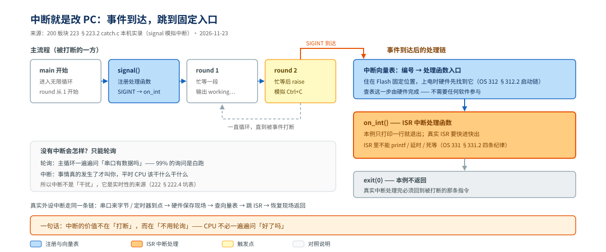

# 223 中断与异常

> **解决**：看懂 CPU 被打断时到底发生了什么——为什么需要中断、硬件怎么记住"回来时该接着跑哪"、以及"中断"与"异常"的来源差别为什么决定了你排障时该看谁。  
> **范围**：轮询的浪费 · 中断的最小机制（向量表 / 保存现场 / ISR / 恢复）· 中断与异常的四类分界（fault.c 与 catch.c 实测）· 与 DMA 的关系。  
> **口径**：机制通用；实测用 POSIX 信号模拟（Windows MinGW 下亦可跑），真实外设中断的递送归 300 操作系统原理 331 与规划 600 MCU 与外设。  
> **更新**：2026-11-23  
> **本册导读** ── 必会三点：① 中断 = 硬件强制改 PC 跳到固定入口，保存现场 / 恢复现场是"回来还能接着跑"的全部秘密 ② 中断来自 CPU 外部，异常由 CPU 自己发现（实测 SIGINT vs SIGFPE / SIGSEGV）③ ISR 必须短、不能阻塞、不能调 `printf`——违反任一条，现场就表现为"随机死机" ｜ 跟做时长：约 1.2 小时 ｜ 前置：222（知道改 PC）。  
> **标记**：★ = 必会节；○ = 拓展节。

## 目录

| 节 | 内容 |
|---|---|
| 223.1 | 为什么需要中断：轮询的浪费（实验：catch.c） ★ |
| 223.2 | 最小机制：向量表 + 保存现场 + ISR + 恢复 ★ |
| 223.3 | 中断与异常：来源不同，走的是同一条路（实验：fault.c） ★ |
| 223.4 | 坑表 |
| 223.5 | 检查清单（自测 6 题 + 动手任务 2 件） |

---

## 223.1 为什么需要中断：轮询的浪费（实验：catch.c） ★

**问题**：CPU 怎么知道"串口来了一个字节"？

**轮询（polling）**：CPU 一遍遍去问外设"好了吗"。代价是——**绝大多数询问的答案是"没好"**。串口 9600 波特率下每毫秒才来一个字节，而 CPU 每秒能问上亿次，99.999% 的工作是白问。

**中断（interrupt）**：让外设主动打断 CPU。CPU 该干嘛干嘛，事件真到了才处理。**把"主动询问"换成"被动通知"**，这是效率上的一次质变。

**定义**：中断 = 外设（或软件）主动打断 CPU 当前工作、转去处理紧急事件的机制。

### 完整示例（[code/223/catch.c](../code/223/catch.c)——用信号模拟中断）

```c
void on_int(int sig)                 /* 中断处理函数：被打断后跳到这里 */
{
    (void)sig;
    printf("\ncaught SIGINT - handler took over, exiting\n");
    exit(0);
}

int main(void)
{
    signal(SIGINT, on_int);          /* 注册：SIGINT 到来时跳 on_int */
    for (int round = 1; ; round++) {
        printf("working... round %d\n", round);
        fflush(stdout);
        for (volatile long i = 0; i < 20000000; i++) { }   /* 忙等一段 */
        if (round == 2) raise(SIGINT);                     /* 模拟 Ctrl+C */
    }
}
```

**跟做步骤**：`cd code/223` → `gcc -Wall catch.c -o catch.exe` → `.\catch.exe`。**预期输出（本机实录）**：

```text
working... round 1
working... round 2

caught SIGINT - handler took over, exiting
```

**三处必看**：

1. **`round 2` 之后控制流离开了 `for` 死循环** —— 主循环本来是 `for (;;)`，永远出不来。是 `raise(SIGINT)` 把它"劫持"出去的。
2. **`fflush(stdout)` 不是装饰** —— 不加这行，输出走管道时是**全缓冲**，程序退出时缓冲区可能来不及冲，`working... round 1` 会丢。这是 C 112 §112.4 讲过的"缓冲丢失"在中断场景的复现。
3. **这正是 C 122 §122.2 里 Ctrl+C 打断死循环的正式版** —— 事件到达 → OS 改 PC → 跳进处理函数。**你在终端按 Ctrl+C 就是真实的中断递送**。

**试一试**：把 `raise(SIGINT)` 删掉，程序变成真正的无限循环——然后在终端按 **Ctrl+C** 手动触发。效果与实验一致，只是事件来源从"程序自己发"变成"键盘发"。

## 223.2 最小机制：向量表 + 保存现场 + ISR + 恢复 ★

**四个零件**，缺一个都跑不起来：

| 零件 | 作用 | 少了会怎样 |
|---|---|---|
| **中断源编号** | 每个中断有自己的号，硬件才知道"是谁来了" | 无法区分事件类型 |
| **中断向量表** | 一张"编号 → 处理函数入口"的表，固定在内存某处 | CPU 不知道跳哪 |
| **保存现场** | 把被打断时的寄存器、PC 压进栈 | 回来时不知道执行到哪、寄存器值全乱 |
| **ISR + 恢复现场** | 处理完弹回现场，PC 回到被打断处 | 一去不回 |

**完整流程**（五步，背下来）：

```text
事件发生
  → 硬件把当前 PC 与关键寄存器压栈（保存现场）
  → 按中断号查向量表，取到 ISR 入口地址
  → PC 跳到 ISR 执行（这就是 222 说的"改 PC"）
  → ISR 执行完，弹栈恢复现场
  → PC 回到被打断的那条指令，继续跑
```

**一句话**：**中断 = 一次"硬件替你完成的函数调用"，只是返回地址不是你写的，而是硬件压的。**



**为什么"保存现场"是全部秘密**：被打断时，CPU 可能在算一个表达式、寄存器里存着中间结果、标志位刚被设置。如果这些不保存，回来时程序状态就乱了——**看起来只是"慢了"，实际是数据被悄悄改坏**。这类 bug 极难查，因为它不崩、不报错。

**跟做（观察）**：`catch.c` 里 `on_int` 只调用了 `printf` 和 `exit`，没有保存任何东西——这是因为**操作系统已经替你保存了现场**（信号处理返回时会恢复）。在裸机 MCU 上，这件事要由硬件 + 编译器生成的 prologue 一起完成，写 ISR 时**绝不能碰未保护的共享变量**。

**试一试**：在 `on_int` 里加一句 `for (volatile int i = 0; i < 100000000; i++) { }`（故意让处理函数变慢），观察主循环是不是"卡住"了——**ISR 执行期间，被中断的代码停摆**。这就是"ISR 要尽量短"的原因。

## 223.3 中断与异常：来源不同，走的是同一条路（实验：fault.c） ★

**两者的区别只有一条**：**事件是谁发现的**。

| | 中断（interrupt） | 异常（exception） |
|---|---|---|
| 谁发现 | CPU **外部**（外设、定时器、键盘） | CPU **自己**执行指令时发现 |
| 时机 | 异步，随时可能来 | 同步，**由某条指令触发** |
| 例子 | 串口来字节、定时器到点、Ctrl+C | 整数除零、非法地址、断点指令 |
| 处理完 | 回到被打断处继续 | 可能重试、可能终止进程 |

**共同点**：两者的递送机制**完全一样**——都是"保存现场 → 查表 → 跳 ISR → 恢复"。所以操作系统常把它们放在同一张表里（x86 叫 IDT，ARM 叫向量表）。

### 完整示例（[code/223/fault.c](../code/223/fault.c)——同一套处理函数，接三种事件）

```c
static const char *sig_name(int sig)
{
    switch (sig) {
    case SIGFPE:  return "SIGFPE  —— 算术故障（CPU 执行指令时自己发现）";
    case SIGSEGV: return "SIGSEGV —— 非法访存（CPU 的地址检查拒绝）";
    case SIGINT:  return "SIGINT  —— 外部打断（键盘 Ctrl+C，来自 CPU 之外）";
    default:      return "未知信号";
    }
}

int main(int argc, char **argv)
{
    signal(SIGFPE,  on_sig);
    signal(SIGSEGV, on_sig);
    signal(SIGINT,  on_sig);
    /* fpe: 10 / zero ；segv: 向 NULL 写 1 */
}
```

**跟做步骤**：`cd code/223` → `gcc -O0 -Wall fault.c -o fault.exe` → 分别运行 `.\fault.exe fpe` 与 `.\fault.exe segv`。

> **必须 `-O0`**：`-O2` 下编译器可能把 `10/0` 提前算掉或直接判定为 UB 而删掉。

**预期输出（本机实录）**：

```text
about to divide by zero...

[handler] 捕获信号 8: SIGFPE  —— 算术故障（CPU 执行指令时自己发现）
[handler] 控制流已离开 main，正在处理函数里
```

```text
about to write through NULL...

[handler] 捕获信号 11: SIGSEGV —— 非法访存（CPU 的地址检查拒绝）
[handler] 控制流已离开 main，正在处理函数里
```

**四处必看**：

1. **信号 8 与 11 是固定的编号** —— `SIGFPE = 8`、`SIGSEGV = 11`。这就是 §223.2 说的"中断源编号"，只不过这里是 OS 层的编号，硬件层还有另一套（x86 的除零异常是 0 号）。
2. **两个程序都没有"出错提示"就直接跳进了处理函数** —— 因为异常不是"返回值"，是**控制流的强制转移**。检测不到返回值、`errno` 也不会被设置（除非库函数自己设）。
3. **`about to ...` 那行必须先 `fflush(stdout)`** —— 崩溃时缓冲区里的内容会丢，你只会看到空白然后突然进 handler，误以为是别的问题。
4. **异常是"同步"的** —— 除零一定发生在执行 `10 / zero` 这条指令时；中断是"异步"的，Ctrl+C 可能在你程序的任何一句之间到达。**同步意味着可复现，异步意味着难复现**——这也是为什么"崩溃类 bug"比"偶发卡顿"好查。

**四类异常（x86 术语，知道名字就够）**：

| 类型 | 特征 | 例子 |
|---|---|---|
| **故障** fault | 处理后**可以重试**该指令 | 缺页（换入内存后重试）、除零（不可恢复时转 SIGFPE） |
| **陷阱** trap | 执行**完**当前指令后报告 | 断点指令 `int3`、系统调用 |
| **中止** abort | 不可恢复，进程终止 | 硬件校验错、双重故障 |
| **中断** interrupt | 外部异步事件 | 定时器、串口 |

**试一试**：把 `fault.exe fpe` 里的 `10 / zero` 改成 `10 / 1`，程序正常结束、什么信号都没有——**没有那条指令，就没有那个异常**。这条对比能让你彻底区分"异步中断"和"同步异常"。

## 223.4 坑表

| # | 现象 | 原因 | 解法 |
|---|---|---|---|
| 1 | ISR 里打印日志，主程序行为变怪 | ISR 抢占了共享资源（stdout 锁、全局变量） | ISR 只置标志位，处理放到主循环 |
| 2 | 中断里的变量改了主循环看不见 | 编译器把变量优化进寄存器，未加 `volatile` | 跨 ISR 共享的量加 `volatile` |
| 3 | 崩溃时看不到崩溃前的日志 | stdout 全缓冲，进程终止时未冲 | 关键日志后 `fflush`，或用无缓冲 stderr |
| 4 | 中断当"坏事"想关掉 | 没理解实时性的来源 | 轮询才低效（§223.1 的对照面） |
| 5 | 以为 `signal()` 返回值能判断出错 | 异常是控制流转移，不是返回值 | 用 handler 记录状态，别指望返回值 |
| 6 | 裸机上 ISR 里调 `printf` 就死机 | 库函数不可重入、栈不够 | ISR 里只做最小动作 |

## 223.5 检查清单（自测 6 题 + 动手任务 2 件）

**自测**：

| # | 问题 | 自测标准 |
|---|---|---|
| 1 | 中断相对轮询的本质优势 | 事件驱动，不做无效询问 |
| 2 | 中断机制的四个零件 | 编号、向量表、保存现场、ISR+恢复 |
| 3 | "保存现场"保存什么、为什么必须 | 寄存器与 PC；否则回来状态错乱且不报错 |
| 4 | 中断与异常的唯一区别 | 事件由 CPU 外部还是 CPU 自己发现 |
| 5 | SIGFPE / SIGSEGV 各是几号、属于哪类 | 8 / 11，都是异常（fault） |
| 6 | 为什么 ISR 要尽量短 | 执行期间被打断的代码停摆 |

**动手任务**：① 跑通 `catch.c`，再删掉 `raise` 用 Ctrl+C 触发一次，对比两种事件来源；② 跑通 `fault.c` 的 fpe 与 segv 两种模式，把两个信号编号和 handler 输出抄进笔记，并说明"为什么这属于异常而不是中断"。

> 下一篇：[231 MCU 存储速度阶梯](../230-存储/231-MCU存储速度阶梯.md)——CPU 与中断讲完，接下来看数据住在哪：为什么 Flash 里跑代码比 RAM 里慢、为什么要关心等待周期。
