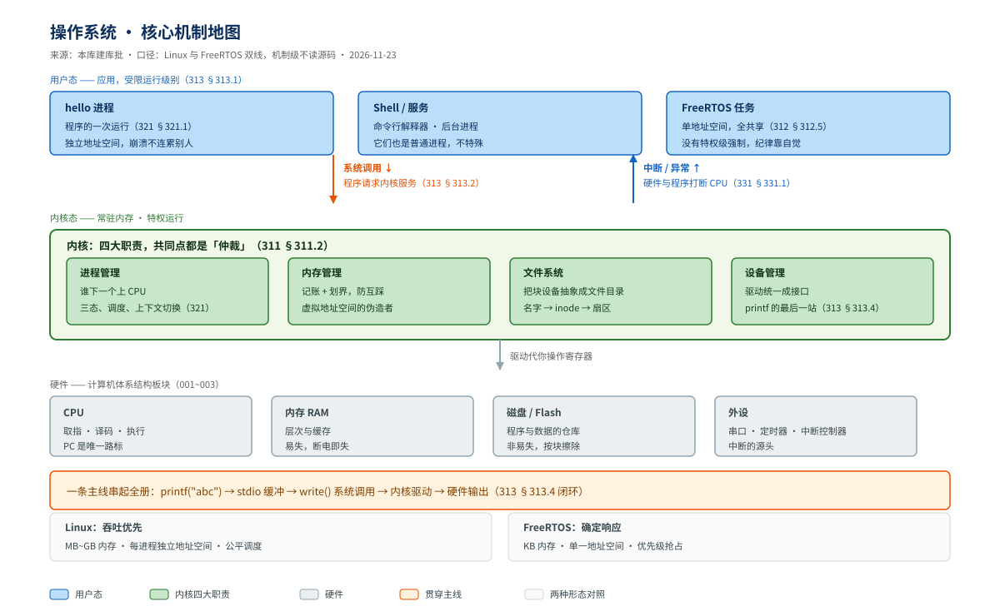

# 302 操作系统原理全貌

> **一句话**：操作系统是硬件与应用之间的总管家——把 CPU 时间、内存、外设、文件抽象成可仲裁的服务；裸机、RTOS、Linux 只是"管理权交给谁"的不同答案。

中间那层是内核（进程 / 内存 / 文件 / 设备四格），上面用户态、下面硬件；两者之间只有两条通道——**系统调用**向下要服务，**中断**向上打断 CPU。记住这张图，八册各打通一段。

- **310 内核与接口**：内核是什么、门在哪（定义）
- **320 执行单元**：管的是谁、为什么打架（对象）
- **330 中断与调度**：运行权怎么被抢、抢到后怎么分（机制）

---

> 下一篇：[311 操作系统的四大职责](310-内核与接口/311-操作系统的四大职责.md)——先认识总管家在管哪四件事。  
> 完整册表、概念速览、板块分界与三种读法：[板块 README](README.md)。
