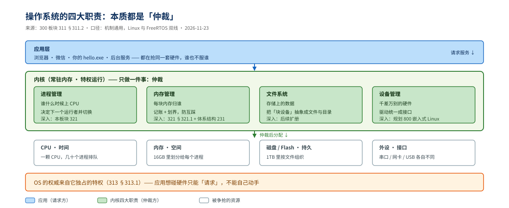

# 311 操作系统的四大职责

> **解决**：立住世界观——OS 到底管什么。把"操作系统"从一句口号拆成四条可指认的职责，并说明它们为什么必须由同一个角色来仲裁。  
> **范围**：OS 的定义（复用与隔离）· 四大职责逐条 · 仲裁的共同本质 · 内核/发行版/外壳三词分界 · 裸机怎么回答同样四个问题。  
> **口径**：机制通用；例证 Linux + FreeRTOS 双线；本机观察环境 = Windows 11（10.0.26100）。启动过程、系统调用、调度算法不在本册，分别归 312 / 313 / 332。  
> **更新**：2026-11-23  
> **本册导读** ── 必会三点：① OS 的两个根本目标是**复用**与**隔离** ② 四大职责的共同答案是**仲裁** ③ 内核 ≠ 发行版 ≠ 外壳 ｜ 跟做时长：约 1.5 小时 ｜ 前置：「C 语言」141（内存四区与生命周期）、「计算机体系结构」221（上电与内存布局）。  
> **标记**：★ = 必会节；○ = 拓展节。

## 目录

| 节 | 内容 |
|---|---|
| 311.1 | 操作系统是什么：复用与隔离 ★ |
| 311.2 | 四大职责：CPU 时间、内存、文件、设备 ★ |
| 311.3 | 仲裁：四条职责的共同答案 ★ |
| 311.4 | 内核、发行版与外壳：三个常混的概念 ○ |
| 311.5 | 没有 OS 的 MCU 怎么回答同样四个问题 ○ |
| 311.6 | 坑表 |
| 311.7 | 检查清单（自测 6 题 + 动手任务 2 件） |

---

## 311.1 操作系统是什么：复用与隔离 ★

**定义**：操作系统是跑在硬件上的**第一个大软件**，干两件根本的事——**复用**与**隔离**。

- **复用**：硬件只有一套，程序有很多个。CPU 轮着跑、内存分着用、磁盘分区放、设备排队使唤——让多个程序分享同一套硬件。
- **隔离**：一个程序的错误不能连累别人。你的程序越界写内存，不能把隔壁进程的数据改掉；你的程序死循环，不能让整个系统失去响应。

**"抽象"是达成这两个目标的手段**：千差万别的硬件被包装成统一接口，应用只管调接口，不必知道底下是 SSD 还是 SD 卡、是 Intel 还是 ARM。接口统一了，程序才能在"复用同一套硬件"的同时"互不干扰"。

**内核**是 OS 的核心本体：调度、内存、文件、驱动全在里面，常驻内存、特权运行；窗口、命令行、设置面板都只是外壳。桌面 Ubuntu 与服务器 Ubuntu 是不同**发行版**（内核 + 工具 + 应用的打包），内核是同一个 Linux——三者的分界见 311.4。

**一句话判据**：判断一个东西是不是"OS 本体"，问它是不是在**替所有程序做决定**。替你决定"下一个谁跑"的是内核；替你决定"窗口画在哪"的是外壳。

## 311.2 四大职责：CPU 时间、内存、文件、设备 ★

**定义**：内核做的事可以归成四类，缺一类系统就不可用。这四类就是"复用与隔离"落到具体资源上的四个答案。

| 职责 | 管什么 | 一句话机制 | 本库深入去哪 |
|---|---|---|---|
| 进程管理 | 谁什么时候上 CPU | 决定下一个运行者，并切换现场 | 本板块 321、331 |
| 内存管理 | 每块内存归谁 | 记账 + 划界，防互踩 | 本板块 321 §321.3 |
| 文件系统 | 存储上的数据 | 把"块设备"抽象成文件与目录 | 规划「600 MCU 与外设」「800 嵌入式 Linux」 |
| 设备管理 | 千差万别的硬件 | 用驱动统一成可调用接口 | 规划「600 MCU 与外设」 |

**四条职责不是并列的四个模块，而是一条链**：设备管理把数据从硬件搬进内存 → 文件系统决定这些数据叫什么名字、放哪个位置 → 内存管理决定这块内存归哪个进程 → 进程管理决定哪个进程有机会用 CPU 处理它。任何一条断了，链就断在那一环。

**读法**：遇到"系统级"故障，先问"这属于四条的哪一条"，再往下查。这是系统排障的第一层定位表，判断方法见 311.3。

## 311.3 仲裁：四条职责的共同答案 ★

**定义**：**仲裁** = 资源只有一份、请求者众多，必须有个角色立规矩并强制执行。四条职责全是仲裁，只是争的东西不同。

| 争什么 | 仲裁形态 | 典型规则 |
|---|---|---|
| CPU 时间 | 分时：切成时间片轮流给 | 优先级、时间片长度（332 展开） |
| 内存空间 | 分片：划成互不重叠的区域 | 每进程独立地址空间（321 §321.3） |
| 存储位置 | 命名：谁的文件放在哪 | 目录树、权限位 |
| 设备使用权 | 排队：一次只给一个用 | 独占 / 共享、缓冲队列 |

**为什么应用自己仲裁不行**：三个程序都想用打印机，谁让？如果由程序自己协商，任意一个不守规矩的程序就能独占全部资源——所以仲裁权必须交给一个**所有程序都绕不过去的角色**。这个角色就是内核，它的权威来自 CPU 特权级（313 §313.1）：应用没有权限执行"分配内存""直接写磁盘"这类指令，只能请求内核代办。

**观察与判断（这张表往后每次排障都用得上）**：

| 现象 | 先归到哪条职责 | 下一步 |
|---|---|---|
| 系统卡顿、某个程序不响应 | 进程管理 | 看谁占着 CPU（321 §321.5） |
| 内存不足、程序被系统杀掉 | 内存管理 | 看谁在涨、有没有泄漏（「C 语言」142） |
| 文件丢了、权限被拒 | 文件系统 | 看路径与权限，不是"OS 坏了" |
| 设备认不出、串口没数据 | 设备管理 | 看驱动与连线，不是"程序写错了" |

**常见误判**：把"程序 bug"归成"OS bug"。判据是——**换一个程序还发生吗？** 换个程序正常，问题在被换掉的那个程序；换个程序照样出，才往四条职责上找。

## 311.4 内核、发行版与外壳：三个常混的概念 ○

**三个词的分界**：

| 词 | 是什么 | 例子 | 判据 |
|---|---|---|---|
| 内核（Kernel） | 管四条职责的那部分代码，常驻内存、特权运行 | Linux kernel、FreeRTOS 内核 | 换发行版，内核可以不变 |
| 发行版（Distribution） | 内核 + 工具 + 应用 + 包管理，打包成能装能用的系统 | Ubuntu、Debian、Yocto 产出的镜像 | 换发行版，接口不变但内核版本可能不同 |
| 外壳（Shell / GUI） | 给人用的交互层：命令行、桌面、设置面板 | bash、Windows 资源管理器 | 外壳崩了，系统还在跑 |

**为什么这个区分有用**：嵌入式里三个词经常被混着说，导致选型时说错对象。要"小"是说内核裁剪，要"能装软件"是说发行版工具链，要"界面好看"是外壳的事——三件事的成本差一个数量级。

**内核形态先立两个名词**（细节归 312 §312.4）：

- **宏内核**：调度、文件、驱动全塞进一个大内核，互相之间是函数调用，快；一处崩可能全崩。Linux 是代表。
- **微内核**：内核只留最小机制（调度、消息传递），文件系统、驱动这些服务放到用户态进程里，隔离好，但每次服务都要发消息，有开销。QNX 是代表。

判断句：**宏内核拿性能换简单，微内核拿性能换隔离**——两者都在"四条职责由谁执行"这个维度上做取舍。

## 311.5 没有 OS 的 MCU 怎么回答同样四个问题 ○

**命题**：一块没有 OS 的 MCU，四问一个都躲不掉——只是答案从"内核决定"变成"你写死"。

| 四问 | 有 OS | 裸机 |
|---|---|---|
| 谁什么时候用 CPU | 调度器决定 | 主循环顺序执行 + 中断插队，优先级靠你排 |
| 内存放哪 | 内核记账、按需分配 | 链接脚本定布局，全局/静态/栈，`malloc` 通常禁用 |
| 数据怎么存 | 文件系统给名字 | 自己划 Flash 扇区，自己定格式 |
| 设备怎么用 | 驱动注册、统一接口 | 直接读写寄存器，时序自己保证 |

**结论**：裸机开发不是"不需要理解 OS"，而是**你自己就是那个 OS**——只不过规则写死在代码里，不能动态调整。这套"没有进程的 OS 思维"在 331 §331.5 会与真正的中断机制对照一次。

**为什么放在本册最后**：先把"OS 在管什么"认清楚，再看裸机，才不会把"没有 OS"误解成"没有这些问题"。反过来，学过裸机的人读本板块，最容易的入口也是这张表。

## 311.6 坑表

| # | 现象 | 原因 | 解法 |
|---|---|---|---|
| 1 | 把桌面、窗口当成操作系统 | 只看到外壳 | 内核的四条职责才是本体（311.4） |
| 2 | 说"OS 就是管理硬件的软件"，说不出管什么 | 停在口号层 | 背下四条职责并各举一例（311.2） |
| 3 | 混淆内核与发行版 | 装系统时装的是发行版 | 内核管资源，发行版是打包（311.4） |
| 4 | 以为应用能直接读写硬件寄存器 | 忽略特权级 | 一切经系统调用（313 §313.1） |
| 5 | 把程序 bug 报成系统 bug | 没有定位方法 | 换一个程序还发生吗（311.3） |
| 6 | 拿 Linux 的直觉评估 MCU 实时性 | 吞吐思维 ≠ 确定响应 | 看 312 §312.5 的两列对照 |

## 311.7 检查清单（自测 6 题 + 动手任务 2 件）

**自测**：

| # | 问题 | 自测标准 |
|---|---|---|
| 1 | OS 的两个根本目标 | 复用与隔离 |
| 2 | 四条职责各管什么 | 进程/内存/文件/设备，各举一例 |
| 3 | 四条职责的共同点 | 都是仲裁：一份资源、多方争用 |
| 4 | 内核、发行版、外壳怎么分 | 资源决定 / 打包 / 交互层 |
| 5 | 宏内核与微内核的取舍 | 性能换简单 vs 性能换隔离 |
| 6 | 裸机怎么回答"内存放哪" | 链接脚本定布局，静态分配为主 |

**动手任务**：① 打开本机任务管理器，把"性能"页的 CPU、内存、磁盘、网络四项逐一对应到 311.2 的四条职责（哪一项对不上？想清楚为什么）；② 找一块手边的开发板或手机，查它跑的是什么内核、什么发行版，把两个答案分开写下来。

> 下一篇：《312 启动链：从上电到 shell》——这四件事是谁在开机时按顺序立起来的。
