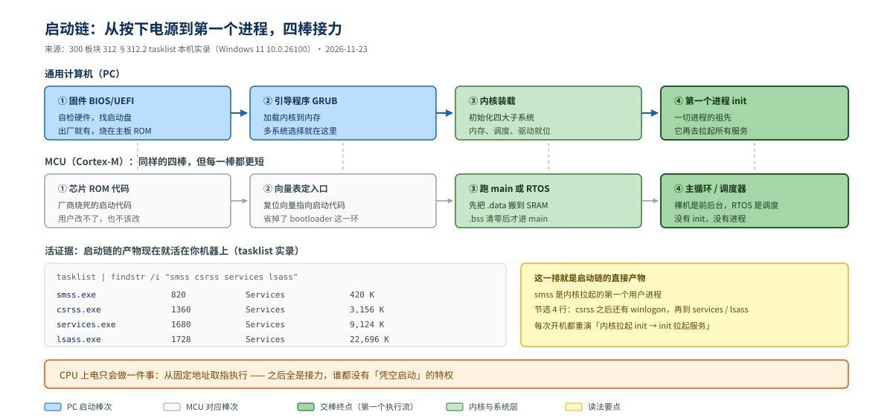

# 312 启动链：从上电到 shell

> **解决**：回答"按下电源之后，谁第一个跑、它怎么把控制权一棒一棒交到你的程序手里"。启动链不是抽象概念——它的产物此刻就在你的任务列表里跑着，可以当场看见。  
> **范围**：上电取指的硬约束 · 四棒接力（固件/引导/内核/init）· PC 与 MCU 两套对照 · 本机实验（tasklist 活证据）· 内核形态与 RTOS 定位。  
> **口径**：机制通用；例证 Linux + FreeRTOS 双线；本机 = Windows 11（10.0.26100），观察类实验均可照做。中断与系统调用归 331 / 313，本册只到"第一个进程跑起来"为止。  
> **更新**：2026-11-23  
> **本册导读** ── 必会三点：① 上电后 CPU 只会从固定地址取指，其余全靠接力 ② 四棒：固件 → 引导程序 → 内核 → 第一个进程 ③ tasklist 里那一排系统进程就是启动链的活证据 ｜ 跟做时长：约 1.5 小时 ｜ 前置：311（四条职责）、「计算机体系结构」221（上电与内存布局）。  
> **标记**：★ = 必会节；○ = 拓展节。

## 目录

| 节 | 内容 |
|---|---|
| 312.1 | 上电那一刻：CPU 只会做一件事 ★ |
| 312.2 | 四棒接力：固件 → 引导 → 内核 → init ★ |
| 312.3 | 实验：在任务列表里看启动链的活证据 ★ |
| 312.4 | 内核形态：宏内核、微内核与 RTOS ○ |
| 312.5 | RTOS 与 Linux：不是大小差异，是目标差异 ○ |
| 312.6 | 坑表 |
| 312.7 | 检查清单（自测 6 题 + 动手任务 2 件） |

---

## 312.1 上电那一刻：CPU 只会做一件事 ★

**定义**：CPU 断电后所有寄存器归零，没有任何"记忆"。上电瞬间它唯一会做的动作是——**从一个固定地址取指令执行**。这个地址由芯片设计写死（ARM 常见是复位向量，x86 是复位向量指向固件入口），不是软件决定的。

**为什么必须是固定地址**：如果连"第一条指令在哪"都要靠软件告诉它，那第一条指令自己就没地方来。启动必须有一个不依赖任何软件的硬锚点——这是整个启动链的起点，也是理解"为什么需要固件"的关键。

**由此推出两件事**：

1. **第一个跑的东西一定是"出厂就烧在板子上的"**——因为它必须在任何操作系统、任何程序之前就在那儿。这就是固件（BIOS/UEFI、芯片 ROM 里的启动代码）。
2. **控制权是一棒一棒交的**：每一棒只干"把下一棒搬到内存并跳过去"，谁都不负责整条链。链条断在哪一棒，现象就停在哪一步——这是排查开机故障的唯一正确思路（312.6 坑表第 6 条）。

## 312.2 四棒接力：固件 → 引导 → 内核 → init ★

**完整链条（PC 与 MCU 对照）**：

| 阶段 | PC（通用计算机） | MCU（Cortex-M） |
|---|---|---|
| ① 固件 | BIOS/UEFI：自检、初始化内存与总线、找启动盘 | 芯片 ROM 里的厂商启动代码：初始化时钟与最小外设 |
| ② 引导程序 | GRUB / Windows Boot Manager：从磁盘读内核映像 | 向量表就定在 Flash 起始，硬件直接跳到复位处理函数 |
| ③ 内核装载 | 内核解压、初始化内存管理/调度/驱动，挂载根文件系统 | 直接跑 `main()`，或先跑 RTOS 的初始化 |
| ④ 第一个进程 | `init`（systemd / SysV init）——一切用户进程的祖先 | 裸机：主循环；RTOS：调度器启动，最高优先级任务先跑 |



**每一棒失败的典型现象**（这张表是排障入口，不是知识背诵）：

| 断在哪 | 现象 | 说明 |
|---|---|---|
| ① 固件 | 屏幕无任何输出、风扇转但黑屏 | 连自检都没过，与磁盘无关 |
| ② 引导 | 出现厂商 logo 后停住，或提示 "no bootable device" | 固件活了，找不到/读不出引导程序 |
| ③ 内核 | 打印一堆启动日志后卡住，或 panic | 引导程序活了，内核起不来（常见：根文件系统挂不上） |
| ④ init | 内核日志走完，但没有登录界面/没有 shell | 内核活了，第一个用户进程没起来 |

**关键区别**：PC 的四棒是**四个不同来源**的程序（主板厂商、引导器、内核、发行版）；MCU 常常只有两棒（ROM → 你的固件），因为"引导"这一步被硬件用向量表直接跳过了。**棒数不同，但"固定地址 → 交接控制权"的机制完全相同**。

## 312.3 实验：在任务列表里看启动链的活证据 ★

**命题**：启动链的产物不是历史，是**现在仍在运行的进程**。

**完整示例（跟做）**：在终端执行（PowerShell，本机实录）：

```powershell
tasklist | findstr /i "smss csrss services lsass"
```

**预期输出（本机实录）**：

```text
smss.exe                       820 Services                   0        420 K
csrss.exe                     1360 Services                   0        3,156 K
csrss.exe                     1580 Console                    1        4,500 K
winlogon.exe                  1668 Console                    1        3,552 K
services.exe                  1680 Services                   0        9,124 K
lsass.exe                     1728 Services                   0       22,696 K
```

**读法（逐行对应启动链）**：

| 进程 | 它是什么 | 对应哪一棒 |
|---|---|---|
| `smss.exe` | 会话管理器，内核拉起的第一个用户态进程 | 第④棒——Windows 的 init |
| `csrss.exe` | 客户端/服务运行时（两行是不同会话） | `smss` 的子进程 |
| `winlogon.exe` | 登录与桌面会话管理 | 用户登录这一步 |
| `services.exe` | 服务控制管理器 | 系统服务的父进程 |
| `lsass.exe` | 本地安全认证 | 登录后常驻 |

**这一排就是"内核拉起 init、init 再拉起服务"的直接产物**——每次开机都重演一遍。注意 `smss.exe` 的会话列是 `Services`（会话 0）、PID 820 极小：会话 0 是系统会话，PID 小说明它起得极早。

**试一试**：`tasklist | find /c ".exe"` 数当前进程总数（本机数十个）。这几十个进程全是那一条启动链的子孙——**没有一条是"凭空出现"的**。再试 `tasklist /svc | findstr /i "smss"`，看 `smss` 对应的服务名列。

**Linux 侧对照（不跟做，读法相同）**：`ps -ef | head`，PID 1 就是 init（多数发行版是 systemd），它的父进程 PID 是 0——那个 0 就是内核。**看 PID 与父 PID（PPID），就能把启动链倒着画出来**。

## 312.4 内核形态：宏内核、微内核与 RTOS ○

**三种组织方式，同一个目的**：把 311 §311.2 的四条职责安排给谁执行。

| 形态 | 谁执行四条职责 | 优点 | 代价 | 代表 |
|---|---|---|---|---|
| 宏内核 | 全部在内核态，模块间是函数调用 | 调用快、结构简单、生态全 | 一处崩全崩；内核代码量大 | Linux、Windows NT（混合） |
| 微内核 | 内核只留调度与消息传递，文件/驱动在用户态进程 | 隔离好，单个服务崩可重启 | 每次服务都要消息往返 | QNX、L4 系列 |
| RTOS 内核 | 只保留调度与同步机制，其余靠库与用户代码 | 极小（KB 级）、响应确定 | 功能少，网络/文件常靠外挂 | FreeRTOS、RT-Thread Nano |

**一句话判断**：宏内核与微内核的争论是"**职责放内核态还是用户态**"；RTOS 与它们的分歧不在这条轴上，而在"**要不要保证响应时间**"（312.5）。

**为什么嵌入式更常见 RTOS**：KB 级的 RAM 装不下一个完整 Linux，而电机控制要的是"最坏情况下 50 微秒内必须响应"，不是"平均很快"。取舍不是先进与否，是目标不同。

## 312.5 RTOS 与 Linux：不是大小差异，是目标差异 ○

| | Linux | FreeRTOS 类 RTOS |
|---|---|---|
| 目标 | 吞吐与功能全 | 响应时间**确定** |
| 内存 | MB ~ GB | KB 级 |
| 地址空间 | 每进程独立（靠 MMU） | 单一地址空间，全共享 |
| 隔离 | 硬件强制（特权级 + MMU） | 多数靠自觉，无硬件强制 |
| 调度 | 吞吐优先、公平（CFS） | 优先级抢占、可预期 |
| 适合 | 协议栈、GUI、文件系统、边缘计算 | 电机控制、传感采集、硬实时 |

**判断句**：要"功能多"选 Linux，要"永远按时"选 RTOS。两者常在同一设备并存——A 核跑 Linux 做交互与网络、M 核跑 RTOS 做实时控制，中间用共享内存或串口通信。

**易错点**：Linux 打上实时补丁（PREEMPT_RT）能显著改善延迟，但**它改善的是"最坏延迟的分布"，不是"确定性保证"**——真正的硬实时仍要看 RTOS 或专用协处理器。这条区分在选型会上最容易被含糊过去。

## 312.6 坑表

| # | 现象 | 原因 | 解法 |
|---|---|---|---|
| 1 | 混淆 bootloader 与固件 | 都叫"启动相关" | 固件是出厂件（BIOS/UEFI），bootloader 是引导器（GRUB/U-Boot），312.2 |
| 2 | 开机黑屏就去重装系统 | 没定位断在哪一棒 | 按 312.2 的表从①往下排 |
| 3 | 以为 init 是内核的一部分 | 名字像 | init 是**第一个用户态进程**，PID 1，312.3 |
| 4 | 拿 Linux 直觉评估 MCU 实时性 | 吞吐思维 ≠ 确定响应 | 看 312.5 两列 |
| 5 | 认为 RTOS 就是"精简版 Linux" | 只比大小 | 单地址空间 + 优先级抢占，机制不同（312.4） |
| 6 | 嵌入式板子起不来就怀疑应用代码 | 应用还没机会跑 | 先确认四棒各到哪一步（串口日志是最便宜的探针） |

## 312.7 检查清单（自测 6 题 + 动手任务 2 件）

**自测**：

| # | 问题 | 自测标准 |
|---|---|---|
| 1 | 上电后 CPU 的第一条指令从哪来 | 固定地址取指，芯片设计写死 |
| 2 | 启动链四棒（PC 版） | 固件 → 引导 → 内核 → init |
| 3 | MCU 为什么常常只有两棒 | 向量表定在 Flash 起始，硬件直接跳复位处理 |
| 4 | smss 是什么、对应哪一棒 | 内核拉起的第一个用户进程，第④棒 |
| 5 | 宏内核与微内核的争论轴 | 职责放内核态还是用户态 |
| 6 | RTOS 与 Linux 的分野 | 确定响应 vs 吞吐功能 |

**动手任务**：① 跑 312.3 的 tasklist 实验，把 `smss.exe` 那一行抄下来，标出它的 PID 与会话；② 用 `wmic process where "name='smss.exe'" get ProcessId,ParentProcessId` 查出它的父进程 PID，对照"父进程 = 内核"的结论写一句你的观察。

> 下一篇：《313 系统调用与用户态内核态》——第一个进程跑起来之后，它想动硬件，为什么必须先敲一扇门。
