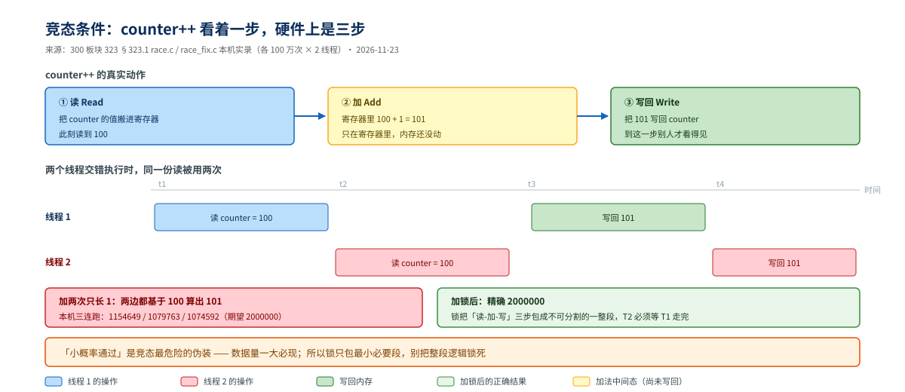

# 323 竞态与同步原语

> **解决**：回答"多个执行流同时改一个数据，为什么会算错"，并当场复现（三次实验全丢数）与当场修复（加锁精确到 2000000）。这是本板块唯一能让你亲眼看到 bug 的一册。  
> **范围**：竞态的定义与根因 · race.c 复现实验 · 互斥锁修复实验 · 同步原语家族（锁/信号量/条件变量/原子操作/自旋锁/读写锁）· 死锁四条件与加锁纪律。  
> **口径**：概念通用；实验在本机 Windows（MinGW-w64 pthread）实录，Linux 下命令相同。  
> **更新**：2026-11-23  
> **本册导读** ── 必会三点：① 竞态根因是"读-改-写"三步被打断 ② 互斥锁把临界区关成一个原子段 ③ 选原语看"谁等谁、等多久"，不看好不好听 ｜ 跟做时长：约 2.5 小时 ｜ 前置：322（线程共享地址空间）。  
> **标记**：★ = 必会节；○ = 拓展节。

## 目录

| 节 | 内容 |
|---|---|
| 323.1 | 竞态条件：counter++ 其实有三步 ★ |
| 323.2 | 实验：连跑三次，每次都少 ★ |
| 323.3 | 互斥锁：把临界区关起来 ★ |
| 323.4 | 同步原语家族：六种工具的选择表 ★ |
| 323.5 | 死锁：四个条件与一条纪律 ○ |
| 323.6 | 坑表 |
| 323.7 | 检查清单（自测 6 题 + 动手任务 2 件） |

---

## 323.1 竞态条件：counter++ 其实有三步 ★

**定义**：**竞态条件**（Race Condition）= 多个执行流争用同一份数据，最终结果依赖它们执行的**时序**。同一份代码跑十次可能得到十个不同结果——这不是"偶发 bug"，这是缺同步的必然。

**根因一句话**：`counter++` 在源码里是一行，在机器上是**三步**：

| 机器步骤 | 做什么 | 危险在哪 |
|---|---|---|
| ① 读 | 把 `counter` 从内存读进寄存器 | 读到的是"旧值快照" |
| ② 改 | 寄存器里加 1 | — |
| ③ 写回 | 把新值写回内存 | 覆盖掉别人在这期间写入的结果 |

**交错是怎么丢数的**（两个线程各加一次，期望结果是 2）：

| 时刻 | 线程 A | 线程 B | 内存里的 counter |
|---|---|---|---|
| t1 | 读 counter = 0 | | 0 |
| t2 | | 读 counter = 0 | 0 |
| t3 | 加 1 → 寄存器 1 | | 0 |
| t4 | | 加 1 → 寄存器 1 | 0 |
| t5 | 写回 1 | | 1 |
| t6 | | 写回 1 | 1 |

**两次加 1，结果是 1**——A 的写回被 B 的写回覆盖了。丢的那一次不是"算错了"，是**根本没留下痕迹**。



**关键判断**：任何"先读后写"的操作（`x++`、`x += n`、`if (p) p->ref--`、累加统计、检查再使用）**都不是原子的**。原子性（Atomicity）= 这一步不会被别的执行流从中间插进来——只有硬件指令或同步原语能提供。

## 323.2 实验：连跑三次，每次都少 ★

**完整示例（`race.c`，故意不加锁）**：

```c
#include <stdio.h>
#include <pthread.h>

#define LOOPS 1000000
int counter = 0;

void *add_million(void *arg)
{
    (void)arg;
    for (int i = 0; i < LOOPS; i++)
        counter++;                    /* read-add-write: NOT atomic */
    return NULL;
}

int main(void)
{
    pthread_t t1, t2;
    pthread_create(&t1, NULL, add_million, NULL);
    pthread_create(&t2, NULL, add_million, NULL);
    pthread_join(t1, NULL);
    pthread_join(t2, NULL);
    printf("counter = %d  (expected %d)\n", counter, 2 * LOOPS);
    return 0;
}
```

**跟做步骤**：

1. `gcc -Wall race.c -o race.exe -pthread`
2. `.\race.exe`，**连跑三次**

**预期输出（本机实录）**：

```text
counter = 1154649  (expected 2000000)
counter = 1079763  (expected 2000000)
counter = 1074592  (expected 2000000)
```

**读法**：丢掉将近一半，且**每次数字都不同**——这正是竞态的本质：结果依赖时序。少掉的那部分，就是"读-改-写"被打断交错时蒸发的更新。注意它丢得**很不均匀**（三次差距达 8 万），说明交错点是随机的。

**试一试**：把 `LOOPS` 改成 100 再连跑几次——次数少时竞态窗口小，很可能"看起来正确"。**"小概率通过"是竞态最危险的伪装**：它会让你在测试环境放过一个必现于生产的问题。把这个观察记下来，它是本册最该带走的一条经验。

**为什么没有崩溃**：竞态不是内存越界，不会触发异常。数据在合法地址上被合法地读写，只是逻辑错了。**这类 bug 只能靠设计消除，不能靠崩溃发现**。

## 323.3 互斥锁：把临界区关起来 ★

**定义**：**临界区**是访问共享数据的那段代码；**互斥锁**（Mutex）保证同一时刻只有一个执行流能进入临界区。

**完整示例（`race_fix.c`）**——只在 `counter++` 外面套上锁：

```c
pthread_mutex_t m = PTHREAD_MUTEX_INITIALIZER;
/* 线程函数里改为： */
    pthread_mutex_lock(&m);
    counter++;
    pthread_mutex_unlock(&m);
```

**跟做步骤**：`gcc -Wall race_fix.c -o race_fix.exe -pthread` → `.\race_fix.exe`

**预期输出（本机实录）**：

```text
counter = 2000000  (expected 2000000)
```

**精确到个位**。锁提供了 `counter++` 三步的原子性：进临界区前拿锁，出来时放锁，中间没有别人能插进来。

**代价与纪律**：

| 代价 | 说明 |
|---|---|
| 吞吐下降 | 临界区变成了串行段，多核并发在这里被削平 |
| 可能阻塞 | 拿不到锁的线程转入阻塞态（321 §321.4） |
| 可能死锁 | 多把锁互相等待（323.5） |

**纪律：锁只包最小必要段**。把整个函数包起来能让 bug 消失，但把一个 1 毫秒的 IO 调用包进锁里，等于让所有线程陪它等。**判据：临界区里只放"对共享数据的读写"，不放打印、延时、IO、调用别人代码**。

**更好的选择（条件允许时）**：用原子操作（323.4）——`atomic_fetch_add(&counter, 1)` 一条硬件指令完成，无锁无阻塞，性能远好于互斥锁。**能用原子操作解决的计数，不要用锁**。

## 323.4 同步原语家族：六种工具的选择表 ★

**选型口诀**：**看"谁等谁、等多久"**——等一块很短的时间用自旋，等一个条件用条件变量，只是互斥用锁，控制并发数量用信号量。

| 原语 | 一句话 | 适用 | 不适用 |
|---|---|---|---|
| 互斥锁 Mutex | 同一时刻只许一个进；谁锁谁解 | 保护共享数据的读写 | 临界区里有长阻塞操作 |
| 信号量 Semaphore | 计数型许可，取完就等；**允许别人代还** | 控制并发数（如最多 4 个线程下载） | 需要"所有权"语义时 |
| 条件变量 Condition | 等某个条件成立，配锁使用；条件变了要唤醒 | 生产者-消费者、等队列非空 | 单独使用（必须配锁，且用 while 而非 if 判条件） |
| 原子操作 Atomic | 硬件指令保证不可分割 | 计数器、标志位、引用计数 | 复合逻辑（多步判断） |
| 自旋锁 Spinlock | 拿不到就忙等（不睡觉） | 极短临界区、中断上下文 | 临界区长（白烧 CPU） |
| 读写锁 RWLock | 读共享、写独占 | 读多写少（配置表、路由表） | 写频繁时退化成普通锁 |

**三个反复踩的点**：

1. **条件变量必须用 `while` 等，不能用 `if`**——被唤醒不代表条件成立（可能被别人抢先消费），要用循环重新检查。
2. **信号量没有所有权**——A 取、B 还可以，这在"事件通知"里是特性，在"互斥保护"里是 bug 源。
3. **自旋锁不能持有过长**——它不释放 CPU，等 1 微秒还行，等 1 毫秒就是灾难。

**中断上下文只能用自旋锁**：ISR 里不能睡眠（331 §331.2 的纪律），所以拿不到锁只能自旋。这条约束是"为什么会有自旋锁"的真实原因，不是性能优化。

## 323.5 死锁：四个条件与一条纪律 ○

**定义**：**死锁** = 两个或多个执行流各自持有对方需要的资源，互不相让，永久等待。

**四个必要条件**（同时成立才可能死锁，破一个即可预防）：

| 条件 | 含义 | 破法 |
|---|---|---|
| 互斥 | 资源一次只能给一个 | 尽量用可共享的机制（如原子操作） |
| 持有并等待 | 拿着 A 还等 B | 一次性申请全部资源，或申请失败就释放已持有的 |
| 不可剥夺 | 拿到的不能被抢走 | 支持超时放弃（`trylock` + 回退重试） |
| 循环等待 | 等待关系成环 | **全局统一加锁顺序**（最实用的一条） |

**一条实操纪律**：**多把锁的加锁顺序在所有代码路径上保持一致**。线程 A 按「锁1 → 锁2」加，线程 B 也必须「锁1 → 锁2」，绝不出现反向。这一条能消灭绝大多数工程死锁，且不需要任何额外机制。

**现象识别**：程序偶发卡死（不是崩溃），两个操作同时发生时必现，暂停后查看调用栈发现两个线程各停在一个 `lock` 上——这就是死锁的典型现场。

## 323.6 坑表

| # | 现象 | 原因 | 解法 |
|---|---|---|---|
| 1 | 计数结果每次都少 | 竞态（323.2 三连丢数实录） | 互斥锁或原子操作 |
| 2 | 加锁后性能暴跌 | 临界区太大，含 IO/打印 | 锁只包最小必要段（323.3） |
| 3 | 偶发卡死，两个操作并发时必现 | 死锁 | 全局统一加锁顺序（323.5） |
| 4 | 条件变量醒来后仍然出错 | 用了 `if` 而非 `while` 判条件 | 循环重检（323.4） |
| 5 | 小数据量测试通过就上线 | 竞态窗口小而侥幸 | 大数据量压力复测（323.2） |
| 6 | 用信号量做互斥保护，偶发失效 | 信号量无所有权，可能被别人释放 | 互斥场景用互斥锁（323.4） |

## 323.7 检查清单（自测 6 题 + 动手任务 2 件）

**自测**：

| # | 问题 | 自测标准 |
|---|---|---|
| 1 | 竞态的根因 | 读-改-写三步被打断交错 |
| 2 | 哪些操作不是原子的 | `x++`、`x+=n`、检查再使用 |
| 3 | race 与 race_fix 的数字差 | 丢近一半 vs 精确 2000000（实录） |
| 4 | 临界区该包多大 | 只包共享数据的读写，不含 IO |
| 5 | 条件变量为什么用 while | 被唤醒≠条件成立，要重检 |
| 6 | 破死锁最实用的一条 | 全局统一加锁顺序 |

**动手任务**：① 复现 `race.c` 连跑三次，记录三个不同数字；再跑 `race_fix` 对比，把两组数字并排写成一张小表；② 把 `LOOPS` 改成 100 再跑五次，记录"是否看起来正确"，用一句话解释为什么小数据量会骗人。

> 下一篇：《331 中断异常与上下文切换》——竞态在单线程里也会发生，因为中断随时会插进来。
