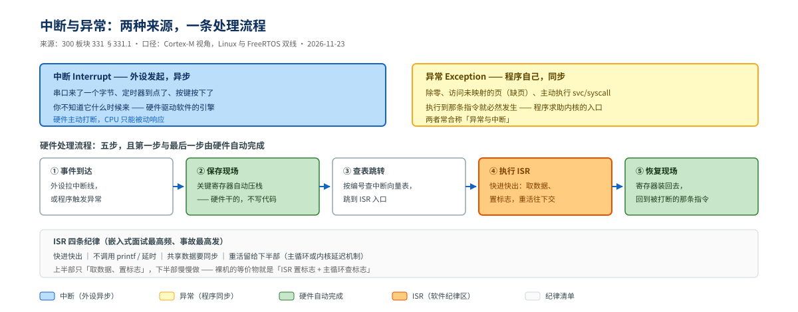

# 331 中断异常与上下文切换

> **解决**：回答"CPU 正在跑的程序，凭什么被别的东西插队"。中断是硬件驱动软件的引擎，异常是程序求助内核的入口，上下文切换是这一切留下的痕迹——三者合起来是"抢占"这件事的全貌。  
> **范围**：中断 vs 异常 · 向量表与 ISR 四条纪律 · 上下半部分工 · 上下文切换切了什么 · 裸机与 OS 两套组织方式对照。  
> **口径**：机制通用；例证 Cortex-M 与 Linux 双线；不深入内核源码，版本不绑定。  
> **更新**：2026-11-23  
> **本册导读** ── 必会三点：① 中断是外设异步打断，异常是程序同步触发 ② ISR 四条纪律的核心是"快进快出" ③ 上下文切换的真实成本在保存现场与切换地址空间 ｜ 跟做时长：约 2 小时 ｜ 前置：321（进程与三态）、323（竞态，ISR 会重现它）。  
> **标记**：★ = 必会节；○ = 拓展节。

## 目录

| 节 | 内容 |
|---|---|
| 331.1 | 两种打断：中断与异常 ○ |
| 331.2 | 中断处理：向量表、现场与 ISR 纪律 ★ |
| 331.3 | 上下半部：把重活挪出去 ★ |
| 331.4 | 上下文切换：切换到底切了什么 ★ |
| 331.5 | 裸机中断与 OS 中断：两个世界的对照 ★ |
| 331.6 | 坑表 |
| 331.7 | 检查清单（自测 6 题 + 动手任务 2 件） |

---

## 331.1 两种打断：中断与异常 ○

**定义**：CPU 的正常执行流被"打断"、转向处理函数，来源只有两种——**中断**（外设主动）与**异常**（程序自己）。

| | 中断（Interrupt） | 异常（Exception） |
|---|---|---|
| 来源 | **外设**：串口来字节、定时器到点、按键按下 | **程序自己**：除零、缺页、非法指令、主动陷入 |
| 同步性 | 异步：随时可能来，与指令无关 | 同步：执行到那条指令必然发生 |
| 可预测性 | 不可预测（所以要有优先级与嵌套机制） | 可预测（同一输入必触发同一异常） |
| 意义 | 硬件驱动软件的引擎 | 程序求助内核的入口 |
| 典型处理 | 收数据、置标志、唤醒任务 | 修页表、杀进程、进系统调用 |



**两者的硬件流程几乎一样**：保存现场 → 按编号查表 → 跳到处理函数 → 返回时恢复现场。所以它们在硬件手册里常被合称"异常与中断"，区别只在**谁触发**。

**与系统调用的关系**：系统调用就是一次**主动异常**（陷入指令），这是 313 §313.2 那扇门的物理形态。**主动陷入 vs 被动打断**——同一个机制，两种用法。

## 331.2 中断处理：向量表、现场与 ISR 纪律 ★

**机制（Cortex-M 视角，五步）**：

| 步 | 发生什么 | 谁在做 |
|---|---|---|
| ① 到达 | 外设拉高中断线，或异常条件成立 | 硬件 |
| ② 保存现场 | 硬件自动把关键寄存器（PC/PSR/R0-R3 等）压入当前栈 | 硬件（不用写代码） |
| ③ 查表 | 按中断号从**中断向量表**取出处理函数入口地址 | 硬件 |
| ④ 执行 | 跳进 ISR（中断服务程序）跑你写的代码 | 软件 |
| ⑤ 返回 | 特殊返回指令，硬件自动恢复现场，回到被打断的那条指令 | 硬件 |

**向量表住在哪**：Flash 起始处的固定位置，是一张"编号 → 入口地址"的数组。启动时硬件先找到它（312 §312.2 第②棒），所以**向量表的位置由链接脚本决定，改错了整个中断系统就全乱了**。

**ISR 四条纪律**（嵌入式面试最高频、事故最高发）：

| 纪律 | 原因 | 违反的后果 |
|---|---|---|
| 快进快出，只做必要的事 | 中断优先级高于主流程，ISR 拖着，一切都被拖 | 主循环卡顿、其他中断延迟 |
| 不调用 printf / 延时 / 动态分配 | 可能阻塞、可能重入、可能触发新的系统调用 | 卡死或堆损坏 |
| 与主流程共享的数据必须同步 | 主流程随时被打断——323 §323.1 的竞态在这里重现 | 数据偶发错乱，几乎无法复现 |
| 重活留给主流程/下半部 | 上半部只"取数据、置标志" | 中断响应变慢，丢事件 |

**第三、四条纪律是本册最值钱的部分**：很多人以为竞态只在多线程里出现，其实**单线程 + 中断**同样有竞态——主流程刚读完变量，中断插进来改了它，主流程再写回，改动就没了。**这是嵌入式中最常见的"偶发丢数据"根因**。

## 331.3 上下半部：把重活挪出去 ★

**定义**：把一个中断的处理拆成两段——**上半部**（ISR 本体，快进快出）与**下半部**（稍后执行，慢慢做重活）。

**为什么必须拆**：中断到达时，同优先级（或更低优先级）的中断被屏蔽。ISR 里做 1 毫秒的活，意味着这 1 毫秒内别的中断都得等着——**实时性就是这么丢的**。

| | 上半部（ISR） | 下半部 |
|---|---|---|
| 跑在哪 | 中断上下文 | 任务/主循环上下文 |
| 能睡眠吗 | **不能** | 能 |
| 能拿什么锁 | 只能自旋（323 §323.4） | 任何锁 |
| 该做什么 | 读数据、清标志、发通知 | 解析、计算、写存储、打印 |
| 裸机等价物 | ISR 置标志 | 主循环查标志后处理 |
| Linux 机制 | 硬中断处理函数 | 软中断 / tasklet / 工作队列 |

**裸机的"标志 + 主循环查"就是下半部的原始形态**：

```c
volatile int rx_flag = 0;
char rx_byte;

void USART1_IRQHandler(void)     /* 上半部：只取数据、置标志 */
{
    rx_byte = read_data_register();
    rx_flag = 1;
}

int main(void)
{
    while (1) {
        if (rx_flag) {           /* 下半部：慢慢处理 */
            rx_flag = 0;
            handle(rx_byte);     /* 解析、存储、打印都放这里 */
        }
        /* 其他任务 */
    }
}
```

**注意 `volatile`**：`rx_flag` 会被 ISR 改、被主循环读，编译器若把它优化进寄存器，主循环就永远看不到变化。`volatile` 告诉编译器"每次都去内存读"——它**不解决竞态**，只保证可见性（这条区分在嵌入式里常被混淆）。

## 331.4 上下文切换：切换到底切了什么 ★

**定义**：**上下文**是一个执行流"下次还能接着跑"所需要的全部状态；**上下文切换** = 保存当前上下文的现场、恢复另一个执行流的现场。

**切的东西按成本排序**：

| 切什么 | 成本 | 说明 |
|---|---|---|
| 寄存器现场 | 小（几十个寄存器） | PC、SP、通用寄存器、状态字 |
| 切换栈 | 小 | 换 SP 指向另一个栈 |
| 换地址空间 | **大** | 换页表基址，可能刷 TLB（321 §321.3） |
| 缓存污染 | 中~大 | 新执行流的代码/数据不在缓存里，要重新预热 |

**由此得出两条判断**：

1. **线程切换比进程切换便宜**——同一个地址空间，不用换页表、不刷 TLB。这是 322 §322.3"线程更轻"的硬件依据。
2. **切换太频繁会吃掉吞吐**——每次切换都有一段"没有有用工作"的开销，任务数远超核数时，CPU 大量时间花在切换上（321 §321.4 的纪律）。

**切换的触发者**：时间片用完（调度器主动切）、被更高优先级抢占（332）、阻塞在系统调用里（313 §313.2）、中断返回时发现该换任务了（RTOS 常见）。**这四条都指向同一个动作**——所以"卡一下"的现象，四种原因的症状很像（321 §321.5 的判据表）。

**一个易错直觉**：中断本身**不等于**上下文切换。中断服务完可以原样返回，什么都没换；只有"中断返回时决定换个任务跑"，才发生真正的任务切换。理解这一层，才能分清"中断延迟"和"切换延迟"两种不同的性能问题。

## 331.5 裸机中断与 OS 中断：两个世界的对照 ★

同一个硬件机制，软件组织方式分两个世界——这是"裸机 → RTOS → Linux"这条主线的枢纽。

| | 裸机（前后台系统） | 有 OS（RTOS / Linux） |
|---|---|---|
| 结构 | 主循环（后台）+ ISR（前台） | 内核统一管理中断，驱动注册处理函数 |
| ISR 里干什么 | 置标志、存数据，快进快出 | ISR 只唤醒任务，处理交给任务 |
| 谁保证不丢事件 | 自己写"标志 + 主循环查" | 队列/信号量机制内建 |
| 竞态防护 | 关中断 / 原子访问（自己保证） | 内核提供锁与调度原语 |
| 优先级管理 | 硬件中断优先级寄存器 | 中断优先级 + 任务优先级两层 |
| 心智模型 | "我是唯一的管家" | "内核是管家，我只提需求" |

**结论**：裸机前后台系统就是"**没有进程的 OS 思维**"——ISR 纪律、竞态防护、事件通知，在裸机里手工实现，在 OS 里由内核代管。**RTOS 介于两者之间**：有调度器与任务，但多数没有硬件特权级强制，纪律靠开发者自觉（312 §312.5 的隔离一栏）。

**观察与判断**：

| 现象 | 裸机侧病根 | RTOS 侧病根 |
|---|---|---|
| 偶发丢事件 | 标志没处理全 / 关中断太久 | 队列满 / ISR 没用 FromISR 版 API |
| 任务不响应中断 | — | ISR 里调用了不可在中断上下文用的 API |
| 系统卡顿但没死 | 主循环里有长阻塞 | 高优先级任务霸占 CPU（332 §332.3） |

## 331.6 坑表

| # | 现象 | 原因 | 解法 |
|---|---|---|---|
| 1 | 一进 ISR 程序就卡死 | ISR 里 printf / 延时 / 死等 | 快进快出，重活挪到下半部（331.2） |
| 2 | ISR 与主流程数据偶发错乱 | 共享变量没同步 | 关中断窗口 / 原子访问 / 队列（331.2） |
| 3 | 加了 volatile 还是错 | volatile 只保证可见性，不保证原子性 | 该加锁还是加锁（331.3） |
| 4 | 改中断处理没生效 | 向量表位置/入口名与启动文件不匹配 | 核对链接脚本与启动文件（331.2） |
| 5 | 实时性不达标但 CPU 不高 | ISR 太长，屏蔽了同级中断 | 拆分上下半部（331.3） |
| 6 | 把中断延迟与切换延迟混为一谈 | 两者机制不同 | 中断延迟看 ISR 时长，切换延迟看调度（331.4） |

## 331.7 检查清单（自测 6 题 + 动手任务 2 件）

**自测**：

| # | 问题 | 自测标准 |
|---|---|---|
| 1 | 中断与异常各由谁触发 | 外设异步 vs 程序同步 |
| 2 | 中断处理五步 | 到达 → 保现场 → 查表 → 执行 → 返回恢复 |
| 3 | ISR 四条纪律 | 快进快出/禁慢调用/同步共享/重活下放 |
| 4 | 上下半部各做什么 | 上半部取数据置标志，下半部做重活 |
| 5 | 上下文切换成本排序 | 换地址空间 > 缓存污染 > 寄存器与栈 |
| 6 | 中断与上下文切换的关系 | 中断不等于切换，切换只发生在"决定换任务"时 |

**动手任务**：① 把 331.3 的"标志 + 主循环"骨架补成一个完整可编译的裸机片段（可用任意外设或直接在主循环里模拟触发），说明为什么 `rx_flag` 要加 `volatile`；② 用一句话分别写下"中断延迟"和"上下文切换延迟"的定义，并各举一个你能观察到的现象。

> 下一篇：《332 调度策略》——切换由谁决定？调度器在遵守什么规则。
