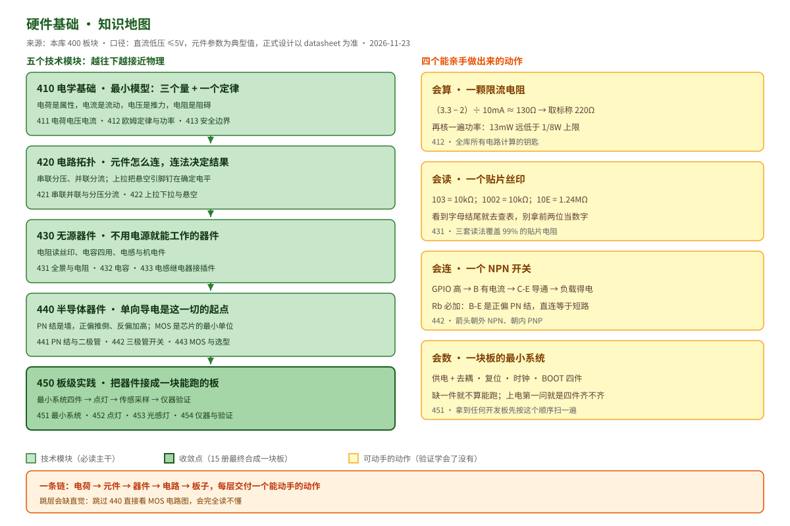

# 402 硬件基础全貌

> **一句话**：硬件基础是从"电是什么"到"一块板能跑"的物理层——电荷怎么流、元件怎么读、半导体为什么能开关、器件怎么连成板；看懂这一层，芯片手册里每一句"接个上拉""加个去耦"才不是咒语。

左边五层是技术模块，越往下越接近物理：上面两层是**抽象规律**（三个量与一个定律、连法决定结果），中间两层是**具体元件**（无源件、半导体件），最下面一层是**把它们接成板**。右边四个框是这条链上你能亲手做出来的动作——会算、会读、会连、会数。

- **410 电学基础**：三个量是什么、一个定律怎么算、哪里不能碰（定义）
- **420 电路拓扑**：元件怎么连、连法如何决定结果（关系）
- **430 无源器件**：不用电源就能工作的元件，重点是把丝印读对（对象）
- **440 半导体器件**：单向导电从哪来，三极管与 MOS 怎么当开关（器件）
- **450 板级实践**：最小系统、点灯、传感、仪器——合成一块能跑的板（落地）

---

> 下一篇：[411 电荷·电压·电流](410-电学基础/411-电荷电压电流.md)——先从"电到底是什么"讲起。  
> 完整册表、概念速览、板块分界与三种读法：[板块 README](README.md)。
