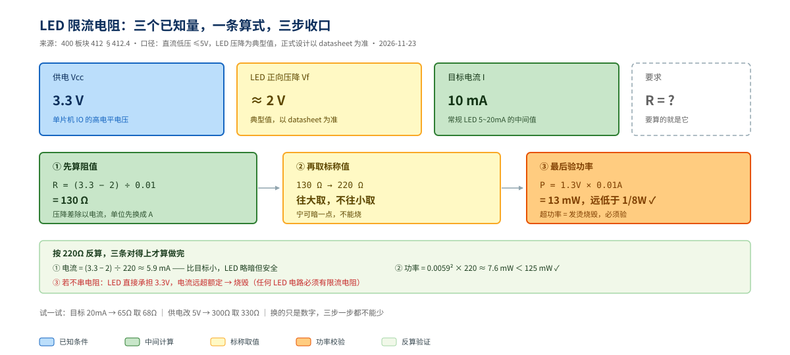

# 412 欧姆定律与功率发热

> **解决**：给 411 的三个量之间那条锁死的关系——一个定律（U=IR）加一个发热公式（P=I²R），就能算出限流电阻、核对元件会不会烧。全库所有电路计算的钥匙都在这一册。  
> **范围**：欧姆定律的三种变形 · 功率三式 · 焦耳定律与积热 · LED 限流电阻的完整推演 · 额定功率与散热 · 稳压芯片为什么会烫。  
> **口径**：直流稳态；数值为典型值（LED 压降 2V、β 取 10、常规电阻 1/8W），正式设计以 datasheet 为准；不涉及交流有效值与瞬态热阻。  
> **更新**：2026-11-23  
> **本册导读** ── 必会三点：① U=IR 三种变形都会用 ② 限流电阻 =(供电−压降)/目标电流，且必须核功率 ③ P 是**发热速率**，Q=P×t 是总量——功率决定"烫不烫"，时间决定"积多少热" ｜ 跟做时长：约 1.5 小时（纸面计算，全带答案） ｜ 前置：411（三要素与单位）。  
> **标记**：★ = 必会节；○ = 拓展节。

## 目录

| 节 | 内容 |
|---|---|
| 412.1 | 欧姆定律：一个定律锁死三个量 ★ |
| 412.2 | 三种变形：求电流、求阻值、求压降 ★ |
| 412.3 | 功率：元件发热的速率 ★ |
| 412.4 | 跟做：算出 LED 的限流电阻 ★ |
| 412.5 | 焦耳定律：能量、积热与"为什么不是立刻烧" ○ |
| 412.6 | 额定功率与散热：电阻与稳压芯片 ★ |
| 412.7 | 坑表 |
| 412.8 | 检查清单（自测 6 题 + 动手任务 3 件） |

---

## 412.1 欧姆定律：一个定律锁死三个量 ★

**定义**：在电阻值不变的前提下，流过电阻的电流与两端电压成正比。

```text
U = I × R      I = U / R      R = U / I
```

知道任意两个量，第三个必然确定——**这是电路计算的总钥匙**，没有例外，也不需要额外条件。

**它的前提只有一个**：电阻值不变。这句话容易被读反：

- 正确理解：给一只 10kΩ 电阻加不同电压，电流跟着变，**阻值始终是 10kΩ**。
- 错误理解：电阻会"跟着电压变"。

**为什么这条定律这么重要**：它把"看得见的电压"与"算得出的电流"连起来。实际调试时，你只能方便地量电压（并联跨两点），但很多判断依赖电流——欧姆定律就是那座桥：量到电阻两端的电压，除以阻值，就知道流过多少电流。

**一个常见场景**：板子上有一只 10kΩ 上拉，想知道它耗不耗电。不用断开电路去串电流表——量一下它两端的电压（3.3V − 0V = 3.3V），I = 3.3/10000 = 0.33mA。**两秒算完，不用动板子**。

## 412.2 三种变形：求电流、求阻值、求压降 ★

三个变形对应三类日常问题，各自有固定套路：

| 想知道 | 用哪一版 | 典型场景 |
|---|---|---|
| 流过多少电流 | `I = U / R` | 已知电压与阻值，核算会不会超限 |
| 该用多大电阻 | `R = U / I` | 已知电压与目标电流，选限流/分压电阻 |
| 元件上分掉多少压 | `U = I × R` | 已知电流与阻值，算压降（如导线上损失多少） |

**统一单位再算**，这是最容易出错的一步：

```text
✅ 正确：I = 3.3V / 10000Ω = 0.00033A = 0.33mA
❌ 错误：I = 3.3 / 10 = 0.33  ← 把 10kΩ 当成 10Ω 代进去，结果差 1000 倍
```

**纪律**：代入数字前，先把 V、A、Ω 统一成基本单位；算完再折算回 mA / kΩ 表达。中间步骤混用单位，是新手最常犯的计算错误。

## 412.3 功率：元件发热的速率 ★

**定义**：功率是电流在单位时间内做的功，表示消耗电能的快慢。

```text
P = U × I      P = I² × R      P = U² / R      单位：瓦特 W
1 kW = 10³ W；1 W = 10³ mW = 10⁶ μW
```

**三式怎么选**：手上已知哪两个量，就用不含第三个的那一版。知道 U 与 I 用第一式；只知 I 与 R 用第二式；只知 U 与 R 用第三式。**算出来的是同一个数，选式只影响计算方便程度**。

**功率是"速率"，不是"总量"**。这是理解发热的关键：

| 概念 | 单位 | 回答什么 |
|---|---|---|
| 功率 P | 瓦特 W | 每秒钟产生多少热（**烫不烫**） |
| 热量 Q | 焦耳 J | 累计产生了多少热（**会不会积起来**） |

一只 1/4W 电阻通 15mA，功率 0.225W——**贴着上限但不超**，短时间内不坏；持续几小时，热量积起来散不掉，就会烫到变色、阻值漂移。**功率决定"会不会烫"，时间决定"烫到什么程度"**，两者都要看（§412.5）。

## 412.4 跟做：算出 LED 的限流电阻 ★

这是嵌入式"点灯"的第一道计算题，也是本册唯一的必修算例。

```text
已知：供电 3.3V，LED 正向压降约 2V（典型值，以 datasheet 为准），目标电流 10mA
求：限流电阻 R

第一步（求电阻两端电压）：U_R = 3.3 − 2 = 1.3V      ← 压降被 LED 吃掉 2V，剩下才落在电阻上
第二步（求阻值）：R = U_R / I = 1.3 / 0.01 = 130Ω
第三步（取标称值）：取 220Ω（宁可电流偏小、LED 略暗，也更安全）
第四步（核功率）：P = 1.3V × 0.01A = 13mW  ← 远低于 1/8W（125mW）上限 ✓
```



**为什么取 220Ω 而不取 130Ω**：130Ω 不是标称值（E24 系列里没有），而且实际电流会随 LED 压降的批次差异上下浮动。取大一档，电流降到 5.9mA——LED 稍暗，但任何批次都不会过流。**"宁可偏小"是限流电阻的选值原则**。

**验证你的答案**（三条自查判据，任何一条不过就重算）：

1. 实际电流 = (3.3−2)/220 ≈ 5.9mA，比目标 10mA 小、LED 略暗但安全 ✓
2. 电阻功率 = 1.3²/220 ≈ 7.6mW，远低于 125mW ✓
3. 若不串电阻：LED 直接承担 3.3V，远超其额定 → **瞬间烧毁**

> ⚠️ **任何 LED 电路必须有限流电阻**。LED 的内阻极小，直接接电压源等于短路，没有例外。

**试一试**（先自己算，再看括号）：

- 目标电流改成 20mA：R = 1.3/0.02 = 65Ω → 取 68Ω（E24 标称）
- 供电改成 5V、目标 10mA：R = (5−2)/0.01 = 300Ω → 取 330Ω
- 供电 5V、目标 20mA：R = 3/0.02 = 150Ω → 取 150Ω（E24 里正好有）

**三个结果为什么都"取大一档"**：电流偏小只是暗一点，电流偏大直接烧。**单向的容错方向，决定了选值方向**。

## 412.5 焦耳定律：能量、积热与"为什么不是立刻烧" ○

**定义**：电流通过导体产生的热量，与电流的平方成正比、与电阻成正比、与通电时间成正比。

```text
Q = I² × R × t      Q = U × I × t      Q = P × t      单位：焦耳 J
1 kJ = 10³ J；1 MJ = 10³ kJ
```

**这条定律解释了 412.6 那句"电阻功率要留余量"**：

- 同样的功率，时间越久积热越多 → 短时间超一点不会立刻坏
- 但**电路板上的元件没有主动散热**，热量只能靠表面积散出去 → 积到一定程度就热平衡在一个高温点

**这就是"超一点能用、超多了早晚坏"的物理原因**——它不是安全余量的问题，是散热能力的问题。

**日常换算**：1 度电 = 1 kWh。一颗 18650 电池标称 3.7V / 2000mAh：

```text
能量 = 2A × 3.7V × 1h = 7.4Wh = 0.0074 kWh  →  约 0.0074 度电
```

**嵌入式为什么要管这件事**：稳压芯片把 5V 降到 3.3V，压差 1.7V 全部变成热；电流 500mA 时 P = 1.7 × 0.5 = 0.85W——SOT-223 封装已经明显发烫。**这就是板上要给稳压芯片铺铜、加散热片的原因**（§412.6）。

**边界**：本节只算稳态直流发热，不涉及交流有效值与瞬态热阻曲线。要精确算温升需要热阻参数（θJA），属于硬件设计范畴。

## 412.6 额定功率与散热：电阻与稳压芯片 ★

**额定功率** = 元件长期连续安全工作可耗散的最大功率，是选型必看参数，不是"能扛住的峰值"。

**反查电流上限**（最实用的一步）：一只 1/4W、1kΩ 的电阻，能长期流过多大电流？

```text
P = I²R  →  0.25 = I² × 1000  →  I² = 0.00025  →  I = 0.0158A ≈ 15mA
超过 15mA 长期跑，电阻会烫到变色、阻值漂移
```

**常见封装的功率上限**（选型时的经验值，具体看 datasheet）：

| 封装/类型 | 常见额定功率 | 典型场景 |
|---|---|---|
| 贴片 0603 | 1/10W | 信号级、上拉下拉 |
| 贴片 0805 | 1/8W | 通用限流 |
| 贴片 1206 | 1/4W | 稍大电流 |
| 直插 1/4W | 1/4W | 面包板实验最常用 |
| 线绕 / 水泥电阻 | 5 ~ 20W | 大功率、过载保护 |

**稳压芯片为什么是"发热大户"**：线性稳压（LDO）的原理是"把多余的电压变热扔掉"，效率约等于 Vout/Vin。

```text
AMS1117-3.3，输入 5V、输出 3.3V、负载 500mA
发热功率 = (5 − 3.3) × 0.5 = 0.85W
如果输入改成 12V：发热 = (12 − 3.3) × 0.5 = 4.35W  ← 必然烧毁
```

**两个工程结论**：

1. **压差越大越烫**——所以开发板多用 5V 输入 + LDO 出 3.3V，而不是从 12V 直接降。
2. **铺铜就是散热片**——PCB 上大片铜箔能把热传导出去，这是最便宜的散热手段。

**边界**：开关电源（DCDC）效率高、发热小，但设计与布局复杂，本库不展开。**要记住的只是"线性稳压的发热 = 压差 × 电流"这一条**。

## 412.7 坑表

| # | 现象 | 原因 | 解法 |
|---|---|---|---|
| 1 | LED 一接就烫/烧 | 没串限流电阻 | 按 §412.4 四步算，再接线 |
| 2 | 算出的电流差 1000 倍 | kΩ 当 Ω、mA 当 A 代入 | 先统一基本单位再算（§412.2） |
| 3 | 电阻用久了变色、阻值漂移 | 额定功率没留余量 | 用 P=I²R 反查电流上限（§412.6） |
| 4 | 稳压芯片烫手甚至烧 | 压差 × 电流全变成热 | 降输入电压或加铺铜/散热（§412.6） |
| 5 | 以为"功率小就绝对安全" | 没算积热时间 | 功率管"烫不烫"，时间管"积多少"（§412.5） |
| 6 | 取标称值时取小了 | 只按算出的阻值就近取 | 单向容错：宁可电流偏小（§412.4） |

## 412.8 检查清单（自测 6 题 + 动手任务 3 件）

**自测**：

| # | 问题 | 自测标准 |
|---|---|---|
| 1 | 欧姆定律三式 | U=IR、I=U/R、R=U/I，能说出各自何时用（§412.1~412.2） |
| 2 | 算出 3.3V 供电、LED 压降 2V、10mA 的限流电阻 | 130Ω，取 220Ω（§412.4） |
| 3 | 功率三式与选用 | P=UI / I²R / U²/R，按已知量选（§412.3） |
| 4 | 功率与热量的区别 | 速率（W）vs 总量（J）；Q=P×t（§412.5） |
| 5 | 1/4W、1kΩ 电阻的长期电流上限 | 约 15mA（§412.6） |
| 6 | 稳压芯片发热怎么算 | 压差 × 电流；压差越大越烫（§412.6） |

**动手任务**：① 完成 §412.4 三道"试一试"，把每道的标称值选择理由写一行；② 算一只 3.3V、20mA 的 LED 在 5V 供电下的限流电阻与电阻功率，再算改用 220Ω 后的实际电流；③ 找一块开发板，找到它的稳压芯片型号，按"输入电压 − 输出电压 × 估测电流"算一次发热功率，判断它需不需要铺铜。

> 下一篇：《413 安全边界：直流交流与强弱电》——会算之后，先弄清哪些电压可以碰、哪些一步都不能碰。
