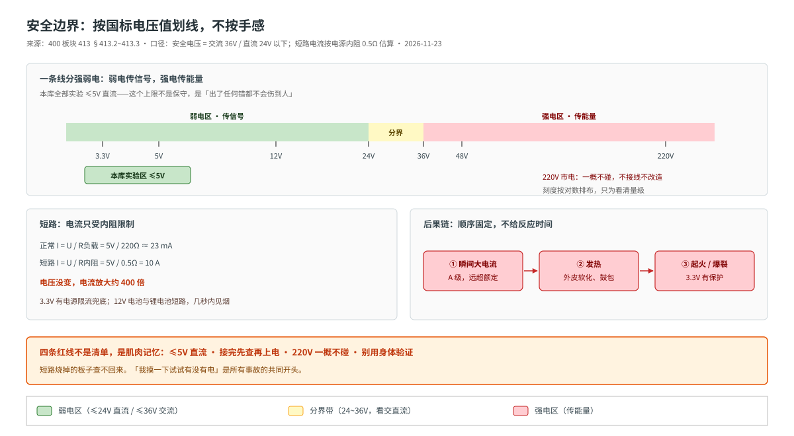

# 413 安全边界：直流交流与强弱电

> **解决**：给整个板块画一条线——哪些电压可以放心碰、哪些一步都不能碰。分界不是"感觉危险不危险"，而是国标的安全电压值；短路是唯一需要时刻警惕的故障。  
> **范围**：直流与交流的差别 · 强电与弱电的国标分界 · 安全电压 · 短路的物理后果 · 人体安全电流 · 家庭电路链路（认识级）。  
> **口径**：本库全部实验限 ≤5V 直流；市电 220V 与大电流一概不写不做；本章只讲"边界在哪、为什么"，不讲电力系统设计。  
> **更新**：2026-11-23  
> **本册导读** ── 必会三点：① 安全电压 = 交流 36V / 直流 24V 以下 ② 短路是"电流只受内阻限制"，先查再上电 ③ 弱电传信号、强电传能量，本库只在弱电侧工作 ｜ 跟做时长：约 1 小时（纸面为主） ｜ 前置：411（三要素）、412（功率）。  
> **标记**：★ = 必会节；○ = 拓展节。

## 目录

| 节 | 内容 |
|---|---|
| 413.1 | 直流与交流：两种电，两套场景 ○ |
| 413.2 | 强电与弱电：国标的安全电压 ★ |
| 413.3 | 短路：唯一必须时刻警惕的故障 ★ |
| 413.4 | 人体安全与实验室四条红线 ★ |
| 413.5 | 家庭电路顺带认识 ○ |
| 413.6 | 坑表 |
| 413.7 | 检查清单（自测 6 题 + 动手任务 2 件） |

---

## 413.1 直流与交流：两种电，两套场景 ○

| | 直流 DC（Direct Current） | 交流 AC（Alternating Current） |
|---|---|---|
| 特征 | 大小与方向不随时间周期性变化 | 大小与方向随时间周期性变化 |
| 长处 | 稳定、无电磁辐射，适合敏感设备与储能 | 可用变压器升降压，适合远距离输电 |
| 本库场景 | **全部**（电池、USB、3.3V/5V 供电） | 只在"入户 220V"这一句里出现 |

**为什么输电用交流、板子用直流**：交流最大的本事是**能用变压器升降压**——高压输电损耗小、到了用户端再降下来。而电子电路需要稳定电压，所以最后一级都要整流滤波（把交流变直流）。这个转换发生在电源适配器里，**不在你的板子上**。

**一个反直觉的点**：嵌入式板子上的一切都是直流，但**高低电平切换本身也是一次"交流"**——信号在 0 与 1 之间反复跳变，所以数字信号线同样适用"电容通交隔直"那一套（见 432 §432.3）。

**本节要记住的只有一句**：**本库全部工作在直流侧，交流只出现在"不要碰那根线"的语境里。**

## 413.2 强电与弱电：国标的安全电压 ★

**分界看国标安全电压**，不看"摸上去麻不麻"：

```text
安全电压：交流 36V 以下，直流 24V 以下
强电：直流 24V 以上 / 交流 36V 以上  → 传能量（220V 家电、1000V 以上高压）
弱电：直流 24V 以下 / 交流 36V 以下  → 传信号（3.3V、5V、12V、音视频、网络、电话）
```

> **一句话记法：弱电传信号，强电传能量。**

**为什么是这两个数**：36V / 24V 是"在正常干燥环境下，人体接触不会造成生命危险"的电压上限。它是工程统计结论，不是物理突变点——**超过这条线并不代表立刻出事，但已经出了"可以靠意志保证安全"的范围**。

**三个常见误判**：

| 误判 | 实际 |
|---|---|
| "12V 摸不出来，所以不算强电" | 12V 是弱电，但**短路 12V 也能烧导线**——安全与功率是两回事 |
| "手机充电器是 5V，整条线都安全" | 适配器**输入端**是 220V，危险在那一段，不在输出 |
| "电池只有 3.7V，随便玩" | 锂电池**短路**时瞬时电流可达数安到数十安，会鼓包、起火 |

**本库的边界**：全部实验 ≤5V 直流（USB 供电即合规）。这个上限不是保守，而是"**出了任何错都不会伤到人**"——这是入门教材必须守住的下限。



## 413.3 短路：唯一必须时刻警惕的故障 ★

**定义**：电源正负极之间几乎没有电阻地直接连通。

**为什么它比"接错元件"危险得多**：

```text
正常电路：I = U / R负载      R负载 通常几百 Ω ~ 几 kΩ  → 电流 mA 级
短路：    I = U / R内阻      R内阻 通常 0.1Ω ~ 1Ω 量级   → 电流 A 级甚至更大
```

**电流由"唯一剩下的那个小电阻"决定**，而这个电阻是电源内阻加导线电阻，通常不到 1Ω。电压不变、电阻缩小上千倍，电流就放大上千倍。

**后果链**（顺序固定）：

1. **瞬间大电流** → 导线与电池内阻发热
2. **发热** → 塑料外皮软化、电池鼓包
3. **持续** → 起火或电池爆裂

**它不会给你反应时间**。3.3V 短路还算温和（受电源限流保护），12V 电池或锂电池短路就是几秒内的事。

**三条纪律**：

1. **接完电路先查再上电**——用眼睛核对正负有没有直连，别急着通电。
2. **上电前先量电阻**——万用表欧姆档跨在电源两端，读数接近 0Ω 就是短路（断电测）。
3. **串一个保险或限流**——实验室电源开 CC 限流（454 §454.4），电池串保险丝。

**这条是本册唯一"必须养成肌肉记忆"的内容**：其他知识忘了可以查，短路烧掉的板子和手指查不回来。

## 413.4 人体安全与实验室四条红线 ★

**人体为什么导电**：人体含大量水分与电解质，本身是一个"不太好的导体"——电阻随皮肤干湿、接触面积、电压高低剧烈变化。干燥皮肤可达几十 kΩ，出汗或破皮后可能降到 1kΩ 以下。

**危险的不是电压，是流过人体的电流**：

| 电流（工频交流） | 生理反应 |
|---|---|
| 1 mA 左右 | 有感觉（麻） |
| 10 mA 左右 | 肌肉痉挛，可能无法自主摆脱 |
| 30 mA 以上 | 呼吸肌麻痹，危险 |
| 50 mA 以上持续 | 心室颤动，可能致命 |

**"电压高才危险"是简化说法**：真正决定后果的是电流，而电流 = 电压 / 人体电阻。所以潮湿环境下同样的电压更危险——人体电阻变小了。

**实验室四条红线**（本库所有实验的边界）：

1. **一律 ≤5V 直流**（USB 供电即合规）。
2. ⚠️ **短路是大敌**——接完先查再上电。
3. **市电 220V 一概不碰**。弱电平台用手摸最多静电击穿元件；强电平台碰一下有生命危险。
4. **别用身体验证任何一条**——"我摸一下试试有没有电"是所有事故的共同开头。

**静电这条单独说**：秋冬干燥时人体静电可达数千伏，虽然电流极小、对人无害，但**足以击穿 MOS 管的栅极**（443 §443.3 会讲栅极为什么这么脆）。拿芯片前先摸一下接地的金属。

## 413.5 家庭电路顺带认识 ○

知道有这回事即可，不需要会修：

```text
进户线 → 电能表 → 总开关 → 保险装置（熔丝或空气开关）→ 各分支回路 → 用电器
```

**两个装置的作用**（它们的逻辑与 413.3 直接相关）：

- **空气开关**：电流超过额定值自动跳闸，替代了老式的熔丝。跳闸后可以复位，熔丝断了要换。
- **漏电保护器**：检测"火线流出、零线流入"的电流差，差值超过 30mA 就跳闸——它保护的正是 413.4 那张表里"危险电流"的下限。

**为什么讲这个**：它和你要做的电路是同一套逻辑——**限流、熔断、保护**。理解家里为什么跳闸，也就理解了 412.6 的额定功率和本册的短路。

**边界**：本节不涉及接线、改装、维修。**任何涉及 220V 的操作都不在本库范围内，也不建议业余尝试。**

## 413.6 坑表

| # | 现象 | 原因 | 解法 |
|---|---|---|---|
| 1 | 上电瞬间冒烟/发烫 | 电源正负直连短路 | 断电，欧姆档量电源两端，接近 0Ω 即短路（§413.3） |
| 2 | 锂电池鼓包 | 短路或过流，内部产气 | 立即停用、隔离、不要刺破（§413.2） |
| 3 | 以为"低电压绝对安全" | 忽略短路功率 | 电压低≠功率小，看的是电流（§413.3） |
| 4 | 拿 12V 当弱电随便短接 | 弱电也会烧导线 | 弱电传信号不等于可以短路（§413.2） |
| 5 | 冬天焊完芯片就坏 | 人体静电击穿栅极 | 操作前摸接地金属，用防静电垫（§413.4） |
| 6 | 把适配器输出端当成"整条线都安全" | 输入端仍是 220V | 危险在插头那一侧（§413.2） |

## 413.7 检查清单（自测 6 题 + 动手任务 2 件）

**自测**：

| # | 问题 | 自测标准 |
|---|---|---|
| 1 | 安全电压是多少 | 交流 36V、直流 24V 以下（§413.2） |
| 2 | 弱电与强电的分界依据 | 传信号 vs 传能量，按国标电压值分（§413.2） |
| 3 | 短路为什么危险 | 电流只受内阻限制，放大上千倍（§413.3） |
| 4 | 危险的是电压还是电流 | 电流；电压通过人体电阻决定电流（§413.4） |
| 5 | 上电前怎么自查短路 | 断电，欧姆档跨电源两端，接近 0Ω 即短路（§413.3） |
| 6 | 空气开关与漏电保护器的区别 | 过流跳闸 vs 检测火零电流差（§413.5） |

**动手任务**：① 找出你手边所有电源（手机充电器、充电宝、开发板适配器），逐个标出"输入端电压"和"输出端电压"，判断哪一端属于强电；② 给自己的实验台写一张 A5 纸的红线卡：四条红线 + "接完先查再上电" + "断电才动线"，贴在看得见的位置。

> 下一篇：《421 串联并联与分压分流》——边界划清了，回到电路本身：元件怎么连、连法如何决定结果。
