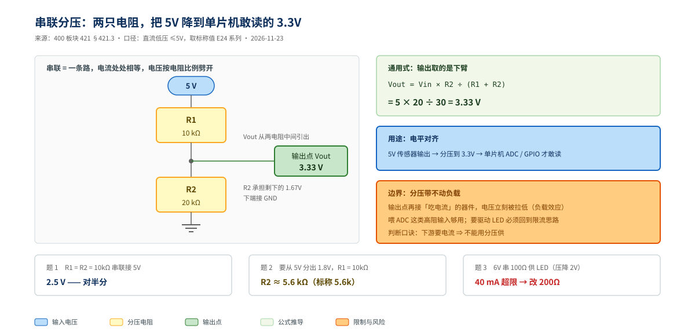

# 421 串联并联与分压分流

> **解决**：同样的几只电阻，接法不同结果就不同——串联分压、并联分流，一套公式管住所有组合。本册把"连法决定结果"讲透，并给出嵌入式里最常用的一个派生式：用两只电阻把 5V 降到 3.3V。  
> **范围**：串联三条规律 · 并联三条规律 · 等效电阻计算 · 串联分压公式与设计 · 并联分流 · 负载效应与分压电路的适用边界 · 三道计算题。  
> **口径**：纯电阻直流电路；取标称值按 E24 系列；分压只用于高阻输入（ADC 前置），不用于驱动负载。  
> **更新**：2026-11-23  
> **本册导读** ── 必会三点：① 串联电流相同、电压相加；并联电压相同、电流相加 ② 分压公式 `Vout = Vin × R2/(R1+R2)`，R2 是接地的下臂 ③ 分压电路带不动负载（负载效应） ｜ 跟做时长：约 1.5 小时（三道计算题带答案） ｜ 前置：412（欧姆定律）。  
> **标记**：★ = 必会节；○ = 拓展节。

## 目录

| 节 | 内容 |
|---|---|
| 421.1 | 串联：一条路，电流处处相等 ★ |
| 421.2 | 并联：多条路，电压处处相等 ★ |
| 421.3 | 串联分压：嵌入式最常用的派生式 ★ |
| 421.4 | 跟做：三道计算题 ★ |
| 421.5 | 负载效应：分压电路的能力边界 ★ |
| 421.6 | 并联分流与"并联不是万能药" ○ |
| 421.7 | 坑表 |
| 421.8 | 检查清单（自测 6 题 + 动手任务 3 件） |

---

## 421.1 串联：一条路，电流处处相等 ★

**定义**：元件首尾相接，电流只有一条通路。

```text
I总 = I1 = I2            电流处处相等（没有岔路，流进多少流出多少）
U总 = U1 + U2            总电压等于各段压降之和
R总 = R1 + R2            总电阻等于各电阻之和（越串越大）
```

**三条规律的内在联系**：电流相等是"一条路"的必然结果；电压相加是因为电荷走完全程要依次克服每一段的阻力；电阻相加则是对"阻力累积"的直接表述。**串联的本质是"路变长了"**。

**串联的两个实际用途**：

1. **分压**——把高电压按比例分出一部分（§421.3）。
2. **限流**——串一只电阻把电流压下来（LED 限流就是串联，见 412 §412.4）。

**一个容易忽略的推论**：串联电路里，**阻值大的元件分到的电压也大**（因为 U = I×R，电流相同）。所以串联的电阻如果功率规格相同，**阻值最大的那只最先发烫**。

## 421.2 并联：多条路，电压处处相等 ★

**定义**：元件两端分别接在同两个节点上，电流有多条通路。

```text
U总 = U1 = U2            电压处处相等（两端接在同一对节点上）
I总 = I1 + I2            总电流等于各支路电流之和
1/R总 = 1/R1 + 1/R2      总电阻的倒数等于各电阻倒数之和（越并越小）
```

**两只并联的速算**：

```text
R总 = (R1 × R2) / (R1 + R2)      ←  "积除和"
```

**这条速算有一个极其好用的判据**：**并联后的总电阻一定小于其中最小的那一只**。因为多开了一条路，电流更容易通过，阻碍必然变小。

> **自查技巧**：算完并联结果，先看它是不是比最小的那只更小。如果不是，一定算错了。这个判据不用记公式也能用来验算。

**并联的两个实际用途**：

1. **分流**——大电流分成几路，每路元件承受的电流更小（§421.6）。
2. **降阻**——手头没有合适阻值，用两只并联凑出来（例如需要 50Ω，用两只 100Ω 并联）。

**并联的本质是"路变宽了"**，与串联的"路变长了"正好对称。

## 421.3 串联分压：嵌入式最常用的派生式 ★

**定义**：两只电阻串联，输出电压从中间取出，则输出与下臂电阻成正比。

```text
Vout = Vin × R2 / (R1 + R2)      （R2 是接地的下臂）

5V ──[ R1 10kΩ ]──┬──[ R2 20kΩ ]── GND
                  └── Vout = 5 × 20/(10+20) = 3.33V
```



**记住谁在分子**：**接地的下臂在分子**。这一点最容易记反——用极端值自查即可：如果 R2 趋近 0（下臂短路到地），输出必然趋近 0V，与公式一致。**用极端值验算，比背公式可靠**。

**典型用途**：5V 传感器输出降到 3.3V 单片机可读（ADC 采样前置）。

**设计一个分压器的三步**：

1. 定比例：需要 5V → 1.8V，比例 1.8/5 = 0.36
2. 定总阻：总阻不能太小（费电）也不能太大（易受干扰），常用 10kΩ ~ 100kΩ 量级
3. 分配：R2/(R1+R2) = 0.36，取 R1 = 10kΩ → R2 ≈ 5.6kΩ（E24 标称值）

**一个必须核的副作用**：分压器本身**一直在耗电**。5V 跨 15.6kΩ，静态电流约 0.32mA——电池供电的设备要算这笔账。**要省电就加大总阻值，代价是抗干扰变差**。

## 421.4 跟做：三道计算题 ★

先自己算，再看答案栏（答案给的是过程，不是结论）。

| # | 题目 | 答案与过程 |
|---|---|---|
| 1 | R1 = R2 = 10kΩ 串联接 5V，输出点电压？ | 2.5V。Vout = 5 × 10/(10+10) = 2.5V（对半分） |
| 2 | 要从 5V 分出 1.8V，R1 = 10kΩ，R2 取多少？ | 约 5.6kΩ。1.8 = 5·R2/(10+R2) → 1.8(10+R2) = 5R2 → 18 = 3.2R2 → R2 = 5.625kΩ，取 5.6k |
| 3 | 6V 电源串 R = 100Ω 供 LED（压降 2V），电流多大？ | 40mA。I = (6−2)/100 = 0.04A。⚠️ 超过常规 LED 20mA 上限，应加大到 200Ω |

**第 3 题的意义**：它把"串联限流"和"额定上限"连在一起——算出 40mA 不是终点，**还要拿它和器件的额定值比**。这是 412.6 那张功率表在具体场景里的用法。

**试一试**：把第 3 题改成两只 100Ω 并联再串进电路，等效电阻多少、电流多少？

> 答案：并联后 50Ω，电流 = (6−2)/50 = 80mA——**比原来更危险**。并联不是"减小危害"的通用手段，它减小的是电阻、增大的是电流。

## 421.5 负载效应：分压电路的能力边界 ★

**定义**：分压电路的输出端一旦接上"吃电流"的负载，输出电压就会被拉低，不再等于计算值。

**为什么会这样**：负载相当于在 R2 上**并联**了一只电阻。

```text
空载：Vout = Vin × R2/(R1+R2)                    ← 只有 R1、R2
带载：Vout = Vin × (R2∥R负载)/(R1 + R2∥R负载)     ← 下臂被并联拉小
```

**下臂变小 → 分压比变小 → 输出变低**。这不是"元件不合格"，是分压器本身的性质。

**量化感受**（5V、R1=10k、R2=20k，空载输出 3.33V）：

| 负载 | 下臂等效 | 实际输出 |
|---|---|---|
| 空载（∞） | 20kΩ | 3.33V |
| 200kΩ | 18.2kΩ | 3.22V（可用） |
| 20kΩ | 10kΩ | 2.50V（已明显偏离） |
| 2kΩ | 1.82kΩ | 0.77V（完全不能用） |

**判据**：**负载电阻 ≥ 下臂电阻的 10 倍**时，误差约 10% 以内，可以接受。低于这个量级，分压器就失效了。

**所以分压电路只能喂高阻输入**：ADC 采样脚（输入阻抗通常 MΩ 级）、比较器输入、运放同相端——这些"只看不摸"的输入端，电流几乎为零，分压比才成立。

**不能做的事**：用分压器给传感器、LED、电机供电。那需要的是**稳压电路**（用 LDO 或 DCDC），不是分压。

> **一句话分界**：**分压是"取一个电压信号"，不是"供一个电压电源"**。前者只要电压对，后者还要能出电流。

## 421.6 并联分流与"并联不是万能药" ○

**分流公式**（两只并联，电流按电阻反比分配）：

```text
I1 = I总 × R2/(R1+R2)      I2 = I总 × R1/(R1+R2)
```

**注意它与分压公式的区别**：分压是"下臂在分子"，分流是"**另一只**在分子"。两者都遵循同一个直觉——**电阻小的那条路分到的电流大**（水流挑宽的路走）。

**并联的三个正确用途**：

1. **降阻**：需要 50Ω 而手头只有 100Ω，两只并联。
2. **分流**：单只电阻功率不够，用两只分担（**前提是两只见的阻值相同**，否则电流分配不均，阻值小的那只先烧）。
3. **提高可靠性**（工程做法）：两路并联，一路坏了另一路还能工作——但这属于设计冗余，不是入门内容。

**并联的两个误区**：

| 误区 | 实际 |
|---|---|
| "并联能减小电流" | 并联减小**等效电阻**，总电流反而**变大**（§421.4 试一试就是反例） |
| "两只不同阻值并联能平均分担功率" | 电流按反比分配，**阻值小的那只承担更多电流与功率**，可能先烧 |

**边界**：本节只讲纯电阻。真实电路里还有感性与容性元件，交流下的并联要考虑相位，属于硬件设计范畴。

## 421.7 坑表

| # | 现象 | 原因 | 解法 |
|---|---|---|---|
| 1 | 分压输出一接负载就掉 | 负载效应，下臂被并联拉小 | 只喂高阻输入，或改用稳压（§421.5） |
| 2 | 分压比记反，输出差很多 | 把上臂当成了分子 | 接地下臂在分子；用极端值验算（§421.3） |
| 3 | 并联算出的总阻比最小的还大 | 用了"积除和"但算错，或误用串联公式 | 总阻必小于最小的一只，用它验算（§421.2） |
| 4 | 并联后电流反而变大，烧了元件 | 以为并联能限流 | 并联降阻增流；限流要串联（§421.6） |
| 5 | 分压器耗电超过预期 | 没算静态电流 | 加大总阻值，或改用电平转换芯片（§421.3） |
| 6 | 串联电阻只有一只发烫 | 阻值最大的分压最多、功率最大 | 按最大那只核功率（§421.1） |

## 421.8 检查清单（自测 6 题 + 动手任务 3 件）

**自测**：

| # | 问题 | 自测标准 |
|---|---|---|
| 1 | 串联三条规律 | 电流相等、电压相加、电阻相加（§421.1） |
| 2 | 并联三条规律 | 电压相等、电流相加、电阻倒数相加（§421.2） |
| 3 | 分压公式与谁是分子 | Vout = Vin×R2/(R1+R2)，接地下臂在分子（§421.3） |
| 4 | 并联总阻的验算判据 | 必小于最小的一只（§421.2） |
| 5 | 什么是负载效应 | 带载后下臂被并联拉小，输出降低（§421.5） |
| 6 | 分压电路能不能给传感器供电 | 不能；只能取信号，供电要用稳压（§421.5） |

**动手任务**：① 完成 §421.4 三道题并复核过程，第 2 题把 R2 换成 5.1kΩ 重算输出，看误差多少；② 用两只任意阻值的电阻并联，先算等效值再用万用表实测，对比误差来源（标称误差 vs 测量误差）；③ 找一个 5V 转 3.3V 的场景（传感器、舵机信号），分别用"分压"和"电平转换"两种方案写一句适用性判断。

> 下一篇：《422 上拉下拉与悬空》——分压是"取电压"，上拉是"钉电压"；悬空引脚为什么必须被钉住。
