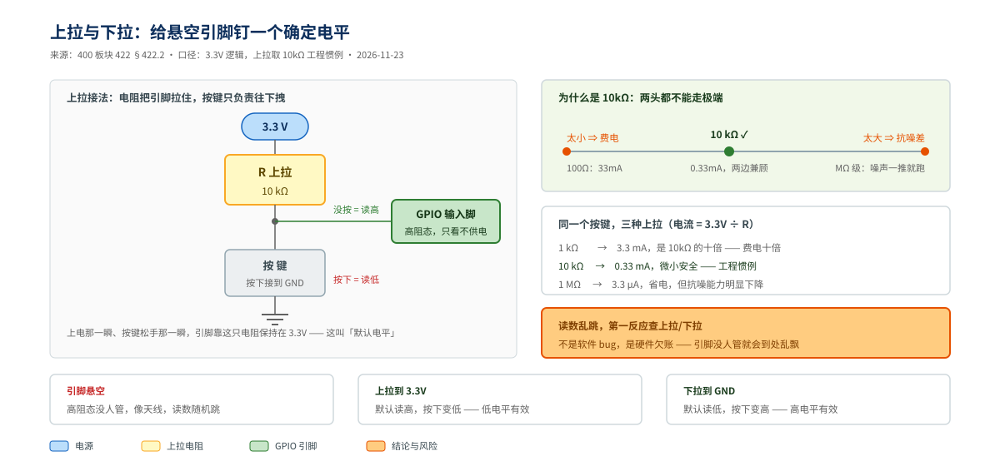

# 422 上拉下拉与悬空

> **解决**：MCU 输入引脚为什么"读不准"——它本身不产生电平，悬空时像一根天线随噪声乱跳。解决办法是把引脚用一只大电阻钉在确定电平。这一册讲清"钉哪儿、钉多大、代价是什么"。  
> **范围**：高阻态的含义 · 悬空为什么会乱跳 · 上拉与下拉的画法 · 10kΩ 的取舍 · 按键两种接法 · MCU 内部上拉 · I2C/总线上的上拉（认识级）。  
> **口径**：3.3V 逻辑；10kΩ 为工程惯例值，实际以芯片手册的推荐值为准；只讲开关量输入，不涉及模拟输入阻抗匹配。  
> **更新**：2026-11-23  
> **本册导读** ── 必会三点：① 悬空引脚是高阻随机态，不是"0" ② 上拉/下拉不是特殊元件，就是普通电阻，名字来自用法 ③ 10kΩ 是"费电"与"抗噪"的折中，不是唯一定值 ｜ 跟做时长：约 1.5 小时（纸面 + 万用表可实测） ｜ 前置：421（串联分压）、412（欧姆定律）。  
> **标记**：★ = 必会节；○ = 拓展节。

## 目录

| 节 | 内容 |
|---|---|
| 422.1 | 问题的起点：高阻态与悬空 ★ |
| 422.2 | 解法：用一只电阻把引脚钉住 ★ |
| 422.3 | 为什么是 10kΩ：一道取舍题 ★ |
| 422.4 | 按键的两种画法：上拉与下拉 ★ |
| 422.5 | 内部上拉与总线上的上拉 ○ |
| 422.6 | 坑表 |
| 422.7 | 检查清单（自测 6 题 + 动手任务 2 件） |

---

## 422.1 问题的起点：高阻态与悬空 ★

**定义**：**高阻态**指引脚内部既不接到电源、也不接到地，对外呈现极大的电阻（MΩ 级以上）。

**高阻态的物理含义**：它**不提供电平**，只是"等着被外部决定"。可以想成一个悬在半空的开关——两端的电压完全由外部电路说了算；外部什么都没接，它就没有确定的电压。

**悬空为什么会乱跳**：一根没有接任何东西的导线，实际上是一根**天线**。周围的电源线、开关电源、人体、甚至空气里的电磁波都会在它上面感应出电压。这个感应电压的大小和方向随机变化，于是：

```text
引脚悬空 → 读到 0、1 之间随机跳变 → 程序行为无法复现
```

**这个故障最恶劣的地方**：它不是"一直坏"，而是**偶发**。同一份代码，今天正常明天出错；手靠近时出错、手拿开就好了。这类问题最难查，因为一切看起来都正常。

> **一句话**：**悬空的输入脚不是"读到 0"，是"读到随机"**。数字电路里没有"没电"这个状态，只有明确的高与明确的低。

**判据**：看到一个输入引脚，先问"它的电平由谁决定"。答不出来，就是悬空。

## 422.2 解法：用一只电阻把引脚钉住 ★

**解法**：用一只大电阻把引脚连到固定电平——连到电源叫**上拉**，连到地叫**下拉**。

```text
上拉：3.3V ──[ R 10kΩ ]──┬── GPIO 输入脚
                          └──[ 按键 ]── GND      （没按 = 读高，按下 = 读低）

下拉：GND ──[ R 10kΩ ]──┬── GPIO 输入脚
                         └──[ 按键 ]── 3.3V      （没按 = 读低，按下 = 读高）
```



**关键概念澄清**：**上拉电阻、下拉电阻都不是特殊的元件**。它们就是普通电阻，叫法来自它的用法——同一只 10kΩ 电阻，接在电源侧叫上拉，接在地侧叫下拉。

**它为什么能"钉住"电平**：电阻虽然大，但在"什么都没接"的情况下是唯一的通路，所以引脚电位被拉到与它相连的那一端。**一旦有更强的驱动力（按键按下、芯片输出），它就退让**——这就是为什么上拉电阻要大：既要能钉住，又不能妨碍正常驱动。

**一句话概括上拉电阻的双重身份**：**平时是"默认值的来源"，动作时是"不妨碍别人的软约束"**。

## 422.3 为什么是 10kΩ：一道取舍题 ★

**10kΩ 不是物理常数，是工程惯例**。它在一个区间里取了折中，区间两端各有代价：

| 取值 | 按下瞬间电流（3.3V） | 后果 |
|---|---|---|
| 100Ω | 33 mA | 费电，且可能超过 GPIO 灌电流上限（十几 mA） |
| 1kΩ | 3.3 mA | 偏费电，电池设备不可接受 |
| **10kΩ** | **0.33 mA** | **兼顾省电与抗噪，工程惯例** |
| 100kΩ | 33 μA | 省电，但抗噪变差 |
| 1MΩ | 3.3 μA | 极省电，长线容易误触发（感应电流就能翻转） |

**两个方向的代价，说清就好选了**：

- **往小取**（1kΩ）：抗噪强、边沿陡，但费电，且可能超出引脚驱动能力。
- **往大取**（1MΩ）：省电，但抗噪弱——导线稍长、环境稍差就会误动作。

**10kΩ 落在"0.33mA 可接受、抗噪够用"的交叉点**，所以成了惯例。**它是起点，不是终点**：

- 电池供电、长期待机 → 可以加大到 100kΩ
- 按键线长达几十厘米、工业环境 → 应减小到 4.7kΩ 甚至更低，或改成硬件消抖
- 芯片手册给了推荐值 → **以手册为准**，惯例让位于规格

**试一试**（先算再看括号）：上拉改 1kΩ，按下时电流多大？改 1MΩ 呢？

> 3.3mA（是 10kΩ 的十倍）；3.3μA（省电，但抗噪大幅下降）。

## 422.4 按键的两种画法：上拉与下拉 ★

同一个按键，两种接法得到相反的默认状态：

| | 上拉 + 按键到地 | 下拉 + 按键到电源 |
|---|---|---|
| 未按下 | 读到**高**（1） | 读到**低**（0） |
| 按下 | 读到**低**（0） | 读到**高**（1） |
| 常见程度 | **更常见**（多数开发板默认上拉） | 较少 |
| 优点 | 按键一端接地，布线简单；不易受干扰误触发 | 逻辑直观（按下=1） |
| 缺点 | 逻辑反相，代码要取反 | 按键一端接电源，误碰电源风险更高 |

**为什么上拉更常见**：**接地比接电源安全**——按键是暴露在外、会被手指反复触碰的元件，让它一端接 GND，即使误碰其他金属也不会造成短路；如果一端接 3.3V，任何意外搭接都可能短路。

**软硬件对账**（这是"软件看到的现象"与"硬件实际状态"的对照）：

```text
上拉接法：未按 → 读 1；按下 → 读 0    → 代码里判断"读到 0 才算按下"
下拉接法：未按 → 读 0；按下 → 读 1    → 代码里判断"读到 1 才算按下"
```

**忘了上拉会怎样**：如果配置成"浮空输入"又没外接上拉，未按下时读到的是随机值——表现就是"按键自己会触发"。这是新手最常见的硬件欠账之一。

## 422.5 内部上拉与总线上的上拉 ○

**MCU 内部上拉**：多数 MCU 的 GPIO 内部带可开关的上拉电阻（典型 30kΩ ~ 50kΩ），软件配置一下就能启用，省掉外部元件。

**什么时候不能只靠内部上拉**：

| 场景 | 原因 |
|---|---|
| 线缆较长 | 内部上拉阻值大（几十 kΩ），抗干扰不足 |
| 高速信号 | 阻值大导致上升沿变缓，边沿变圆 |
| 低功耗设计 | 内部上拉精度差，且无法按需调整 |

**I2C 总线上的上拉**（认识级，后面会在 600 板块遇到）：I2C 的 SDA/SCL 是**开漏输出**——只能主动拉低，不能主动拉高，所以**必须**靠外部上拉电阻把电平拉回来。上拉阻值由总线速率与总线电容决定：速率越高、线越长，阻值越小（常见 4.7kΩ @ 100kHz、2.2kΩ @ 400kHz）。

**这类总线的上拉是"必需品"而不是"防悬空的保险"**——没有上拉，总线根本产生不了高电平。**这是上拉电阻从"防错"升级为"功能组成"的例子**。

**边界**：开漏、推挽、总线电容这些概念属于数字接口部分，本册只点到"上拉是功能组成"，具体机制留到 MCU 与外设板块。

## 422.6 坑表

| # | 现象 | 原因 | 解法 |
|---|---|---|---|
| 1 | GPIO 输入读数乱跳 | 引脚悬空，落在随机态 | 加上拉或下拉，或启用内部上拉（§422.2） |
| 2 | 按键"自己会触发" | 配置成浮空输入且无外部上拉 | 见 §422.2 / §422.4 |
| 3 | 手靠近板子就出错 | 悬空引脚在感应人体电场 | 同上，钉住电平（§422.1） |
| 4 | 上拉太小，引脚发热或读数异常 | 阻值过小，按下时电流超引脚能力 | 按 §422.3 的取舍表重新取值 |
| 5 | 上拉太大，长线误触发 | 抗噪不足 | 减小阻值，或加硬件滤波 |
| 6 | 逻辑写反（按下读到 1） | 上拉接法却按"高=按下"判断 | 先确认接法再写判断（§422.4） |
| 7 | I2C 通信完全无响应 | 忘了外部上拉（开漏必需） | 加 4.7kΩ 上拉到 VCC（§422.5） |

## 422.7 检查清单（自测 6 题 + 动手任务 2 件）

**自测**：

| # | 问题 | 自测标准 |
|---|---|---|
| 1 | 高阻态是什么意思 | 既不接电源也不接地，不提供电平（§422.1） |
| 2 | 悬空引脚读到什么 | 随机态，不是 0（§422.1） |
| 3 | 上拉电阻是特殊元件吗 | 不是，就是普通电阻，按用法命名（§422.2） |
| 4 | 10kΩ 怎么来的 | 费电与抗噪的折中；不是唯一定值（§422.3） |
| 5 | 按键上拉与下拉的默认状态 | 上拉未按读高、下拉未按读低（§422.4） |
| 6 | 为什么 I2C 必须有外部上拉 | 开漏只能拉低，高电平靠上拉（§422.5） |

**动手任务**：① 画两个按键电路（上拉版、下拉版），各标注"未按/按下"时的引脚电平与代码判断条件；② 用万用表量一块开发板上某个按键引脚的电压（未按、按下各一次），判断它用的是上拉还是下拉，并说明依据。

> 下一篇：《431 元器件全景与电阻读法》——电路怎么连说清了，接下来认元件：板上有几类常客、电阻丝印怎么读。
