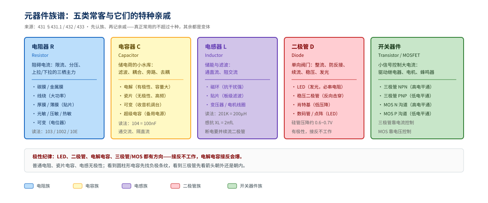
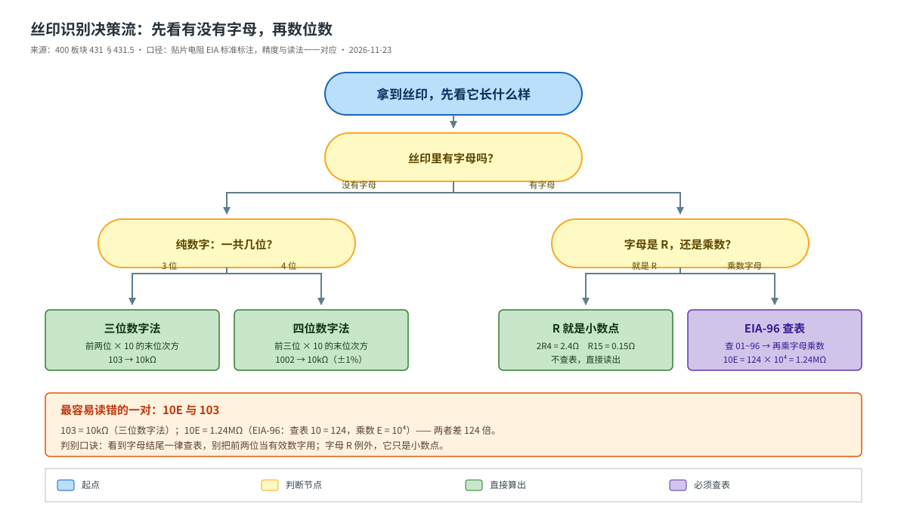

# 431 元器件全景与电阻读法

> **解决**：把开发板上真会遇到的元件认全，并把电阻这一种读透——`103` 是 10kΩ、`1002` 也是 10kΩ、`10E` 却是 1.24MΩ。本册先建族谱（有哪些、谁是谁的亲戚），再拆解电阻的参数、材料与三套丝印规则。  
> **范围**：插件与贴片两大阵营 · 五类常客 · 极性纪律 · 电阻四个必看参数 · 五种材料 · 三种特种电阻 · 三位/四位/EIA-96 三套读法 · 色环与直标。  
> **口径**：以贴片件与常见直插件为主；丝印读法以 EIA 标准与厂商通用标注为准；元件参数以 datasheet 为最终依据。  
> **更新**：2026-11-23  
> **本册导读** ── 必会三点：① 电阻三种数字读法（三位/四位/EIA-96）② 看到字母结尾一定要查表，不能拿前两位当数字用 ③ 每种元件买之前看哪几个参数 ｜ 跟做时长：约 2 小时（读丝印 + 列采购参数表） ｜ 前置：411（三要素）、412（功率）。  
> **标记**：★ = 必会节；○ = 拓展节。

## 目录

| 节 | 内容 |
|---|---|
| 431.1 | 两大封装阵营与五类常客 ○ |
| 431.2 | 极性纪律：哪些元件不能接反 ★ |
| 431.3 | 电阻：买之前看四个参数 ★ |
| 431.4 | 五种材料与三种特种电阻 ○ |
| 431.5 | 丝印三套规则：先数位数再决定用哪套 ★ |
| 431.6 | EIA-96 对照表与两个易错例 ★ |
| 431.7 | 色环法与直标法 ○ |
| 431.8 | 跟做：读四个真实丝印 ★ |
| 431.9 | 坑表 |
| 431.10 | 检查清单（自测 6 题 + 动手任务 2 件） |

---

## 431.1 两大封装阵营与五类常客 ○

**两大封装阵营**：

| 阵营 | 特征 | 场景 |
|---|---|---|
| 插件式（直插） | 有引脚穿过 PCB 焊接，体积大、好手工焊 | 面包板实验、电源板、大功率 |
| 贴片式（SMD） | 直接贴焊在板面，小、适合机器贴装 | 现代产品板、开发板 |

**五类常客**（其余都是它们的变体或延伸）：

| 元件 | 符号直觉 | 在嵌入式里的角色 |
|---|---|---|
| 电阻器 R | 阻碍电流的"阀门" | 限流（LED）、分压（ADC 前置）、上拉/下拉（422） |
| 电容器 C | 储电荷的"小水库" | 滤波、耦合、旁路、去耦（432） |
| 电感器 L | 储磁能的"飞轮" | 电源滤波、开关电源储能（433） |
| 二极管 D | 单向阀门 | 防反接、整流；LED 是它的发光亲戚（441） |
| 晶体管（三极管/MOS） | 小信号控制大电流的开关 | 驱动继电器/电机；数字芯片的内部原子（442 / 443） |



**这个族谱怎么用**：拿到一块陌生的板子，先把元件往这五类里归。归不进去的，多半是它们的组合（数码管 = 多个 LED、光耦 = LED + 光敏管）或外围件（接插件、蜂鸣器、晶振、稳压芯片）。**归类的目的是知道"它大概干什么"，不是背型号**。

## 431.2 极性纪律：哪些元件不能接反 ★

| 有极性（接反不工作甚至爆） | 无极性（怎么接都行） |
|---|---|
| LED、普通二极管、电解电容、钽电容、电池、稳压芯片 | 普通电阻、瓷片电容、电感、陶瓷电容 |

**看到圆柱形电容先找负极标记**——这是新手烧电容最常见的原因。电解电容的负极侧有一条**印着减号的宽带**，钽电容则用一条**加号或色带标正极**（注意两者标法相反，别套用）。

**为什么接反会爆**：电解电容内部是卷绕的铝箔与电解液，极性决定了氧化层的方向。接反后氧化层被反向电解，迅速失效，内部产气——轻则鼓包，重则炸开。**这不是"性能下降"，是物理破坏**。

**判极性三个办法**：

1. **看标记**：二极管有色环的一端是阴极（K）；LED 长脚是阳极。
2. **用万用表二极管档**：正向显示 0.5~0.8V，反向显示 `OL`（454 §454.2）。
3. **查 datasheet 的封装图**：贴片件底部标记、缺口方向都有规定。

## 431.3 电阻：买之前看四个参数 ★

| 参数 | 含义 | 常见取值 |
|---|---|---|
| 阻值 | 阻碍电流的能力 | 1Ω ~ 10MΩ |
| **额定功率** | 长期连续安全工作可耗散的最大功率 | 1/8W、1/4W、1/2W、1W、2W… |
| 精度（容差） | 实际值与标称值的允许偏差 | ±5%（J）、±1%（F）、±0.1%（B） |
| 价格 | 精度越高越贵 | 0.1% 约为 1% 的十倍，1% 约为 5% 的 1.3 倍 |

**额定功率怎么核**（这条最容易忽略）：一只 1/4W、1kΩ 的电阻，能长期流过多大电流？

```text
P = I²R  →  0.25 = I² × 1000  →  I = 0.0158A ≈ 15mA
超过 15mA 长期跑，电阻会烫到变色、阻值漂移
```

**这条计算与 412 §412.6 是同一件事**：本册从"选型"的角度再看一次——**买电阻时就要把功率定下来，而不是装上去才发现烫**。

**精度怎么选**（不是越高越好）：

| 场景 | 够用的精度 |
|---|---|
| LED 限流、上拉下拉 | ±5% 完全够 |
| 分压给 ADC 参考 | ±1% 更稳 |
| 精密测量、仪表前端 | ±0.1% 起，还要看温度系数 |

**价格与精度的关系值得看一眼**：0.1% 约为 1% 的十倍价，1% 约为 5% 的 1.3 倍价。所以**能用 5% 就不用 1%**——多花的钱买不到对应的收益。

## 431.4 五种材料与三种特种电阻 ○

**五种常见材料**（按工艺分，选型时看这张表）：

| 材料 | 特点 | 场景 |
|---|---|---|
| 碳膜 | 成本低、阻值范围宽、稳定性好 | 民用家电，最常用 |
| 金属膜 | 精度高、噪声小、温度系数小 | 仪器仪表、通信设备 |
| 线绕 | 耐大功率（5~20W）、精度高、**高频性能差** | 大功率、过载保护 |
| 厚膜（贴片） | 成本低、精度一般 | 主流电子产品 |
| 薄膜（贴片） | 精度高、成本高 | 精密仪器、军工航空 |

**"线绕高频性能差"值得单独记**：线绕电阻本身就是个线圈，有电感。高频电路里它会变成一个"电阻 + 电感"，破坏信号。**看到线绕电阻就不要往高频通路上放**。

**三种特种电阻**（靠"环境量"改变阻值）：

| 类型 | 特性 | 用途 |
|---|---|---|
| 光敏电阻 | 光照越强，阻值越低 | 光控灯、报警器（453 光感灯的起点） |
| 压敏电阻 | 两端电压超阈值时阻值骤降 | 吸收浪涌、雷击保护（并联在电路两端） |
| 热敏电阻 | 温度变化引起阻值变化 | 温度检测、过流保护 |

**压敏电阻丝印怎么读**（`10D180K` 这类）：

```text
10  = 直径 10mm
D   = 圆形（S 表示方形）
180 = 前两位 18 是有效数字，末位 0 表示加 0 个零 → 压敏电压 18V
K   = 误差 ±10%（J=±5%、K=±10%、M=±20%）
```

**注意这里的 `180` 不是 18Ω**：压敏电阻的丝印是**电压值**，不是阻值。同一种数字标注法，在不同元件上含义完全不同的情况很常见——**先确认元件类型，再套读法**。

## 431.5 丝印三套规则：先数位数再决定用哪套 ★

贴片电阻的丝印有三套规则，**先数位数再决定用哪套**——这是读错丝印的根本原因。



### 三位数字法（±5% 精度，最常见）

前两位是有效数字，第三位是"补几个零"，单位 Ω。**R 表示小数点。**

```text
472  → 47 × 10² = 4700Ω = 4.7kΩ
151  → 15 × 10¹ = 150Ω
2R4  → 2.4Ω        （R 占一位，表示小数点）
R15  → 0.15Ω
```

### 四位数字法（±1% 精度）

前三位有效数字，第四位补零的个数。

```text
1002 → 100 × 10² = 10000Ω = 10kΩ
1001 → 100 × 10¹ = 1000Ω = 1kΩ
R500 → 0.5Ω（500mΩ）
```

### EIA-96 精密法（±0.1%~±1%，两位数字 + 一位字母）

这是最容易读错的一套：**前两位数字不是有效数字，要去对照表查**；第三位字母是乘数。

```text
乘数：Y=10⁻²  X=10⁻¹  A=10⁰  B=10¹  C=10²  D=10³  E=10⁴  F=10⁵

01B → 查表 01=100，B=10¹  → 100 × 10 = 1000Ω = 1kΩ
10E → 查表 10=124，E=10⁴  → 124 × 10⁴ = 1.24MΩ   ⚠️ 不是 10kΩ！
```

> **一个真实易错点**：`10E` 和 `103` 长得像，但含义天差地别——`103` = 10kΩ（三位数字法），`10E` = 1.24MΩ（EIA-96）。**看到字母结尾，一定去查表，不要拿前两位当数字用。**

## 431.6 EIA-96 对照表与两个易错例 ★

**代号对照表**（01~96 对应三位有效数字）：

| 代号 | 值 | 代号 | 值 | 代号 | 值 | 代号 | 值 |
|---|---|---|---|---|---|---|---|
| 01 | 100 | 25 | 178 | 49 | 316 | 73 | 562 |
| 02 | 102 | 26 | 182 | 50 | 324 | 74 | 576 |
| 03 | 105 | 27 | 187 | 51 | 332 | 75 | 590 |
| 04 | 107 | 28 | 191 | 52 | 340 | 76 | 604 |
| 05 | 110 | 29 | 196 | 53 | 348 | 77 | 619 |
| 06 | 113 | 30 | 200 | 54 | 357 | 78 | 634 |
| 07 | 115 | 31 | 205 | 55 | 365 | 79 | 649 |
| 08 | 118 | 32 | 210 | 56 | 374 | 80 | 665 |
| 09 | 121 | 33 | 215 | 57 | 383 | 81 | 681 |
| 10 | 124 | 34 | 221 | 58 | 392 | 82 | 698 |
| 11 | 127 | 35 | 226 | 59 | 402 | 83 | 715 |
| 12 | 130 | 36 | 232 | 60 | 412 | 84 | 732 |
| 13 | 133 | 37 | 237 | 61 | 422 | 85 | 750 |
| 14 | 137 | 38 | 243 | 62 | 432 | 86 | 768 |
| 15 | 140 | 39 | 249 | 63 | 442 | 87 | 787 |
| 16 | 143 | 40 | 255 | 64 | 453 | 88 | 806 |
| 17 | 147 | 41 | 261 | 65 | 464 | 89 | 825 |
| 18 | 150 | 42 | 267 | 66 | 475 | 90 | 845 |
| 19 | 154 | 43 | 274 | 67 | 487 | 91 | 866 |
| 20 | 158 | 44 | 280 | 68 | 499 | 92 | 887 |
| 21 | 162 | 45 | 287 | 69 | 511 | 93 | 909 |
| 22 | 165 | 46 | 294 | 70 | 523 | 94 | 931 |
| 23 | 169 | 47 | 301 | 71 | 536 | 95 | 953 |
| 24 | 174 | 48 | 309 | 72 | 549 | 96 | 976 |

**读这个表的顺序**：先查前两位数字 → 得到三位有效数字 → 再看字母乘数 → 相乘。**两步，不要跳**。

**两个易错例**（都来自真实贴片件）：

| 丝印 | 错读 | 正读 | 错在哪 |
|---|---|---|---|
| `10E` | 10 × 10⁴ = 100kΩ | 124 × 10⁴ = **1.24MΩ** | 把代号 10 当成了 10 |
| `01C` | 1 × 10² = 100Ω | 100 × 10² = **10kΩ** | 把代号 01 当成了 1 |

**为什么这套规则必须存在**：EIA-96 用两位数字表达 96 个值，配合 8 个乘数，能覆盖 E96 系列的精密阻值。**它牺牲了"一眼可读"换取"精密件可用短丝印"**——代价是必须查表。

## 431.7 色环法与直标法 ○

- **色环**：4 环或 5 环表示阻值与精度，靠颜色顺序记忆。**实战建议：直接用万用表量，别读色环**——色环受光照、褪色影响大，读错率高。
- **直标法**：元件表面直接印"4Ω J"这类，J 是误差代号（A=±0.05%、B=±0.1%、C=±0.25%、D=±0.5%、F=±1%、G=±2%、J=±5%、K=±10%、M=±20%）。

**两组字母代号不要混**：

| 字母 | 在**误差**位置的含义 | 在 **EIA-96 乘数**位置的含义 |
|---|---|---|
| B | ±0.1% | ×10¹ |
| C | ±0.25% | ×10² |
| D | ±0.5% | ×10³ |
| F | ±1% | ×10⁵ |

**同一个字母，位置不同含义完全不同**。判据是它在丝印的哪一段：**紧跟在阻值后面的字母是误差，末尾单独一位字母是乘数**。

## 431.8 跟做：读四个真实丝印 ★

下面四个实物丝印，先自己读，再看答案。

| 丝印 | 用哪套规则 | 阻值 |
|---|---|---|
| `1002` | 四位数字法 | 100 × 10² = **10kΩ** |
| `R10` | 三位数字法（R 为小数点） | **0.10Ω** |
| `3R40` | 四位数字法（R 为小数点） | **3.40Ω** |
| `103` | 三位数字法 | 10 × 10³ = **10kΩ** |

**试一试**：`4701` 是多少？`01C` 是多少？

> 4701 = 4.7kΩ（四位法）；01C = 100 × 10² = 10kΩ（EIA-96）。两者同为 10kΩ，但前者是 ±1% 的普通件、后者是 EIA-96 精密件——**精度不同，价钱不同**。

**判据回顾**（读完丝印后自查）：看到 `R` 就是在说小数点；看到**末尾字母**就去查表；纯数字先数位数。**三条判据覆盖 99% 的贴片电阻**。

## 431.9 坑表

| # | 现象 | 原因 | 解法 |
|---|---|---|---|
| 1 | 电阻丝印读出来差 1000 倍 | 把 EIA-96 的 `10E` 当成 `103` | 见字母就查表（§431.5~431.6） |
| 2 | 压敏电阻丝印当成阻值读 | 它的丝印是**电压**，不是阻值 | 先确认元件类型，再套读法（§431.4） |
| 3 | 电阻用久了变色 | 额定功率没留余量 | 用 P=I²R 反查电流上限（§431.3） |
| 4 | 电解电容装反爆浆 | 有极性，接反 | 认负极条纹，装配前再核一遍（§431.2） |
| 5 | 钽电容按电解的方式认极性 | 钽电容色带标**正极**，与电解相反 | 分开记（§431.2） |
| 6 | 精度买高了，成本翻十倍 | 没按场景选精度 | LED 限流 5% 足够（§431.3） |
| 7 | 色环读错，阻值离谱 | 光照/褪色影响辨识 | 直接用万用表量（§431.7） |
| 8 | 高频电路上用了线绕电阻 | 线绕本身有电感 | 高频通路避免线绕（§431.4） |

## 431.10 检查清单（自测 6 题 + 动手任务 2 件）

**自测**：

| # | 问题 | 自测标准 |
|---|---|---|
| 1 | `103`、`1002`、`10E` 各是多少 | 10kΩ / 10kΩ / 1.24MΩ（§431.5~431.6） |
| 2 | 电阻四个必看参数 | 阻值/功率/精度/价格（§431.3） |
| 3 | 1/4W、1kΩ 的长期电流上限 | 约 15mA（§431.3） |
| 4 | 哪些元件有极性 | LED、二极管、电解/钽电容、电池、稳压芯片（§431.2） |
| 5 | EIA-96 的读法顺序 | 查前两位代号 → 得有效数字 → 乘字母系数（§431.6） |
| 6 | 丝印末尾字母是误差还是乘数 | 紧跟阻值后的是误差，末尾单独的是乘数（§431.7） |

**动手任务**：① 找任意一块开发板或元件盒，挑 5 个电阻读出阻值并与万用表实测对照，记录读错的；② 给下面这份采购单补齐参数——"LED 限流电阻 ×10、MCU 电源脚去耦电容 ×10、3.3V 稳压芯片 ×1"，每种写出阻值/容量、耐压或功率、封装。

> 下一篇：《432 电容：容抗与四类用途》——第二类无源器件，也是嵌入式板子上数量最多的一种。
