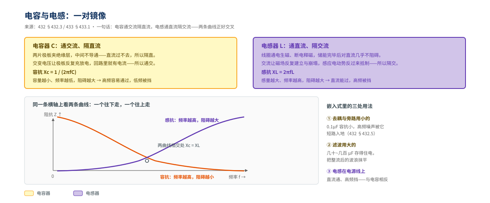
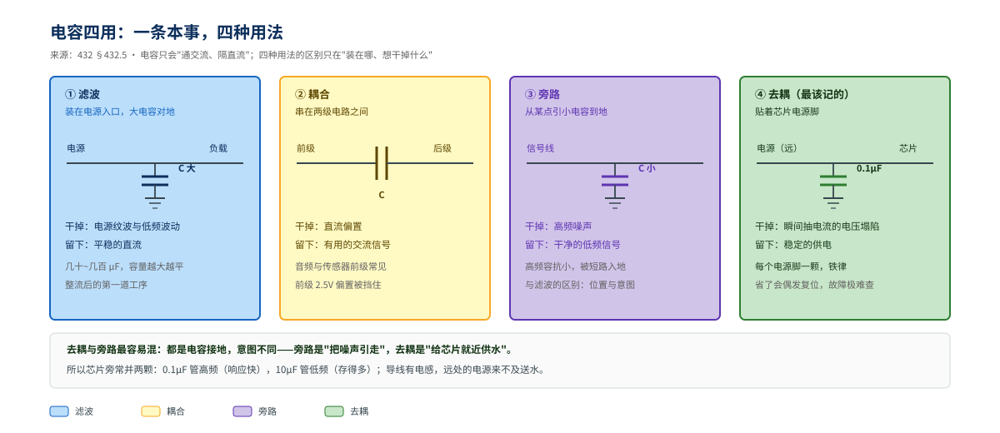
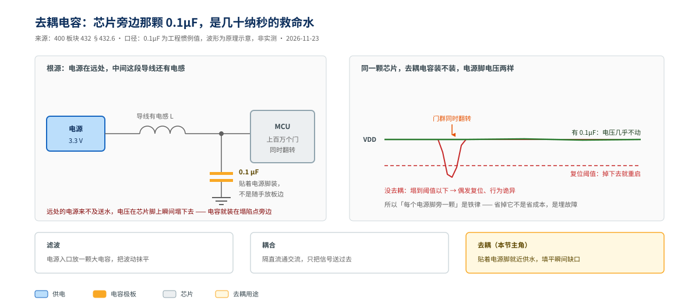

# 432 电容：容抗与四类用途

> **解决**：板子上数量最多的元件是电容，而它的本事只有一条——通交流、隔直流。本册把这条本事拆成四种用法（滤波、耦合、旁路、去耦），并讲清"贴在电源脚那颗 0.1μF"为什么是铁律而不是装饰。  
> **范围**：电容的结构与原理 · 三个必看参数 · 三种容量读法 · 容抗公式与频段选择 · 四类结构分类 · 四种用法的分界 · 去耦电容的物理意义。  
> **口径**：只讲直流与低频信号场景；不涉及阻抗匹配、谐振回路设计；0.1μF 与 10μF 的搭配为工程惯例值。  
> **更新**：2026-11-23  
> **本册导读** ── 必会三点：① `104` = 10×10⁴ pF = 100nF = 0.1μF ② 容抗 Xc = 1/(2πfC)，频率越高阻碍越小 ③ 去耦与旁路都是"电容接地"，但意图相反——一个就近供电、一个引走噪声 ｜ 跟做时长：约 2 小时 ｜ 前置：421（串并联）、412（功率）。  
> **标记**：★ = 必会节；○ = 拓展节。

## 目录

| 节 | 内容 |
|---|---|
| 432.1 | 电容是什么：两块极板之间的学问 ★ |
| 432.2 | 三个必看参数与三种容量读法 ★ |
| 432.3 | 容抗：电容对交流的阻碍有多大 ★ |
| 432.4 | 四类结构与选型 ★ |
| 432.5 | 四类用途：滤波、耦合、旁路、去耦 ★ |
| 432.6 | 去耦：嵌入式最该记住的一条 ★ |
| 432.7 | 坑表 |
| 432.8 | 检查清单（自测 6 题 + 动手任务 2 件） |

---

## 432.1 电容是什么：两块极板之间的学问 ★

**定义**：两片靠得很近的平行极板，中间夹一层绝缘介质。

**工作机制**：通电时两极板分别聚集正负电荷（充电），撤电后短接则中和（放电）。

**为什么"通交流、隔直流"**：

- **直流过不去**：中间是绝缘介质，没有导电通路，电荷只能堆积在极板上，堆满了就停。
- **交流过得去**：电压方向反复变化，极板跟着反复充放电，等效于"电流一直在流"。

> **一句话**：电容的本事只有一条——**通交流、隔直流**。后面四种用法都是这一条在不同位置的应用。

**与电阻的根本区别**：电阻消耗能量（变成热），电容**储存**能量（充电时存、放电时还）。所以电容不是"阻碍电流"，而是"改变电流的时间分布"。

## 432.2 三个必看参数与三种容量读法 ★

**三个必看参数**：

| 参数 | 说明 | 常见取值 |
|---|---|---|
| 容量 | 能储存多少电荷 | 1F = 10³mF = 10⁶μF = 10⁹nF = 10¹²pF |
| **耐压值** | 能承受的最大电压，超了会击穿甚至爆 | 6.3V、10V、16V、25V、50V、100V…（常用到 600V） |
| 容差 | 实际容量与标称的偏差 | B=±0.1pF、C=±0.25pF、D=±0.5pF、J=±5%、K=±10% |

**耐压与体积的关系**（选型时很实用）：标称耐压越高，电容体积越大；有极性（电解）的耐压偏低、容量大且便宜，无极性（瓷片）耐压高、容量小。

> **选型第一判据**：**耐压值必须高于电路里可能出现的最高电压**，通常留 1.5~2 倍余量。3.3V 电路用 10V 或 16V 的电容，5V 电路用 16V 以上。

**三种容量读法**：

```text
① 直接标注法（电解电容）：表面印多少就是多少，如 470μF、1500μF
② 三位乘方表示法（瓷片电容）：前两位有效数字 + 第三位补零个数，单位 pF
     100 → 10 × 10⁰ = 10pF
     102 → 10 × 10² = 1000pF = 1nF
     103 → 10 × 10³ = 10000pF = 10nF
     104 → 10 × 10⁴ = 100000pF = 100nF
     105 → 10 × 10⁵ = 1000nF = 1μF
③ 字母表示法（IEC 推荐）：p/n/u/m 表示单位，字母前是整数、字母后是小数
     1p5 → 1.5pF     4u7 → 4.7μF     3n9 → 3.9nF
```

**贴片电解电容是例外**：丝印数字直接读，单位 μF（如 `470` = 470μF）。

**最容易错的一步是单位**：瓷片电容的三位法算出来的**单位是 pF**，不是 μF。`104` = 100000pF，不是 104pF，也不是 104μF。

**同一颗电容的三种写法**（必须能瞬间互换）：

```text
104  =  100nF  =  0.1μF
```

这三个写法在原理图、BOM、实物丝印上各用一种，认不出是同一颗就会买错件。

## 432.3 容抗：电容对交流的阻碍有多大 ★

**定义**：电容对交流电的阻碍称为**容抗**，与频率和容量都成反比。

```text
Xc = 1 / (2πfC)     容量越小、频率越低，阻碍越大
```

**这条公式给出一个极好用的判据**：

| 想做什么 | 选多大的电容 | 为什么 |
|---|---|---|
| 滤掉高频噪声 | 小（0.01μF ~ 0.1μF） | 高频下容抗极小，噪声被短路入地 |
| 滤掉低频纹波 | 大（几十 ~ 几百 μF） | 低频下小电容容抗太大，起不到作用 |
| 隔断直流、通过音频信号 | 中等（1μF ~ 10μF） | 直流容抗无穷大，音频频率下容抗足够小 |

**所以 0.1μF 这种小电容专管高频，几 μF~几十 μF 的管低频**——这不是习惯，是容抗公式的直接推论。

**与电感正好对称**：



| | 电容 | 电感 |
|---|---|---|
| 直流 | 隔断（容抗 ∞） | 通过（感抗 0） |
| 高频 | 通过（容抗小） | 阻碍（感抗大） |
| 一句话 | 通交隔直 | 通直隔交 |

**边界**：本节只给标量公式，不做复数运算与相位分析。真实电路里容抗与感抗会组成谐振，属于硬件设计范畴。

## 432.4 四类结构与选型 ★

| 类型 | 极性 | 特点 | 用途 |
|---|---|---|---|
| 电解电容 | **有极性**，接反会爆 | 容量大、便宜，只能用于直流 | 电源储能、滤波 |
| 瓷片电容 | 无极性 | 容量小、高频特性好 | 高频旁路、振荡回路、去耦 |
| 可变电容 | 无极性 | 可调，收音机调台用 | 调谐（很少用） |
| 超级电容 | 有极性 | 容量极大、充放电快，介于电容与电池之间 | 备用电源、瞬间供电 |

**一句话选型**：要**大容量储能**选电解（注意极性），要**高频与去耦**选瓷片。

**为什么电解电容容量这么大**：它用电解液浸润的粗糙箔面做极板，等效表面积是普通平行板的成百上千倍（容量与面积成正比）。代价是极性、寿命（电解液会干涸）和较差的高频特性。

**电解电容的寿命问题值得单独说**：标称寿命通常 1000~8000 小时（@105℃），温度每降 10℃ 寿命约翻倍。**所以老设备故障常常是"电源部分的电解电容鼓了"**——不是设计问题，是耗材到期。

## 432.5 四类用途：滤波、耦合、旁路、去耦 ★

四种用法都是"通交隔直"这一条本事的应用，区别在"装在哪儿、想干掉什么"。

| 用法 | 装在哪 | 干掉什么 | 留下什么 |
|---|---|---|---|
| **滤波** | 电源入口，大电容对地 | 电源纹波与低频波动 | 平稳的直流 |
| **耦合** | 两级电路之间串接 | 直流偏置 | 有用的交流信号 |
| **旁路** | 某点到地，小电容 | 高频噪声 | 低频与直流 |
| **去耦** | 芯片电源脚旁，紧贴 | 芯片瞬间抽电流造成的电压塌陷 | 稳定的供电 |



**滤波**：整流后的电压是"波浪形"的，并联一只大电容（几十~几百 μF）把波峰的电存起来、波谷时放出来，输出就平了。容量越大越平，但体积和成本也上去了。

**耦合**：前一级输出带 2.5V 直流偏置，后一级只想放大交流成分——串一只电容，直流被挡住，交流照过。音频电路里到处都是。

**旁路**：某条线上混着高频噪声，从该点接一只小电容到地，高频短路入地，剩下的干净信号继续走。

**四个词的位置关系**（看图记最快）：

```text
滤波：串在电源路径上？不——是并在电源与地之间，大电容
耦合：串在信号路径上（电容在"路上"）
旁路：并在信号与地之间，小电容
去耦：并在芯片电源脚与地之间，紧贴芯片
```

**判据**：**串在路上的是耦合，并在旁边的是滤波/旁路/去耦**。并的三个再按"给谁服务"分：给整机电源的叫滤波，给某条信号线的叫旁路，给某颗芯片的叫去耦。

## 432.6 去耦：嵌入式最该记住的一条 ★

**现象**：芯片内百万级门同时翻转的瞬间，要从电源抽走一大股电流。

**为什么远处的电源来不及送**：导线有电感（哪怕是直的铜线），电感阻碍电流突变。远处的电源"来不及送水"，电源脚上的电压会瞬间塌陷——轻则逻辑出错，重则复位。

**解法**：芯片电源脚旁放一只 0.1μF，就近供水，填平那几十纳秒的缺口。



> **每颗芯片的每个电源脚旁一颗 0.1μF，是铁律不是装饰。**

**省掉它的症状**："偶发复位、行为诡异"——这类故障最难查，因为一切看起来都正常。用示波器能抓到电源脚的毛刺，但多数人没有示波器，于是只能靠"补上去试试"。

**为什么常并两颗（0.1μF + 10μF）**：

| 电容 | 管什么 | 位置 |
|---|---|---|
| 0.1μF（瓷片） | 高频（几十 ns 级的瞬间缺口） | **紧贴电源脚**，越近越好 |
| 10μF（电解/钽） | 低频（ms 级的波动、负载突变） | 可以稍远，放在芯片附近 |

**"紧贴"为什么重要**：中间那段走线的电感会抵消电容的作用。**电容离引脚 1cm 与 5mm，效果能差一个数量级**——这不是玄学，是走线电感。

**去耦与旁路的分界**：旁路是"把噪声引走"，去耦是"给芯片就近供电"。物理上都是电容接地，但意图不同——**这也是为什么不能简单地"多放几个电容就完事"，得知道每个在干什么**。

## 432.7 坑表

| # | 现象 | 原因 | 解法 |
|---|---|---|---|
| 1 | 电容标 `104` 却不清楚多大 | 单位是 pF，不是 μF | 104 = 10×10⁴ pF = 100nF（§432.2） |
| 2 | 把 `104` 当成 104pF | 三位法要按"前两位 + 补零"算 | 见 §432.2 的三个例子 |
| 3 | 电解电容装反爆浆 | 有极性，接反 | 认负极条纹，装配前再核一遍（§432.1） |
| 4 | 电容耐压不够，击穿短路 | 只看容量没看耐压 | 耐压留 1.5~2 倍余量（§432.2） |
| 5 | 芯片偶发复位、行为诡异 | 电源脚没加去耦电容 | 每个电源脚配 0.1μF（§432.6） |
| 6 | 加了去耦还是没用 | 电容放得太远，走线电感抵消 | 紧贴电源脚，越近越好（§432.6） |
| 7 | 老设备电源部分鼓包 | 电解电容寿命到期（耗材） | 换同规格新品（§432.4） |
| 8 | 高频噪声滤不掉 | 用了大电容（高频容抗不够小） | 高频用小电容，见 Xc 公式（§432.3） |

## 432.8 检查清单（自测 6 题 + 动手任务 2 件）

**自测**：

| # | 问题 | 自测标准 |
|---|---|---|
| 1 | `104` 电容是多少 | 100nF = 0.1μF（§432.2） |
| 2 | 电容为什么通交流隔直流 | 介质不导通，但交变电压反复充放电（§432.1） |
| 3 | 容抗公式与频段选择 | Xc=1/(2πfC)；高频用小电容（§432.3） |
| 4 | 电解与瓷片怎么选 | 大容量储能选电解（注意极性），高频去耦选瓷片（§432.4） |
| 5 | 去耦与旁路的区别 | 就近供电 vs 把噪声引走（§432.5） |
| 6 | 去耦为什么必须紧贴电源脚 | 走线电感会抵消电容作用（§432.6） |

**动手任务**：① 找一块开发板，数出所有 0.1μF 去耦电容的位置，量一量它们离各自芯片电源脚的距离（目测即可），判断有没有放得偏远；② 把 `104`、`103`、`223`、`4u7` 四个标法各换算成 nF 与 μF，写成一行对照。

> 下一篇：《433 电感、继电器与接插件》——第三类无源器件，以及把板子与外部世界连起来的那些件。
