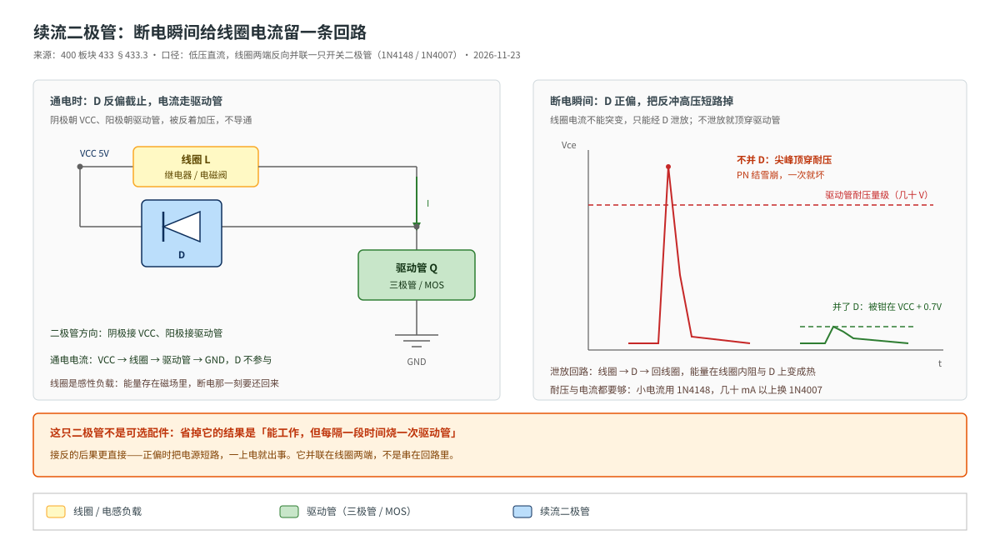

# 433 电感、继电器与接插件

> **解决**：把剩下的常客一次认完——电感（与电容正好相反）、继电器（小电流开大电流）、保险丝（故意做脆弱的电阻）、接插件（唯一要记的是脚间距）、蜂鸣器（有源无源之分）、电池与稳压芯片。它们的共同点是：**都是把电路与外部世界连接的件**。  
> **范围**：电感原理与感抗 · 电感丝印 · 继电器参数与续流二极管 · 保险丝参数与自恢复 · 接插件脚间距 · 有源/无源蜂鸣器 · 电池型号与容量 · 稳压芯片选型。  
> **口径**：以常见直插件与开发板上的件为主；不涉及开关电源拓扑设计与继电器触点寿命计算。  
> **更新**：2026-11-23  
> **本册导读** ── 必会三点：① 电感**通直隔交**，与电容正好相反 ② 继电器线圈必须并**续流二极管**，否则断电瞬间击穿驱动管 ③ 有源蜂鸣器给电平就响，无源必须给方波——欧姆档有读数的是无源 ｜ 跟做时长：约 1.5 小时 ｜ 前置：432（电容与容抗）、412（功率与发热）。  
> **标记**：★ = 必会节；○ = 拓展节。

## 目录

| 节 | 内容 |
|---|---|
| 433.1 | 电感：储能与通直隔交 ★ |
| 433.2 | 电感丝印与两个必看参数 ★ |
| 433.3 | 继电器：用小电流开大电流 ★ |
| 433.4 | 保险丝：一只故意做脆弱的电阻 ○ |
| 433.5 | 接插件：唯一要记的是脚间距 ★ |
| 433.6 | 蜂鸣器：有源与无源之分 ★ |
| 433.7 | 电池与稳压芯片 ○ |
| 433.8 | 坑表 |
| 433.9 | 检查清单（自测 6 题 + 动手任务 2 件） |

---

## 433.1 电感：储能与通直隔交 ★

**定义**：导线绕成线圈，电流通过时把电能转成磁能存起来。

**单位**亨利 H，常用 mH / μH（1H = 10³mH，1mH = 10³μH）。

**与电容恰好相反**：

| | 电容 | 电感 |
|---|---|---|
| 直流通路 | 隔断 | **通过**（储能完毕后几乎不阻碍） |
| 高频 | 通过 | **阻碍** |
| 储能形式 | 电场（电荷） | 磁场（电流） |
| 阻碍的公式 | Xc = 1/(2πfC) | **XL = 2πfL** |

**感抗**：

```text
XL = 2πfL       频率越高、感量越大，阻碍越强
```

**两个公式对照着记**：容抗与 fC **成反比**，感抗与 fL **成正比**。这就是"电容让高频过、电感挡高频"的数学来源，**不是两条独立的规定，是一条公式的一个除号**。

**电感为什么"通直隔交"**：电感的本质是"阻碍电流变化"（楞次定律：感应电动势总反抗电流的变化）。直流电流恒定 → 没有变化 → 不阻碍；交流电流一直在变 → 一直阻碍，频率越高阻碍越强。

> **一句话**：**电感抵抗的是"变化"，电容抵抗的是"不变"**。

**嵌入式要看的两点**（其余归硬件工程师）：① **储能**——开关电源靠它续流；② **通直隔交**——电源线上串一颗，把高频噪声挡在外面。

**常见类型**：磁环电感（绕在环形磁芯上，抗干扰强）、贴片电感（体积小，用于板级滤波）。

## 433.2 电感丝印与两个必看参数 ★

**三个参数**：

| 参数 | 说明 |
|---|---|
| 电感量 | 与线圈面积、圈数、有无磁芯有关 |
| 直流电阻 DCR | 线圈本身的电阻，等效于串联一只小电阻，**越小越好** |
| 允许误差 | J=±5%、K=±10%、L=±15%、M=±20%、P=±25%、N=±30% |

**DCR 为什么重要**：电感串在电源通路上，DCR 直接造成压降与发热。**大电流场合 DCR 是首要选型参数**，感量反而次要——一个 DCR 0.5Ω 的电感通 2A 就是 2W 的纯发热（按 412.3 的 P=I²R 算）。

**丝印读法**（三位数字 + 一位字母，末位数字是补零个数）：

```text
201K → 20 × 10¹ = 200μH，K = ±10%
4R7J → 4.7μH，J = ±5%       （R 表示小数点，单位 μH）
4N7J → 4.7nH                （N 表示小数点，单位 nH）
```

**注意与电阻的区别**：同样是 `R` 表示小数点，但电感的**默认单位是 μH**，电阻是 Ω。**同一个符号在不同元件上含义不同，先认元件类型再套读法**（431.4 的压敏电阻是同一个坑）。

## 433.3 继电器：用小电流开大电流 ★

**定义**：用小电流控制大电流的"自动开关"——线圈通电产生磁力吸合触点。

**为什么需要它**：GPIO 只能给十几 mA，驱动 220V 的负载必须靠继电器这种"隔空操作"的机械开关。它的价值在于**电气隔离**：控制侧与负载侧没有电连接，只有磁耦合。

| 参数 | 含义 |
|---|---|
| 额定电压 | 线圈正常工作能承受的电压（常见 5V、12V） |
| 最大切换电流 | 触点能通过的最大负载电流 |
| 最大切换电压 | 触点能正常开合的最高电压 |
| 触点形式 | 常开（NO）、常闭（NC）、转换（COM+NO+NC） |

**单刀单掷 vs 单刀双掷**：单刀单掷只有"通/断"两态；单刀双掷有一把刀在两个触点间切换（像岔道），可做"二选一"。

**驱动纪律（本册最重要的一条）**：线圈是电感性负载，断电瞬间会产生反电动势，**必须并一只续流二极管**保护驱动管。

```text
        VCC
         │
      [ 线圈 ]
         │
         ├──────┤◁├────  续流二极管（反向并联在线圈两端）
         │
      [ 驱动管 C ]
         │
        GND
```



**反电动势有多大**：断电瞬间电流突变，电感按 `U = L × di/dt` 产生反向高压，可能是电源电压的几倍到几十倍。**不并二极管的后果是驱动管被击穿**——这是"继电器一断电就烧管"的唯一原因（见表 433.8 第 1 条）。

**二极管方向**：**反向并联**——正常工作时截止（不影响电路），断电时正向导通泄放。接反了会直接把电源短路。

**嵌入式怎么驱动继电器**：GPIO → 基极电阻 → 三极管（442）→ 线圈，线圈两端并续流二极管。**三个元件缺一不可**。

## 433.4 保险丝：一只故意做脆弱的电阻 ○

**定义**：本质是一只"故意做脆弱"的电阻，电流超额定值时熔断，切断电路保护后级。

| 参数 | 说明 |
|---|---|
| 额定电压 | 安全使用所允许的电路最高工作电压 |
| 额定电流 | 常见 100mA、200mA、315mA、500mA、1A、2A、3A、5A… |
| 熔断速度 | TT（特慢）、T（慢）、M（中）、F（快）、FF（特快） |

**一次性 vs 自恢复**：一次性熔断后必须更换；自恢复（PPTC）熔断后冷却可复位，适合反复过流的场合（USB 口）。

**熔断速度怎么选**：

| 负载类型 | 选哪种 | 原因 |
|---|---|---|
| 纯阻性（加热、照明） | F（快断） | 无启动冲击，快断更安全 |
| 电机、变压器 | T（慢断） | 启动瞬间有大电流，快断会误熔 |
| USB 供电 | 自恢复 | 需要反复插拔、偶发过流 |

**选额定电流的原则**：**大于正常工作电流、小于导线与器件的承受上限**——它保护的是导线和电源，不是负载本身。

**配合使用**：压敏电阻吸收浪涌电压 + 保险丝切断持续过流，是电源入口的经典组合。

## 433.5 接插件：唯一要记的是脚间距 ★

**定义**：把不同设备连起来的机械件。**唯一必记的参数是脚间距（pitch）**：

```text
1.25 / 1.5 / 2.0 / 2.54 / 3.5 / 3.81 / 3.96 / 5.08 / 7.62 mm
其中 2.54mm（= 0.1 英寸）是面包板与排针的事实标准
```

**为什么脚间距是第一参数**：间距不对，插不上。**这是唯一"参数全对但就是用不了"的元件**——阻值、容量都可以商量，间距差 0.5mm 就是废件。

**常见类型**：

| 类型 | 用途 |
|---|---|
| 排针 / 排母 | 连接核心板与扩展板 |
| 杜邦线 | 面包板飞线 |
| 跳线帽 | 短接两个引脚（BOOT 配置常用，见 451） |
| 轻触按键 | 人机输入 |
| 拨码开关 | 多位配置 |
| DC 插座 | 电源输入 |

**买之前的纪律**：量一下现有板的排针间距（卡尺或对着已知 2.54mm 的排针对比），**不要凭"看起来差不多"下单**。

## 433.6 蜂鸣器：有源与无源之分 ★

**这个区分是新手第一个坑**：

| 类型 | 内部 | 怎么响 |
|---|---|---|
| 有源（自激式） | 含振荡电路 | 通电就响，给高低电平即可 |
| 无源（他激式） | 只有发声元件 | 必须给**方波信号**才响，给直流不响 |

**判别方法**（不用通电）：万用表拨到欧姆档量两端——**有读数（几 Ω~几十 Ω）= 无源；无读数（开路）= 有源**。

**为什么是这个结果**：有源蜂鸣器内部有振荡电路（含三极管），用欧姆档量会被电路的半导体结挡住，读数接近开路；无源蜂鸣器就是一个线圈/压电片，直流电阻很小。

> **记忆抓手**：**无源 = 纯线圈 = 有阻值**；**有源 = 带电路 = 量不到**。

**驱动纪律**：蜂鸣器工作电流常超过 GPIO 能力，一般用三极管或 MOS 管做开关级（442 / 443）。有源蜂鸣器给电平就行，无源要用 PWM 输出方波——**软件写法完全不同**，买错件就会"给了信号不响"。

## 433.7 电池与稳压芯片 ○

**电池两个参数**：

| 参数 | 说明 |
|---|---|
| 额定电压 | 标称工作电压（锂电 3.7V、干电池 1.5V） |
| 容量 | mAh：2000mAh 表示以 2000mA 恒流可放电 1 小时 |

**型号命名**：`18650` = 直径 18mm、长 65mm、圆柱形；`14500` = 直径 14mm、长 50mm、圆柱形。**型号就是尺寸，不是容量**——同样是 18650，容量可以从 1500mAh 到 3500mAh。

**注意锂电的两个危险**：过放（低于 2.5V 会永久损坏）、短路（见 413.3）。**带保护板的电芯才有过放保护**，裸电芯没有。

**稳压芯片**（电源管理芯片）：把不稳定的输入变成稳定输出。三个参数：输入电压范围、输出电压、最大输出电流。

| 型号 | 输出 | 特点 |
|---|---|---|
| 7805 | 5V | 老牌线性稳压，压差大时发热明显 |
| AMS1117-3.3 | 3.3V | 低压差（LDO），开发板常客 |

**发热是它的主要矛盾**：线性稳压把多余电压全变成热（412 §412.6 有算式），压差大、电流大时必须铺铜或加散热片。**这也是为什么开发板多用 5V 输入 + LDO 出 3.3V，而不是从 12V 直接降。**

**LDO 的"低压差"是什么意思**：普通 7805 需要输入比输出高 2V 以上才能稳压，AMS1117 只需要 1V 左右。**压差小 → 发热少**，这就是开发板都选它的原因。

## 433.8 坑表

| # | 现象 | 原因 | 解法 |
|---|---|---|---|
| 1 | 继电器一断电就烧驱动管 | 线圈反电动势没泄放 | 并续流二极管，反向并联（§433.3） |
| 2 | 续流二极管接反，一上电就短路 | 方向装错 | 反向并联：正常截止、断电导通（§433.3） |
| 3 | 蜂鸣器给电平不响 | 买的是无源蜂鸣器 | 改给方波，或换有源件（§433.6） |
| 4 | 排针插不上 | 脚间距不是 2.54mm | 买前量间距（§433.5） |
| 5 | 电感发热严重 | DCR 大，I²R 损耗 | 选 DCR 更小的型号（§433.2） |
| 6 | 电感丝印读成电阻值 | 单位是 μH 不是 Ω | 先认元件类型（§433.2） |
| 7 | 保险丝一上电就熔 | 选了快断型给电机用 | 电机选慢断（T）（§433.4） |
| 8 | 稳压芯片烫手 | 压差 × 电流全变热 | 降输入电压或加散热（§433.7） |

## 433.9 检查清单（自测 6 题 + 动手任务 2 件）

**自测**：

| # | 问题 | 自测标准 |
|---|---|---|
| 1 | 电感与电容的作用为何相反 | 电感通直隔交，电容通交隔直（§433.1） |
| 2 | 感抗与容抗公式的区别 | XL=2πfL（正比）vs Xc=1/(2πfC)（反比）（§433.1） |
| 3 | 继电器为什么必须并续流二极管 | 线圈反电动势会击穿驱动管（§433.3） |
| 4 | 有源与无源蜂鸣器怎么区分 | 欧姆档有读数=无源；无读数=有源（§433.6） |
| 5 | 接插件的第一参数 | 脚间距，2.54mm 是事实标准（§433.5） |
| 6 | LDO 的"低压差"好处 | 压差小 → 发热少（§433.7） |

**动手任务**：① 画一个"GPIO 驱动 5V 继电器"的完整电路（GPIO、基极电阻、三极管、线圈、续流二极管、VCC、GND 全部标出），并说明二极管为什么反向并联；② 找任意一个蜂鸣器（或查它的型号 datasheet），用欧姆档判断有源无源，再写出对应的软件驱动方式（给电平 / 给方波）。

> 下一篇：《441 硅 PN 结与二极管》——无源件讲完，进入半导体：一块硅为什么能当单向阀门。
