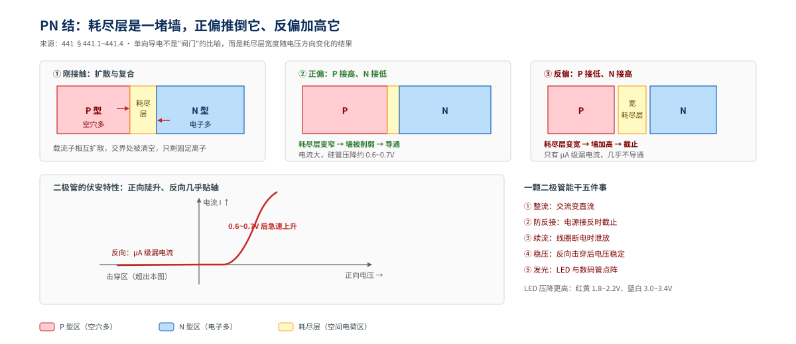

# 441 硅 PN 结与二极管

> **解决**：讲清"为什么一块硅片能当开关"的第一步——硅怎么掺出 P 型和 N 型，PN 结为什么只让电流单向过。理解耗尽层这一层，二极管、三极管、MOS 管、乃至整颗 CPU 才有物理底座。  
> **范围**：本征半导体与两种载流子 · 掺杂造 N/P 型 · PN 结形成的五步 · 耗尽层与单向导电 · 二极管的五种用法 · LED 与数码管。  
> **口径**：经典半导体物理的"够用版"，不涉及能带图与量子统计；以硅管为主，正向压降取典型值（硅 0.6~0.7V）。  
> **更新**：2026-11-23  
> **本册导读** ── 必会三点：① 掺磷得 N 型（多电子）、掺硼得 P 型（多空穴）② PN 结单向导电来自**耗尽层宽度随电压方向变化**，不是"阀门"的比喻 ③ 硅二极管正向压降约 0.6~0.7V，这个数来自内建电场 ｜ 跟做时长：约 2 小时（画一遍 PN 结） ｜ 前置：411（电荷电流）、431（元件识别）。  
> **标记**：★ = 必会节；○ = 拓展节。

## 目录

| 节 | 内容 |
|---|---|
| 441.1 | 从硅原子到载流子：本征半导体 ★ |
| 441.2 | 掺杂：可控地制造载流子 ★ |
| 441.3 | PN 结：五步形成过程 ★ |
| 441.4 | 单向导电：耗尽层是一堵墙 ★ |
| 441.5 | 二极管的五种用法 ○ |
| 441.6 | LED 与数码管：发光的那一支 ★ |
| 441.7 | 坑表 |
| 441.8 | 检查清单（自测 6 题 + 动手任务 2 件） |

---

## 441.1 从硅原子到载流子：本征半导体 ★

**硅为什么是半导体**：硅原子最外层 4 个价电子，刚好能和 4 个邻居各拉一只手，形成稳定的共价键——此时既没有多余电子，也没有空位，**几乎不导电**。这就是**本征半导体**（纯净、无缺陷的半导体）。

**但纯硅有两个天生的"载流子"**：

| 载流子 | 来源 | 电荷 |
|---|---|---|
| 自由电子 | 热激发让个别价电子挣脱共价键 | 负 |
| **空穴** | 电子跑掉后，共价键上留下的空位 | 视为正 |

**本征状态下电子与空穴成对产生、数量相等**，导电能力很弱且**随温度升高而增强**（这就是半导体怕热的原因之一）。

**"空穴"这个概念值得停一下**：它不是真实存在的粒子，而是"电子缺席"的状态。但因为它表现为"正电荷在移动"，工程上直接当成一种带正电的载流子处理——**这是一个抽象的胜利：把"缺一个电子"简化成"有一个正电荷"**，之后的 P 型、PN 结、三极管全都建立在这个抽象上。

**与金属的关键区别**（411 §411.1 讲的是金属）：

| | 金属 | 半导体 |
|---|---|---|
| 载流子 | 只有自由电子 | 电子 + 空穴两种 |
| 载流子数量 | 极多，不随温度大变 | 少，且随温度显著变化 |
| 导电能力 | 好（导线） | 弱（本征态），但**可调** |

**"可调"才是半导体的价值**：纯硅没什么用，但掺了杂质之后导电能力能在几个数量级内调整——**这才是整个半导体工业的起点**。

## 441.2 掺杂：可控地制造载流子 ★

**定义**：**掺杂** = 往硅里加"杂质"，可控地制造载流子。

| 掺什么 | 价电子数 | 结果 | 载流子 | 类型 |
|---|---|---|---|---|
| **磷（P）**、砷（As） | 5 个 | 4 个成键，多出 1 个自由电子 | 电子多（多子） | **N 型**（Negative） |
| **硼（B）**、铝（Al） | 3 个 | 只能成 3 个键，留 1 个空位 | 空穴多（多子） | **P 型**（Positive） |

**记忆抓手**：掺五价元素给电子 → N 型（Negative，负）；掺三价元素留空位 → P 型（Positive，正）。

**"多子"与"少子"**：掺了杂质之后，一种载流子变成"多数"（多子），另一种仍存在但很少（少子，来自热激发）。

> **关键**：**"多子"是由掺杂决定的，温度只影响"少子"**。所以掺了杂质的半导体导电能力稳定、可控——这才是能拿来做器件的原因。

**这句话解释了半导体的温度敏感性**：多子数量几乎不变，但少子数量随温度指数增长。温度高到一定程度，少子数量追上多子，掺杂就"失效"了——这是半导体器件有最高工作温度的根本原因。

**边界**：本节不涉及掺杂浓度与电阻率的定量关系（那需要载流子迁移率与电导率公式），只建立"掺什么得什么"的定性认识。

## 441.3 PN 结：五步形成过程 ★

**把 P 型和 N 型贴在一起会发生什么**：

```text
① 扩散：P 区空穴浓度高，往 N 区跑；N 区电子浓度高，往 P 区跑
② 复合：跑到对面的载流子与本地多子相遇湮灭
③ 留下离子：P 区侧留下带负电的受主离子，N 区侧留下带正电的施主离子
④ 形成耗尽层（空间电荷区）：交界处载流子被清空，只剩固定离子
⑤ 内建电场：方向从 N 指向 P，阻止后续扩散 → 达到动态平衡
```

**这五步要抓住的主线**：**扩散把载流子推过去 → 复合消耗掉 → 剩下不能动的离子 → 离子产生电场 → 电场反过来阻止扩散 → 平衡**。

**"耗尽层"这个名字的含义**：这一层里载流子被"耗尽"了（清空了），只剩下固定在晶格上的离子。**它不再导电，但它不是绝缘体——它是一堵可以被电压推倒或加高的墙**。

**关键：耗尽层里有一道"内建电场"，它是一堵墙。** 这堵墙的高度决定了"要多大的电压才能让电流通过"。

## 441.4 单向导电：耗尽层是一堵墙 ★

| 外加电压 | 耗尽层 | 结果 |
|---|---|---|
| **正向偏置**（P 接高、N 接低） | 变窄，墙被削弱 | 载流子能穿过 → **导通**，电流大 |
| **反向偏置**（P 接低、N 接高） | 变宽，墙加高 | 只有极小的漏电流 → **截止** |

**这就是单向导电**：不是一个"阀门"的比喻，而是**耗尽层宽度随电压方向变化的结果**。

**硅二极管正向导通压降约 0.6~0.7V**——这个数字来自"越过内建电场需要的最小电压"，不是随便给的。所以：

- 3.3V 系统里串两只硅二极管，只剩约 2V（每只吃掉 0.7V）
- 肖特基二极管压降只有 0.3~0.4V，所以防反接场合优先用它（少损失电压）



**两个衍生特性**（知道有这回事即可）：

- **电容效应**：反偏时耗尽层两侧的离子构成一个小电容，容量随反偏电压变化——变容二极管与 MOS 管的栅极电容都源于此（443 §443.3 的栅极电容就是从这儿来的）。
- **击穿**：反向电压加到一定程度，载流子被强电场"撞"出更多载流子（雪崩击穿）或直接隧穿（齐纳击穿），反向电流骤增。稳压二极管正是利用击穿后的电压稳定特性工作。

**跟做（画一遍，比读十遍有用）**：在纸上画 P | N 两块，标出扩散箭头（空穴→右、电子→左）、耗尽层范围、内建电场方向（N→P）。画完自检三点：耗尽层在哪、电场朝哪、正偏时它变宽还是变窄。

## 441.5 二极管的五种用法 ○

**二极管 = 一个 PN 结 + 两个引脚**。阳极（A，接 P 区）、阴极（K，接 N 区，壳体上有色环的一端）。

| 用法 | 原理 | 典型电路 |
|---|---|---|
| 整流 | 只允许单向导通，把交流变直流 | 电源适配器、桥式整流 |
| 防反接 | 电源接反时截止，保护后级 | 电池仓入口串一只 |
| 续流 | 电感性负载断电时提供泄放回路 | 继电器/电机线圈并联（433 §433.3） |
| 稳压 | 反向击穿后电压稳定 | 稳压二极管 + 限流电阻 |
| 发光 | 正向导通时电子与空穴复合释放光子 | LED 指示、数码管、点阵 |

**五种用法的共同点**：全都建立在"只让一个方向通过"这一条上。**整流、防反接、续流用的是"挡"，稳压、发光用的是"通过时的副产物"**。

**防反接的两种接法**（都会损失压降，取舍不同）：

| 接法 | 压降 | 优点 |
|---|---|---|
| 串联一只二极管 | 0.7V（硅）/ 0.3V（肖特基） | 简单，一颗搞定 |
| 串联一只 MOS 管 | 接近 0 | 压降小，但电路复杂（443 §443.4） |

**稳压二极管必须配限流电阻**：它工作在反向击穿区，靠"电流变化时电压几乎不变"来稳压。**不串限流电阻会直接烧毁**——因为它本质上是在"故意让电流反向流过"。

## 441.6 LED 与数码管：发光的那一支 ★

**LED 与普通二极管的两点不同**：

1. **正向压降高**：红/黄约 1.8~2.2V，蓝/白约 3.0~3.4V。
2. **必须串限流电阻**：LED 的内阻极小，直接接电压源会瞬间过流烧毁（412 §412.4 那道计算题就是为它准备的）。

**为什么蓝/白 LED 压降特别高**：发光波长越短，光子能量越大，需要的禁带宽度也越大。蓝光对应更宽的禁带 → 更高的正向压降。**这不是工艺问题，是物理必然**。

**极性怎么认**：

| 方法 | 判据 |
|---|---|
| 直插件看引脚 | 长脚为正（阳极）、短脚为负 |
| 贴片件看标记 | 底部标记或封装缺口一侧为阴极 |
| 万用表二极管档 | 正向导通显示 0.5~0.8V（硅 PN 结正常值），反向显示 `OL` |

> 注意：**LED 的导通压降比普通硅二极管高**，用二极管档量 LED 时读数常在 1.5~2.5V 区间，有些万用表档位电压不够、量 LED 会不亮，这是表的问题不是 LED 坏了。

**数码管与点阵**：本质是多个 LED 的组合。

- **数码管**：8 段（7 段 + 小数点），分**共阴**（所有 LED 阴极接在一起拉低）与**共阳**（阳极接在一起拉高）两种。
- **点阵**：LED 排成矩阵，靠行列扫描逐点亮。

**选型时必须先确认共阴还是共阳**——选错则显示全反（该亮的灭、该灭的亮）。**这是买件时最容易漏掉的一个参数**，因为型号上通常只差一个字母。

## 441.7 坑表

| # | 现象 | 原因 | 解法 |
|---|---|---|---|
| 1 | LED 接反不亮 | 有极性 | 长脚为正，或用二极管档量（§441.6） |
| 2 | LED 一接就烧 | 没串限流电阻 | 按 412 §412.4 算（§441.6） |
| 3 | 数码管显示全乱 | 共阴/共阳选错 | 先确认型号再写驱动（§441.6） |
| 4 | 3.3V 系统串两只二极管后电压不够 | 每只吃 0.7V | 改用肖特基（0.3V）或少串一只（§441.4） |
| 5 | 稳压二极管一上电就烧 | 没串限流电阻 | 必须配限流电阻（§441.5） |
| 6 | 高温下器件失效 | 少子数量追上多子，掺杂失效 | 查 datasheet 的最高工作温度（§441.2） |
| 7 | 万用表量 LED 不亮，以为坏了 | 表笔输出电压不够高 | 换档位或用 3V 以上电源串电阻试（§441.6） |

## 441.8 检查清单（自测 6 题 + 动手任务 2 件）

**自测**：

| # | 问题 | 自测标准 |
|---|---|---|
| 1 | 掺磷和掺硼分别得到什么 | 磷→N 型（多电子）；硼→P 型（多空穴）（§441.2） |
| 2 | PN 结为什么单向导电 | 正偏耗尽层变窄导通，反偏变宽截止（§441.4） |
| 3 | 硅二极管正向压降 | 约 0.6~0.7V（§441.4） |
| 4 | 五种二极管用法各举一例 | 整流/防反接/续流/稳压/发光（§441.5） |
| 5 | LED 为什么必须串限流电阻 | 内阻极小，直连电压源即过流烧毁（§441.6） |
| 6 | 共阴与共阳的区别 | 阴极共接（拉低亮）vs 阳极共接（拉高亮）（§441.6） |

**动手任务**：① 在纸上画一遍 PN 结五步，标出扩散箭头、耗尽层、内建电场方向，并画出正偏与反偏两种情况下耗尽层的宽窄变化；② 用万用表的二极管档量三只不同的二极管（普通硅管、肖特基、LED），记录正向读数，比较三种压降的差异并解释原因。

> 下一篇：《442 三极管与开关电路》——两个 PN 结拼在一起，就得到了"用小信号控制大电流"的器件。
