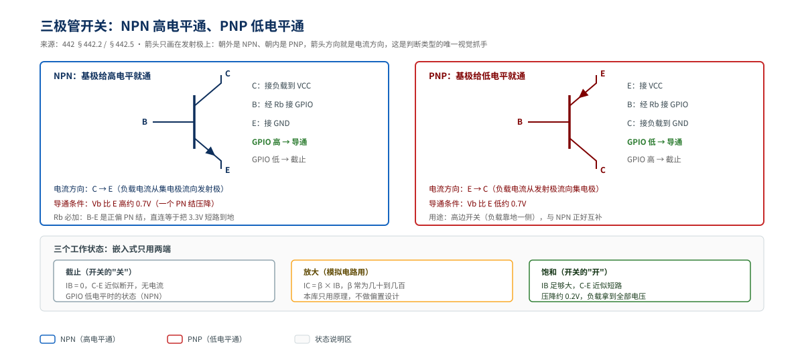
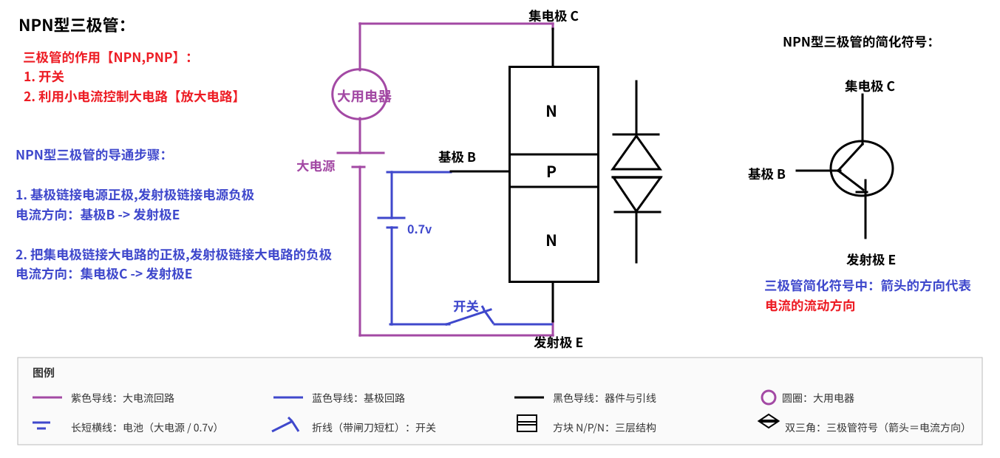
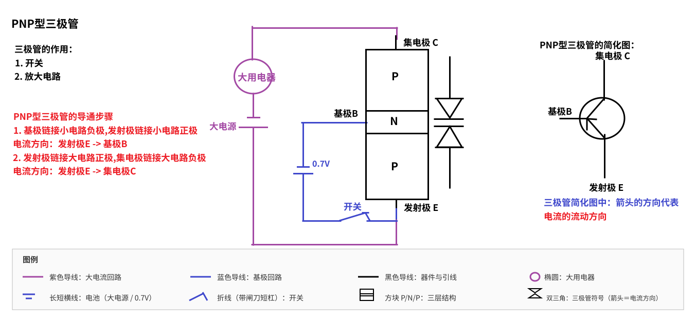
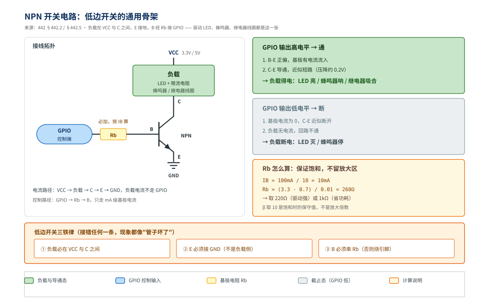

# 442 三极管与开关电路

> **解决**：两颗 PN 结背靠背拼起来，就得到"用小电流控制大电流"的器件。本册只讲一种用法——**开关**：怎么接、Rb 怎么算、为什么必须算、驱动电感性负载时为什么还要加一只二极管。  
> **范围**：三极管结构与三引脚 · NPN/PNP 对照 · 三个工作状态 · 为什么只用截止与饱和 · NPN 开关电路骨架 · 基极电阻计算 · 续流二极管与达林顿（认识级）。  
> **口径**：以硅管为主（S8050/S8550 一类）；放大区只讲 β 概念，不做偏置设计与频率分析（归硬件工程师）；开关用法是本册重点。  
> **更新**：2026-11-27  
> **本册导读** ── 必会三点：① NPN 高电平通（电流 C→E）、PNP 低电平通（电流 E→C），看箭头朝向 ② 嵌入式只用**截止**与**饱和**两端，中间放大区是给模拟电路用的 ③ 基极必须串电阻 Rb，否则 B-E 结直接短路烧管 ｜ 跟做时长：约 2 小时（画两种开关电路） ｜ 前置：441（PN 结）、412（欧姆定律与功率）。  
> **标记**：★ = 必会节；○ = 拓展节。

## 目录

| 节 | 内容 |
|---|---|
| 442.1 | 三极管是什么：两个 PN 结与三个引脚 ★ |
| 442.2 | NPN 与 PNP：看箭头朝向 ★ |
| 442.3 | 三个工作状态：截止、放大、饱和 ★ |
| 442.4 | 嵌入式只用两端：为什么要故意进饱和 ★ |
| 442.5 | 开关电路骨架与基极电阻计算 ★ |
| 442.6 | 驱动电感性负载：续流二极管 ★ |
| 442.7 | 达林顿与光耦：两个延伸 ○ |
| 442.8 | 坑表 |
| 442.9 | 检查清单（自测 6 题 + 动手任务 2 件） |

---

## 442.1 三极管是什么：两个 PN 结与三个引脚 ★

**定义**：三极管 = 两个 PN 结背靠背拼在一起，三个引脚。

| 引脚 | 英文 | 作用 |
|---|---|---|
| 基极 B | Base | **控制端**，决定通断 |
| 集电极 C | Collector | 电流的"收集端" |
| 发射极 E | Emitter | 电流的"发射端" |

```text
NPN：N 型 - P 型 - N 型      电流从 C、B 流入，从 E 流出
PNP：P 型 - N 型 - P 型      电流从 E 流出，分给 C、B
```

**"两个 PN 结"是什么意思**：B 与 E 之间一个结（B-E 结），B 与 C 之间一个结（B-C 结）。**这两个结的相互作用，才产生了"小电流控制大电流"的效果**——单独一个 PN 结只能单向导电（441），两个结拼起来才有放大与开关。

**为什么叫"双极型"（BJT）**：电子与空穴两种载流子都参与导电。这与 MOS 管只有一种载流子（单极型）形成对照（443 §443.1）。

## 442.2 NPN 与 PNP：看箭头朝向 ★

**"箭头朝外是 NPN，箭头朝内是 PNP"**——符号里发射极那只箭头，方向就是**电流方向**，也是判断类型的唯一视觉抓手。



**两种类型对照**（这是本册最该背下来的一张表）：

| | NPN | PNP |
|---|---|---|
| 导通条件 | 基极**高电平**（B 比 E 高约 0.7V） | 基极**低电平**（B 比 E 低约 0.7V） |
| 电流方向 | C → E（B 也流入） | E → C（B 也流出） |
| 常见接法 | E 接地，负载接在 VCC 与 C 之间 | E 接 VCC，负载接在 C 与 GND 之间 |
| 一句话 | **给高就通** | **给低就通** |

**从结构看，"NPN 与 PNP"就是三层半导体排列顺序不同**（N-P-N / P-N-P）。下面两张是两种管子的结构原理图：中间的方块是三层半导体，左侧是大电路（用电器 + 大电源）与基极回路（0.7V 偏置 + 开关），方块右侧的两个三角形代表 B-E、B-C 两个 PN 结，最右是简化符号——**符号里的箭头方向与结构图里的电流方向一致**。





**为什么箭头只画在发射极上**：发射极是"载流子出发的地方"，箭头表示发射极电流的方向。NPN 的发射极向外发射电子（等效电流向内流），所以箭头朝外；PNP 相反。

> **实用判据**：拿到一个三极管符号，只看箭头。**朝外 = NPN = 高电平通**；**朝内 = PNP = 低电平通**。这一条能解决 90% 的读图问题。

**E 为什么必须接地（NPN）**：E 是电流的出口，也是"参考点"——基极电压是相对 E 而言的（Vbe ≈ 0.7V 才导通）。**E 不接地，基极就没有明确的参考，管子不会按预期工作**。这是新手最常见的接错方式（见表 442.8 第 2 条）。

## 442.3 三个工作状态：截止、放大、饱和 ★

| 状态 | 条件 | 表现 | 嵌入式用途 |
|---|---|---|---|
| 截止 | 基极电流为 0 | C-E 间近似断开 | 开关的"关" |
| 放大 | 基极电流适中 | IC = β × IB（β 常为几十到几百） | 模拟放大（本库不深入） |
| 饱和 | 基极电流足够大 | C-E 间近似短路，压降约 0.2V | 开关的"开" |

**β 是什么**：电流放大倍数，IC = β × IB。常见三极管 β 在 100~400（datasheet 里写作 hFE）。

**β 为什么在饱和时不适用**：饱和之后 C-E 已经"短路"了，集电极电流由**外部负载**决定（IC ≈ VCC/负载电阻），不再由 IB × β 决定。**这是理解"为什么要给足基极电流"的关键**：

```text
如果按 β=100 算，给 1mA 基极电流"应该"得到 100mA 集电极电流
但如果负载只允许 50mA（VCC/负载 = 50mA），那么给 1mA 就够了 → 进入饱和
如果负载需要 200mA，给 1mA 只能得到 100mA → 停在放大区，管子发烫
```

**这就是"三极管发烫但负载不工作"的成因**：停在放大区，管子上有较大的电压降 × 电流 = 发热（412 §412.3）。

## 442.4 嵌入式只用两端：为什么要故意进饱和 ★

**嵌入式只用两端：截止与饱和**。中间那个放大区是给模拟电路用的——我们要的是"要么通、要么断"。

**所以驱动时故意把基极电流给足，让它一头扎进饱和区**。

**为什么"给足"是好事**：

| | 停在放大区 | 进入饱和区 |
|---|---|---|
| C-E 压降 | 可能几伏 | 约 0.2V |
| 管子功耗 | 压降 × 电流，可能很大 | 0.2V × 电流，很小 |
| 负载得到的电压 | 不足 | 接近 VCC |
| 稳定性 | 受 β 分散性影响大 | 不受 β 影响 |

**最后一行最关键**：β 的分散性很大（同一型号不同个体可能差两三倍），如果设计依赖 β 的精确值，换个批次就不工作了。**进饱和之后，结果只取决于外部电路，与 β 无关**——这是工程上"可复现"的保证。

**代价**：基极电流大一点，多耗一点电。**用一点电换稳定性，非常划算**。

## 442.5 开关电路骨架与基极电阻计算 ★

**NPN 开关电路**（驱动 LED、蜂鸣器、继电器线圈的通用骨架）：



**基极电阻 Rb 怎么算**：保证饱和。设负载电流 100mA、β 取 10（饱和时的保守值）、B-E 压降 0.7V：

```text
第一步（求所需基极电流）：IB = IC / β = 100mA / 10 = 10mA
第二步（求 Rb）：Rb = (VGPIO − 0.7) / IB = (3.3 − 0.7) / 0.01 = 260Ω
第三步（取标称值）：取 220Ω 或 1kΩ（视驱动强度与功耗权衡）
```

**为什么 β 取 10 而不是 datasheet 上的 100**：饱和判据是"IB 足够大"，取值越小越保守。业界惯例是**按 β/10 或直接取 β=10 来算**，保证任何批次的管子都能进饱和。**这是"过驱动"，是故意的**。

**Rb 取小了会怎样**：基极电流过大，GPIO 可能超过输出能力上限（十几 mA），且基极功耗增加。

**Rb 取大了会怎样**：基极电流不足，停在放大区，管子发烫、负载不工作。

**为什么必须加 Rb**：B-E 之间就是一个正向 PN 结，直接接 GPIO 等于把 3.3V 短路到 GND（只剩 0.7V 压降），**瞬间烧掉引脚或管子**。

```text
❌ GPIO ── B（无 Rb）    →  B-E 结正向导通，电流只受 GPIO 内阻限制 → 烧
✅ GPIO ── Rb ── B       →  电流 = (3.3−0.7)/Rb，可控
```

**GPIO 直接驱动行不行**：小电流负载（几 mA 的 LED）可以直接驱动，不需要三极管。**判据是"负载电流是否在 GPIO 能力内"**（452 §452.4 有对账表）。

## 442.6 驱动电感性负载：续流二极管 ★

**电感性负载**（继电器线圈、电机、电磁阀）有一个特性：**电流不能突变**。

```text
断电瞬间：电流想继续流 → 电感产生反向高压（U = L × di/dt）
反向高压加在驱动管的 C-E 两端 → 超过耐压 → 击穿
```

**解法**：在线圈两端**反向并联**一只二极管（续流二极管）。

| 状态 | 二极管 | 效果 |
|---|---|---|
| 正常通电 | 反向偏置，截止 | 不影响电路 |
| 断电瞬间 | 正向导通 | 给线圈电流一条泄放回路，把高压钳在 0.7V |

**方向判断**：二极管的正极接线圈的**低电位端**、负极接**高电位端**——这样正常工作时它反偏不导通。**接反的后果是一上电就短路**（441 §441.5 的防反接原理反过来用）。

**为什么这只二极管不能省**：它不是"保护二极管"这种可选配件，而是**电路能长期工作的必要条件**。省掉它的结果是"能工作，但每隔一段时间烧一次驱动管"——这种故障最难查。

## 442.7 达林顿与光耦：两个延伸 ○

**达林顿管**：两只三极管级联，β 相乘（β ≈ β1 × β2，可达数千）。

**用途**：需要"极小基极电流控制较大电流"的场合（如用高阻信号驱动继电器）。

**代价**：饱和压降升高（约 1.2~1.4V 而不是 0.2V），发热更多。**所以大电流场合反而不选它，改用 MOS 管**（443 §443.4）。

**光耦**：内部是"LED + 光敏管"，用光传递信号。

```text
输入侧：电流驱动 LED 发光
输出侧：光敏管受光照导通
```

**价值是电气隔离**：输入与输出之间没有电连接，只有光。**隔离电压可达几千伏**，用于强电与弱电之间的信号传递（如市电检测、工业现场）。**这是唯一能安全跨越 413 那条强弱电边界的器件**。

**边界**：光耦的传输速度、CTR（电流传输比）衰减等参数属于硬件设计范畴，本库只建立"它能隔离"的认识。

## 442.8 坑表

| # | 现象 | 原因 | 解法 |
|---|---|---|---|
| 1 | 三极管接上就烧 | 基极没串电阻，B-E 结直接短路 | 必加 Rb，按 §442.5 算 |
| 2 | NPN 电路给高电平不导通 | E 没接地 / 负载接错位置 | E 接 GND，负载接 VCC 与 C 之间（§442.2） |
| 3 | PNP 电路逻辑反了 | PNP 是低电平导通 | 换 NPN 或反转软件逻辑（§442.2） |
| 4 | 三极管发烫、负载却不工作 | 停在放大区没进饱和 | 加大基极电流（Rb 取小）（§442.4） |
| 5 | 继电器断电瞬间烧驱动管 | 线圈反电动势 | 并续流二极管，反向并联（§442.6） |
| 6 | 续流二极管接反，一上电就短路 | 方向装错 | 正极接低电位端（§442.6） |
| 7 | 换个批次的管子就不工作 | 设计依赖了 β 的精确值 | 按 β=10 过驱动，保证饱和（§442.5） |
| 8 | 达林顿管发热严重 | 饱和压降约 1.2V，功耗大 | 大电流改用 MOS 管（§442.7） |

## 442.9 检查清单（自测 6 题 + 动手任务 2 件）

**自测**：

| # | 问题 | 自测标准 |
|---|---|---|
| 1 | NPN 与 PNP 的导通条件 | NPN 高电平通（C→E），PNP 低电平通（E→C）（§442.2） |
| 2 | 怎么看符号判断类型 | 箭头朝外 NPN、朝内 PNP（§442.2） |
| 3 | 三极管三个状态与嵌入式用法 | 截止/放大/饱和；只用截止与饱和（§442.3） |
| 4 | 为什么要故意进饱和 | 压降小、发热小、不受 β 分散性影响（§442.4） |
| 5 | Rb 的算法 | IB=Ic/β（β 取 10），Rb=(VGPIO−0.7)/IB（§442.5） |
| 6 | 电感性负载为什么要加续流二极管 | 断电反电动势会击穿驱动管（§442.6） |

**动手任务**：① 在纸上画一个 NPN 驱动 LED 的电路（VCC、LED、限流电阻、C、B、Rb、GPIO、E、GND 全部标出），并按负载 20mA 算出 Rb；② 把同一个电路改成 PNP 版本，说明 GPIO 电平要反过来，并说明为什么 PNP 版本里负载要接在 C 与 GND 之间。

> 下一篇：《443 MOS 管与器件选型》——另一个开关器件：不用电流、只靠电压就能控制。
