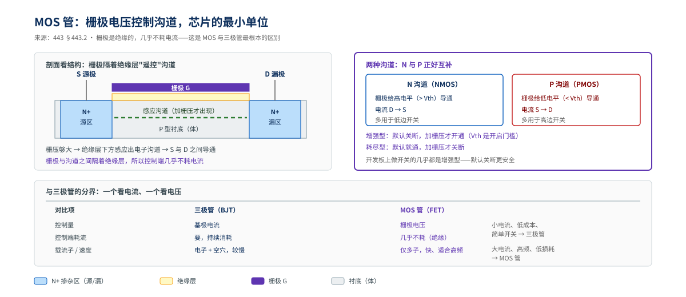

# 443 MOS 管与器件选型

> **解决**：另一个开关器件——不用电流、只靠电压就能控制。MOS 管是芯片里数量最多的元件（一颗 MCU 集成百万到亿级），理解它的"栅极电压控制沟道"，就理解了数字芯片的物理底座。  
> **范围**：电压控制 vs 电流控制 · G/D/S 三极 · N 沟道与 P 沟道 · 高边与低边开关 · 增强型与耗尽型 · 栅极驱动三条纪律 · 体二极管 · 三种器件选型对照。  
> **口径**：只用增强型 MOS；不涉及开关损耗计算、米勒效应与栅极驱动芯片选型；大功率应用只给方向。  
> **更新**：2026-11-23  
> **本册导读** ── 必会三点：① MOS 靠**电压**控制、栅极几乎不耗流；三极管靠**电流**控制、B 极持续耗流 ② N 沟道高电平通（低边开关）、P 沟道低电平通（高边开关）③ 栅极绝缘 = 等效小电容，**不能悬空** ｜ 跟做时长：约 1.5 小时 ｜ 前置：442（三极管开关）、441（PN 结）。  
> **标记**：★ = 必会节；○ = 拓展节。

## 目录

| 节 | 内容 |
|---|---|
| 443.1 | 电压控制 vs 电流控制：两者的根本区别 ★ |
| 443.2 | 三个引脚与两种沟道 ★ |
| 443.3 | 栅极是绝缘的：三条驱动纪律 ★ |
| 443.4 | 体二极管：一个容易忽略的寄生通路 ★ |
| 443.5 | 为什么说 MOS 是芯片的最小单位 ○ |
| 443.6 | 三种器件怎么选 ★ |
| 443.7 | 坑表 |
| 443.8 | 检查清单（自测 6 题 + 动手任务 2 件） |

---

## 443.1 电压控制 vs 电流控制：两者的根本区别 ★

**三极管靠电流控制，MOS 管靠电压控制**——这是两者最根本的区别。

| | 三极管（BJT） | MOS 管（FET） |
|---|---|---|
| 控制量 | 基极**电流** | 栅极**电压** |
| 控制端是否耗流 | 要，持续消耗 | **几乎不耗**（栅极是绝缘的） |
| 载流子 | 电子与空穴都参与（双极型） | 只有多子参与（单极型） |
| 开关速度 | 较慢 | 快，适合高频 |
| 成本 | 便宜 | 芯片内极便宜（数字电路的原子） |

**"栅极几乎不耗流"这一条的意义**：控制一个 MOS 管不需要持续供给电流，只需要维持一个电压。**这直接带来了低功耗与高输入阻抗**——也是 CMOS 电路静态功耗极低的原因。

**代价在开关瞬间**：栅极是绝缘的，等效一个小电容。每次开关都要给这个电容充放电，**频率越高，这部分损耗越大**。所以"不耗流"是稳态特性，动态仍有代价。

**一句话对照**：**三极管像用水流控制阀门（要一直出水），MOS 管像用压力控制阀门（只需维持压力）**。

## 443.2 三个引脚与两种沟道 ★

**三个引脚**：**栅极 G**（Gate）、**漏极 D**（Drain）、**源极 S**（Source）。对应三极管的 B、C、E。

| 三极管 | MOS | 对应关系 |
|---|---|---|
| B（基极，控制） | G（栅极） | 控制端 |
| C（集电极） | D（漏极） | 负载端 |
| E（发射极） | S（源极） | 公共端 / 参考点 |

**N 沟道与 P 沟道**（本库只用增强型）：

| | N 沟道（NMOS） | P 沟道（PMOS） |
|---|---|---|
| 导通条件 | Vgs > 阈值电压 Vth（栅极给**高**） | Vgs < Vth（栅极给**低**） |
| 电流方向 | D → S | S → D |
| 典型位置 | **低边开关**（负载接 VCC，MOS 接 GND） | **高边开关**（MOS 接 VCC，负载接 GND） |



**高边与低边的区别，看图记最快**：

```text
低边开关（NMOS）：  VCC ──[ 负载 ]── D ▷ S ── GND         MOS 在负载与地之间
高边开关（PMOS）：  VCC ── S ▷ D ──[ 负载 ]── GND         MOS 在电源与负载之间
```

**为什么 NMOS 常做低边**：NMOS 的源极要接低电位（这样 Vgs 才容易做得比 Vth 高）。放在低边，源极天然接地，栅极给 3.3V 就有 Vgs=3.3V > Vth，容易驱动。**放在高边，源极电位随负载浮动，Vgs 就不好保证了**——这时需要自举电路或专用驱动芯片，属于硬件设计范畴。

**增强型与耗尽型的区别**：增强型"默认关断，加电压才开通"（Vth 是开启门槛）；耗尽型"默认就通，加电压才关断"。**开发板上做开关用的几乎都是增强型——默认关断更安全**（万一驱动信号丢了，负载是断电的）。

## 443.3 栅极是绝缘的：三条驱动纪律 ★

**栅极结构**：金属（或 polysilicon）— 氧化物绝缘层 — 沟道。**绝缘层让栅极几乎不耗流，但也让它非常脆弱**。

**栅极电容的来历**：441 §441.4 讲过"耗尽层两侧离子构成电容"——MOS 的栅极-沟道之间就是一个典型的小电容（几十 pF 到几 nF）。**开关时要把这个电容充放电**。

**三条纪律**：

| # | 纪律 | 原因 |
|---|---|---|
| 1 | 栅极串一只小电阻（几十 Ω） | 抑制振铃（电容 + 走线电感形成的 LC 振荡） |
| 2 | **栅极不能悬空** | 悬空时感应电压可能超过 Vth，导致误导通 |
| 3 | 大功率 MOS 用专门驱动芯片 | 普通 GPIO 的驱动电流不足以快速充放栅极电容 |

**第 2 条是本册最实用的**：栅极悬空 → 感应电压 → 管子自己导通 → 负载意外动作。这个故障的表现是"上电就导通、什么都没干就动作"，且**用手靠近会变化**（人体电场）。解法：栅极加一只下拉电阻（10kΩ 级）到源极。

**第 1 条的机理值得看一遍**：栅极电容 C 与走线电感 L 形成 LC 回路，开关瞬间的高频分量会激起振荡（振铃），波形上出现尖峰。**串电阻是阻尼**——用功耗换平稳。

## 443.4 体二极管：一个容易忽略的寄生通路 ★

**定义**：MOS 管内部天生带一只**体二极管**（D 与 S 之间），方向从 S 指向 D（NMOS）。

**为什么会有**：MOS 的衬底（Body）必须与源极连在一起，这个连接在结构上形成了一个 PN 结——它不是设计出来的，是**制造工艺的必然副产物**。

**后果：MOS 并不是完全"双向截止"的**。

| 场景 | 影响 |
|---|---|
| 反向电压加在 D-S 之间 | 体二极管正向导通，电流能反向流 |
| 做双向开关 | 单只 MOS 挡不住一个方向，需两只背靠背 |
| 电源防反接 | 体二极管会让反接电流通过，防护失效 |

**"两只 MOS 背靠背"为什么能双向截止**：两只管子串联、体二极管方向相反，任何方向的电流都会遇到一只反偏的体二极管。**这是"理想二极管"电路的基础**。

**做防反接时的对照**：

| 方案 | 压降 | 复杂度 |
|---|---|---|
| 串一只二极管（441 §441.5） | 0.7V（硅）/ 0.3V（肖特基） | 一颗搞定 |
| 串一只 MOS | 接近 0（导通电阻 × 电流） | 简单，但要注意体二极管方向 |
| 两只 MOS 背靠背 | 接近 0 | 复杂，真正双向截止 |

## 443.5 为什么说 MOS 是芯片的最小单位 ○

**一颗 MCU 里集成的是百万级到亿级的 MOS 管**，每一只就是一个受电压控制的开关。

**逻辑门本质上是几只 MOS 管的组合**：一个反相器 = 一只 PMOS + 一只 NMOS；一个与非门 = 4 只 MOS。**所有数字电路（加法器、寄存器、CPU）都只是这些开关的连接方式不同**（500 板块会把这条线走完）。

> **理解 MOS 的"栅极电压控制沟道通断"，就理解了数字芯片的物理底座。**

**这条链可以完整串起来**：

```text
掺杂（441.2）→ PN 结（441.3）→ 两个结拼成三极管 / 一个栅极控制沟道（443）
→ 几只 MOS 组成逻辑门（005）→ 门组成运算器与寄存器（005）
→ 加时钟与指令译码（005）→ 一颗 CPU（200 板块）
```

**这就是本板块存在的理由**：不讲这一层，上面每一层都是"魔法"。

## 443.6 三种器件怎么选 ★

| 需求 | 首选 | 理由 |
|---|---|---|
| LED 指示、小继电器（<100mA） | 三极管（S8050 / S8550） | 便宜、驱动简单、基极电阻一颗搞定 |
| 电机、加热片、大电流（>1A） | MOS 管（如 AO3400、IRF 系列） | 导通电阻小、发热少、电流能力强 |
| 电源防反接 | 二极管（肖特基更佳） | 压降小、一颗搞定 |
| 高频开关（开关电源） | MOS 管 | 开关速度快 |
| 需要"双向导通" | 两只 MOS 背靠背 | 单只 MOS 有体二极管，方向受限 |

**选型的三步判断**：

1. **看电流**：几十 mA 以内 → 三极管；1A 以上 → MOS。
2. **看频率**：几十 kHz 以上 → MOS（三极管开关慢）。
3. **看控制方式**：控制信号不能提供持续电流（如高阻源、光敏分压点）→ MOS（栅极不耗流）。

**一个容易被忽略的点**：MOS 管的"导通电阻 Rds(on)"是发热的主因。**选型时必须核对 Rds(on) 在目标电流下的发热**：P = I² × Rds(on)。1A 通 0.05Ω 就是 50mW，几乎不热；通 0.5Ω 就是 0.5W，需要散热。

**边界**：高边驱动、栅极驱动芯片、开关损耗、米勒平台这些属于电力电子范畴，本库只到"会选、会用低边开关"为止。

## 443.7 坑表

| # | 现象 | 原因 | 解法 |
|---|---|---|---|
| 1 | MOS 管一上电就导通 | 栅极悬空被感应电压打开 | 栅极加下拉电阻（§443.3） |
| 2 | 手靠近板子负载就动作 | 栅极悬空，感应人体电场 | 同上（§443.3） |
| 3 | NMOS 放高边驱动不了 | 源极电位浮动，Vgs 不够 | 改低边，或用 PMOS / 驱动芯片（§443.2） |
| 4 | 电源防反接失效 | 体二极管让反接电流通过 | 用背靠背双 MOS 或换方案（§443.4） |
| 5 | MOS 发热严重 | Rds(on) 大，I²R 损耗 | 选 Rds(on) 更小的型号（§443.6） |
| 6 | 开关波形有尖峰振荡 | 栅极电容与走线电感振铃 | 栅极串几十 Ω 电阻阻尼（§443.3） |
| 7 | 大功率 MOS 开关很慢、发热 | GPIO 驱动电流不足，栅极充放慢 | 用专用栅极驱动芯片（§443.3） |
| 8 | 小电流场合用了 MOS，成本高了没必要 | 没按电流分档选型 | 100mA 以内优先三极管（§443.6） |

## 443.8 检查清单（自测 6 题 + 动手任务 2 件）

**自测**：

| # | 问题 | 自测标准 |
|---|---|---|
| 1 | MOS 与三极管的根本区别 | 电压控制 vs 电流控制；栅极几乎不耗流（§443.1） |
| 2 | NMOS 与 PMOS 的导通条件 | NMOS 高电平通、PMOS 低电平通（§443.2） |
| 3 | 高边与低边怎么放 | NMOS 做低边、PMOS 做高边（§443.2） |
| 4 | 栅极为什么不能悬空 | 感应电压会误导通（§443.3） |
| 5 | 体二极管从哪来、有什么影响 | 衬底与源极相连形成；破坏双向截止（§443.4） |
| 6 | 1A 以上为什么选 MOS | 导通电阻小、发热少、开关快（§443.6） |

**动手任务**：① 画出 NMOS 低边开关与 PMOS 高边开关两个电路，各标注 Vgs 为多少、何时导通；② 查一颗常用 MOS（如 AO3400）的 datasheet，找出 Vth、Rds(on) 两个参数，按 1A 电流算一次导通发热，判断需不需要散热。

> 下一篇：《451 最小系统四件》——器件都认完了，最后一步：把它们连成一块能跑的板。
