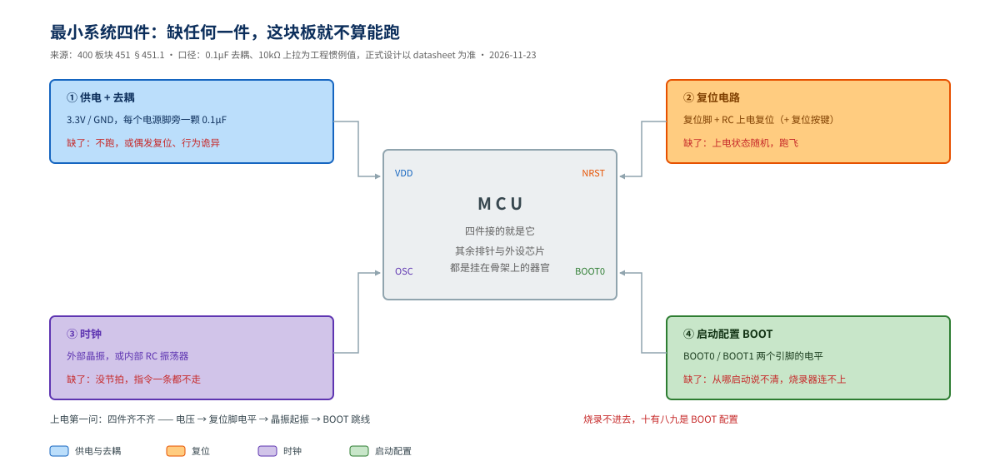

# 451 最小系统四件

> **解决**：让 MCU 跑起来的最少电路——骨架恒为四件（供电、复位、时钟、启动配置），缺一件就不算能跑。本册给出四件的构成、缺了会怎样、以及拿到任何一块开发板时"先数四件"的固定扫法。  
> **范围**：最小系统的定义 · 供电与去耦 · 复位电路 · 时钟（晶振 vs 内部 RC）· BOOT 启动配置 · 看板四步扫法 · 上电第一问。  
> **口径**：以 STM32 一类的 Cortex-M 为例，但四件结构对所有 MCU 通用；具体引脚名与电平以各自 datasheet 为准。  
> **更新**：2026-11-23  
> **本册导读** ── 必会三点：① 最小系统四件 = 供电+去耦 / 复位 / 时钟 / 启动配置 ② BOOT 配错 = 烧录器连不上、程序不跑 ③ 内部 RC 能用但精度差，串口对时钟敏感 ｜ 跟做时长：约 2 小时（纸上画骨架 + 看板指认） ｜ 前置：432（去耦电容）、433（稳压芯片）、422（上拉）。  
> **标记**：★ = 必会节；○ = 拓展节。

## 目录

| 节 | 内容 |
|---|---|
| 451.1 | 最小系统的定义：四件骨架 ★ |
| 451.2 | 第一件：供电与去耦 ★ |
| 451.3 | 第二件：复位电路 ★ |
| 451.4 | 第三件：时钟 ★ |
| 451.5 | 第四件：启动配置 BOOT ★ |
| 451.6 | 看板方法：拿到一块板先数四件 ○ |
| 451.7 | 坑表 |
| 451.8 | 检查清单（自测 6 题 + 动手任务 3 件） |

---

## 451.1 最小系统的定义：四件骨架 ★

**定义**：**最小系统** = 让 MCU 跑起来的最少电路。

**骨架恒为四件，缺一件就不算能跑**：

| 件 | 构成 | 缺了会怎样 |
|---|---|---|
| ① 供电 + 去耦 | 3.3V/GND + 每个电源脚 0.1μF | 不跑或偶发复位（432 §432.6） |
| ② 复位电路 | 复位脚 + RC 上电复位（+ 复位按键） | 上电状态随机，跑飞 |
| ③ 时钟 | 外部晶振 或 内部 RC 振荡器 | 没节拍，指令不走——CPU 的心跳 |
| ④ 启动配置（BOOT） | BOOT0/BOOT1 引脚电平 | 决定从 Flash 还是烧录模式启动；配错 = 烧录器连不上 |

**"最小"的含义**：这四件之外的一切（LED、按键、串口、传感器）都是"可选的器官"。**骨架不在，器官再多也没用**——这是排查"板子不跑"时的第一层判断。

**为什么是这四件**：分别对应一颗 MCU 的三个必需输入（电、复位、时钟）和一个必需状态（从哪启动）。**缺任何一项，芯片都不进入"执行用户程序"这个状态**。

## 451.2 第一件：供电与去耦 ★

**要点两条**：

1. **电压要对**：MCU 的 VDD 接 3.3V（不是 5V——看手册的"绝对最大额定值"）。超压是不可逆损伤，不是"可能有问题"。
2. **每个电源脚旁一颗 0.1μF**：这是 432 §432.6 那条铁律的具体落地。

**为什么"每个"电源脚都要**：现代 MCU 有多个 VDD 引脚（内核、IO、模拟各一组），**内部并不完全连通**。只在一个脚旁边放电容，其他脚仍然没有就近供电。

**去耦电容的布局要求**：紧贴引脚，越近越好。**走线电感会抵消电容作用**——1cm 与 5mm 的效果能差一个数量级（432 §432.6）。

**供电链路**（一块典型开发板上）：

```text
USB 5V ──→ LDO（AMS1117-3.3）──→ 3.3V 轨 ──→ 各 VDD 脚（每脚一颗 0.1μF）
```

**上电第一件事：量电压**。万用表直流电压档，红笔接 3.3V 轨、黑笔接 GND，确认读数在 3.3V ±5% 内（454 §454.2）。**电压不对，后面所有排查都是白费**。

## 451.3 第二件：复位电路 ★

**多数 MCU 复位脚是低电平有效**（标注为 NRST 或 RESET#）。

**上电复位怎么工作**：

```text
上电瞬间：电容未充电 → 复位脚为低 → 芯片保持复位状态
电容充电到高电平 → 复位脚变高 → 芯片开始跑
```

**RC 时间常数决定"复位保持多久"**：典型取值 R = 10kΩ、C = 100nF，时间常数 1ms——足够让电源稳定下来再放芯片跑。

**为什么必须有它**：没有复位电路，上电瞬间电源还没稳定、芯片就开始执行，可能出现"随机状态启动"或"跑飞"。**这不是"可能出问题"，是"每次上电都在赌"**。

**复位按键**：并联在复位电容两端，按下时把复位脚短路到地，实现手动复位。**调试时最常用的一个键**——程序跑飞了按一下，比重上电快。

**复位脚为什么是低有效**：这是历史惯例（早期芯片如此），现代 MCU 也有高有效的，**看 datasheet 的引脚说明，不要假设**。

## 451.4 第三件：时钟 ★

**时钟是 CPU 的心跳**——没有节拍，指令不走。

**两种来源**：

| 来源 | 精度 | 成本 | 场景 |
|---|---|---|---|
| 外部晶振 | ±20ppm 量级（约 ±0.002%） | 需要外加元件与两个负载电容 | 串口通信、USB、需要精确时序 |
| 内部 RC 振荡器 | ±1% 量级 | 零成本，芯片自带 | 一般控制、对时序不敏感 |

**"内部 RC 能用但串口偶尔抽风"的根源**：串口波特率的误差容忍度约 ±2~3%。内部 RC 的 ±1% 在常温下勉强够，**温度变化或电压波动时会超差**，于是表现为"平时正常、天冷或负载重时乱码"。**这是最典型的"偶发故障"之一**。

**ppm 是什么**：百万分之一。±20ppm = ±0.002%，一天累积误差约 1.7 秒。**精度差 500 倍**，这就是外部晶振存在的理由。

**负载电容**：晶振两端各接一只小电容（典型 10~22pF）到地，与晶振本身构成振荡回路。**容值要按晶振 datasheet 给的值选**——选错会导致不起振或频率偏移。

**排查晶振的判据**：示波器看波形（有探头负载效应，可能停振）；更实用的办法是**软件里翻转一个 GPIO，用示波器或频率计量它的频率**——如果频率与预期差很多，说明时钟没切到外部晶振。

## 451.5 第四件：启动配置 BOOT ★

**BOOT 引脚决定芯片上电后从哪里取指令**（以 STM32 为例）：

| BOOT0 | 启动位置 | 用途 |
|---|---|---|
| 低（接 GND） | 主 Flash | **正常运行时**（跑你烧进去的程序） |
| 高（接 VDD） | 系统存储器（出厂 Bootloader） | **串口烧录时** |

**"烧录不进去十有八九是这里"**——因为烧录工具需要通过 Bootloader 与芯片通信，而 Bootloader 只在 BOOT0 拉高时才被映射到启动地址。

**典型工作流**（串口烧录）：

```text
① BOOT0 拉高 → 复位 → 芯片进入 Bootloader
② 烧录工具写入 Flash
③ BOOT0 拉低 → 复位 → 芯片从 Flash 启动，跑新程序
```

**为什么开发板上常有跳线帽或拨码开关**：就是为了免去手动接线。**看到一块陌生板，先找 BOOT 跳线在哪、当前在什么位置**——这是 451.6 四步扫法的最后一步，也是最容易出问题的一步。

**用 SWD/JTAG 调试器时不需要动 BOOT**：调试器直接访问芯片的调试接口，绕过了启动模式。**所以"用调试器能烧、用串口烧不进"这个现象，指的就是 BOOT 配置**。



## 451.6 看板方法：拿到一块板先数四件 ○

**跟做（实物，有板才做）**：拿到任何一块开发板，按固定顺序扫一遍：

```text
① 找电源：USB 口 / 稳压芯片，输出几 V？每颗主芯片旁有没有 0.1μF？
② 找复位：RESET 按键 / RC 网络
③ 找时钟：金属壳晶振（或确认用内部 RC）
④ 找 BOOT：跳线帽 / 拨码开关位置
```

**为什么按这个顺序**：电源是根，电源不对后面都不用看；复位与时钟决定"能不能开始跑"；BOOT 决定"从哪跑"。**顺序错了会浪费大量时间在次要问题上**。

**数完四件之后**："能不能跑、为什么烧不进"就有了判断底稿；剩下排针与外设芯片都是"挂在骨架上的器官"。

**无板的替代跟做**：网上搜任意 STM32 最小系统板的产品图，把四件逐一指认出来写在纸上——指认不出就回 §451.1 的表格回炉。

**上电第一问永远是"四件齐不齐"**：

| 问 | 工具 | 判据 |
|---|---|---|
| 供电电压对不对 | 万用表直流档 | 3.3V ±5%（§451.2） |
| 复位脚电平正常吗 | 万用表直流档 | 运行时为高（低有效复位） |
| 晶振有没有起振 | 软件翻转 GPIO 测频 | 频率与配置一致（§451.4） |
| BOOT 跳线在哪个位置 | 目视 | 运行时应在"从 Flash 启动"（§451.5） |

**这张表的价值**：它把"板子不跑"这个模糊问题，拆成四个可以逐项验证的具体问题。**排查的本质就是把模糊变成具体**。

## 451.7 坑表

| # | 现象 | 原因 | 解法 |
|---|---|---|---|
| 1 | 上电不跑，量电源也不对 | 供电电压错或 LDO 坏 | 先量电压（§451.2） |
| 2 | 偶发复位、跑飞 | 去耦电容省了 | 每个电源脚补 0.1μF（§451.2） |
| 3 | 烧录器连不上 | BOOT 配置错 | 查跳线，进烧录模式（§451.5） |
| 4 | 调试器能烧、串口烧不进 | 串口烧录依赖 BOOT 进 Bootloader | BOOT0 拉高再复位（§451.5） |
| 5 | 串口偶尔乱码 | 用内部 RC，时钟精度不够 | 换外部晶振或降波特率（§451.4） |
| 6 | 晶振不起振 | 负载电容值不对/漏焊 | 按 datasheet 选容值（§451.4） |
| 7 | 上电状态随机 | 没有 RC 上电复位 | 加 10kΩ + 100nF 复位网络（§451.3） |
| 8 | 按复位键没反应 | 复位脚高低有效搞反 | 查 datasheet 的引脚说明（§451.3） |

## 451.8 检查清单（自测 6 题 + 动手任务 3 件）

**自测**：

| # | 问题 | 自测标准 |
|---|---|---|
| 1 | 最小系统四件 | 供电+去耦 / 复位 / 时钟 / BOOT（§451.1） |
| 2 | 每个电源脚为什么要单独加电容 | 内部不完全连通，远端脚没有就近供电（§451.2） |
| 3 | 上电复位怎么工作 | 电容未充电→复位脚低→充到高才放行（§451.3） |
| 4 | 内部 RC 与外部晶振的精度差 | ±1% vs ±20ppm，差约 500 倍（§451.4） |
| 5 | 烧录不进去先查什么 | BOOT 配置（§451.5） |
| 6 | 上电第一问是什么 | 四件齐不齐，先量供电电压（§451.6） |

**动手任务**：① 不看表格，画一个 MCU 方框图，把四件各自接到哪个引脚标注出来——判定标准：四件齐、每件标了"缺了会怎样"；② 按 §451.6 的四步扫法看一遍手边的开发板（或找产品图），把四件的位置与当前状态写成一张表；③ 用万用表量开发板上 3.3V 轨与复位脚的电压（运行状态），记录读数并与 §451.6 那张表的判据对照。

> 下一篇：《452 点灯：GPIO 与限流》——板子能跑了，第一件事是让它输出：引脚怎么推电流、代码怎么写、软硬件怎么对账。
