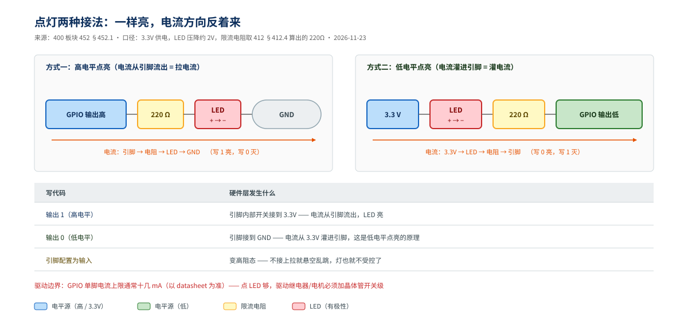

# 452 点灯：GPIO 与限流

> **解决**：板子能跑之后的第一个输出动作——让一个引脚点亮一颗 LED。看起来简单，但它把软件与硬件第一次对上账：代码里写 1，物理上发生了什么？引脚能推多大电流？220Ω 从哪来？  
> **范围**：两种接法（拉电流/灌电流）· 软硬件对账表 · GPIO 四种工作模式 · 驱动能力边界 · 限流电阻的来历 · 忘了初始化方向的后果。  
> **口径**：3.3V 逻辑；GPIO 单脚电流上限取"十几 mA"这一量级（具体以 datasheet 为准）；LED 压降取 2V。  
> **更新**：2026-11-23  
> **本册导读** ── 必会三点：① 两种接法方向相反：拉电流高电平亮、灌电流低电平亮 ② 灌电流能力通常强于拉电流，所以开发板更常见方式二 ③ 单脚十几 mA 是上限，驱动继电器/电机必须加开关级 ｜ 跟做时长：约 1.5 小时（纸面 + 有板可实操） ｜ 前置：442（三极管开关）、412（限流电阻）。  
> **标记**：★ = 必会节；○ = 拓展节。

## 目录

| 节 | 内容 |
|---|---|
| 452.1 | 两种接法：拉电流与灌电流 ★ |
| 452.2 | 软硬件对账表：每行代码在硬件层发生什么 ★ |
| 452.3 | GPIO 四种工作模式 ★ |
| 452.4 | 驱动能力边界：十几 mA 的天花板 ★ |
| 452.5 | 220Ω 从哪来：回到限流计算 ○ |
| 452.6 | 坑表 |
| 452.7 | 检查清单（自测 6 题 + 动手任务 2 件） |

---

## 452.1 两种接法：拉电流与灌电流 ★

**同一个 LED，两种接法，差别只在 LED 与电阻的位置**：



| | 方式一：拉电流（Sourcing） | 方式二：灌电流（Sinking） |
|---|---|---|
| 接法 | VCC → 电阻 → LED → GPIO | VCC → LED → 电阻 → GPIO |
| 电流方向 | 从引脚**流出** | 从引脚**流入**（灌进内部到 GND） |
| 点亮条件 | GPIO 输出**高**（1） | GPIO 输出**低**（0） |
| 引脚能力 | 通常较弱 | **通常较强** |

**为什么两种都能用**：MCU 的引脚内部是一对开关（一边接 VCC、一边接 GND），所以既能"往外推电流"，也能"往里吸电流"。

**为什么灌电流能力更强**：CMOS 输出级的 NMOS（下拉到地）通常比 PMOS（上拉到 VCC）做得更大——这是芯片工艺的惯例，因为**下拉是更常用的路径**。所以 datasheet 里常常写着"灌电流 20mA、拉电流 10mA"这类不对称数字。

**开发板上更常见方式二的原因**：同样的引脚，灌电流能带动更亮的 LED 或更低的阻值。**这不是设计偏好，是能力差异**。

**记法**：**看 LED 接在哪一侧**。LED 接在 VCC 侧 → 电流从引脚流走 → 高电平亮（拉）；LED 接在 GND 侧 → 电流从引脚流入 → 低电平亮（灌）。

## 452.2 软硬件对账表：每行代码在硬件层发生什么 ★

**这张表是"软硬结合"的第一张对照表**，也是排查"代码看着对但不亮"的判据：

| 写代码 | 硬件层发生什么 |
|---|---|
| 输出 1（高电平） | 引脚内部开关接到 3.3V（411 §411.3 的"切换连接"） |
| 输出 0（低电平） | 接到 GND，电流从 3.3V 灌进引脚（方式二） |
| 引脚配置为输入 | 变高阻态——不接上拉就悬空乱跳（422 §422.1） |
| 引脚配置为复用功能 | 内部接到某个外设（串口/定时器），不再受 GPIO 寄存器控制 |

**这张表最有用的一行是第三行**：很多"LED 不亮"的真实原因是**引脚方向没初始化，默认是高阻输入**——此时写 1 写 0 都不产生电流，引脚既不推也不吸。

**第四行也值得注意**：引脚一旦被配置为复用功能（PA9 = USART1_TX），再用 GPIO 的方式去写它是无效的。**"代码没报错但引脚不动"往往就是这一条**。

**设计意图 vs 硬件行为**（把两层分开看）：

```text
软件层：GPIOA->ODR |= (1 << 5)       // 意图：把 PA5 置高
硬件层：PMOS 导通、NMOS 截止         // 行为：PA5 接到 3.3V
物理层：电流从 3.3V 经外部电路流向 GND
```

**三层都能对上，才是真的"懂了点灯"**。只会写第一行的人，遇到不亮就只能猜。

## 452.3 GPIO 四种工作模式 ★

| 模式 | 行为 | 典型用途 |
|---|---|---|
| 输入浮空 | 高阻，电平由外部决定 | **很少用**（除非外部有强驱动） |
| 输入上拉/下拉 | 高阻 + 内部上/下拉电阻 | 按键输入（替代外部上拉，422 §422.5） |
| 推挽输出（Push-Pull） | 主动输出高或低 | **点灯、驱动数字信号** |
| 开漏输出（Open-Drain） | 只能主动拉低，高电平靠外部上拉 | I2C 等总线（422 §422.5） |

**推挽与开漏的区别，一句话**：

- **推挽**：我有能力主动输出高，也有能力主动输出低。
- **开漏**：我只会"拉低"，高电平要靠别人（外部上拉电阻）拉上去。

**为什么要开漏**：一条总线上挂多个设备，如果都用推挽，一个输出高、一个输出低，就是**电源短路**（两个开关对打）。开漏让所有设备只能"拉低"或"放开"，**天然不会冲突**——这就是 I2C 必须用开漏的原因。

**配置错了会怎样**：

| 配错 | 后果 |
|---|---|
| 点灯配成输入 | 不亮，且引脚读数乱跳 |
| I2C 配成推挽 | 通信失败，甚至烧引脚（两设备对打） |
| 按键配成浮空输入无上拉 | 读数随机，按键"自己触发" |

## 452.4 驱动能力边界：十几 mA 的天花板 ★

**GPIO 单脚电流上限通常十几 mA**（以 datasheet 为准），并且还有**整颗芯片的总电流上限**（所有引脚加起来）。

| 负载 | 电流量级 | 能否直驱 |
|---|---|---|
| 小 LED（3~5mA） | 几 mA | ✅ 可以 |
| 亮 LED（15~20mA） | 十几 mA | ⚠️ 贴着上限，不建议长期 |
| 蜂鸣器 | 20~30mA | ❌ 需要开关级 |
| 继电器线圈 | 30~100mA | ❌ 必须开关级 |
| 电机 | 数百 mA ~ 数 A | ❌ 必须 MOS + 独立电源 |

**"引脚推不动外设"是初学者第二个硬件欠账**（第一个是忘了上拉，422 §422.2）。

**超限的后果不是"不工作"，是"慢慢坏"**：长期超限会让引脚的输出级退化，表现为"用了几个月后这个引脚不灵了"。**这种损伤不可逆，且很难归因**。

**解法固定**：加一级开关——小电流用三极管（442），大电流用 MOS（443）。

```text
GPIO ── Rb ── B [三极管] C ── 负载 ── VCC
                E ── GND
```

**关于"总电流上限"**：一颗 MCU 所有 IO 加起来通常有 100~150mA 的上限。**点亮 8 颗 20mA 的 LED 就已经超了**——这也是为什么多 LED 的板子要用驱动芯片或三极管阵列，而不是每个 LED 一个引脚直驱。

## 452.5 220Ω 从哪来：回到限流计算 ○

**不是拍脑袋**——是 412 §412.4 那道题的结果：

```text
(3.3 − 2) / 10mA ≈ 130Ω  →  取标称 220Ω 更安全
```

**换接法要不要重算**：不需要，**限流电阻的值与接法无关**，只与"供电电压、LED 压降、目标电流"三个量有关。两种接法里电阻承受的电压都是 3.3 − 2 = 1.3V。

**唯一需要重算的情况**：换了 LED（压降不同，如蓝光 3.0V）、换了供电（5V 系统）、改了目标电流。

**蓝光 LED 在 3.3V 系统里的问题**：压降 3.0~3.4V，供电 3.3V，剩下只有 0~0.3V 给电阻。**余量太小，电流对压降的批次差异极其敏感**——同一批蓝光 LED，有的很亮有的不亮。**遇到这种情况应该提高供电电压或用恒流驱动**，而不是硬调电阻。

**试一试**：把两种接法的 GPIO 电平逻辑写在纸上（方式一高电平亮、方式二低电平亮），再想一个问题——如果代码里忘了初始化引脚方向，默认是高阻输入，LED 会怎样？

> 答：不亮，且引脚读数乱跳。**这就是 452.2 那张表第三行的实际后果**。

## 452.6 坑表

| # | 现象 | 原因 | 解法 |
|---|---|---|---|
| 1 | LED 不亮还怪代码 | 极性接反/没串电阻/引脚没初始化 | 先查硬件再查软件（§452.2） |
| 2 | 代码写 1 却低电平亮 | 用的是灌电流接法（方式二） | 确认接法再写逻辑（§452.1） |
| 3 | 引脚怎么都不动 | 被配置成复用功能 | 查引脚复用表，改回 GPIO（§452.3） |
| 4 | 驱动继电器把脚烧了 | 超 GPIO 驱动能力 | 加三极管/MOS 开关级（§452.4） |
| 5 | 用了几个月某引脚失灵 | 长期超电流，输出级退化 | 不可逆，换脚或改设计（§452.4） |
| 6 | I2C 配成推挽，通信失败 | 两设备对打短路 | 改开漏 + 外部上拉（§452.3） |
| 7 | 蓝光 LED 亮度批次差异大 | 压降接近供电电压，余量不足 | 提高供电或改恒流驱动（§452.5） |
| 8 | 多颗 LED 一起点亮，板子异常 | 总电流超芯片上限 | 用驱动芯片或三极管阵列（§452.4） |

## 452.7 检查清单（自测 6 题 + 动手任务 2 件）

**自测**：

| # | 问题 | 自测标准 |
|---|---|---|
| 1 | 拉电流与灌电流的区别 | 引脚流出（高电平亮）vs 流入（低电平亮）（§452.1） |
| 2 | 为什么灌电流能力更强 | 输出级下拉管的尺寸通常更大（§452.1） |
| 3 | 写 1 在硬件层发生什么 | 引脚内部开关接到 3.3V（§452.2） |
| 4 | 引脚配成输入时写 1 有用吗 | 没用，高阻态不推不吸（§452.2） |
| 5 | 推挽与开漏的区别 | 能主动输出高 vs 只能拉低、靠外部上拉（§452.3） |
| 6 | GPIO 直驱的电流上限 | 单脚十几 mA，整片还有总上限（§452.4） |

**动手任务**：① 画出两种点灯接法，各标注"点亮的 GPIO 电平"与"电流方向"，并说明为什么灌电流更常用于开发板；② （有板才做）让一个引脚以 1Hz 闪烁，用万用表直流电压档量引脚对地电压——读出的是平均值还是瞬时值？想清楚为什么。

> 下一篇：《453 传感采样与光感灯》——从"输出"转向"输入"：读一个模拟量，并让它驱动判断。
