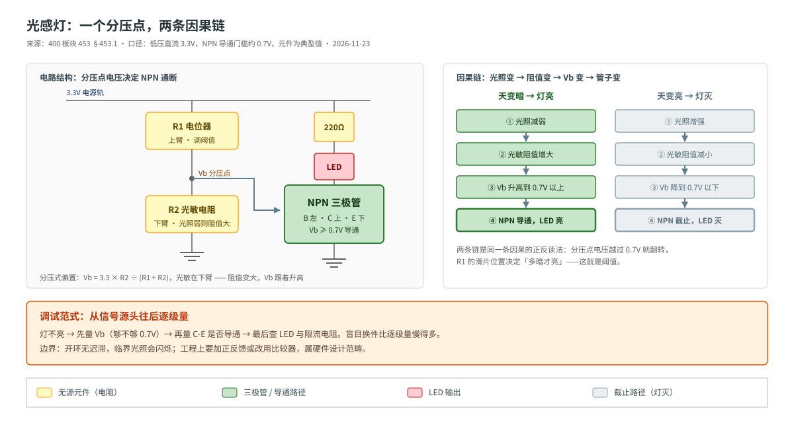

# 453 传感采样与光感灯

> **解决**：把前面所有东西串成一个能工作的小系统——天黑了自动亮灯。这个电路用到分压（421）、光敏电阻（431）、NPN 导通条件（442）、限流（412），是"模拟信号驱动开关"的最小完整案例。  
> **范围**：光感灯电路结构 · 两条因果链 · 阈值调节 · 逐级测量的排障范式 · 迟滞与临界闪烁 · 从模拟到数字（ADC 的入口）。  
> **口径**：3.3V 低压直流；光敏电阻与电位器为典型值；本册是开环开关控制，不涉及比较器与正反馈设计（属硬件设计范畴）。  
> **更新**：2026-11-23  
> **本册导读** ── 必会三点：① 因果链：光照弱 → 光敏阻值大 → Vb 升高 → NPN 导通 → 灯亮 ② 排障从信号源头往后逐级量，比盲目换件快 ③ 开环控制没有迟滞，临界光照下必然闪 ｜ 跟做时长：约 2 小时（CircuitJS 可全过程仿真） ｜ 前置：421（分压）、442（三极管开关）、431（光敏电阻）。  
> **标记**：★ = 必会节；○ = 拓展节。

## 目录

| 节 | 内容 |
|---|---|
| 453.1 | 电路结构：一个完整的最小系统 ★ |
| 453.2 | 因果链：从光照到灯亮 ★ |
| 453.3 | 阈值怎么调：电位器的作用 ★ |
| 453.4 | 排障范式：从信号源头逐级量 ★ |
| 453.5 | 为什么会闪：开环控制与迟滞 ○ |
| 453.6 | 从模拟到数字：ADC 的入口 ○ |
| 453.7 | 坑表 |
| 453.8 | 检查清单（自测 6 题 + 动手任务 3 件） |

---

## 453.1 电路结构：一个完整的最小系统 ★

**这是把 410~443 全部串起来的一个小电路：天黑了自动亮灯。**



**电路由三段组成**：

```text
第一段（传感）：VCC ──[ 电位器 R1 ]──┬──[ 光敏电阻 R2 ]── GND
                                    └── Vb（分压点）

第二段（判断）：Vb ──[ 基极电阻 ]── B [NPN] C ── 负载
                                     E ── GND

第三段（输出）：VCC ──[ LED + 限流电阻 ]── C
```

**为什么需要一个电位器**：光敏电阻的阻值范围很宽（亮处几百 Ω、暗处几百 kΩ），而"多暗才算暗"取决于使用场景。**电位器就是把这个判断标准做成可调的**。

**这个电路的价值**：它不是"一个玩具"，而是**所有传感器开关电路的模板**——把光敏电阻换成热敏电阻就是温控，换成湿敏就是湿度报警。**结构一模一样，只换传感元件**。

## 453.2 因果链：从光照到灯亮 ★

**为什么这个电路能成立**，全在 421 的分压公式和 442 的导通条件上：

| 环节 | 机制 | 出处 |
|---|---|---|
| ① 光照变弱 | 光敏电阻阻值**增大** | 431 §431.4 |
| ② 分压点电压升高 | 下臂阻值增大 → 分压比增大 | 421 §421.3 |
| ③ NPN 基极电压够 0.7V | B-E 结正向导通 | 442 §442.2 |
| ④ 集电极电流流过负载 | 三极管进入导通状态 | 442 §442.3 |
| ⑤ LED 亮 | 电流经限流电阻流过 LED | 412 §412.4 |

```text
Vb = VCC × R2 / (R1 + R2)        ← 光敏在下臂，阻值增大则 Vb 升高
NPN 导通门槛：Vb ≈ 0.7V          ← 这个 0.7V 就是 PN 结压降（441 §441.4）
```

**为什么光敏电阻放在下臂**：放在下臂，光照弱 → 阻值大 → 分压点电压高 → 触发导通。**如果想要"天亮了亮灯"（反向逻辑），把光敏电阻换到上臂即可**——同一个电路，换个位置，逻辑就反过来了。

**这就是分压电路的灵活性**：谁在上臂、谁在下臂，决定了"阻值增大时输出升高还是降低"。**读懂这个，才算真懂分压**。

## 453.3 阈值怎么调：电位器的作用 ★

**电位器 R1 的作用是调阈值**：调到刚好在想要的光照下翻转。

**调节的物理含义**：

```text
R1 调大  → 分压比 R2/(R1+R2) 变小 → 需要更暗（R2 更大）才能达到 0.7V → 更晚亮灯
R1 调小  → 分压比变大 → 稍暗一点就达到 0.7V → 更早亮灯
```

**调节方法**（这是个可迁移的调试动作）：

1. 把环境光调到"希望它亮"的那个亮度
2. 慢慢转电位器，直到 LED 刚好亮起
3. 回到正常光照，确认灯是灭的
4. 反复验证两三次，找中间位置

**为什么不能只调一次就完**：光敏电阻的阻值随温度漂移，电位器本身也有误差。**工程上的做法是留一定余量，让阈值落在"想要的亮度"两侧都有空间**。

**用一个固定电阻替代电位器**：量产时不希望有可调件（会被误调），做法是**实测出合适的阻值，换成固定电阻**。调试阶段用可调，定型后用固定——这是硬件开发的标准流程。

## 453.4 排障范式：从信号源头逐级量 ★

**这是一个可迁移的排障范式**，不限于光感灯：

```text
灯不亮 → 先量 Vb（够不够 0.7V）→ 再量 C-E 是否导通 → 再看 LED 与限流电阻
```

**为什么这个顺序有效**：电路是一条因果链，**从源头往后查，第一个"不对"的点就是病根**。反过来从负载往前查，会在多个可能的原因之间反复摇摆。

**逐级测量表**（每一级都有明确的判据）：

| 测哪里 | 期望值 | 不对说明什么 |
|---|---|---|
| VCC | 3.3V | 供电问题（451 §451.2） |
| Vb（分压点） | 暗处 >0.7V、亮处 <0.5V | 光敏电阻或电位器问题 |
| Vbe（B-E 之间） | 导通时约 0.7V | 基极电阻太大或三极管坏 |
| Vce（C-E 之间） | 导通时约 0.2V、截止时接近 VCC | 三极管没进饱和或已击穿 |
| LED 两端 | 亮时约 2V | LED 接反或已烧 |
| 限流电阻两端 | 亮时约 1.3V | 阻值不对或没接通 |

**这张表的意义**：把"灯不亮"这个模糊现象，拆成 6 个可验证的具体问题。**与 451.6 的"上电第一问"是同一套方法论**——排查的本质就是把模糊变成具体。

**比盲目换件快得多**：换件法在元件少时有效，元件一多就变成碰运气。**测量法每次都能定位到具体一级**。

## 453.5 为什么会闪：开环控制与迟滞 ○

**现象**：临界光照下 LED 会闪烁。

**原因**：**这是开环的开关控制，没有迟滞**。

```text
光照略低于阈值 → 灯亮 → 灯照亮了光敏电阻 → 光照升高 → 灯灭 → 又暗了 → 灯亮 ...
```

**注意这个循环里有一个"自反馈"**：灯本身是光源，它照亮了传感器。**这不是设计缺陷，是物理事实**——任何"用光控灯、灯又发光"的系统都会遇到。

**两种解法**（都属于硬件设计范畴，这里只给方向）：

| 解法 | 原理 |
|---|---|
| 加正反馈（迟滞） | 让"亮→灭"的阈值低于"灭→亮"的阈值，形成回差 |
| 改用比较器 | 比较器本身可以做迟滞，且不受负载影响 |

**软件也能做迟滞**：如果用 ADC 采样而不是直接用 NPN 判断，可以在代码里加"连续 N 次低于阈值才动作"或"两个阈值"——**这是软件相对硬件的优势**（453.6）。

**为什么讲这个**：它是"理想电路"与"实际电路"差距的典型例子。**书本上的公式都是理想化的，真实的电路总要处理边界情况**。

## 453.6 从模拟到数字：ADC 的入口 ○

**本册的电路是纯模拟的**：分压点电压连续变化，NPN 在 0.7V 附近"突变"。**没有数字化**。

**如果要精确判断**（比如"光照低于 30% 才亮"），需要 ADC：

```text
分压点 Vb ──→ ADC 输入 ──→ 数字量（如 0~4095）──→ 软件比较阈值
```

**ADC 对前级的要求**（这正好回到 421 §421.5 的负载效应）：

| 要求 | 原因 |
|---|---|
| 前级输出阻抗要低 | ADC 采样时会短暂抽取电流，高阻源会被拉低 |
| 电压范围要在参考电压内 | 超过 Vref 会饱和（读满值） |
| 信号要稳定 | 采样瞬间的波动会直接变成误差 |

**所以分压电路喂 ADC 是合适的**（ADC 输入阻抗高，负载效应小），但**分压电路直接驱动 LED 就不行**——这正是 421 §421.5 那条分界的实际应用。

**软件做判断的好处**：阈值可调、可加迟滞、可以做滤波（连续采样取平均）、可以记录历史。**硬件只能"过线就动作"，软件能"想清楚再动作"**。

**边界**：ADC 的分辨率、采样率、参考电压选择属于 MCU 外设部分，归 600 板块。本册只建立"模拟量要变成数字量才能被软件处理"这个认识。

## 453.7 坑表

| # | 现象 | 原因 | 解法 |
|---|---|---|---|
| 1 | 光感灯临界光照下闪 | 无迟滞，且灯自身照到传感器 | 加正反馈或用 ADC + 软件迟滞（§453.5） |
| 2 | 调不出想要的阈值 | 电位器范围与光敏阻值不匹配 | 换阻值范围合适的电位器（§453.3） |
| 3 | 灯一直亮/一直灭 | 光敏电阻上下臂放反 | 换位置即反向逻辑（§453.2） |
| 4 | 灯微亮但不完全导通 | NPN 停在放大区，Vb 不够 | 调电位器让 Vb 超过 0.7V（§453.4） |
| 5 | 换了环境后要重新调 | 光敏阻值随温度漂移 | 留余量，或改 ADC + 软件阈值（§453.3） |
| 6 | 分压点接 ADC 后读数偏低 | 前级输出阻抗高，被采样拉低 | 降低分压电阻总阻值（§453.6） |

## 453.8 检查清单（自测 6 题 + 动手任务 3 件）

**自测**：

| # | 问题 | 自测标准 |
|---|---|---|
| 1 | 光感灯的完整因果链 | 光照弱→阻值大→Vb 高→NPN 通→灯亮（§453.2） |
| 2 | 为什么光敏电阻放下臂 | 阻值增大时 Vb 升高，才能触发导通（§453.2） |
| 3 | 电位器调的是什么 | 分压比，即"多暗才算暗"的阈值（§453.3） |
| 4 | 排障为什么从源头往后量 | 因果链上第一个不对的点就是病根（§453.4） |
| 5 | 临界光照为什么会闪 | 开环无迟滞，灯自身照到传感器（§453.5） |
| 6 | 分压电路喂 ADC 合不合适 | 合适（ADC 高阻输入，负载效应小）（§453.6） |

**动手任务**：① 在 CircuitJS 里搭这个光感灯（454 §454.3 讲操作），把光敏电阻阻值从 1kΩ 拖到 100kΩ，记录 LED 翻转时的阻值与 Vb 读数；② 按 §453.4 的逐级测量表，在仿真里逐点量一次六个电压，填成一张表；③ 把光敏电阻从上臂换到下臂，说明逻辑如何反转，并重画因果链。

> 下一篇：《454 仪器与验证》——电路要能被测量，才算真的被理解；本板块最后一件工具。
