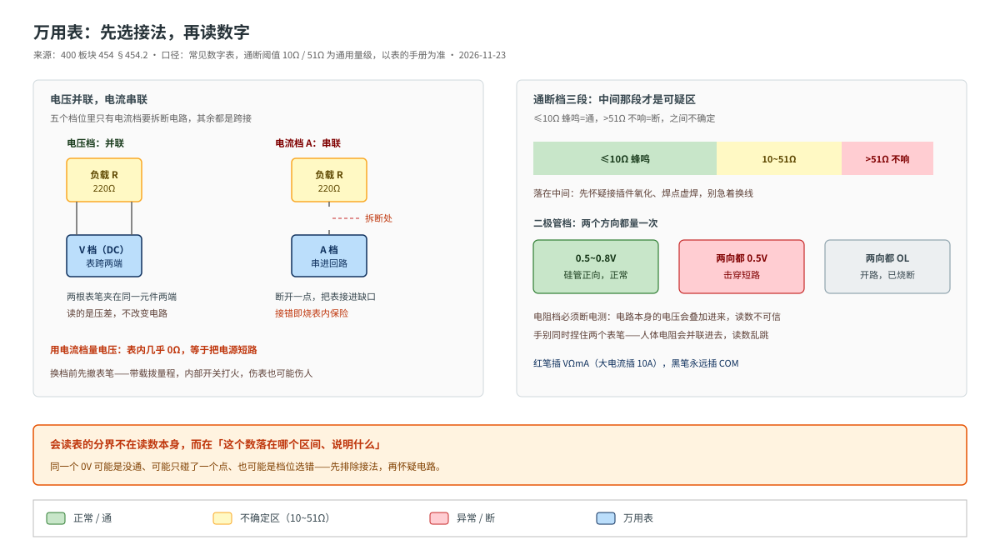
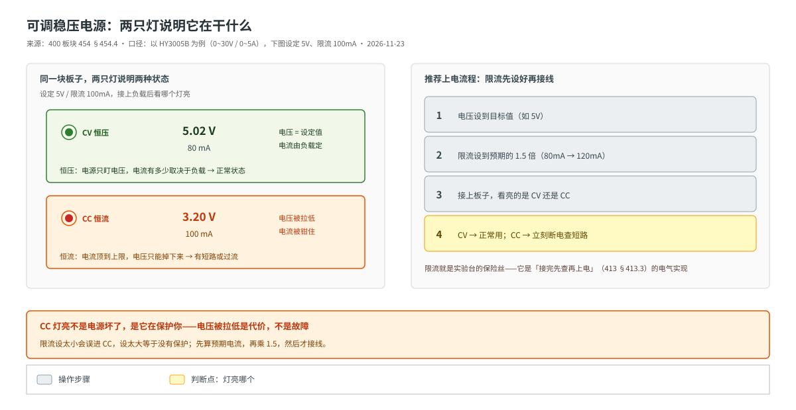

# 454 仪器与验证

> **解决**：电路要能被测量，才算真的被理解。本册讲三件入门仪器——万用表（五档怎么用、读到什么算正常）、CircuitJS 仿真（不买元件就能试电路）、可调稳压电源（CV 与 CC 两种状态）。  
> **范围**：万用表安全三条 · 五个档位的接法与判据 · 插孔位置 · CircuitJS 常用操作与一个陷阱 · 稳压电源的 CV/CC · 示波器为什么暂不展开。  
> **口径**：万用表以常见数字表为例；判据值（如通断 ≤10Ω）为通用量级，具体以表的手册为准；不涉及校准与仪器维修。  
> **更新**：2026-11-23  
> **本册导读** ── 必会三点：① 电压并联、电流串联，测量中严禁拨量程 ② 通断档 ≤10Ω 蜂鸣=通、>51Ω 不响=断 ③ 稳压电源 CC 灯亮说明进了限流，电压会被拉低 ｜ 跟做时长：约 1.5 小时（仿真可全程替代实物） ｜ 前置：411（测量口径）、413（安全边界）。  
> **标记**：★ = 必会节；○ = 拓展节。

## 目录

| 节 | 内容 |
|---|---|
| 454.1 | 万用表安全三条 ★ |
| 454.2 | 五个档位：接法与判据 ★ |
| 454.3 | CircuitJS：不买元件就能试电路 ★ |
| 454.4 | 可调稳压电源：CV 与 CC ★ |
| 454.5 | 示波器：为什么暂不展开 ○ |
| 454.6 | 坑表 |
| 454.7 | 检查清单（自测 6 题 + 动手任务 3 件） |

---

## 454.1 万用表安全三条 ★

⚠️ **这三条是使用纪律，不是建议**：

1. **后盖没盖好别用**——内部有高压（电阻档输出、部分表的升压电路），开盖状态可能触电。
2. **测直流 >60V 或交流 >30Vrms 要格外小心**——超出这个范围已经进入"能伤到人"的区间（413 §413.4）。
3. **测量过程中严禁拨动量程开关**——带载切换会让内部开关打火，损坏仪表，也可能在高压下引发意外。

**第 3 条是最容易犯的**：量一个不知道多大的电压，先用大量程、发现读数太小、手一抖就转量程——**必须先撤表笔、再换档、再重新接**。

**为什么第 3 条这么严重**：量程切换是改变内部的分压/分流网络（物理上切换不同的电阻接入）。**在带电且表笔接触的状态下切换，相当于在通着电的电路上拔插元件**——瞬间的电弧会烧触点。

## 454.2 五个档位：接法与判据 ★

| 档位 | 接法 | 读什么 | 判定 |
|---|---|---|---|
| 直流电压 V⎓ | 表笔**并联**在被测两点 | 电压差 | 红笔接高电位 |
| 交流电压 V~ | 同上 | 交流有效值 | 本库基本不用 |
| 电阻 Ω | 并联在电阻两端（**断电测**） | 阻值 | 读数前先短接表笔校零 |
| 通断（蜂鸣） | 两表笔接导线两端 | 通/断 | **≤10Ω 蜂鸣=通；>51Ω 不响=断** |
| 二极管 | 红笔接阳极、黑笔接阴极 | 正向压降 | 硅管 0.5~0.8V 正常，反接显示 `OL` |
| 电流 A | **串联**进电路（断开一点串进去） | 电流 | 新手最易接错烧保险 |

**插孔**：红笔插 `VΩmA`（大电流插 `10A`），黑笔永远插 `COM`。



**五个判据的实际意义**（这才是"会用表"与"能读表"的区别）：

| 读数 | 说明什么 |
|---|---|
| 电压 0V 且应该有点压 | 只碰了一个点，或电路没通（411 §411.5） |
| 电阻读数跳动不定 | 手同时碰到了两个表笔（人体电阻并联进来了） |
| 通断档不响但目视连着 | 接触不良、氧化，或中间有别的东西 |
| 二极管档两个方向都显示 0.5V | 管子击穿短路 |
| 二极管档两个方向都 `OL` | 管子开路（烧断） |

**电阻档为什么必须断电测**：万用表测电阻的原理是"输出一个小电流、量两端电压"。如果电路本身有电压，测量结果会被叠加，读数完全不可信——**严重时还会损坏仪表**。

**通断档的两个数（10Ω / 51Ω）**：10Ω 是"蜂鸣阈值"，低于它认为导通；51Ω 是"不响阈值"，高于它认为断开。**10~51Ω 之间是不确定区**——这段区间的导线可能接触不良。看到读数落在这个区间，应该怀疑接插件氧化或焊点虚焊。

## 454.3 CircuitJS：不买元件就能试电路 ★

**是什么**：绿色免安装的离线版电路仿真器（`github.com/SEVA77/circuitjs1`——pfalstad/circuitjs1 源码的离线打包版，活跃维护；网页在线版直接开 `falstad.com/circuit`）。

**为什么值得用**：**不用买元件、不用担心烧坏东西、可以看电流动画**。对初学者，它把"抽象公式"变成"看得见的流动"。

**常用操作**：

| 操作 | 方式 |
|---|---|
| 放置元件 | 菜单"绘制"，或快捷键：R 电阻、C 电容、L 电感、S 开关、G 地、v 直流源、w 导线、t 文字 |
| 改参数 | 双击元件或右键编辑 |
| 移动 | 按住元件拖动（或先按空格） |
| **布线** | 按 `w` 拖拽；⚠️ **每个连接点都要分段，不能一笔连到底**，否则软件判定没导通 |
| 跑/停 | 工具栏运行与重置；可调仿真速度与电流动画速度 |
| 调可变电阻 | 运行状态下鼠标悬停变蓝，滚轮调节 |

**那个"陷阱"值得单独说**：**每个节点要重新起笔**。仿真器按"线段端点是否重合"判断连接，一笔画到底的折线在拐点处不构成"节点"，于是电路看起来连了，实际是断的。

> **判据**：如果仿真里电流不动、电压读数为 0，先怀疑"线没分段"，而不是怀疑元件参数。

**跟做**：搭一个 3.3V + 220Ω + LED + 地的回路，观察电流动画方向；再把 LED 反接，看它是否还亮（这就是 441 §441.4 的单向导电）。

**仿真的边界**（必须说清，否则会误以为仿真=真实）：

| 仿真能做 | 仿真不能替代 |
|---|---|
| 验证拓扑对不对（通不通、逻辑对不对） | 元件的真实容差与漂移 |
| 算电压电流的理论值 | 发热、烧毁、寿命 |
| 试参数（改阻值看效果） | 布线电感、寄生电容、EMI |
| 看波形与相位 | 接触不良、虚焊 |

**一句话**：**仿真验证"想对了没有"，实物验证"做对了没有"**。两者不能互相替代。

## 454.4 可调稳压电源：CV 与 CC ★

以 HY3005B 为例：输出 0~30V / 0~5A 连续可调，粗调步进 1V、细调 10mV。

**两灯状态是关键**：

| 指示灯 | 含义 | 此时的行为 |
|---|---|---|
| **CV**（恒压） | 电压被稳定在设定值 | 正常状态 |
| **CC**（恒流） | 电流达到设定上限，进入限流 | **电压被拉低**，读数不是你设定的那个值 |



**"电压被拉低"是最容易误判的现象**：设定 5V，接上负载后量到 3.2V——**不是电源坏了，是进了 CC 模式**。电源在"保护"，把电流钳在设定值，代价是电压降下来。

**为什么这个功能重要**：**CC 限流是实验台上的保险丝**。第一次给新板子上电时，把限流设到 100mA 左右——如果板子有短路，电源会进 CC 而不是烧掉板子。**这是"先查再上电"（413 §413.3）的电气实现**。

**推荐的上电流程**：

```text
① 电压设到目标值（如 5V）
② 限流设到略高于预期电流（如预期的 1.5 倍）
③ 接上板子，观察是 CV 还是 CC
④ CV → 正常；CC → 有短路或过流，立刻断电排查
```

**与实验室电源对照的还有"电子负载"**：用来模拟负载、测电源能力，本库不涉及。

## 454.5 示波器：为什么暂不展开 ○

**示波器能看波形**，是排查时序问题的唯一有效工具（串口波形、I2C 时序、PWM 占空比、电源纹波）。

**为什么本库暂不展开**：

| 原因 | 说明 |
|---|---|
| 门槛高 | 探头选择、触发设置、时基调整都需要练习，讲不透等于没讲 |
| 本阶段用不上 | 410~443 的内容都是直流稳态，万用表够用 |
| 真正需要时再学 | 等做到串口/I2C 时序调试（600 板块）时，需求明确、学起来有目标 |

**一个务实的替代**：软件里翻转一个 GPIO，用万用表频率档量——能测频率但看不到波形。**对"时钟有没有起振"这类问题够用**（451 §451.4）。

**记住它的定位**：**示波器解决"随时间变化"的问题，万用表解决"稳态"的问题**。本板块全是稳态，所以用不到。

## 454.6 坑表

| # | 现象 | 原因 | 解法 |
|---|---|---|---|
| 1 | 万用表读数怪异 | 档位/接法错，或测量中拨了量程 | 撤表笔再换档（§454.1） |
| 2 | 量电流烧保险 | 用电流档量电压 | 电流档必须串联（411 §411.5） |
| 3 | 电阻读数乱跳 | 手同时碰了两个表笔 | 只碰绝缘部分（§454.2） |
| 4 | 断电测电阻读到并联值 | 电路里还有其他通路 | 拆下一端再测（§454.2） |
| 5 | CircuitJS 电路不导通 | 连线没分段 | 每个节点重新起笔（§454.3） |
| 6 | 稳压电源电压被拉低 | 进了 CC 恒流模式 | 调大限流或减小负载（§454.4） |
| 7 | 新板子上电就烧 | 没设限流 | 先设 CC 限流再上电（§454.4） |
| 8 | 仿真通过，实物不行 | 仿真不含容差/寄生/接触 | 仿真验拓扑，实物验实现（§454.3） |

## 454.7 检查清单（自测 6 题 + 动手任务 3 件）

**自测**：

| # | 问题 | 自测标准 |
|---|---|---|
| 1 | 万用表安全三条 | 后盖盖好、高压小心、测量中不拨量程（§454.1） |
| 2 | 电压与电流档的接法 | 并联 vs 串联（§454.2） |
| 3 | 通断档的两个阈值 | ≤10Ω 通、>51Ω 断，中间是不确定区（§454.2） |
| 4 | 电阻档为什么必须断电 | 电路电压会叠加，读数不可信（§454.2） |
| 5 | CircuitJS 电路不导通先查什么 | 连线有没有分段（§454.3） |
| 6 | CV 与 CC 的区别 | 恒压正常 vs 恒流限流且电压被拉低（§454.4） |

**动手任务**：① 用万用表依次完成四项测量：一节电池电压、一只电阻阻值、一段导线的通断、一只二极管的两个方向——把四个读数与"正常范围"对照写下来；② 在 CircuitJS 里搭出一个分压电路，用虚拟表验证 421 §421.3 的公式，再把负载接上观察电压跌落（对照 421 §421.5）；③ （有可调电源才做）把电压设 5V、限流设 50mA，接一只 100Ω 电阻，观察是 CV 还是 CC，并算出理论电流判断是否应该进 CC。

> **本板块到此结束**。回到 [README](../README.md) 看板块总览与学习路径；下一站「500 数字电路」——把 MOS 管组成门，让 0 与 1 开始运算。
