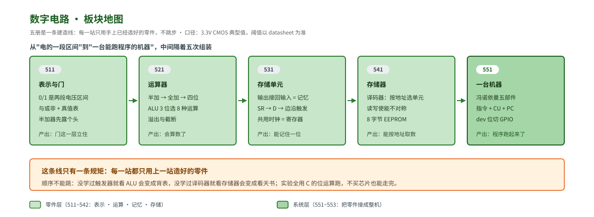

# 502 数字电路全貌

> 数字电路 = 把连续的电变成离散的 0/1，用门把它们组合成运算、用时序单元记住状态、用地址把状态排成阵列，最后用一条指令把这三件事串成一台能跑程序的机器。

**图怎么读**：从"电的一段区间"到"一台能跑程序的机器"，中间隔着五次组装；每一站只用手上已经造好的零件，不跳步。

- **510 数字信号**：管 0 和 1 是什么、门怎么把布尔运算变成电路。
- **520 组合逻辑**：管加法器、ALU、译码器——没有记忆，输出只看当前输入。
- **530 时序逻辑**：管锁存器、触发器、寄存器——引入记忆，输出开始依赖过去。
- **540 存储**：管地址怎么选中格子、读写按什么顺序打卡、阵列怎么排。
- **550 系统集成**：管五部件怎么接、指令怎么编、谁把程序一条条推下去。

> 下一篇：[511 从模拟到 0 和 1：电平与噪声容限](510-数字信号/511-从模拟到0和1-电平与噪声容限.md)——先从"0 和 1 到底长什么样"讲起。板块总览、册表与分界见 [README](README.md)。
