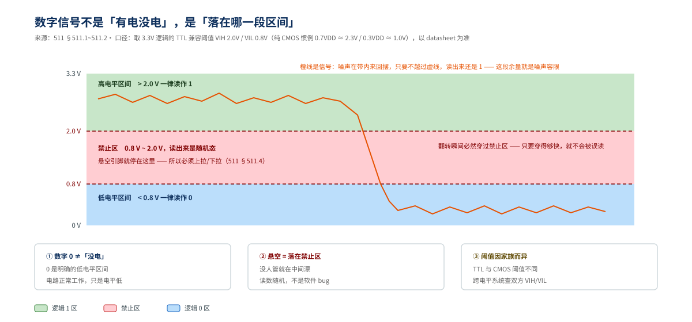

# 511 从模拟到 0 和 1：电平与噪声容限

> **解决**：数字电路不是"没有电压"，而是把连续电压切成几段、每段只代表一个值。这一册讲清楚三件事：0 和 1 各自是哪一段电压、中间那段为什么谁都不认、以及悬空引脚为什么是随机数发生器。  
> **范围**：模拟与数字的分野 · 高低电平区间与禁止区 · 噪声容限的来历 · 悬空引脚 · 阈值随芯片家族变化 · 静电为什么专门打 CMOS。  
> **口径**：以 3.3V 逻辑为例，电平数字取 TTL 兼容与纯 CMOS 两种惯例的典型值；判定阈值一律以具体芯片 datasheet 的 VIH / VIL 为准。  
> **更新**：2026-11-23  
> **本册导读** ── 必会三点：① 0 是明确的低电平区间，不是"没电" ② 禁止区落在中间，读数不确定 ③ 悬空 = 随机态，必须上拉或下拉钉死 ｜ 跟做时长：约 40 分钟（纸面 + 万用表） ｜ 前置：400 硬件基础 441（PN 结与二极管）、422（上拉下拉）。  
> **标记**：★ = 必会节；○ = 拓展节。

## 目录

| 节 | 内容 |
|---|---|
| 511.1 | 模拟信号与数字信号：为什么嵌入式选后者 ★ |
| 511.2 | 电平区间：高、低、以及谁都不认的中间 ★ |
| 511.3 | 噪声容限：抗干扰能力被量化成一段余量 ★ |
| 511.4 | 悬空引脚：为什么它会读出随机值 ★ |
| 511.5 | 阈值不是常数：家族差异与 datasheet ○ |
| 511.6 | 静电：CMOS 栅极为什么这么脆 ○ |
| 511.7 | 坑表 |
| 511.8 | 检查清单（自测 6 题 + 动手任务 2 件） |

---

## 511.1 模拟信号与数字信号：为什么嵌入式选后者 ★

**模拟信号连续变化**：麦克风输出、光敏电阻分压点、热电偶电压——理论上可以取无穷多个中间值。**数字信号只用少数离散电平**：通常两个，高与低，对应 1 与 0。

嵌入式几乎总是选数字，理由是**抗干扰**：模拟量被噪声扰动一点，值就变了；数字量只要噪声没把电平推出判定区间，值就一个字都不变。代价是要先把模拟量变成数字（这就是 ADC 做的事），但在传输、存储、运算这三个环节上，数字的稳定性压倒性胜出。

**一条容易忽略的推论**：数字信号的"跳变"本身仍是模拟过程——电平从 0.1V 爬到 3.2V 需要时间（纳秒量级）。所以数字电路同样有电容充放电、有反射、有串扰，只是这些效应在低速下可以忽略。

## 511.2 电平区间：高、低、以及谁都不认的中间 ★

关键认知：**高电平不是"3.3V 这个点"，而是一段区间**。输入引脚只要落在区间内，内部就认定是 1。

以 3.3V 逻辑、TTL 兼容阈值为例：

```text
3.3V ┬─────────────────────────
     │   高电平区  VIH ≥ 2.0V   → 判为 1
2.0V ┼─────────────────────────
     │   禁止区（不确定态）
0.8V ┼─────────────────────────
     │   低电平区  VIL ≤ 0.8V   → 判为 0
0V   ┴─────────────────────────
```

按纯 CMOS 惯例（0.7×VDD / 0.3×VDD），分界变成约 2.3V 与 1.0V。**两种惯例并存**，所以看到"2.0V 算高电平"或"2.3V 才算"都不算错——要看芯片属于哪个家族。



**两个直接结论**：

1. **数字 0 ≠ 没电**。0 是一个被明确定义的低电平区间，电路在 0 状态下照常工作、照常耗电（CMOS 静态功耗极低，但不是零）。
2. **落在禁止区的输入，芯片自己也不知道该判什么**。输出可能是 1、可能是 0、可能随温度漂移——这就是悬空引脚必须处理的根因（§511.4）。

## 511.3 噪声容限：抗干扰能力被量化成一段余量 ★

**噪声容限（noise margin）= 电平区间与判定阈值之间的余量**。

```text
高电平噪声容限 = VOH(输出高电平最小值) − VIH(输入判 1 门槛)
低电平噪声容限 = VIL(输入判 0 门槛) − VOL(输出低电平最大值)
```

例：前级输出高电平最低 2.4V，后级判定高电平的门槛是 2.0V → 高电平噪声容限 0.4V。意思是：**这段线路上叠加的噪声只要小于 0.4V，逻辑值就不会错**。

这就是数字电路"皮实"的量化解释——不是没有噪声，而是设计时预留了一段可以容忍的余量。余量的来源是驱动能力（输出能拉多高、能拉多低）与输入阈值之间的差。

**工程含义**：长线、多负载、强干扰环境会吃掉容限。吃到负数，电路就开始出错，而且错误是**随机的、不可复现的**——这类 bug 极难查，所以布线、去耦、上拉都不是可选项。

## 511.4 悬空引脚：为什么它会读出随机值 ★

引脚什么都不接，它既不在这段带子里也不在那段——**落在禁止区**，电位由漏电流、邻近走线的耦合电容、甚至手指靠近决定。

后果分两种：

- **输入悬空**：读到的值随机跳变。程序里表现为"这个按键没按却一直触发"、"这个中断莫名其妙进"。
- **CMOS 输入悬空更糟**：内部一对 MOS 管同时半导通，形成一条从 VDD 到 GND 的直流通路，**静态电流骤增、芯片发热**。这是"芯片摸上去烫但功能正常"的常见原因之一。

解法只有两个：**上拉**（钉到高电平）或**下拉**（钉到低电平）。选哪个由"默认应该是什么状态"决定——按键一端接地、默认要高电平，就上拉。具体阻值与取值权衡在 400 硬件基础 422 §422.2。

**推挽与开漏**：有些输出是"开漏"结构，它只能拉低、不能拉高，**必须外接上拉电阻**才输出得了高电平。I²C 总线就是典型。

## 511.5 阈值不是常数：家族差异与 datasheet ○

同一个"3.3V 系统"，不同家族阈值差很多：

| 家族 | 典型 VIH（判 1 门槛） | 典型 VIL（判 0 门槛） | 备注 |
|---|---|---|---|
| TTL 兼容 | 2.0V | 0.8V | 5V 时代遗留，3.3V 系统仍在沿用 |
| 纯 CMOS（0.7/0.3 VDD） | 2.31V | 0.99V | 按电源比例走，更"讲道理" |

**跨电平系统必须查双方 datasheet**：前级的 VOH 最小值要高于后级的 VIH，否则高电平"够不着"，症状是通信时好时坏。3.3V 器件驱动 5V 器件的老问题就出在这里。

**边界**：本册只讲直流稳态下的判定。上升沿、传输延迟、时序余量属于 600 板块的内容。

## 511.6 静电：CMOS 栅极为什么这么脆 ○

CMOS 的栅极是一层极薄的绝缘氧化层（纳米量级），栅极与沟道之间几乎是纯电容结构。人体静电在干燥季节可达数千伏，**电压高、能量小**：对人无害，但足以击穿这层氧化层。

击穿之后有两种表现：一种是当场失效（栅极短路），另一种是**轻微损伤、阈值漂移**——芯片还能用，但参数变了、寿命短了，"用着用着就不稳定"。这类故障最难查，因为现象不像故障。

**纪律**：拿开发板或芯片前，先摸一下接地的金属物体放电；板卡不用时放防静电袋。这条与 400 硬件基础 413 §413.4 是同一条纪律的两面——那边讲人身安全，这边讲器件安全。

## 511.7 坑表

| # | 现象 | 原因 | 解法 |
|---|---|---|---|
| 1 | 把 0 电平当"没电" | 概念混同 | 0 是低电平区间，电路正常工作（§511.2） |
| 2 | 电平判定想当然 | 不同家族阈值不同 | 查 datasheet 的 VIH / VIL（§511.5） |
| 3 | 悬空输入当 0 用 | 禁止区随机态 | 上拉或下拉钉住（§511.4；400 硬件基础 422 §422.2） |
| 4 | 芯片摸着烫但功能正常 | 悬空 CMOS 输入半导通 | 查未用引脚是否都钉住了（§511.4） |
| 5 | 看不懂"信号名上带横线" | 低电平有效记号 | 横线 = 取反：拉低才动作 |
| 6 | 摸过板子后芯片莫名失灵 | 静电轻微击穿 | 先放电再动手（§511.6） |
| 7 | 3.3V 驱动 5V 器件时好时坏 | 高电平够不着 VIH | 查双方 datasheet，必要时加电平转换（§511.5） |

## 511.8 检查清单（自测 6 题 + 动手任务 2 件）

**自测**：

| # | 问题 | 自测标准 |
|---|---|---|
| 1 | 数字 0 和 1 是什么 | 两段电平区间，不是一个电压点（§511.2） |
| 2 | 禁止区是什么 | 高低电平之间的未定义区间，读数不确定 |
| 3 | 噪声容限怎么算 | 输出电平与输入阈值之差的余量（§511.3） |
| 4 | 悬空引脚为什么危险 | 落在禁止区随机跳变；CMOS 还额外耗电发热（§511.4） |
| 5 | 拿板子前为什么先放电 | 静电击穿栅极氧化层，可能只是"轻微损伤"（§511.6） |
| 6 | 两个家族阈值差在哪 | TTL 兼容 2.0/0.8V，纯 CMOS 0.7/0.3×VDD（§511.5） |

**动手任务**：① 用万用表量三种状态：一根悬空杜邦线的电位、同一引脚上拉后的电位、下拉后的电位，把三个读数记下来对照 §511.2 的区间；② 找一份 74 系列逻辑芯片的 datasheet，翻出 VIH / VIL / VOH / VOL 四个值，算出高、低电平噪声容限各是多少。

> 下一篇：《512 布尔代数与基本门》——电平定义清楚了，下一册把它变成运算：三个门怎么拼出一切逻辑。
