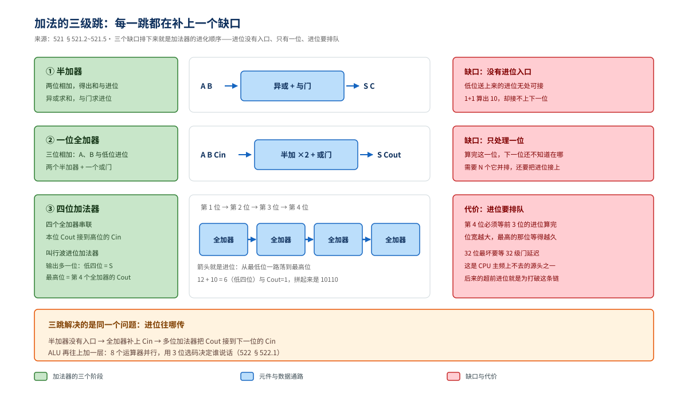

# 521 加法器：从半加到进位链

> **解决**：把门接成一台真的会算数的机器——从只算一位的半加器，到把进位一级级传下去的四位加法器。每一级的门组成都用 C 程序当天跑出来（`adder.c`），不靠想象。  
> **范围**：组合逻辑的判据 · 半加器 · 一位全加器 · 四位行波进位加法器 · 进位的级联与延迟。  
> **口径**：以 4 位无符号数为例；门运算一律用 C 位运算符表达，与 512 的 `gates.c` 同一手法；真值表输出为本机实跑结果。  
> **更新**：2026-11-23  
> **本册导读** ── 必会三点：① 半加器 = 异或求本位 + 与门求进位 ② 全加器 = 两个半加器 + 一个或门 ③ 多位加法器 = 全加器串联，本位 Cout 接高位 Cin ｜ 跟做时长：约 1.5 小时（写 `adder.c`） ｜ 前置：512（布尔代数与基本门）。  
> **标记**：★ = 必会节；○ = 拓展节。

## 目录

| 节 | 内容 |
|---|---|
| 521.1 | 组合逻辑：输出只看当前输入 ★ |
| 521.2 | 加法的三级跳：每一跳补上一个缺口 ★ |
| 521.3 | 半加器：一个异或 + 一个与门 ★ |
| 521.4 | 一位全加器：两个半加器 + 一个或门 ★ |
| 521.5 | 四位加法器：把进位串起来 ★ |
| 521.6 | 坑表 |
| 521.7 | 检查清单（自测 6 题 + 动手任务 2 件） |

---

## 521.1 组合逻辑：输出只看当前输入 ★

**判据只有一句**：输出完全由当前输入决定，不含任何历史信息，就叫组合逻辑。

加法器、比较器、译码器、多路选择器都是组合逻辑——同样一组输入，永远得到同样的输出。它的对立面是**时序逻辑**（530 模块），那边电路"记得住"上一次的结果。

**为什么先说这个**：后面 530 模块的所有坑（锁存、竞争、时钟），根源都是"电路开始有记忆"；在此之前，只要输入定了，输出就定了，没有时间维度的问题。

**规模感**：512 里的半加器是组合逻辑，ALU 是组合逻辑，CPU 里的加法器还是组合逻辑——区别只是门的数量。CPU 的"运算"部分几乎全是组合逻辑，只有寄存器和内存是时序的。

## 521.2 加法的三级跳：每一跳补上一个缺口 ★

**加法器不是一次造出来的，是三级跳。** 每一跳都在解决上一跳留下的缺口：

| 级 | 元件 | 能算什么 | 缺口 |
|---|---|---|---|
| 第一跳 | 半加器（Half Adder） | 两位相加，得出本位和与进位 | 不接受低位送上来的进位 |
| 第二跳 | 一位全加器（Full Adder） | 三位相加：A、B、低位进位 | 只处理一位 |
| 第三跳 | 多位加法器 | 把 N 个全加器串起来算 N 位 | 进位要一级一级传，慢 |

**这个缺口顺序值得记住**：半加器"只算了一半"（1+1 时给了进位却没处接），全加器补上了进位入口，多位加法器又把"进位出口"接到下一位的"进位入口"。**整条链的本质是同一个动作——进位往下传。**



## 521.3 半加器：一个异或 + 一个与门 ★

**半加器 = 1 个异或门 + 1 个与门**，两个输出分别是"本位和"与"进位"。

| A | B | 和 S | 进位 C |
|---|---|---|---|
| 0 | 0 | 0 | 0 |
| 0 | 1 | 1 | 0 |
| 1 | 0 | 1 | 0 |
| 1 | 1 | 0 | 1 |

**怎么从真值表读出这两个门**：看 S 列——0,1,1,0，两位不同才出 1，这是**异或**；看 C 列——0,0,0,1，两位都是 1 才出 1，这是**与**。四行看下来门就定了，不用猜。

**为什么它叫"半"**：1+1 本该得 2（二进制 10），半加器给出 S=0、C=1，两个输出拼起来才是完整的 10。它算出了结果，但没有地方接收那个进位——**下一位在哪儿，它不知道**。

```c
/* 半加器：只算本位，不管低位进位 */
static void half_adder(int a, int b, int *sum, int *carry)
{
    *sum   = a ^ b;   /* 异或：两位不同才有 1（不进位的和） */
    *carry = a & b;   /* 与：两位都是 1 才进位 */
}
```

**预期输出**（本机实测）：

```text
== 半加器真值表 ==
 A B | S C
-----+----
 0 0 | 0 0
 0 1 | 1 0
 1 0 | 1 0
 1 1 | 0 1
```

**判定标准**：四行与上表逐格对齐即通过。**试一试**：把 `*sum = a ^ b` 改成 `a | b`（或门），再跑一遍——`1 1` 那行会变成 S=1、C=1，而 1+1 应该是 10（S=0 进位 1）。**错在"1+1 不进位"时用或门会多出一个 1**，这就是加法器必须用异或而不是或的原因。

## 521.4 一位全加器：两个半加器 + 一个或门 ★

**一位全加器 = 两个半加器 + 一个或门**。它多了一个输入 Cin（低位来的进位），三个输入两两相加两次：

```text
第一步：A + B        → 中间和 s1、中间进位 c1
第二步：s1 + Cin     → 本位和 S、中间进位 c2
第三步：c1 OR c2     → 进位输出 Cout（两级任一出进位都要往上报）
```

**为什么进位要用"或"合起来**：两次半加各自可能产生进位，只要有一次产生，本位就装不下、必须往高位报。**"任一出进位就算出进位"**——或门的语义正好对上。

| A | B | Cin | S | Cout |
|---|---|---|---|---|
| 0 | 0 | 0 | 0 | 0 |
| 0 | 0 | 1 | 1 | 0 |
| 0 | 1 | 0 | 1 | 0 |
| 0 | 1 | 1 | 0 | 1 |
| 1 | 0 | 0 | 1 | 0 |
| 1 | 0 | 1 | 0 | 1 |
| 1 | 1 | 0 | 0 | 1 |
| 1 | 1 | 1 | 1 | 1 |

**八行按 A、B、Cin 三个输入的二进制顺序排**（000→111）。自己数一遍 `1 1 1` 那行：1+1=0 进 1，再 +1 得 1，总进位 1、本位 1——即 1+1+1=11（十进制 3），两个输出拼起来正好。

**实测输出**（同一份 `adder.c`，本机实录）：

```text
== 一位全加器真值表 ==
 A B Cin | S Cout
---------+-------
 0 0  0  | 0  0
 0 0  1  | 1  0
 0 1  0  | 1  0
 0 1  1  | 0  1
 1 0  0  | 1  0
 1 0  1  | 0  1
 1 1  0  | 0  1
 1 1  1  | 1  1
```

**试一试**：把 `*cout = c1 | c2` 改成 `c1 ^ c2`，再跑。八行里前几行结果不变，但 `1 1 1` 那行会变成 Cout=0——因为两个进位同时为 1 时异或把它们消掉了。**"同时进两次位还是要进一次位"**，这个差别只有或门能表达。

## 521.5 四位加法器：把进位串起来 ★

**四位加法器 = 四个一位全加器串联**，本位的进位输出直接接到高一位的进位输入。这种接法叫**行波进位加法器**（ripple carry adder）——进位像水波一样从最低位一路荡到最高位。

```c
/* 四位行波进位加法器：四个全加器串起来，本位进位喂给下一位 */
static int ripple_add4(int a, int b, int *cout4)
{
    int sum = 0, carry = 0;
    for (int i = 0; i < 4; i++) {
        int s, c;
        full_adder((a >> i) & 1, (b >> i) & 1, carry, &s, &c);
        sum |= s << i;
        carry = c;
    }
    *cout4 = carry;
    return sum & 0x0F;
}
```

**代码里的三个动作对应三条硬件连线**：`(a >> i) & 1` 是"把第 i 位取出来"（硬件里是直接连到那一位的导线）；`sum |= s << i` 是"把这一位的结果放回第 i 位"；`carry = c` 是**把进位交给下一轮循环**——这一行就是那根级联导线。

**实测输出**（本机实录，最后一列是用十进制核对）：

```text
== 四位加法器 ==
  A +   B =   S  Cout | 十进制核对
----------------------+-----------
  3 +   4 =   7   0   | 7
  7 +   1 =   8   0   | 8
  9 +   6 =  15   0   | 15
 15 +   0 =  15   0   | 15
 12 +  10 =   6   1   | 22
```

**最后一行是全部要点**：12+10=22，而 22 写成 5 位二进制是 `10110`。四位加法器给出 `S=6（0110）、Cout=1`，把 Cout 放到最左边拼起来正是 `1 0110` = 22。**这证明"多位加法器"的输出是一个"多一位的数"**——四个全加器不够装，必须留一根 Cout 线。

**试一试**：把 `pairs` 里的 `{12, 10}` 改成 `{15, 15}`，跑一遍。预期 `S=14（1110）、Cout=1`，十进制 30 = `1 1110` ✓。然后改成 `{15, 16}`——B 已经超出 4 位范围，`(b >> i) & 1` 只会取低四位，16 的低四位是 0，于是算成 15+0=15。**这就是硬件位宽的硬边界：超出位宽的部分不是"算错"，是根本进不来。**

## 521.6 坑表

| # | 现象 | 原因 | 解法 |
|---|---|---|---|
| 1 | 1+1 得 S=1 而不是 0 | 本位和用了或门而非异或 | 和用异或，进位用与（§521.3） |
| 2 | 多位加法高位全错 | 进位没接到下一位的 Cin | 本位 Cout 必须连高位 Cin（§521.5） |
| 3 | 两个数一加就变"小"了 | 超出位宽被截断 | 加宽位宽或先判断是否会溢出（522 §522.3） |
| 4 | 以为加法器能"一次算完" | 行波进位要逐级等待 | 位宽越大，最高位等得越久（522 §522.4） |
| 5 | 把 4 位加法器当 5 位用 | 忘了 Cout 也是一根输出线 | 位宽 N 的加法器输出是 N+1 位（§521.5） |
| 6 | 仿真里加法对、实物上错 | 门延迟导致的毛刺 | 稳态值正确不代表没有瞬态错误 |

## 521.7 检查清单（自测 6 题 + 动手任务 2 件）

**自测**：

| # | 问题 | 自测标准 |
|---|---|---|
| 1 | 组合逻辑的判据 | 输出只由当前输入决定，无记忆（§521.1） |
| 2 | 半加器由哪两个门组成 | 和=异或、进位=与（§521.3） |
| 3 | 全加器怎么用两个半加器搭 | A+B 得中间和与进位，再加 Cin，两级进位或起来（§521.4） |
| 4 | 四位加法器怎么接 | 四个全加器串联，本位 Cout → 高位 Cin（§521.5） |
| 5 | 12+10 为什么输出 6 和 1 | 22=`10110`，低四位 6、最高位就是 Cout |
| 6 | 位宽超出时发生什么 | 高位根本进不来，不是算错（§521.5） |

**动手任务**：① 跑通 `adder.c`，产出半加器 4 行、全加器 8 行、四位加法器 5 行输出；再把 `{12,10}` 改成 `{15,15}` 重跑，确认 S=14、Cout=1；② 把 `pairs` 改成 `{15,16}`，解释为什么结果是 15 而不是 31，把你的解释写成两句话。

## 附：`adder.c` 完整源码

```c
#include <stdio.h>

/* 半加器：只算本位，不管低位进位 */
static void half_adder(int a, int b, int *sum, int *carry)
{
    *sum   = a ^ b;   /* 异或：两位不同才有 1（不进位的和） */
    *carry = a & b;   /* 与：两位都是 1 才进位 */
}

/* 一位全加器：两个半加器 + 一个或门 */
static void full_adder(int a, int b, int cin, int *sum, int *cout)
{
    int s1, c1, s2, c2;
    half_adder(a, b, &s1, &c1);        /* 第一步：A + B */
    half_adder(s1, cin, &s2, &c2);     /* 第二步：上一步的和再加低位进位 */
    *sum  = s2;
    *cout = c1 | c2;                   /* 两级任一出进位，都要往上报 */
}

/* 四位行波进位加法器：四个全加器串起来，本位进位喂给下一位 */
static int ripple_add4(int a, int b, int *cout4)
{
    int sum = 0, carry = 0;
    for (int i = 0; i < 4; i++) {
        int s, c;
        full_adder((a >> i) & 1, (b >> i) & 1, carry, &s, &c);
        sum |= s << i;
        carry = c;
    }
    *cout4 = carry;
    return sum & 0x0F;
}

int main(void)
{
    printf("== 半加器真值表 ==\n");
    printf(" A B | S C\n");
    printf("-----+----\n");
    for (int a = 0; a <= 1; a++)
        for (int b = 0; b <= 1; b++) {
            int s, c;
            half_adder(a, b, &s, &c);
            printf(" %d %d | %d %d\n", a, b, s, c);
        }

    printf("\n== 一位全加器真值表 ==\n");
    printf(" A B Cin | S Cout\n");
    printf("---------+-------\n");
    for (int a = 0; a <= 1; a++)
        for (int b = 0; b <= 1; b++)
            for (int cin = 0; cin <= 1; cin++) {
                int s, c;
                full_adder(a, b, cin, &s, &c);
                printf(" %d %d  %d  | %d  %d\n", a, b, cin, s, c);
            }

    printf("\n== 四位加法器 ==\n");
    printf("  A +   B =   S  Cout | 十进制核对\n");
    printf("----------------------+-----------\n");
    int pairs[][2] = {{3, 4}, {7, 1}, {9, 6}, {15, 0}, {12, 10}};
    for (int i = 0; i < 5; i++) {
        int a = pairs[i][0], b = pairs[i][1], co;
        int s = ripple_add4(a, b, &co);
        printf("%3d + %3d = %3d   %d   | %d\n", a, b, s, co, a + b);
    }
    return 0;
}
```

> 下一篇：《522 运算器 ALU：选码与标志》——加法器只会加，下一册把八种运算装进一个盒子，用三根线选。
