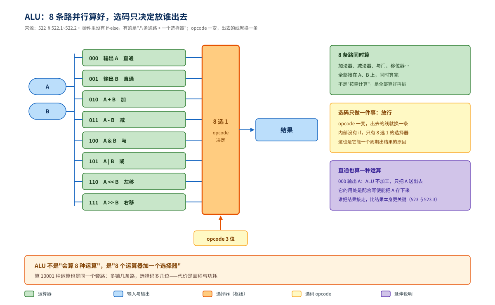

# 522 运算器 ALU：选码与标志

> **解决**：把加法器扩成"八种运算共用一个出口"的盒子。这一册的关键认知是——**硬件没有 if**，它是把八条路全部铺好、同时算完，再用三根选码线决定放哪一条出去。  
> **范围**：ALU 的结构（运算器阵列 + 选择器）· 3 位选码与 8 种运算 · 直通运算与写使能 · 位宽边界（截断、溢出、进位）· 标志位 CF/OF/ZF/NF · 进位链的延迟代价。  
> **口径**：以 8 位无符号数为例，`alu.c` 的输出为本机实跑结果；有符号与无符号的解释差异归 C 语言板块，本册只讲硬件怎么给标志。  
> **更新**：2026-11-23  
> **本册导读** ── 必会三点：① ALU = 8 条路并行 + 一个选择器 ② 截断、溢出、进位是三件不同的事 ③ 标志位硬件只负责摆出来，看不看由软件决定 ｜ 跟做时长：约 1 小时（写 `alu.c`） ｜ 前置：521（加法器）。  
> **标记**：★ = 必会节；○ = 拓展节。

## 目录

| 节 | 内容 |
|---|---|
| 522.1 | ALU 的结构：八条路都铺好，选一条通 ★ |
| 522.2 | 3 位选码与 8 种运算 ★ |
| 522.3 | 直通运算：ALU 算出来了，谁把它接走 ★ |
| 522.4 | 位宽边界：截断、溢出、进位是三件事 ★ |
| 522.5 | 标志位：CF / OF / ZF / NF ○ |
| 522.6 | 进位链的延迟代价 ○ |
| 522.7 | 坑表 |
| 522.8 | 检查清单（自测 6 题 + 动手任务 2 件） |

---

## 522.1 ALU 的结构：八条路都铺好，选一条通 ★

**ALU（算术逻辑单元）= 一堆运算器 + 一个选择器**。所有运算同时算好，由 3 位选码（opcode）决定"放哪一个出去"。

这是嵌入式的 ALU 与"写个 if-else 判断运算"最本质的区别：**硬件没有 if**。软件可以选择"不执行"，硬件不能——时钟一直在跑，门一直在算，区别只在于哪一路的结果被接到出口。

**所以"运算"和"选择"是两块独立的电路**：运算器是组合逻辑（§521.1），选择器就是 523 要讲的多路选择器。ALU 这个词听起来神秘，拆开看就是"好几台运算器 + 一个多路开关"。



**代价与收益**：八条路同时工作，发热与面积都按八份算——这是硬件"用空间换时间"的典型。软件里的 switch 是"按需执行"，硬件里的 ALU 是"全都执行、只挑一个"。

## 522.2 3 位选码与 8 种运算 ★

| opcode | 运算 | 含义 | A=13, B=6 结果 |
|---|---|---|---|
| 000 | 输出 A | 直通，常用于"把 A 存下来" | 13 |
| 001 | 输出 B | 直通，常用于"装载 B" | 6 |
| 010 | A + B | 加 | 19 |
| 011 | A − B | 减（补码加法） | 7 |
| 100 | A & B | 按位与 | 4 |
| 101 | A \| B | 按位或 | 15 |
| 110 | A << B | A 左移 B 位 | 832 |
| 111 | A >> B | A 右移 B 位 | 0 |

**为什么是这三种逻辑运算 + 两种移位**：加、减、与、或、移位、直通——这六类已经够表达"计算地址""取某几位""判断某位"这些 CPU 日常动作。乘除在简单 MCU 上由软件循环实现（用移位加法），在复杂 CPU 上有独立的乘除法单元。

```c
/* op 的 3 个二进制位直接决定做哪种运算 —— 这就是"运算选择码" */
static int alu(int op, int a, int b)
{
    switch (op & 0x7) {
    case 0: return a;         /* 000 输出 A */
    case 1: return b;         /* 001 输出 B */
    case 2: return a + b;     /* 010 加 */
    case 3: return a - b;     /* 011 减 */
    case 4: return a & b;     /* 100 与 */
    case 5: return a | b;     /* 101 或 */
    case 6: return a << b;    /* 110 A 左移 B 位 */
    default: return a >> b;   /* 111 A 右移 B 位 */
    }
}
```

**预期输出**（本机实测）：

```text
== 同一对输入 A=13 B=6，8 种 opcode 各算什么 ==
opcode  运算     结果   二进制(低8位)
---------------------------------------
 000    输出A     13    00001101
 001    输出B      6    00000110
 010    A+B       19    00010011
 011    A-B        7    00000111
 100    A&B        4    00000100
 101    A|B       15    00001111
 110    A<<B     832    01000000
 111    A>>B       0    00000000

== 换个输入验证 减法与位移 ==
 A   B | A-B  A<<1  A>>1
-------+-----------------
 5   3 |   2    10     2
 3   5 |  -2     6     1
 8   1 |   7    16     4
10   2 |   8    20     5
```

**两处值得停下来看**：

- `110 A<<B` 结果 832，但二进制列只显示 `01000000`（=64）。**832 的低 8 位是 64，高位被截掉了**——8 位 ALU 装不下这个结果，这就是 §522.4 的边界问题。
- 第二张表里 `3-5 = -2` 出现负数。C 的 `int` 是有符号的，而硬件里 `3-5` 得到的是补码 `1110`（无符号 14）。**同一个位模式，解释方式不同**：当作无符号是 14，当作补码是 −2。

## 522.3 直通运算：ALU 算出来了，谁把它接走 ★

`000 输出 A` 与 `001 输出 B` 这两条看着没意义——直接把输入送出去，算什么运算？

它们的存在恰恰暴露了硬件的运作方式：**ALU 的输出线一直有电压，"算出结果"和"结果被保存"是两件事**。真正决定"这条结果有没有用"的，是下一级的**写使能（write enable）**信号——它决定寄存器要不要在这个时钟沿把 ALU 的输出收进来。

**试一试**：把 `int a = 13, b = 6;` 改成 `a = 0, b = 0`，再看 `000` 与 `001` 两行——两个都输出 0，看不出区别。**说明"直通"这类运算单独看没意义，它的价值在于配合写使能：ALU 输出什么不重要，重要的是谁把它接走。**

这条认知在 533（寄存器）和 553（控制单元）会再次出现：**数据通路（datapath）负责算，控制信号负责"什么时候算的结果算数"**。

## 522.4 位宽边界：截断、溢出、进位是三件事 ★

初学者最容易把这三件事混成一个"算错了"。它们成因不同、报警方式也不同：

| 现象 | 成因 | 表现 | 硬件给的信号 |
|---|---|---|---|
| **截断** | 结果位宽超出寄存器位宽，高位直接丢弃 | 200+100 在 8 位里得 44，不报错 | 无（设计时就该保证不超） |
| **进位（CF）** | 无符号数最高位向外进位 | 255+1 得 0 | 进位标志 CF |
| **溢出（OF）** | 有符号数"符号位被结果推翻" | 127+1 得 −128 | 溢出标志 OF |

**同一个加法，三个名字不是同义词**：`255+1` 是进位（无符号看 CF），`127+1` 是溢出（有符号看 OF），而 `200+100` 在 8 位里连标志都不给——它就是装着装不下，硬件照常把低 8 位给你。

**硬件不会替你判断哪个更重要**：它只把 CF 和 OF 摆在那里，**由软件决定要不要看**。C 语言里无符号溢出是定义良好的回绕、有符号溢出是未定义行为——这条规则的硬件根源就在这里。

## 522.5 标志位：CF / OF / ZF / NF ○

真实 CPU 的标志寄存器通常有这四位（名字各家不同，含义一致）：

| 标志 | 全称 | 什么时候置 1 | 谁在用 |
|---|---|---|---|
| **CF** | Carry Flag | 无符号运算最高位有进位/借位 | 多字节加法、比较大小 |
| **OF** | Overflow Flag | 有符号运算结果超出可表示范围 | 有符号比较 |
| **ZF** | Zero Flag | 结果为 0 | `if (x == 0)`、循环结束判断 |
| **NF** | Negative Flag | 结果最高位为 1（负数） | 有符号比较 |

**跳转指令就是靠这些标志工作的**：`if (a > b)` 编译后是"做一次减法 → 看 CF/ZF/NF → 条件跳转"。所谓"条件判断"，硬件层面就是"读标志位 + 跳或不跳"。

**这也解释了一个常见困惑**：为什么比较两个数要"减一下"？因为减法会顺带把标志位设好，而比较本身不需要保存结果——用完就扔。

## 522.6 进位链的延迟代价 ○

行波进位加法器的第 4 位必须等第 3 位的进位算完，第 3 位又要等第 2 位……**位宽越大，最高的那一位等得越久**。

32 位加法器最坏要等 32 级门的延迟，这是 CPU 主频上不去的原因之一。后来的**超前进位**（carry lookahead）通过并行计算进位来打破这条链，代价是门数暴增。

**本库不展开超前进位**，只要记住一句：**串行进位是速度瓶颈，位宽是延迟的乘数**。看到"32 位 CPU 的主频比 8 位高不了太多"这类现象时，进位链是原因之一。

## 522.7 坑表

| # | 现象 | 原因 | 解法 |
|---|---|---|---|
| 1 | ALU 输出对但结果没保存 | 只看 ALU，没看写使能 | ALU 只负责算，存不存由使能决定（§522.3） |
| 2 | 以为 ALU 是"按需计算" | 硬件是全部并行算好再选 | 8 条路同时存在，选码只决定放谁出去（§522.1） |
| 3 | 大数相加变成小数 | 截断，且没有任何标志报警 | 加宽位宽或先判断（§522.4） |
| 4 | 有符号加法符号翻了 | OF 置位但软件没看 | 运算后查 OF（§522.4） |
| 5 | 无符号比较大小出错 | 用了有符号的标志位 | 无符号看 CF，有符号看 OF+NF（§522.5） |
| 6 | 减法结果"莫名其妙" | 减法是补码加法，位模式与有符号解释混用 | 分清位模式与解释方式（§522.2） |

## 522.8 检查清单（自测 6 题 + 动手任务 2 件）

**自测**：

| # | 问题 | 自测标准 |
|---|---|---|
| 1 | ALU 由哪两部分组成 | 运算器阵列（组合逻辑）+ 选择器（§522.1） |
| 2 | 8 种运算怎么选 | 3 位 opcode，8 条路并行算好选一条（§522.2） |
| 3 | 为什么有"直通"运算 | 配合写使能，决定谁把结果接走（§522.3） |
| 4 | 截断与溢出差在哪 | 截断无报警，溢出/进位各有标志位（§522.4） |
| 5 | 四个常用标志是什么 | CF、OF、ZF、NF（§522.5） |
| 6 | 条件判断在硬件上是什么 | 运算设标志 + 读标志决定跳不跳（§522.5） |

**动手任务**：① 跑通 `alu.c`，产出 8 行运算表；回答：`A<<B` 当 B=6 时结果 832，为什么二进制列显示的是 64？② 手工验证进位与溢出：把 A=255、B=1 与 A=127、B=1 各算一遍，写出 8 位结果与 CF、OF 分别是什么。

## 附：`alu.c` 完整源码

```c
#include <stdio.h>

/* op 的 3 个二进制位直接决定做哪种运算 —— 这就是"运算选择码" */
static int alu(int op, int a, int b)
{
    switch (op & 0x7) {
    case 0: return a;
    case 1: return b;
    case 2: return a + b;
    case 3: return a - b;
    case 4: return a & b;
    case 5: return a | b;
    case 6: return a << b;
    default: return a >> b;
    }
}

static const char *name(int op)
{
    static const char *n[] = {"输出A", "输出B", "A+B", "A-B", "A&B", "A|B", "A<<B", "A>>B"};
    return n[op & 0x7];
}

int main(void)
{
    int a = 13, b = 6;
    printf("== 同一对输入 A=%d B=%d，8 种 opcode 各算什么 ==\n", a, b);
    printf("opcode  运算     结果   二进制(低8位)\n");
    printf("---------------------------------------\n");
    for (int op = 0; op < 8; op++) {
        int r = alu(op, a, b);
        printf(" %03d    %-6s %6d    ", op, name(op), r);
        for (int i = 7; i >= 0; i--) putchar(((r >> i) & 1) ? '1' : '0');
        putchar('\n');
    }

    printf("\n== 换个输入验证 减法与位移 ==\n");
    printf(" A   B | A-B  A<<1  A>>1\n");
    printf("-------+-----------------\n");
    int t[][2] = {{5, 3}, {3, 5}, {8, 1}, {10, 2}};
    for (int i = 0; i < 4; i++) {
        int x = t[i][0], y = t[i][1];
        printf("%2d   %d | %3d    %2d     %d\n", x, y, x - y, x << 1, x >> 1);
    }
    return 0;
}
```

> 下一篇：《523 译码与选择：译码器与多路选择器》——ALU 里那个"选一条通"的开关，单独拿出来讲。
