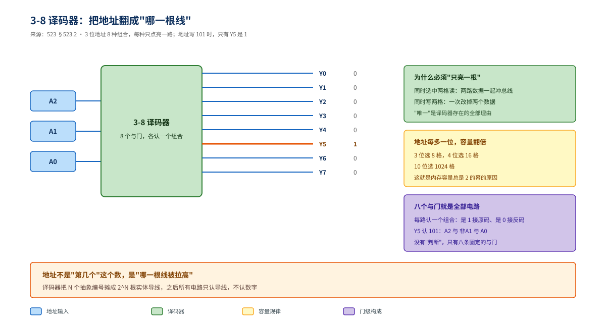

# 523 译码与选择：译码器与多路选择器

> **解决**：硬件不认"第几个"这种抽象编号，它只认"哪一根线被拉高"。这一册讲两块方向相反的电路：**译码器把一个编号展开成一根线**（1 → N），**多路选择器把多根线收拢成一个值**（N → 1）。ALU 里"选一条通"的那个开关，就是后者。  
> **范围**：地址与选中的关系 · 3-8 译码器的真值表与门实现 · 8 选 1 多路选择器 · 两者的分工与组合 · 总线冲突为什么源于"不唯一"。  
> **口径**：以 3 位地址 / 8 路为例，输入输出为本机 `gcc` 实跑结果；门级实现只讲结构，不涉及时序与驱动能力。  
> **更新**：2026-11-23  
> **本册导读** ── 必会三点：① 译码器 = 1 位编号进、N 根线里只亮 1 根 ② 选择器 = N 路数据进、按编号送 1 路出去 ③ 两者方向相反，常成对出现（译码器选中哪一格，选择器从哪一路取） ｜ 跟做时长：约 45 分钟（写 `sel.c`） ｜ 前置：512（布尔代数与基本门）。  
> **标记**：★ = 必会节；○ = 拓展节。

## 目录

| 节 | 内容 |
|---|---|
| 523.1 | 地址：把"第几个"翻译成"哪一根线" ★ |
| 523.2 | 3-8 译码器：8 路里只亮 1 路 ★ |
| 523.3 | 多路选择器：反过来，把多路收成一路 ★ |
| 523.4 | 两者的分工：谁展开、谁收拢 ★ |
| 523.5 | 唯一性为什么是铁律 ○ |
| 523.6 | 坑表 |
| 523.7 | 检查清单（自测 6 题 + 动手任务 2 件） |

---

## 523.1 地址：把"第几个"翻译成"哪一根线" ★

**存储器的本质是"一排并排的格子"，每个格子有一个编号，这个编号就是地址。** 但硬件不认"编号"这种抽象概念——它只认**哪一根线被拉高了**。

**所以地址必须经过一次翻译**：3 位地址 `101` 不是"第五个"这个数，而是"把第 5 根线拉高、其余 7 根压低的那个组合"。完成这次翻译的电路就是**译码器（Decoder）**。

**为什么必须"只选一根"**：如果同时选中两个格子，读的时候两路数据会一起冲上数据总线、互相打架（总线冲突）；写的时候一次改两格，数据就毁了。**"译码"这个词的分量就在"唯一"上**——N 位输入，2^N 路输出，任何时刻只有一路为 1。

**位宽的含义**：3 位地址 → 8 个格子（2³），4 位 → 16 个，10 位 → 1024 个。**地址每多一位，容量翻一倍**——这是"内存条容量总是 2 的幂"的硬件根源。

## 523.2 3-8 译码器：8 路里只亮 1 路 ★

**3 位地址进，8 根线出，只有第 `addr` 根是 1。**

| 地址 | Y0 | Y1 | Y2 | Y3 | Y4 | Y5 | Y6 | Y7 |
|---|---|---|---|---|---|---|---|---|
| 000 | **1** | 0 | 0 | 0 | 0 | 0 | 0 | 0 |
| 001 | 0 | **1** | 0 | 0 | 0 | 0 | 0 | 0 |
| 010 | 0 | 0 | **1** | 0 | 0 | 0 | 0 | 0 |
| 011 | 0 | 0 | 0 | **1** | 0 | 0 | 0 | 0 |
| 100 | 0 | 0 | 0 | 0 | **1** | 0 | 0 | 0 |
| 101 | 0 | 0 | 0 | 0 | 0 | **1** | 0 | 0 |
| 110 | 0 | 0 | 0 | 0 | 0 | 0 | **1** | 0 |
| 111 | 0 | 0 | 0 | 0 | 0 | 0 | 0 | **1** |

**这张表读一眼就能看出结构**：第 `i` 行的 1 落在第 `i` 列，整张表是一条从左上到右下的对角线。**八个格子各自独占一列、互不重叠**——这就是"唯一选中"的表格形态。



**怎么用门搭出来**：8 路输出各对应一个**与门**，每个与门接三根地址线——地址是 1 接原码、是 0 接反码。以 Y5（地址 101）为例：`Y5 = A2 · Ā1 · A0`（A2 为 1、A1 为 0、A0 为 1 时才输出 1）。**八个与门，每个认一个组合**——这就是译码器的全部门电路。

```c
/* 3-8 译码器：3 位地址进，8 路选出 1 路（其余全 0） */
static void decode38(int addr, int out[8])
{
    for (int i = 0; i < 8; i++)
        out[i] = (i == (addr & 0x7)) ? 1 : 0;
}
```

**预期输出**（本机实测）：

```text
== 3-8 译码器：地址 -> 哪一路被选中 ==
地址  Y0 Y1 Y2 Y3 Y4 Y5 Y6 Y7
-----------------------------
 0    1  0  0  0  0  0  0  0
 1    0  1  0  0  0  0  0  0
 2    0  0  1  0  0  0  0  0
 3    0  0  0  1  0  0  0  0
 4    0  0  0  0  1  0  0  0
 5    0  0  0  0  0  1  0  0
 6    0  0  0  0  0  0  1  0
 7    0  0  0  0  0  0  0  1
```

**试一试**：把 `out[i] = (i == (addr & 0x7)) ? 1 : 0;` 里的 `==` 改成 `<=`，再跑。会看到地址 3 时前四路全是 1——**同时选中四格**。这就是"总线冲突"的代码形态：读的时候四格的数据会一起冲上总线。

## 523.3 多路选择器：反过来，把多路收成一路 ★

**多路选择器（MUX）与译码器方向相反**：N 路数据进来，由选择码决定"哪一路被送到唯一的那根输出线上"。

```text
译码器 1→N：   编号 ──▶ 选中 N 根中的一根
选择器 N→1：   N 路数据 + 编号 ──▶ 送出其中一路的值
```

**2 选 1 选择器的门组成**：`Y = (S̄ · D0) + (S · D1)`——用两个与门和一个或门，本质就是"把译码器的两根选中线和两路数据分别相与，再或起来"。**所以选择器 = 译码器 + 一堆与门**，两者是同一套逻辑的两种用法。

```c
/* 8 选 1 多路选择器：8 路数据进，选出第 sel 路送出去 */
static int mux8(const int data[8], int sel)
{
    return data[sel & 0x7];
}
```

**预期输出**（本机实测，`data = {13, 6, 27, 40, 55, 66, 77, 88}`）：

```text
== 8 选 1 选择器：sel 决定哪一路出去 ==
sel  选中的值
-------------
 0      13
 1       6
 2      27
 3      40
 4      55
 5      66
 6      77
 7      88
```

**硬件里它长什么样**：8 路数据线并排进来，每路先过一个与门（另一头接译码器对应那根选中线），8 个与门的输出再或成一根。**同一时刻只有一个与门放行**，所以输出线上只有一个值——这正好解释了 522 的 ALU：8 台运算器同时算，选择器只放一路出去。

## 523.4 两者的分工：谁展开、谁收拢 ★

| | 译码器（Decoder） | 多路选择器（MUX） |
|---|---|---|
| 方向 | 1 → N（一个编号展开成一根线） | N → 1（多路数据收成一个值） |
| 输入 | N 位编号 | N 位编号 + 2^N 路数据 |
| 输出 | 2^N 根线，只有一根有效 | 1 个值 |
| 典型用途 | 存储器地址选中、片选 | ALU 选运算结果、数据通路选来源 |
| 缺了它会怎样 | 不知道动哪一格 | 多个结果抢同一根输出线 |

**它们经常成对出现**：存储器里，译码器把地址翻成"选中第 3 格"，选择器再把 8 格的数据收成一路读出去（542 §542.1）。**一个负责"点名"，一个负责"应答"**。

## 523.5 唯一性为什么是铁律 ○

**"任何时刻只有一路有效"不是风格问题，是电气问题**：

- **读冲突**：两个单元同时驱动同一根数据线，一个想输出高、一个想输出低，中间形成低阻通路 → 大电流、发热、数据变成不确定值（甚至烧输出级）。
- **写冲突**：一次写两个格子，两个都改了，而且改成了同一个值——数据静默损坏，最难查。

**所以共享总线的输出必须能"断开"**：不参与的设备把输出置为**高阻态（Hi-Z）**，相当于从电路上消失。这就是存储器"读也要使能（OE）"的原因（541 §541.2）。

**工程上的三条纪律**：地址译码只允许唯一有效；共用总线同一时刻只允许一个驱动；不能保证唯一时，就必须用使能信号把关。

## 523.6 坑表

| # | 现象 | 原因 | 解法 |
|---|---|---|---|
| 1 | 读出的数据是别的格子的 | 地址线接错位，或译码非唯一 | 核对地址位序，确认只有一路为 1（§523.2） |
| 2 | 两个格子同时输出，数据乱跳 | 多个 OE 同时有效 | 任何时刻只允许一个单元驱动总线（§523.5） |
| 3 | 容量算错 | 把"格子数"与"每格位宽"混为一谈 | 3 位地址 → 8 格；每格 8 位 → 总容量 64 位 |
| 4 | 以为选择器是"按需计算" | 硬件是全部并行准备好再选 | 选择器只挑，不负责算（§523.3） |
| 5 | 译码输出接反 | 低电平有效的片选被当成高有效 | 看信号名有没有横线（§511.7 第 5 条） |
| 6 | 地址多一位以为没影响 | 容量翻倍，译码器与线数全变 | 地址位宽 = 格数的 log₂（§523.1） |

## 523.7 检查清单（自测 6 题 + 动手任务 2 件）

**自测**：

| # | 问题 | 自测标准 |
|---|---|---|
| 1 | 地址在硬件里表示什么 | 哪一根线被拉高，不是"第几个"这个数（§523.1） |
| 2 | 3-8 译码器的门组成 | 8 个与门，每个认一个地址组合（§523.2） |
| 3 | 2 选 1 选择器的表达式 | `Y = S̄·D0 + S·D1`（§523.3） |
| 4 | 译码器与选择器的方向 | 1→N 与 N→1，方向相反（§523.4） |
| 5 | 为什么必须唯一选中 | 多路同驱一根线会冲突、会烧、会写坏（§523.5） |
| 6 | 不参与总线的设备怎么办 | 输出置高阻，从电路上"消失"（§523.5） |

**动手任务**：① 跑通 `sel.c`，产出译码器 8 行表与选择器 8 行表；把 `decode38` 的 `==` 改成 `<=`，记录"同时选中四格"的输出并解释为什么会总线冲突；② 手写一个 4 选 1 选择器的真值表（4 路数据 + 2 位选择码，共 4 行），再用与门/或门写出它的表达式。

## 附：`sel.c` 完整源码

```c
#include <stdio.h>

/* 3-8 译码器：3 位地址进，8 路选出 1 路（其余全 0） */
static void decode38(int addr, int out[8])
{
    for (int i = 0; i < 8; i++)
        out[i] = (i == (addr & 0x7)) ? 1 : 0;
}

/* 8 选 1 多路选择器：8 路数据进，选出第 sel 路送出去 */
static int mux8(const int data[8], int sel)
{
    return data[sel & 0x7];
}

int main(void)
{
    printf("== 3-8 译码器：地址 -> 哪一路被选中 ==\n");
    printf("地址  Y0 Y1 Y2 Y3 Y4 Y5 Y6 Y7\n");
    printf("-----------------------------\n");
    for (int a = 0; a < 8; a++) {
        int out[8];
        decode38(a, out);
        printf(" %d   ", a);
        for (int i = 0; i < 8; i++) printf(" %d ", out[i]);
        printf("\n");
    }

    int data[8] = {13, 6, 27, 40, 55, 66, 77, 88};
    printf("\n== 8 选 1 选择器：sel 决定哪一路出去 ==\n");
    printf("sel  选中的值\n");
    printf("-------------\n");
    for (int s = 0; s < 8; s++)
        printf(" %d      %2d\n", s, mux8(data, s));
    return 0;
}
```

> 下一篇：《531 记忆的诞生：SR 到 D 锁存器》——组合逻辑不会记东西，下一册给电路装上记忆。
