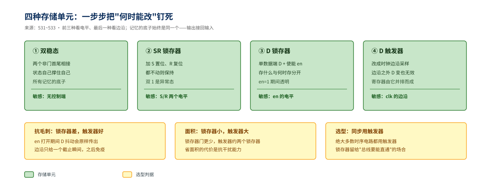

# 531 记忆的诞生：SR 到 D 锁存器

> **解决**：给电路装上"记忆"。从"输出接回输入"这个反直觉的动作开始，做出双稳态，再用两个控制端把它变成 SR 锁存器，最后收成一个数据端 + 一个使能端的 D 锁存器——这是所有存储器的共同接口形态。  
> **范围**：反馈与双稳态 · SR 锁存器六种状态 · 带 en 的 D 锁存器 · 锁存器"透明"的代价。  
> **口径**：以高电平有效的 SR 与高电平透明的 D 锁存器为例；SR 的双 1 异常态只标出不展开（实际芯片要么禁止、要么定义优先级）。时序用"拍"描述，不涉及建立/保持时间的具体数值。  
> **更新**：2026-11-23  
> **本册导读** ── 必会三点：① 记忆来自"输出接回输入"的正反馈 ② SR 的"锁存"就是输入撤回后状态仍在 ③ D 锁存器把"存什么"和"何时存"分成两根线 ｜ 跟做时长：约 1 小时（写 `latch.c` 并逐拍对照） ｜ 前置：512（布尔代数与基本门）。  
> **标记**：★ = 必会节；○ = 拓展节。

## 目录

| 节 | 内容 |
|---|---|
| 531.1 | 记忆从哪来：把输出接回输入 ★ |
| 531.2 | 双稳态：两种状态都稳 ★ |
| 531.3 | SR 锁存器：第一块真正的记忆 ★ |
| 531.4 | 带 en 的 D 锁存器：把"何时写"独立出来 ★ |
| 531.5 | 锁存器的代价：en 期间它是透明的 ○ |
| 531.6 | 坑表 |
| 531.7 | 检查清单（自测 6 题 + 动手任务 2 件） |

---

## 531.1 记忆从哪来：把输出接回输入 ★

**静态的组合逻辑记不住任何东西**：门一断电、输入一撤，输出立刻回到由当前输入决定的值。521 的加法器就是这样——它算得对，但算完就忘。

**记忆的物理前提是"反馈"**：把输出接回自己的输入上，让电路维持住一个状态，不靠外部一直喂。

**为什么必须靠反馈，而不是靠"保持输入不变"**：如果记忆要靠外部持续输入维持，那它只是一个延迟线，输入一撤就丢——**算不上一块记忆**。反馈让状态自己撑住自己，这是所有存储单元（锁存器、触发器、SRAM 单元、寄存器）的同一套底子。

**一句话判据**：看电路里有没有从输出回到输入的环。有环，才可能记住；没环，纯组合逻辑。

## 531.2 双稳态：两种状态都稳 ★

**两个首尾相接的非门**（或两个交叉耦合的与非门）会稳定在两种状态之一：

```text
Q = 1, Q̅ = 0      ← 稳定
Q = 0, Q̅ = 1      ← 也稳定
```

**两种都稳，所以叫"双稳"**——这是它能"记住一位"的根本原因。输入不推它的时候，它就停在当前那个稳定点上不动。

**"双稳"和"单稳"的区别值得分清**：

| 类型 | 稳定状态数 | 行为 |
|---|---|---|
| 双稳 | 2 | 保持，直到被推一下（这就是记忆） |
| 单稳 | 1 | 被推一下后暂时偏离，自己回到唯一位 |
| 无稳 | 0 | 一直在两个状态间振荡（这就是振荡器） |



**这张图是 531~533 三册的路线**：① 双稳态（无控制端，只能靠上电随机落点）→ ② SR 锁存器（两个控制端）→ ③ D 锁存器（一个数据端 + 一个使能）→ ④ D 触发器（把使能换成边沿）。**记忆的底子始终是同一个——输出接回输入；变的只是"何时允许改"这一条规则越钉越死。**

## 531.3 SR 锁存器：第一块真正的记忆 ★

**SR 锁存器 = 双稳态 + 两个控制端**：S（Set，置位）拉高把 Q 置 1，R（Reset，复位）拉高把 Q 清 0，两个都不动则**保持**。

| 状态 | S | R | Q | 说明 |
|---|---|---|---|---|
| 初始 | 0 | 0 | 0 | 上电后靠外部手动拉到 0 |
| 置位 | 1 | 0 | 1 | S 有效，Q 被拉到 1 |
| 锁存（存 1） | 任意 | 0 | 1 | S 撤了，Q 仍是 1——记忆生效 |
| 复位 | 0 | 1 | 0 | R 有效，Q 被拉到 0 |
| 锁存（存 0） | 0 | 任意 | 0 | R 撤了，Q 仍是 0 |
| **异常** | 1 | 1 | 不需要看 | 两个都拉高，Q 与 Q̅ 同时为 1 或震荡 |

**"任意"这两个字就是记忆**：S 撤掉后 R 仍是 0，此时 S/R 都是 0（等于初始行），但 Q 停在 1 而不是回到 0——**同样的输入，不同的历史，不同的输出**。这正是时序逻辑的定义，也是它和组合逻辑的分水岭。

**异常态为什么"不需要看"**：S=R=1 会让 Q 与 Q̅ 同时被压成 0（高电平有效 NOR 型的禁态），违反"它们必须互补"的前提；两个信号同时撤掉时，结果取决于两个门的延迟谁快——**不确定**。工程上的做法是加约束（禁止同 1），或者用下面 §531.4 的 D 锁存器从结构上消灭这种输入组合。

## 531.4 带 en 的 D 锁存器：把"何时写"独立出来 ★

**D 锁存器 = 一个数据端 D + 一个使能端 en**。en=1 时 Q 跟随 D（像一扇打开的门，D 怎么变 Q 就怎么变）；en=0 时 Q 冻住。

| 状态 | D | en | Q | 说明 |
|---|---|---|---|---|
| 初始 | 0 | 0 | 0 | 上电初值，同样靠外部拉定 |
| 关机 | 任意 | 0 | 0 | en=0 且初值为 0，Q 不动 |
| 写入 1 | 1 | 1 | 1 | en 打开，Q 跟着 D |
| 锁存 1 | 任意 | 0 | 1 | en 关掉，D 再怎么变都进不来 |
| 写入 0 | 0 | 1 | 0 | en 打开，Q 跟到 0 |
| 锁存 0 | 任意 | 0 | 0 | en 关掉，D 被挡在门外 |

**它比 SR 多解决了两件事**：

1. **只有一个数据端**——"要存什么"直接给，不需要先想"该拉 S 还是 R"。
2. **"存什么"（D）与"什么时候存"（en）彻底分开**——这是所有存储器的共同接口形态。541 的写使能 WE，就是 en 换了个名字。

**这就是"接口"的雏形**：数据线 + 控制线。后面你看任何存储器、任何外设寄存器，都是这套组合的放大版。

## 531.5 锁存器的代价：en 期间它是透明的 ○

**en=1 期间 D 变一次、Q 就跟着变一次**。所以锁存器也叫"透明锁存器"——它像一扇开着的门，门开着的时候里面外面是连通的。

**问题来了**：如果 D 在 en 打开期间抖动（毛刺、竞争、相邻走线串扰），**抖动会原样传进 Q**。设想 en 打开的那段时间里 D 因为逻辑竞争出现了 `1→0→1` 的窄脉冲，Q 也会跟着抖一下——而下游可能已经把这一抖当成有效数据存下去了。

**这就是 532 要解决的问题**：把"开门的时间"从"一整段时间"缩短到"一个瞬间"。那句"只在时钟边沿采样"，本质是给所有信号定一个统一的截止时刻。

## 531.6 坑表

| # | 现象 | 原因 | 解法 |
|---|---|---|---|
| 1 | 撤掉输入后状态就丢 | 用了纯组合逻辑，没有反馈 | 记忆必须有输出接回输入的环（§531.1） |
| 2 | SR 同时给 1 后行为诡异 | 异常态，结果取决于门延迟 | 禁止双 1 或改用 D 锁存器（§531.3） |
| 3 | 数据在 en 期间莫名跳变 | 锁存器在 en=1 期间是"透明"的 | 换边沿触发器，或缩短 en 窗口（§531.5；532 §532.2） |
| 4 | 锁存器输出一直跟着输入 | 忘了拉低 en | en=0 才冻住（§531.4） |
| 5 | 上电后状态不确定 | 双稳态初值随机 | 加复位，上电统一清零（533 §533.4） |
| 6 | 以为锁存器和触发器是同一个东西 | 一个看电平、一个看边沿 | 判据是"敏感的是电平还是边沿"（532 §532.3） |

## 531.7 检查清单（自测 6 题 + 动手任务 2 件）

**自测**：

| # | 问题 | 自测标准 |
|---|---|---|
| 1 | 记忆的物理前提是什么 | 输出接回输入的反馈，形成双稳态（§531.1） |
| 2 | 双稳态"双"在哪 | 两个稳定点，不推它就停住（§531.2） |
| 3 | SR 锁存器的"锁存"指哪两行 | S 撤后 Q 仍为 1、R 撤后 Q 仍为 0（§531.3） |
| 4 | 为什么 S=R=1 是异常态 | Q 与 Q̅ 同时为 1 或震荡，结果不确定（§531.3） |
| 5 | D 锁存器比 SR 好在哪 | 单数据端 + 把"存什么"与"何时存"分开（§531.4） |
| 6 | 锁存器的代价是什么 | en 期间透明，D 的抖动会原样传出（§531.5） |

**动手任务**：① 跑通 `latch.c`，产出 8 拍对照表；② 纸面推演 SR 锁存器四步（置位 → 锁存 → 复位 → 锁存），每一步只改 S 或 R 一个，说清楚"第 3 步 S 已经撤回 0，Q 为什么还是 1"。

## 附：`latch.c` 完整源码

532 与 533 讲的触发器、寄存器都用这一份程序（三列输出同屏对照）。

```c
#include <stdio.h>

/* SR 锁存器：S 置 1、R 清 0，都不动则保持 */
static int sr_latch(int s, int r, int q)
{
    if (s && r) return -1;   /* 双 1 是异常态，本库不讨论 */
    if (s) return 1;
    if (r) return 0;
    return q;                /* 保持：这就是"记忆" */
}

/* 带 en 的 D 锁存器：en=1 期间 Q 一直跟着 D 变（透明的门） */
static int d_latch(int d, int en, int q)
{
    return en ? d : q;
}

/* 上升沿触发的 D 触发器：只在上一个拍 clk=0、这一拍 clk=1 时采样 */
static int d_ff(int d, int clk, int clk_prev, int q)
{
    if (!clk_prev && clk) return d;   /* 0→1 上升沿，只此一瞬间 */
    return q;
}

int main(void)
{
    /* 8 拍输入序列：同一组 S/R/D/en/clk 喂给三种单元 */
    int seq[8][6] = {
        /* t   D  S  R  en clk */
        { 0,   0, 0, 0, 1, 0 },
        { 1,   1, 1, 0, 1, 1 },
        { 2,   0, 0, 0, 1, 0 },
        { 3,   0, 0, 0, 1, 1 },
        { 4,   1, 0, 1, 1, 0 },
        { 5,   1, 0, 0, 0, 1 },
        { 6,   0, 0, 0, 0, 0 },
        { 7,   1, 0, 0, 1, 1 },
    };

    int q_sr = 0, q_lat = 0, q_ff = 0, clk_prev = 0;

    printf("== 同一组输入，三种单元的 Q 各是多少 ==\n");
    printf("拍  D S R en clk | SR锁存 D锁存 D触发器  说明\n");
    printf("-----------------+------------------------------\n");
    for (int t = 0; t < 8; t++) {
        int d = seq[t][1], s = seq[t][2], r = seq[t][3];
        int en = seq[t][4], clk = seq[t][5];

        q_sr  = sr_latch(s, r, q_sr);
        int q_lat_before = q_lat;
        q_lat = d_latch(d, en, q_lat);
        q_ff  = d_ff(d, clk, clk_prev, q_ff);

        printf(" %d  %d %d %d %d  %d  |   %d     %d      %d    ",
               t, d, s, r, en, clk, q_sr, q_lat, q_ff);

        if (!clk_prev && clk)           printf("clk 上升沿，触发器采样\n");
        else if (q_lat != q_lat_before) printf("锁存器跟随 D，触发器不动\n");
        else                            printf("保持\n");

        clk_prev = clk;
    }

    printf("\n== 差异一句话 ==\n");
    printf("锁存器：en=1 就一直跟着 D 走（电平敏感，像一扇开着的门）\n");
    printf("触发器：只有时钟边沿那一瞬间看 D，其余时间纹丝不动（像快门）\n");
    return 0;
}
```

> 下一篇：《532 边沿触发：寄存器为什么要时钟沿》——锁存器门开着就什么都能进，下一册把它换成快门。
