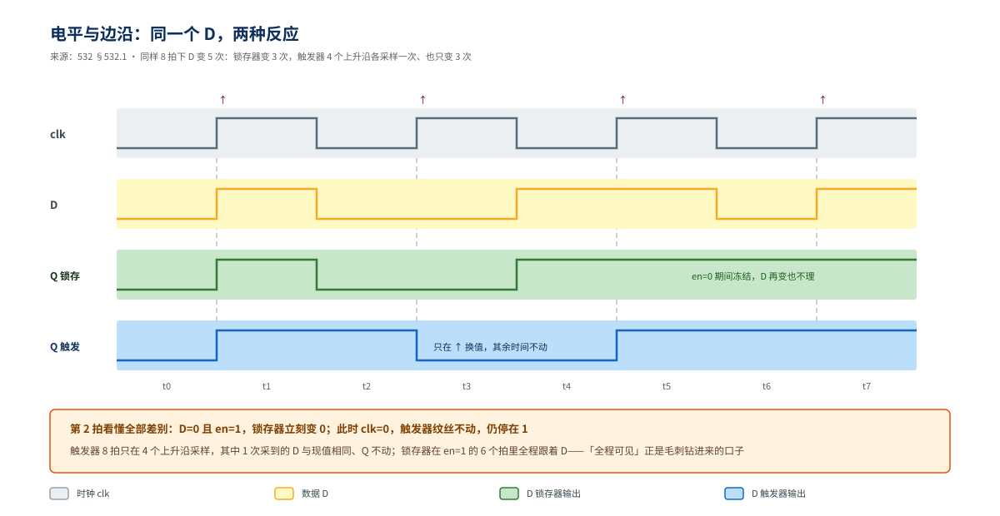

# 532 边沿触发：寄存器为什么要时钟沿

> **解决**：锁存器门开着的时候，什么都能进——包括毛刺。这一册把"开门一段时间"改成"只在瞬间开一次"，讲清边沿触发的 D 触发器怎么工作、时钟为什么是同步设计的根、以及建立时间与保持时间这两个绕不开的约束。  
> **范围**：边沿触发的 D 触发器 · 为什么不采样电平 · 锁存器与触发器的取舍 · 时钟与节拍 · 建立/保持时间的概念级理解。  
> **口径**：以上升沿触发的 D 触发器为例；时序只给"拍"级描述与定性约束，具体纳秒数一律查 datasheet。程序沿用 531 附录的 `latch.c`。  
> **更新**：2026-11-23  
> **本册导读** ── 必会三点：① 触发器只在时钟边沿那一瞬看 D ② 边沿是"所有信号统一的截止时刻" ③ 锁存器省面积、触发器抗毛刺，同步电路一律用触发器 ｜ 跟做时长：约 1 小时（跑 `latch.c` 并对照三列） ｜ 前置：531（记忆的诞生）。  
> **标记**：★ = 必会节；○ = 拓展节。

## 目录

| 节 | 内容 |
|---|---|
| 532.1 | 边沿触发的 D 触发器：只在那瞬间看 D ★ |
| 532.2 | 为什么必须限定成边沿 ★ |
| 532.3 | 锁存器还是触发器：一条选择规则 ★ |
| 532.4 | 时钟：全芯片的统一节拍 ○ |
| 532.5 | 建立时间与保持时间：边沿前后要稳多久 ○ |
| 532.6 | 坑表 |
| 532.7 | 检查清单（自测 6 题 + 动手任务 2 件） |

---

## 532.1 边沿触发的 D 触发器：只在那瞬间看 D ★

**D 触发器（D Flip-flop）只在时钟边沿那一瞬间看 D**，其余时间纹丝不动。上升沿触发指的是"上一个拍 clk=0、这一拍 clk=1"的那一刻。

```c
/* 上升沿触发的 D 触发器：只在上一个拍 clk=0、这一拍 clk=1 时采样 */
static int d_ff(int d, int clk, int clk_prev, int q)
{
    if (!clk_prev && clk) return d;   /* 0→1 上升沿，只此一瞬间 */
    return q;
}
```

注意这个函数需要两个时钟参数：**当前拍与上一拍**。这不是代码的写法问题，而是硬件的真实形态——触发器内部有一小块电路专门负责"检测这次是不是从 0 跳到 1"，只在检测到的那一拍放行一次。

**跑 `latch.c`**（源码见 531 附录）得到的 8 拍对照表，只看最右一列：

```text
== 同一组输入，三种单元的 Q 各是多少 ==
拍  D S R en clk | SR锁存 D锁存 D触发器  说明
-----------------+------------------------------
 0  0 0 0 1  0  |   0     0      0    保持
 1  1 1 0 1  1  |   1     1      1    clk 上升沿，触发器采样
 2  0 0 0 1  0  |   1     0      1    锁存器跟随 D，触发器不动
 3  0 0 0 1  1  |   1     0      0    clk 上升沿，触发器采样
 4  1 0 1 1  0  |   0     1      0    锁存器跟随 D，触发器不动
 5  1 0 0 0  1  |   0     1      1    clk 上升沿，触发器采样
 6  0 0 0 0  0  |   0     1      1    保持
 7  1 0 0 1  1  |   0     1      1    clk 上升沿，触发器采样
```

**第 2 拍是本册的重点**：D 变成 0、en=1，锁存器立刻跟到 0；而触发器 clk=0，纹丝不动，Q 仍停在 1。**同一组输入、同一个时刻，两种单元给出不同答案**——差别不在输入，在"何时允许改变"。



**试一试**：把第 2 拍的 `clk` 从 0 改成 1（`{ 2, 0, 0, 0, 1, 0 }` 改成 `{ 2, 0, 0, 0, 1, 1 }`），再跑。触发器会在这一拍采样 D=0，Q 变 0；而第 3 拍本来要采样的那次上升沿就不存在了（clk 连续为 1），于是第 3 拍的 Q 不再变化。**改一个 clk 值，后面所有拍的触发器状态都跟着变**——这就是"边沿是唯一入口"的直接后果。

## 532.2 为什么必须限定成边沿 ★

**电路里不同的路径延迟不同**。一个组合逻辑块的输入变了，输出要经过若干级门才稳定；在这段时间里，输出可能出现多次中间跳变（术语叫**冒险**，跳变形成窄脉冲叫**毛刺**）。

如果时序单元在整个 en 期间都"开门"（像 531 的锁存器），那么**这段时间里出现的每一个毛刺都会被写进去**。而毛刺的出现与门的延迟、温度、电压都有关——**所以这种错误是概率性的、随温度变化的、复现不了的**。

**边沿触发等于给所有信号定了一个统一的截止时刻**：这一刻之前必须稳，之后随便变。整个芯片按同一根时钟动作，就变成了"拍"的概念——每一拍开始时采样，拍内算完，下一拍再采。

**同步设计的三个前提**（后面 553 讲控制单元时会用到）：

1. 所有触发器共用一根时钟（或同源的时钟）；
2. 数据在边沿前必须稳定（建立时间）；
3. 数据在边沿后还要保持一小会儿（保持时间）。

## 532.3 锁存器还是触发器：一条选择规则 ★

| 维度 | 锁存器（Latch） | 触发器（Flip-flop） |
|---|---|---|
| 敏感对象 | 电平（en=1 期间一直跟随） | 边沿（跳变那一瞬间） |
| 抗毛刺 | 差：en 期间 D 抖动会原样传出 | 好：只在边沿看，其余时间免疫 |
| 面积 | 小（门更少） | 大（内部约两个锁存器 + 边沿检测） |
| 常见场合 | 低速寄存器、总线暂存、"透明锁存" | 绝大多数同步时序电路、寄存器堆 |

**规则一句话**：**要抗干扰、要同步，用触发器；要省面积、要透明直通，用锁存器。**

现代芯片里触发器是绝对主力，锁存器多出现在"总线必须能直通"的场合。**本库后面讲的寄存器、计数器、存储器单元，一律按触发器理解**——这样不用每次纠结电平与边沿。

## 532.4 时钟：全芯片的统一节拍 ○

**时钟是让所有时序单元同时动作的节拍器**，由晶振提供（400 硬件基础 451 §451.1 最小系统四件里的时钟件）。

**时钟频率就是"每秒采样多少次"**，也是主频的字面含义。3.3V 的 MCU 跑 72MHz，意思是每秒有 7200 万次上升沿——每 13.9 纳秒一次采样。

**为什么不能随便提高频率**：每一拍之内，信号必须从上一级触发器出发、穿过组合逻辑、在下一拍边沿到来之前稳住。走完这条路要时间，这段路径叫**关键路径**。频率超过关键路径允许的上限，数据就来不及稳定——**这是主频的物理天花板**，不是工艺或成本的限制。

**分频**：时钟可以分频（二分频就是把触发器输出接到自己的 D 输入端，见 533 §533.2）。低速外设用分频后的时钟，是省功耗的常规做法。

## 532.5 建立时间与保持时间：边沿前后要稳多久 ○

两个约束，方向相反：

| 约束 | 含义 | 违反后果 |
|---|---|---|
| **建立时间（setup）** | 数据必须在时钟边沿**之前**稳定一段时间 | 采到旧值或中间值（亚稳态） |
| **保持时间（hold）** | 数据必须在时钟边沿**之后**继续保持一段时间 | 采到正在变化的中间值 |

**亚稳态**是这里最麻烦的后果：触发器采到不满足条件的数据时，输出可能停在既非 0 也非 1 的中间电平，经过不确定的时间才随机落到一边。**亚稳态会传播**——下游触发器可能继续采到它，错误一级一级传下去。

**本库的边界**：只要求你知道"边沿前后都要稳"这条定性约束，具体纳秒数、跨时钟域怎么处理，属于数字设计与 600 板块的内容。

## 532.6 坑表

| # | 现象 | 原因 | 解法 |
|---|---|---|---|
| 1 | 以为触发器"一直盯着 D" | 它只在边沿采样 | 边沿之外 D 怎么变都无效（§532.1） |
| 2 | 数据偶尔采错，换个温度就好了 | 建立/保持时间被违反 | 降频或缩短组合逻辑路径（§532.5） |
| 3 | 锁存器电路里毛刺被写进去 | en 期间透明，毛刺原样穿过 | 换边沿触发器（§532.2） |
| 4 | 改了时钟相位，后面全乱 | 边沿是唯一入口，动相位等于动采样点 | 不要在同一系统里混用不同相位的时钟（§532.4） |
| 5 | 触发器输出"卡在中间电平" | 亚稳态 | 降频、加同步器、避免跨时钟域（§532.5） |
| 6 | 提高主频后功能错乱 | 关键路径来不及稳定 | 主频有物理上限（§532.4） |

## 532.7 检查清单（自测 6 题 + 动手任务 2 件）

**自测**：

| # | 问题 | 自测标准 |
|---|---|---|
| 1 | 触发器什么时候看 D | 只在时钟边沿那一瞬（§532.1） |
| 2 | 为什么必须边沿触发 | 电平期间 D 会抖动，边沿给出统一截止时刻（§532.2） |
| 3 | 锁存器与触发器的取舍 | 抗毛刺用触发器，省面积/直通用锁存器（§532.3） |
| 4 | 时钟是什么、主频指什么 | 统一节拍器；主频 = 每秒采样次数（§532.4） |
| 5 | 建立时间与保持时间 | 边沿前后各要稳定一段时间，不满足会亚稳态（§532.5） |
| 6 | 主频的上限由什么决定 | 关键路径的延迟（§532.4） |

**动手任务**：① 跑 `latch.c`，只看 D 触发器一列，说明第 2 拍为什么 Q 仍是 1；② 把第 2 拍的 clk 改成 1 再跑，产出改动后的 8 拍表，解释"为什么第 3 拍触发器不再变化"。

> 下一篇：《533 寄存器、计数器与移位》——单个触发器记一位，下一册把很多位排好队。
