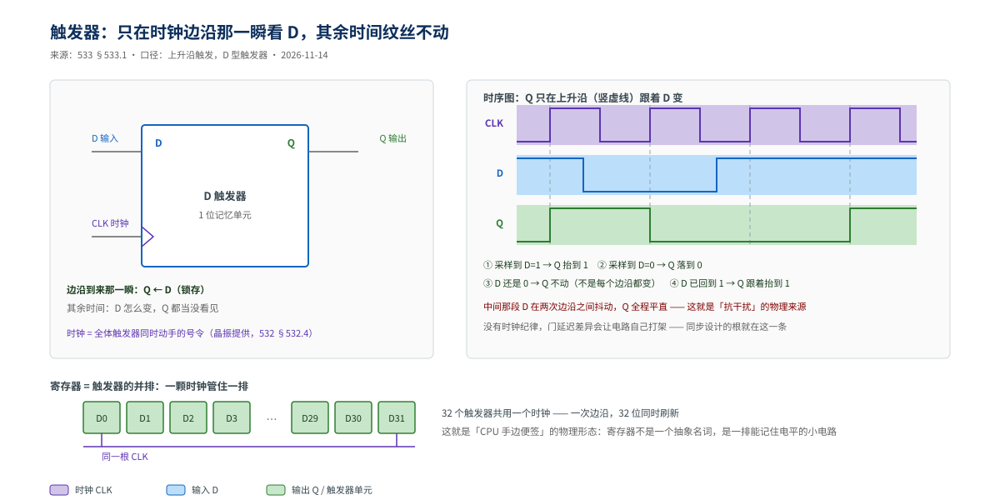

# 533 寄存器、计数器与移位

> **解决**：532 解决了"一位怎么在边沿上被采住"，但一位记不住一个数。这一册把 N 个触发器并排、共用一根时钟，做成寄存器；再把这个寄存器接成会数数的计数器、会搬位的移位寄存器，最后补上开机那一刻必须有的复位——CPU 手边那张"便签"到这里才成形。  
> **范围**：N 位寄存器与共用时钟 · we / rst 两个接口 · 计数器与分频 · 移位寄存器与串并转换 · 复位与初值 · 寄存器堆。  
> **口径**：以 4 位宽为例，便于一张表看完；程序 `reg.c` 为本册原创，输出为本机 `gcc` 实测。时钟只按"拍"描述，不涉具体纳秒。  
> **更新**：2026-11-23  
> **本册导读** ── 必会三点：① 寄存器 = 触发器并排 + 共用一根时钟 ② 计数器 = 寄存器 + 一个"固定加一"的加法器 ③ 移位 = 寄存器 + 错位接线，不是新硬件 ｜ 跟做时长：约 1 小时（跑 `reg.c` 并改三处参数） ｜ 前置：531（记忆的诞生）、532（边沿触发）。  
> **标记**：★ = 必会节；○ = 拓展节。

## 目录

| 节 | 内容 |
|---|---|
| 533.1 | 寄存器：触发器并排，一次写一整排 ★ |
| 533.2 | 计数器：寄存器加一个固定加一 ★ |
| 533.3 | 移位寄存器：一位一位地搬 ★ |
| 533.4 | 复位与初值：开机那一刻 ★ |
| 533.5 | 寄存器堆：CPU 的便签有名字 ○ |
| 533.6 | 坑表 |
| 533.7 | 检查清单（自测 6 题 + 动手任务 2 件） |

---

## 533.1 寄存器：触发器并排，一次写一整排 ★

**寄存器 = N 个 D 触发器并排 + 共用一根时钟线**。4 个并排就是 4 位寄存器，32 个并排就是 32 位。

**关键在"共用"这两个字**：如果 4 个触发器在不同时刻采样，存下来的 4 位就是 4 个不同时刻的快照，拼起来的数毫无意义。同一根时钟线保证"这 4 位是同一瞬间的"——这就是**同步**的字面含义。



**一个寄存器对外有四个接口**，比单个触发器多两个：

| 接口 | 位宽 | 作用 | 对应 531/532 的哪个概念 |
|---|---|---|---|
| D | N 位 | 这一拍要写进去的值 | 数据端 D |
| Q | N 位 | 当前存着的值 | 输出端 Q |
| clk | 1 位 | 什么时候写（边沿） | 532 的时钟 |
| **we** | 1 位 | **准不准写** | 531 D 锁存器的 en，换了个名字 |
| **rst** | 1 位 | **强制清零** | 本册 §533.4 新增 |

**we 和 clk 是两件事，这一点最容易混**：clk 说"现在有一个边沿"，we 说"这次边沿算不算数"。两者同时成立才写。只看边沿不看 we，等于每次时钟跳一下就覆盖一次——程序里那些"本该保持不变"的值会莫名其妙被冲掉。

**完整示例**（文件名 `reg.c`，本册三段演示都在这个文件里）：

```c
/* 4 位寄存器：共用一根 clk，we=1 才装入，rst=1 清零，否则保持 */
static unsigned reg4_step(unsigned q, unsigned d, int we, int rst)
{
    if (rst) return 0;
    if (we)  return d & 0xF;
    return q;
}
```

**跟做步骤**：新建 `reg.c` 抄入册末附录源码 → `gcc -Wall reg.c -o reg4.exe` → `./reg4.exe`。

> 产物名别取 `reg.exe`——那是 Windows 的注册表命令行工具，会被命令安全规则按名字拦下。

**预期输出**（本机实测，第一段）：

```text
== 4 位寄存器：we 才是写入许可 ==
操作            we rst   4 位的值
-------------------------------
装入 13          1   0    13  1101
再来  6          0   0    13  1101  ← we=0，不动
rst 清零         0   1     0  0000
```

**第二行是本节的重点**：`we=0` 时给了新数据 6，寄存器仍是 13。**数据和许可都到位了、只差许可这一位**——和 542 §542.2 里 WE=0 写不进存储器是同一个道理，只是那里叫 WE，这里叫 we。

**试一试**：把 `reg4_step(q, 6, 0, 0)` 的第三个参数从 `0` 改成 `1`，再跑。第二行会变成 `6 0110`。**改一个 0 变 1，历史就被覆盖了**——这就是"写使能决定改不改"的手感。

## 533.2 计数器：寄存器加一个固定加一 ★

**计数器不是新器件，是寄存器接成闭环**：把寄存器的 Q 拉出来，送进一个加法器加 1，结果再送回自己的 D。每来一个时钟边沿，这个环就把"当前值 + 1"写回去。

```text
        ┌──────────────┐
   ┌───→│  加法器 + 1   │───→ D ┌──────────┐
   │    └──────────────┘        │  寄存器   │───→ Q（计数值）
   └────────────────────────────┘          │
                     clk ───────────────────┘
```

**"满 16 回绕"是位宽的自然结果，不是额外设计**：4 位寄存器存不下 16，`1111 + 1 = 1 0000` 的第 5 位没有地方放，直接丢弃，剩下的 `0000` 就是回绕。**模 2⁴ = 16 的计数器，一颗多余的器件都不用加。**

**完整示例**（同一份 `reg.c`）：

```c
/* 4 位二进制计数器：每个时钟沿加 1，满 16 回绕 */
static unsigned cnt_step(unsigned q, int rst)
{
    if (rst) return 0;
    return (q + 1) & 0xF;      /* & 0xF 就是"第 5 位扔掉" */
}
```

**预期输出**（本机实测，第二段，只截前四拍与最后两拍）：

```text
== 4 位计数器：每拍加 1，满 16 回绕 ==
 第 0 拍   0  0000
 第 1 拍   1  0001
 第 2 拍   2  0010
 第 3 拍   3  0011
 ...
 第15 拍  15  1111
 第16 拍   0  0000  ← 加满一圈回到 0000
```

**看第 15 拍到第 16 拍这一跳**：`1111` 再加 1 得到 `1 0000`，最高位被位宽砍掉，剩 `0000`。**回绕不是 bug，是"模"的定义**。

**分频怎么来的**（532 §532.4 留的那个口子）：看最低位那一位——`0,1,0,1,0,1…`，每两个时钟才翻一次。**把最低位当输出，就得到时钟频率的一半**，这叫二分频。再串一级计数器，就是四分频、八分频。低速外设的时钟不是另外造的，是从主时钟一级级分下来的。

**试一试**：把 `(q + 1)` 改成 `(q + 3)`，再跑。计数值变成 `0,3,6,9,12,15,2,5…`——**不再是 0~15 全走一遍，而是跳着走，周期变成 16**。这就是"分频比可以不是 2 的幂"的来源。

## 533.3 移位寄存器：一位一位地搬 ★

**移位寄存器 = 寄存器 + 错位接线**：第 i 位的输出接到第 i+1 位的输入，最低位空出来接一个新来的位（`din`）。每来一个边沿，整排值朝一个方向挪一格。

如果用纸笔画，它是四个方块排成一行、箭头从左往右串起来，最左边一根 `din` 进线——**结构简单到不需要配图，接线关系就是全部**。

**它和计数器一样，都是"寄存器 + 一点接线"，没有新器件**。区别只在接法：计数器把输出送回加法器，移位寄存器把输出送给隔壁。

| 用法 | 数据怎么进出 | 典型场合 |
|---|---|---|
| 串入并出 | 一位一位进，整排一次读出 | 串口接收：线上一根一根来，收满 8 位给 CPU 读 |
| 并入串出 | 整排一次写入，一位一位出去 | 串口发送：CPU 写一个字节，硬件慢慢往外推 |
| 循环移位 | 移出的位补回另一端 | 流水灯、加密运算里的循环左移 |

**完整示例**（同一份 `reg.c`）：

```c
/* 4 位左移寄存器：每个时钟沿把 din 移进最低位 */
static unsigned shl_step(unsigned q, int din, int rst)
{
    if (rst) return 0;
    return ((q << 1) | (din & 1)) & 0xF;
}
```

**预期输出**（本机实测，第三段，串行送入 `1 0 1 1`）：

```text
== 4 位左移：串行输入 1 0 1 1 依次移入 ==
 第1 拍 移入 1 →   1  0001
 第2 拍 移入 0 →   2  0010
 第3 拍 移入 1 →   5  0101
 第4 拍 移入 1 →  11  1011
 并出结果 = 11（二进制 1011）
```

**四拍看下来是一条传送带**：第一个进来的 1 一路被推到最高位，最后停在 `1011` 的最高位；最后一个进来的 1 停在最低位。**进来的顺序决定了出去的顺序**——这是串行通信里"先发高位还是先发低位"必须约定清楚的原因。

**"并出结果 = 11"这句话的含义**：串行送进去 4 位，最后整排读出来是一个 4 位数，值 11。**串转并的全部工作就是"等 4 拍，然后整排读"**，不需要任何额外计算。

**试一试**：把 `(q << 1)` 改成 `(q >> 1)`、同时把 `| (din & 1)` 改成 `| ((din & 1) << 3)`，再跑。变成右移：`1 0 1 1` 送完得到 `1101`（13）。**同一个输入序列，移位方向反向，结果就反了**——串口两端方向配错时数据全乱，原因就在这里。

## 533.4 复位与初值：开机那一刻 ★

**触发器上电时 Q 是随机的**：它靠反馈维持两个稳定点，上电瞬间落在哪个点由制造偏差、温度、电源爬升速度共同决定——**不可控、不可复现**。4 个触发器拼成寄存器，就是 4 个各不相同的随机位，开机值每次都不一样。

素材里那位作者踩过这个坑，原话是四位寄存器做完之后发现"**需要自己手动调节到初始状态**"。手动拨开关的办法在实验板上能凑合，在芯片里没有开关可拨——所以真实器件都带一根**复位线（rst）**。

**复位的两条纪律**：

| 纪律 | 做法 | 为什么 |
|---|---|---|
| 优先级最高 | 代码里 `if (rst) return 0;` 写在最前面 | 复位必须能压过一切，包括正在进行的写入 |
| 上电先复位一次 | 程序开始跑之前统一拉一次 | 让所有寄存器从同一个已知值出发，行为才可复现 |

**完整示例**（`reg.c` 的三个 `_step` 函数都遵循同一顺序）：

```c
if (rst) return 0;      /* 第一优先：不管 we 是什么，一律清零 */
if (we)  return d & 0xF; /* 第二优先：允许写才写 */
return q;               /* 都不满足：保持 */
```

**三行代码就是优先级表**，从上往下压。**顺序写反就是 bug**：如果把 `if (we)` 写在前、`if (rst)` 写在后面，那么在 we=1 的那一拍复位会被忽略——上电时如果恰好 we 有效，随机值就被写进去了。

**预期输出**（本机实测，第一段第三行）：

```text
rst 清零         0   1     0  0000
```

**rst=1 时 we=0、d=0，但 Q 仍然被清成 0**——说明清零不依赖 we，是独立的强制通道。

**同步复位还是异步复位**：本册代码把 rst 放在边沿采样里面，是**同步复位**（复位也要等时钟边沿才生效）；真实芯片还有**异步复位**（复位一到立刻生效，不等时钟）。二者差别在时序细节，入门阶段记住一句就够：**同步复位好做时序分析，异步复位能救急但要做释放同步**。

**试一试**：把 `reg4_step` 里第一行 `if (rst) return 0;` 注释掉，再跑。第三行会变成 `13 1101`——**复位失效，寄存器停在旧值上**。这就是"忘了接复位线"在代码里的样子。

## 533.5 寄存器堆：CPU 的便签有名字 ○

**寄存器堆（register file）= 一排寄存器 + 一套选择电路**。CPU 里的 `R0~R15` 就是它：16 个 32 位寄存器并排，指令里的 4 位字段指出"这次用第几个"。

**它和存储器的结构几乎一样，区别在三处**：

| 维度 | 寄存器堆 | 存储器（542） |
|---|---|---|
| 数量 | 十几个 | 成千上万个 |
| 速度 | 最快（在 CPU 核心里，一拍可读） | 慢一到两个数量级 |
| 怎么寻址 | 编号直接写在指令位域里（552） | 地址要经过译码器选中一行 |
| 端口 | 常见两读一写（同时读两个操作数） | 通常一组地址一根读写线 |

**"两读一写"是它的关键特征**：一条加法指令要同时取出两个操作数，所以寄存器堆有两个独立的读端口；结果只有一个，所以只有一个写端口。**这是被指令格式逼出来的结构**，不是设计者随意定的。

**为什么不用存储器代替寄存器堆**：一拍之内读出两个操作数，存储器做不到——它一组地址线一次只能选一行。**速度换面积**，这十几个寄存器的成本换来的是每拍都能取到操作数。

**联系到 533.1 的接口**：寄存器堆里每一个寄存器的 we，就是由指令的"目标寄存器编号"经译码后给出的那根线。**整排寄存器的 we 全部为 0，只有一个为 1**——这和 523 译码器"8 路里只亮 1 路"是同一个动作，只是这里选的是"哪一个寄存器可以写"。

## 533.6 坑表

| # | 现象 | 原因 | 解法 |
|---|---|---|---|
| 1 | 存进去的数位与位之间对不上 | 各触发器时钟不同源，采样时刻不同 | 所有位共用同一根时钟线（§533.1） |
| 2 | 值莫名其妙被覆盖 | 只看了边沿，没看 we | we=0 时这次边沿不算数（§533.1） |
| 3 | 开机值每次都不一样 | 触发器上电态随机，没有复位 | 加 rst，上电统一清零（§533.4） |
| 4 | 复位按下去没反应 | `if (we)` 写在 `if (rst)` 前面 | rst 判断必须放最前（§533.4） |
| 5 | 计数器数不到 16 以上 | 位宽不够，高位被丢弃 | 回绕是模运算，要更大范围就加位宽（§533.2） |
| 6 | 串口收到的数据全错 | 移位方向与对端不一致 | 两端统一先发高位还是低位（§533.3） |
| 7 | 加一级计数器后频率没变 | 取的不是最低位，或分频级没串起来 | 最低位才是二分频输出（§533.2） |

## 533.7 检查清单（自测 6 题 + 动手任务 2 件）

**自测**：

| # | 问题 | 自测标准 |
|---|---|---|
| 1 | 寄存器里"共用时钟"保证什么 | 所有位是同一瞬间的快照，否则拼起来无意义（§533.1） |
| 2 | we 和 clk 各管什么 | clk 管"有没有边沿"，we 管"这次算不算数"（§533.1） |
| 3 | 计数器为什么能回绕 | 位宽存不下进位，最高位被丢弃，等价于取模（§533.2） |
| 4 | 二分频从哪一位取 | 计数器的最低位，每两个时钟翻一次（§533.2） |
| 5 | 串入并出的全部工作是什么 | 等 N 拍收满，然后整排一次读出（§533.3） |
| 6 | 复位为什么必须写在最前面 | 复位要能压过写入，否则上电时可能写进随机值（§533.4） |

**动手任务**：

1. **跑通 `reg.c`**，产出三段输出；并说明第一段第二行为什么 `we=0` 时值还是 13（两句话）。
2. **做两次"试一试"**：① 把 `reg4_step(q, 6, 0, 0)` 的 we 改成 1，产出改动后的第一段；② 把 `shl_step` 改成右移，产出改动后的第三段，并说明为什么结果是 13 而不是 11。

## 附：`reg.c` 完整源码

```c
#include <stdio.h>

/* 4 位寄存器：共用一根 clk，we=1 才装入，rst=1 清零，否则保持 */
static unsigned reg4_step(unsigned q, unsigned d, int we, int rst)
{
    if (rst) return 0;
    if (we)  return d & 0xF;
    return q;
}

/* 4 位二进制计数器：每个时钟沿加 1，满 16 回绕 */
static unsigned cnt_step(unsigned q, int rst)
{
    if (rst) return 0;
    return (q + 1) & 0xF;
}

/* 4 位左移寄存器：每个时钟沿把 din 移进最低位 */
static unsigned shl_step(unsigned q, int din, int rst)
{
    if (rst) return 0;
    return ((q << 1) | (din & 1)) & 0xF;
}

static void bits(unsigned v)
{
    for (int i = 3; i >= 0; i--) putchar(((v >> i) & 1) ? '1' : '0');
}

int main(void)
{
    unsigned q = 0;

    printf("== 4 位寄存器：we 才是写入许可 ==\n");
    printf("操作            we rst   4 位的值\n");
    printf("-------------------------------\n");
    q = reg4_step(q, 13, 1, 0);
    printf("装入 13          1   0    %2u  ", q); bits(q); printf("\n");
    q = reg4_step(q,  6, 0, 0);
    printf("再来  6          0   0    %2u  ", q); bits(q); printf("  ← we=0，不动\n");
    q = reg4_step(q,  0, 0, 1);
    printf("rst 清零         0   1    %2u  ", q); bits(q); printf("\n");

    printf("\n== 4 位计数器：每拍加 1，满 16 回绕 ==\n");
    q = 0;
    for (int t = 0; t < 17; t++) {
        printf(" 第%2d 拍  %2u  ", t, q); bits(q);
        if (t == 16) printf("  ← 加满一圈回到 0000");
        printf("\n");
        q = cnt_step(q, 0);
    }

    printf("\n== 4 位左移：串行输入 1 0 1 1 依次移入 ==\n");
    q = 0;
    int din[4] = {1, 0, 1, 1};
    for (int t = 0; t < 4; t++) {
        q = shl_step(q, din[t], 0);
        printf(" 第%d 拍 移入 %d →  %2u  ", t + 1, din[t], q); bits(q); printf("\n");
    }
    printf(" 并出结果 = %u（二进制 ", q); bits(q); printf("）\n");
    return 0;
}
```

> 下一篇：《541 地址片选与读写时序》——531 到 533 造完了"位 → 触发器 → 寄存器"这条记忆链；一位一位地记太浪费，下一册把它们按地址排成阵列。
