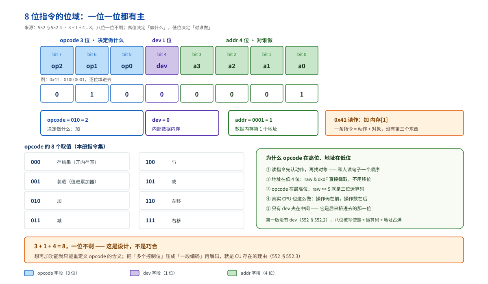

# 552 指令编码：操作码、设备位与地址

> **解决**：五件零件都在了，但它们还是"哑"的——ALU 不知道该做哪种运算，寄存器不知道该不该写。这一册给它们编一套命令语言：一条 8 位指令怎么拆成"做什么 + 对谁做"，为什么最直白的编码方式活不过第二代，以及控制单元（CU）在这中间扮演什么角色。  
> **范围**：指令的两段结构 · 第一版"控制位摊开"编码 · 为什么它短命 · CU 与编码压缩 · 8 位位域设计 · 用程序验证拆解。  
> **口径**：以 8 位指令、3 位 opcode、1 位 dev、4 位地址为例；只讲编码与译码，执行与 PC 推进归 553。  
> **更新**：2026-11-23  
> **本册导读** ── 必会三点：① 每条指令都在回答"做什么"和"对谁做" ② 控制位摊开会把位用光，压缩成 opcode 才留得出余量 ③ 位域是"哪几位管什么"的约定，拆错了指令就变义 ｜ 跟做时长：约 45 分钟（跑 `dec.c` 并手改一条指令） ｜ 前置：551（五部件）、522（ALU 选码）。  
> **标记**：★ = 必会节；○ = 拓展节。

## 目录

| 节 | 内容 |
|---|---|
| 552.1 | 指令 = 做什么 + 对谁做 ★ |
| 552.2 | 第一版：把控制位摊在明面上 ★ |
| 552.3 | CU：把控制信号压成编码 ★ |
| 552.4 | 8 位位域设计 ★ |
| 552.5 | 用程序验证拆解 ○ |
| 552.6 | 坑表 |
| 552.7 | 检查清单（自测 6 题 + 动手任务 2 件） |

---

## 552.1 指令 = 做什么 + 对谁做 ★

**一条指令只需要回答两个问题**：这一拍**做什么运算或动作**，作用在**哪一个数据**上。所有指令集，从 8 位单片机到 x86，都是这两个字段的不断扩展。

| 字段 | 回答 | 本册的位数 |
|---|---|---|
| 操作 | 加、减、装载、存结果…… | 3 位（opcode） |
| 对象 | 第几个地址 / 哪类设备 | 4 位（addr）+ 1 位（dev） |

**"对象"为什么要分成两段**：内部数据内存的地址和外部设备的编号，是两套东西，但它们的取值范围都很小（各 8~16 个）。**用一位 dev 区分"这次说的是内存还是设备"，就能让同一套 4 位地址在两套空间里复用**——这是 553 §553.3 要展开的内容，这里只需知道它占一位。

**为什么指令长度是固定的**：变长指令省空间，但译码时要先"读多长"再"读内容"，多一层判断；固定长度指令每条都占 8 位（哪怕信息量不满），换来的是**译码电路简单、位置固定、可以按固定步长取指**。**入门机器一律选固定长度**，真实 CPU 才开始玩变长。

## 552.2 第一版：把控制位摊在明面上 ★

**最直白的编码是把每一个控制位都摊开**：一位管"要不要写内存"，三位管"ALU 做哪种运算"，四位管"地址是多少"。

```text
第一版：8 位 = [ 写使能 1 位 ][ ALU 运算 3 位 ][ 地址 4 位 ]
```

**这种编码的优点是"没有任何翻译"**：写使能那一位直接接到存储器的 WE 脚，ALU 那三位直接接到 ALU 的选码端。**CU 几乎不用存在**——指令字本身就是控制信号。

**按这个格式，`13+6+27-6` 存回地址 3 的五条指令是**：

| 动作 | 二进制 | 拆解 |
|---|---|---|
| +13 | `00100000` | 0 关写使能 · 010 加法 · 0000 地址 0 |
| +6 | `00100001` | 0 关写使能 · 010 加法 · 0001 地址 1 |
| +27 | `00100010` | 0 关写使能 · 010 加法 · 0010 地址 2 |
| −6 | `00110001` | 0 关写使能 · 011 减法 · 0001 地址 1 |
| 存结果 | `10000011` | 1 **开**写使能 · 000 输出 A · 0011 地址 3 |

**三个特点值得记住**：① 写使能是一位"裸"的控制线，一眼能看出来；② ALU 的运算码直接搬进指令；③ **八位全用满了，一位不剩**。

**为什么它短命**：想加"这次操作的对象是外部 GPIO 而不是内部内存"，就要再加一位设备选择——**没有位可加了**。要么把地址从 4 位砍到 3 位（容量从 16 格降到 8 格），要么想别的办法。**"位不够"是所有指令集演进的第一驱动力**，这就是下一节要解决的问题。

## 552.3 CU：把控制信号压成编码 ★

**解法是把"多个控制信号的组合"压缩成一段编码，再用一块专门电路解码**——这块电路就是 CU（Control Unit，控制单元）。

**压缩的依据很实在**：原本"寄存器写使能、内存写使能、ALU 运算"是三个独立的位，但它们在真实指令里**并不会任意组合**——你几乎不会同时"写寄存器 + 写内存 + 左移"。**有效组合远少于全部组合**，所以可以用 3 位编码表示 8 种有效状态，而不是用多根独立线各管一件事。

```text
第二版：8 位 = [ opcode 3 位 ][ dev 1 位 ][ 地址 4 位 ]
```

**代价与收益**：

| 维度 | 第一版（摊开） | 第二版（带 CU） |
|---|---|---|
| 控制信号怎么来 | 直接从指令位拉出来 | CU 解码 3 位 opcode 得到 |
| 多出的位数 | 没有 | **腾出 1 位给 dev** |
| 灵活性 | 加功能就要加位 | 改 CU 的译码表就能重定义指令 |
| 电路代价 | 小 | 多一块译码电路 |
| 指令含义 | 固定，与硬件绑死 | 可重新定义（同一串位换个译码表就是另一条指令） |

**这一换很值**：用一块固定的译码电路，换来"指令含义可以重新定义"的自由度。**现代 CPU 的指令译码器就是这块 CU 的放大版**——它把定长的指令字拆成几十路控制信号，喂给流水线的各个部件。

**CU 到底输出哪几组信号**（553 的 `cpu.c` 打印的就是其中两个）：

| 控制信号 | 什么时候有效 |
|---|---|
| 寄存器写使能 | 运算结果要落进累加器（装载、加、减、与、或、移位） |
| 内存 / 设备写使能 | opcode 为"存结果"时 |
| ALU 运算选择 | 由 opcode 决定走哪条运算路 |
| 设备选择 dev | 0 = 内部数据内存，1 = 外部 GPIO |

**注意"寄存器写使能"和"内存写使能"互斥这件事**：opcode 000（存结果）只开内存写、关掉寄存器写；其余七条只开寄存器写。**这种互斥不是巧合，是被编码规则保证的**——一个 opcode 只能表示一种动作，所以不可能同时"装载"和"存结果"。**编码压缩用"丢掉无效组合"换来了位数，代价是失去了同时做两件事的能力。**

## 552.4 8 位位域设计 ★

**位域就是"哪几位管什么"的划分**。



| 位 | 字段 | 取值 | 含义 |
|---|---|---|---|
| 7..5 | opcode | 000 | 存结果（开内存写使能，ALU 输出 A） |
| | | 001 | 装载（ALU 输出 B → 累加器） |
| | | 010 | 加 |
| | | 011 | 减 |
| | | 100 | 与 |
| | | 101 | 或 |
| | | 110 | 左移 |
| | | 111 | 右移 |
| 4 | dev | 0 / 1 | 0 = 内部数据内存；1 = 外部 GPIO |
| 3..0 | addr | 0000~1111 | 数据内存地址 / 第几组 GPIO |

**为什么 opcode 放高位、地址放低位**：这是通行做法——**高位决定"做什么"，低位决定"对谁做"**。两个好处：读指令时"先认动作"；地址在低位便于直接截取（`raw & 0x0F`）当地址线用，不需要移位。

**opcode 的取值有顺序逻辑**：000 是"存结果"，001 是"装载"，010~111 依次是加、减、与、或、左移、右移。**这不是随意的排列**——010~111 正好对应 ALU 的六条运算路（522 §522.2 的选码表），**opcode 与 ALU 选码在数值上是同一套编码**，CU 可以直接把三位透传过去，省一级译码。

**怎么把一个十六进制数读成一条指令**：拿 `0x41` 举例。

```text
0x41 = 0100 0001
       └┬┘ └┬┘ └──┬──┘
       op=2 dev=0  addr=1
       ↓
     「加，内部内存，地址 1」→ acc += 内存[1]
```

**手工拆位的三步**：写成 8 位二进制 → 从高位切 3 位得 opcode → 下一 1 位是 dev → 剩下 4 位是 addr。**反过来拼装也一样**：`op<<5 | dev<<4 | addr`。

## 552.5 用程序验证拆解 ○

**完整示例**（文件名 `dec.c`，把五条指令逐个拆开打印）：

```c
int op   = (raw >> 5) & 0x7;   /* 高 3 位：做什么 */
int dev  = (raw >> 4) & 0x1;   /* 第 5 位：对哪类设备 */
int addr = raw & 0xF;          /* 低 4 位：地址 */
```

**跟做步骤**：新建 `dec.c` 抄入册末附录 → `gcc -Wall dec.c -o decdemo.exe` → `./decdemo.exe`。

**预期输出**（本机实测）：

```text
原始码  位       op  dev addr  含义
-------------------------------------
0x20    00100000  1   0   0    装载
0x41    01000001  2   0   1    加
0x42    01000010  2   0   2    加
0x61    01100001  3   0   1    减
0x03    00000011  0   0   3    存结果
```

**逐行对一遍位与字段的对应关系**，比看定义更有效：`0x41` 的第二、三位是 `10`（op=2），第四位是 `0`（dev=0），最后四位是 `0001`（addr=1）——和 §552.4 手拆的结果完全一致。

**注意 `0x03` 这一行**：op=0（存结果）、dev=0、addr=3。**它没有"加"这个动作**，只是一条"把累加器写进地址 3"的指令。之所以能算出 40，是因为前面四条已经把 40 累加在累加器里了。

**试一试**：把 `0x61`（减）改成 `0x41`（加），再跑。第四行的 op 从 3 变成 2、含义变成"加"。**这就是 553 里"改一个字节的中间三位，运算就换了"的编码层解释**——你改的是 bit 7..5，而它们正是 opcode。

## 552.6 坑表

| # | 现象 | 原因 | 解法 |
|---|---|---|---|
| 1 | 指令执行结果完全不对 | 位域拆错：`>>5` 与 `>>4` 写反 | 按 §552.4 的表核对三个掩码 |
| 2 | 加了新功能就没位数可用 | 控制位摊开，8 位已满 | 压缩成 opcode，腾出位给新字段（§552.3） |
| 3 | 同一个 opcode 既能装载又像存结果 | 认为编码可以承载组合动作 | 一个 opcode 只表示一种动作（§552.3） |
| 4 | 地址总是偏一位或翻倍 | 地址没取低位，或错取了 `>>4` | 地址永远是 `raw & 0xF`（§552.4） |
| 5 | dev 位与预期相反 | 误以为 1 = 内部内存 | dev=0 是内部内存，1 是 GPIO（§552.4） |
| 6 | 想扩展指令集但改不动 | 指令格式与硬件绑死 | 把含义放进 CU 译码表，硬件只认 opcode（§552.3） |

## 552.7 检查清单（自测 6 题 + 动手任务 2 件）

**自测**：

| # | 问题 | 自测标准 |
|---|---|---|
| 1 | 一条指令必须回答哪两个问题 | 做什么、对谁做（§552.1） |
| 2 | 第一版编码为什么短命 | 控制位摊开占满 8 位，加功能无位可用（§552.2） |
| 3 | CU 用什么东西换来了灵活性 | 用固定译码电路换"指令含义可重定义"（§552.3） |
| 4 | 8 位怎么切三段 | 高 3 位 opcode、第 4 位 dev、低 4 位 addr（§552.4） |
| 5 | 为什么 opcode 放高位 | 先认动作；地址在低位便于直接截取（§552.4） |
| 6 | `0x41` 是什么指令 | 加、dev=0、地址 1，即 `acc += 内存[1]`（§552.4） |

**动手任务**：

1. **跑通 `dec.c`**，产出五行拆解表；并手工把一个新值 `0x4F` 拆成 op / dev / addr，写出它的中文含义（先笔算，再改程序验证）。
2. **设计一条新指令**：在现有 3 位 opcode 里挑一个没被用满的语义（提示：能否用 110/111 区分"算术左移"与"逻辑左移"），写出位域、含义、以及它对 CU 译码表的影响。

## 附：`dec.c` 完整源码

```c
#include <stdio.h>
int main(void)
{
    unsigned char prog[5] = {0x20, 0x41, 0x42, 0x61, 0x03};
    const char *nm[8] = {"存结果","装载","加","减","与","或","左移","右移"};
    char b[9];
    printf("原始码  位       op  dev addr  含义\n");
    printf("-------------------------------------\n");
    for (int i = 0; i < 5; i++) {
        unsigned char r = prog[i];
        for (int k = 7; k >= 0; k--) b[7-k] = ((r >> k) & 1) ? '1' : '0';
        b[8] = '\0';
        int op = (r >> 5) & 7, dev = (r >> 4) & 1, addr = r & 0xF;
        printf("0x%02X    %s  %d   %d   %d    %s\n", r, b, op, dev, addr, nm[op]);
    }
    return 0;
}
```

> 下一篇：《553 控制单元与程序执行》——编码有了，下一册让 CU 把它译成信号，让 PC 把指令一条条推下去。
