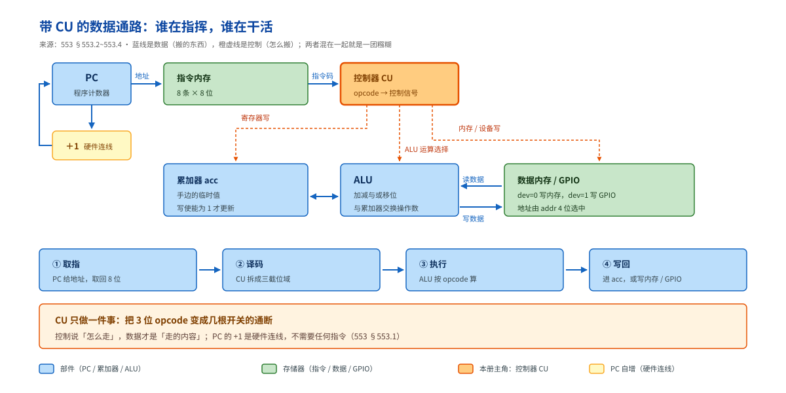

# 553 控制单元与程序执行

> **解决**：552 给了指令一套编码，但编码不会自己跑。这一册讲执行的两个关键：**PC 让指令自己往下走**，**CU 把 opcode 译成控制信号**；再用一份 `cpu.c` 把 `13+6+27-6` 逐拍跑出来，证明五件零件真的能连成一台机器。  
> **范围**：PC 与取指 · 译码-执行循环 · dev 位切换内存与 GPIO · `cpu.c` 逐拍执行 · 流水灯程序骨架 · 跳转与"顺序是常态"。  
> **口径**：以 8 位指令、8 位数据、8 字节数据内存为例；`cpu.c` 是对硬件的**功能等价模拟**（不是门级还原），打印的"寄存器写 / 内存写"是 CU 应当解出的控制信号。附录含完整源码（约 110 行），全文 344 行，未超 400 行参考上限。  
> **更新**：2026-11-23  
> **本册导读** ── 必会三点：① PC 的本质是一个每次加 1 的累加器 ② 一条指令的执行 = 取指 → 译码 → 执行 → PC 前进 ③ dev 位让同一套指令既能写内存也能写引脚 ｜ 跟做时长：约 2 小时（跑 `cpu.c` 并改一条指令） ｜ 前置：551（五部件）、552（指令编码）、542（存储器）。  
> **标记**：★ = 必会节；○ = 拓展节。

## 目录

| 节 | 内容 |
|---|---|
| 553.1 | PC：让指令自己往下走 ★ |
| 553.2 | 一条指令的执行：取指 → 译码 → 执行 ★ |
| 553.3 | dev 位：同一套指令，两套地址空间 ★ |
| 553.4 | 完整跑一遍：`cpu.c` 逐拍输出 ★ |
| 553.5 | 流水灯：第一段真正跑起来的程序 ○ |
| 553.6 | 跳转：顺序是常态，跳转是例外 ○ |
| 553.7 | 坑表 |
| 553.8 | 检查清单（自测 6 题 + 动手任务 2 件） |

---

## 553.1 PC：让指令自己往下走 ★

**没有 PC 时会怎样**：每执行一条指令，人得手动把下一条的地址改过来。素材里明确记下了这个痛点——"**指令内存中的指令是逐条执行的，每次自己去修改 Order_addr 很麻烦**"。

**PC（Program Counter，程序计数器）解决的就是这件事**：它记住"下一条指令在哪"，每取一条就自动加一。

```text
      ┌──────────┐   地址   ┌──────────┐   指令   ┌──────────┐
      │    PC    │ ───────→ │  指令内存 │ ───────→ │    CU    │
      └──────────┘          └──────────┘          └──────────┘
           ↑                                            │
           └──────────── 执行完 +1（下一条）─────────────┘
```

**PC 的本质是一个累加器**，素材里那句判断很准："**程序计数器的本质其实就是一个累加器**"。它就是一个寄存器（533 §533.1），每次加一个固定的 1——**和 533 §533.2 的计数器是同一种东西，只是加的不是数据而是地址**。

**为什么"逐条执行"必须由硬件保证**：如果靠软件改 PC，就得有一条"改 PC"的指令，而这条指令自己也需要地址——**会无限倒退**。所以 PC 的 +1 必须是**硬件连线**，不消耗任何指令。

**在 `cpu.c` 里，PC 就是那个循环变量**：

```c
for (int pc = 0; pc < n; pc++) {   /* 每跑一轮 pc 加一，不写代码也自动递增 */
```

**这一行是硬件 PC 的功能等价物**。真实硬件里它是"寄存器 + 加法器"的组合——就是 533 的计数器，只是加数固定为 1、并且可以被跳转指令改写。

**PC 的位宽决定程序能有多长**：3 位 PC 只能寻址 8 条指令。**"程序大小"和"数据容量"是两个独立的限制**，在哈佛结构（551 §551.4）里它们甚至是两套地址空间各自的位宽。

## 553.2 一条指令的执行：取指 → 译码 → 执行 ★

**一条指令在硬件里走四步**，这四步循环往复，就是"程序"的全部。



| 步 | 动作 | 谁在做 | 本册的对应 |
|---|---|---|---|
| ① 取指 | 把 PC 指向的那条指令读出来 | PC + 指令存储器 | `prog[pc]` |
| ② 译码 | 把 opcode 拆成控制信号 | CU | `cu_decode()` |
| ③ 执行 | 按控制信号让 ALU / 内存动作 | ALU + 寄存器 + 存储器 | `execute()` |
| ④ 前进 | PC 加一，指向下一条 | PC 的加法器 | 循环的 `pc++` |

**译码这一步值得单独看**：`cu_decode()` 只做一件事——把 8 位拆成三个字段，不做任何运算。

```c
static void cu_decode(unsigned char raw, Insn *in)
{
    in->raw  = raw;
    in->op   = (raw >> 5) & 0x7;   /* 高 3 位：做什么 */
    in->dev  = (raw >> 4) & 0x1;   /* 第 5 位：对哪类设备 */
    in->addr = raw & 0xF;          /* 低 4 位：地址 */
}
```

**"译码"和"执行"必须分开**：译码是纯组合逻辑（不改变任何状态），执行才动寄存器与内存。**分开了，才能让同一套译码结果驱动不同的执行单元**——这就是真实 CPU 里"译码器"与"执行单元"分成两块的原因。

**执行这一步的核心是两个写使能**：

```c
static void execute(const Insn *in, int *reg_we, int *mem_we)
{
    int src = src_value(in);
    *reg_we = 1;
    *mem_we = 0;

    switch (in->op) {
    case 0: *reg_we = 0; *mem_we = 1; break;  /* 存结果：写内存，不动寄存器 */
    ...
    }
    if (*mem_we) {                            /* 写使能开着才真写 */
        if (in->dev) gpio[in->addr & 0x7] = acc;
        else         dmem[in->addr & 0x7] = acc;
    }
}
```

**注意 `case 0` 那两行**：存结果时把寄存器写使能关掉、内存写使能打开。**这一对互斥的赋值，就是 533 §533.1 那句"we 决定改不改"在指令层的体现**——CU 最终输出的不是"数据"，而是"准不准写"。

## 553.3 dev 位：同一套指令，两套地址空间 ★

**dev 位解决的问题**：同一条指令，这次想写内部数据内存，下次想写外部 GPIO。**加一位"设备选择"就能复用同一套 opcode 和地址位**，不必为 GPIO 另造一套指令。

```text
dev = 0 → 选内部数据内存，addr 是"第几个字节"
dev = 1 → 选外部 GPIO，   addr 是"第几组引脚"
```

**实测对照**（`cpu.c` 程序二，同一份结果送到 GPIO）：

```text
PC 指令码   op dev addr | 寄存器写 内存写 | acc  观察值  动作
 0  00100011   1   0    3  |    1      0    |  40     0    装载
 1  00010000   0   1    0  |    0      1    |  40    40    存结果
```

**两行的差别只有 dev 那一位**：第一条是"装载、dev=0、地址 3"（从内存读），第二条是"存结果、dev=1、地址 0"（往 GPIO 写）。**地址空间与设备空间，被一位 dev 分成了两半**。

**这就是"统一编址"的最简形态**：真实 MCU 里叫**内存映射 I/O（memory-mapped I/O）**——GPIO 寄存器被编进了地址空间，用读写内存的指令就能驱动引脚。**你在 STM32 上写 `GPIOA->ODR = 1`，本质就是"往某个特定地址写一个值"**，硬件层面和写普通内存没有区别。

**这一位的分量**：它把"运算"和"对外动作"统一到了同一套指令里。**写 GPIO 和写内存，在指令层面是同一件事**——这是 600 板块"用寄存器操作外设"的硬件前提。

**反过来说，为什么有些架构不这么做**：独立编址（如 x86 的 `IN`/`OUT` 指令）把 I/O 空间单独分出来，好处是不占用地址空间，坏处是要为 I/O 专门造指令。**两种做法各有代价，没有优劣之分。**

## 553.4 完整跑一遍：`cpu.c` 逐拍输出 ★

**完整示例**（文件名 `cpu.c`，本册全部输出都在这个文件里）。

**跟做步骤**：新建 `cpu.c` 抄入册末附录源码 → `gcc -Wall cpu.c -o cpudemo.exe` → `./cpudemo.exe`。

**预期输出**（本机实测，程序一）：

```text
== 程序一：13 + 6 + 27 - 6，结果存回地址 3 ==
PC 指令码   op dev addr | 寄存器写 内存写 | acc  观察值  动作
-----------------------------------------------------------
 0  00100000   1   0    0  |    1      0    |  13     0    装载
 1  01000001   2   0    1  |    1      0    |  19     0    加
 2  01000010   2   0    2  |    1      0    |  46     0    加
 3  01100001   3   0    1  |    1      0    |  40     0    减
 4  00000011   0   0    3  |    0      1    |  40    40    存结果
```

**逐列读这张表**：

| 看哪列 | 得到什么信息 |
|---|---|
| PC | 0~4 连续递增——**这就是"程序在往下走"** |
| 指令码 | 每行的 8 位，与 §552.2 的编码表一一对应 |
| op / dev / addr | CU 译码的结果，三个字段各就各位 |
| **寄存器写 / 内存写** | **CU 输出的控制信号，五行里从不冲突** |
| acc | 累加器的当前值：13 → 19 → 46 → 40 |
| 观察值 | 前四行是内存[3]（还是 0），最后一行写入后变 40 |

**"五行里从不冲突"这句话要展开说**：前四条只写寄存器（寄存器写=1、内存写=0），最后一条只写内存（0、1）。**这不是巧合，是 opcode 编码规则保证的**——552 §552.3 讲过，一个 opcode 只能表示一种动作，所以不可能同时开两个写使能。**编码的互斥性在这里变成了可观察的时序特征。**

**"观察值"这一列是本册的巧思**：它盯住的是内存[3]，而前四条指令根本不碰内存——**所以你看到的是"什么都没发生"，直到最后一行才跳到 40**。这正好说明"写使能没开，地址选对了也没用"。

**试一试**：把第 3 条 `0x61`（减）改成 `0x41`（加），再跑。结果变成 `13+6+27+6 = 52`。**改一个字节中间的三位，运算就换了**——指令的"可编程"，物理上就是"这几位接在不同的开关上"。

**再试一次**：把最后一条 `0x03`（存结果）改成 `0x03 | 0x10 = 0x13`（dev 改成 1）。结果会写进 `gpio[0]` 而不是 `dmem[3]`，观察值那一列全程是 0。**一位 dev，货物就送到另一个仓库去了。**

## 553.5 流水灯：第一段真正跑起来的程序 ○

**流水灯 = 一条"亮位"在几组 GPIO 之间轮流移动**。这是嵌入式入门的第一课，因为它把"运算 + 存储 + 输出"三件事串在一个可观察的现象里。

**用本册的指令集写出来**（dev=1 选 GPIO，addr 就是第几组）：

| 步骤 | 指令 | 二进制 | 含义 |
|---|---|---|---|
| 1 | 装载 `0x01` | `0010 0000` → 需先备好数据 | 让累加器 = 0000 0001（第 0 位亮） |
| 2 | 存结果 dev=1 addr=0 | `0001 0000` | 写到 GPIO 第 0 组 |
| 3 | 左移 1 位 | `1100 0000`（左移，地址指向移位位数来源） | 累加器变 0000 0010 |
| 4 | 存结果 dev=1 addr=1 | `0001 0001` | 写到 GPIO 第 1 组 |
| … | 左移 + 存结果 | — | 依次点亮后面几组 |

**这套指令暴露了本册指令集的一个局限**：左移的位数也是从内存里取的（`acc <<= src`），而不是立即数。**真实指令集会有"立即数"字段**，让 `左移 1 位` 直接写在指令里。**这是入门指令集的简化，也是它"只能算，不能灵活操作"的原因。**

**"延时"在哪**：真实流水灯看起来"流"，靠的是两组灯之间停一会儿。**数字电路里没有"时间"这个概念，只有拍**——所以延时要么靠一堆空指令（占拍数），要么靠定时器。**这也是 600 板块要讲定时器的原因：把"等一会儿"变成硬件能力，而不是烧 CPU 空转。**

**为什么这个案例值得做**：它把前面所有零件都用上了——ALU 做左移（522）、累加器存值（533）、GPIO 地址靠 dev + addr 选中（553.3）、CU 译码（553.2）、PC 逐条执行（553.1）。**能跑通流水灯，说明这条链全通了。**

## 553.6 跳转：顺序是常态，跳转是例外 ○

**PC 的 +1 是默认路径**，但程序不可能永远一条道走到黑——循环、分支、函数调用，都需要"不往下走"。

**跳转的实现极其简单**：不是让 PC 加一，而是**把 PC 直接改成目标地址**。

| 类型 | 什么条件下改 PC | 例子 |
|---|---|---|
| 无条件跳转 | 总是改 | `JMP 0x10` |
| 条件跳转 | 某个标志位成立时改 | `JZ label`（累加器为 0 就跳） |
| 函数调用 | 改 PC，同时把返回地址压栈 | `CALL func` |

**"顺序是常态"这个默认设定非常重要**：它让指令可以连续排布，**代码才紧凑、取指才连续**。如果每条指令都要写目标地址，指令字会变长一倍，程序体积也翻倍。

**条件跳转依赖"标志位"**：522 §522.5 讲的 ALU 标志（零标志 Z、进位标志 C、符号标志 S），就是给跳转用的。**"如果结果为 0 就跳"在硬件上就是"检查 Z 标志，为 1 就让 PC 载入目标地址"**——ALU 与 PC 在这里第一次直接握手。

**本册的 `cpu.c` 没有实现跳转**，PC 严格 +1。**这是刻意的简化**：跳转会让"逐拍打印"变成"跳着打印"，读者要先看懂直线执行，再理解控制流。**真实 MCU 的 PC 一定带跳转能力**，否则连一个循环都写不出来。

## 553.7 坑表

| # | 现象 | 原因 | 解法 |
|---|---|---|---|
| 1 | 程序跑飞，第二条指令乱执行 | PC 没递增，或指令地址线接错 | PC 每条 +1，核对地址位序（§553.1） |
| 2 | 执行了但结果不对 | 位域拆错，opcode 与 addr 的位移算反 | 按 `raw>>5` / `raw>>4` / `raw&0xF` 核对（553 §553.2、552 §552.4） |
| 3 | 结果写进了内存却读不到 | dev 位与预期相反 | dev=0 是内部内存、1 是 GPIO（§553.3） |
| 4 | 存结果把累加器也改了 | opcode 000 同时开了寄存器写使能 | 存结果只开内存写，寄存器写必须关（§553.2） |
| 5 | 加了新功能就没位数可用 | 控制位摊开占满 8 位 | 学 CU：压缩成编码再解码（552 §552.3） |
| 6 | 流水灯只是"全亮"不"流" | 没有延时，几组 GPIO 在同一拍被写完 | 加延时或用定时器（§553.5） |
| 7 | 写不出一个循环 | PC 只会 +1，没有跳转 | 需要条件跳转指令（§553.6） |

## 553.8 检查清单（自测 6 题 + 动手任务 2 件）

**自测**：

| # | 问题 | 自测标准 |
|---|---|---|
| 1 | PC 的本质是什么 | 一个每次加 1 的累加器，硬件保证顺序执行（§553.1） |
| 2 | 一条指令的四步是什么 | 取指、译码、执行、PC 前进（§553.2） |
| 3 | 为什么译码与执行要分开 | 译码不改状态，执行才改；分开才能复用译码结果（§553.2） |
| 4 | dev 位解决什么问题 | 用同一套指令与地址位，切换内部内存与外部 GPIO（§553.3） |
| 5 | 程序一里"寄存器写/内存写"为什么从不冲突 | 一个 opcode 只表示一种动作，编码保证互斥（§553.4） |
| 6 | 跳转在 PC 层是怎么实现的 | 不加一，直接把目标地址载入 PC（§553.6） |

**动手任务**：

1. **跑通 `cpu.c`**，产出程序一的 5 行表与程序二的 2 行表；并说明"为什么存结果那一行寄存器写是 0"。
2. **做两次改写**：① 把程序一第 3 条 `0x61` 改成 `0x41`，产出输出并验证结果等于 `13+6+27+6`；② 把最后一条的 dev 位改成 1，产出输出并说明"为什么观察值那一列全程是 0"。

## 附：`cpu.c` 完整源码

```c
#include <stdio.h>

static int acc;                       /* 累加器：MCU 内部的寄存器 */
static unsigned char dmem[8] = {13, 6, 27, 0, 0, 0, 0, 0};
static int gpio[8];                   /* 外部 GPIO 的几组输出 */

typedef struct {
    unsigned char raw;
    int op, dev, addr;
} Insn;

/* CU（控制单元）的职责：把 3 位 opcode 拆成具体的控制信号 */
static void cu_decode(unsigned char raw, Insn *in)
{
    in->raw  = raw;
    in->op   = (raw >> 5) & 0x7;
    in->dev  = (raw >> 4) & 0x1;
    in->addr = raw & 0xF;
}

static const char *op_name(int op)
{
    static const char *n[8] = {
        "存结果", "装载", "加", "减", "与", "或", "左移", "右移"
    };
    return n[op & 0x7];
}

static int src_value(const Insn *in)
{
    return in->dev ? gpio[in->addr & 0x7] : dmem[in->addr & 0x7];
}

/* 执行一条指令，回填 CU 解出的两个写使能 */
static void execute(const Insn *in, int *reg_we, int *mem_we)
{
    int src = src_value(in);
    *reg_we = 1;
    *mem_we = 0;

    switch (in->op) {
    case 0: *reg_we = 0; *mem_we = 1; break;  /* 存结果：写内存，不动寄存器 */
    case 1: acc = src;              break;    /* 装载 */
    case 2: acc += src;             break;    /* 加 */
    case 3: acc -= src;             break;    /* 减 */
    case 4: acc &= src;             break;    /* 与 */
    case 5: acc |= src;             break;    /* 或 */
    case 6: acc <<= src;            break;    /* 左移 */
    default: acc >>= src;           break;    /* 右移 */
    }

    if (*mem_we) {                            /* 写使能开着才真写 */
        if (in->dev) gpio[in->addr & 0x7] = acc;
        else         dmem[in->addr & 0x7] = acc;
    }
}

static void bits8(unsigned char v, char *buf)
{
    for (int i = 7; i >= 0; i--) buf[7 - i] = ((v >> i) & 1) ? '1' : '0';
    buf[8] = '\0';
}

static void run(const char *title, unsigned char *prog, int n, int watch_gpio)
{
    char b[9];
    printf("== %s ==\n", title);
    printf("PC 指令码   op dev addr | 寄存器写 内存写 | acc  观察值  动作\n");
    printf("-----------------------------------------------------------\n");
    for (int pc = 0; pc < n; pc++) {
        Insn in;
        int reg_we, mem_we;
        cu_decode(prog[pc], &in);
        bits8(in.raw, b);
        execute(&in, &reg_we, &mem_we);
        printf(" %d  %s   %d   %d  %3d  |    %d      %d    | %3d   %3d    %s\n",
               pc, b, in.op, in.dev, in.addr, reg_we, mem_we,
               acc, watch_gpio ? gpio[0] : dmem[3], op_name(in.op));
    }
    printf("\n");
}

int main(void)
{
    /* 13 + 6 + 27 - 6，把结果存回数据内存第 4 个地址（地址 3） */
    unsigned char prog1[] = {
        0x20,   /* 001 0 0000  装载 acc = 内存[0] = 13 */
        0x41,   /* 010 0 0001  加   acc += 内存[1] = 6  */
        0x42,   /* 010 0 0010  加   acc += 内存[2] = 27 */
        0x61,   /* 011 0 0001  减   acc -= 内存[1] = 6  */
        0x03    /* 000 0 0011  存结果 → 内存[3]         */
    };
    run("程序一：13 + 6 + 27 - 6，结果存回地址 3", prog1, 5, 0);

    /* 同一份结果，换成 dev=1 送到外部 GPIO 第 0 组 */
    unsigned char prog2[] = {
        0x23,   /* 001 0 0011  装载 acc = 内存[3] = 40 */
        0x10    /* 000 1 0000  存结果 → gpio[0]       */
    };
    run("程序二：把内存[3] 的值送到外部 GPIO 第 0 组（dev 位换成 1）",
        prog2, 2, 1);

    printf("最终：内存[3] = %d，gpio[0] = %d（都等于 13+6+27-6）\n",
           dmem[3], gpio[0]);
    return 0;
}
```

> 下一篇：回到 [README](../README.md) 总览——数字电路这条线到此闭合：从门 → 加法器 → 寄存器 → 存储器 → 一台能跑程序的机器。下一站「600 MCU 与外设」（规划中），把这台机器接到真实的引脚与定时器上。
