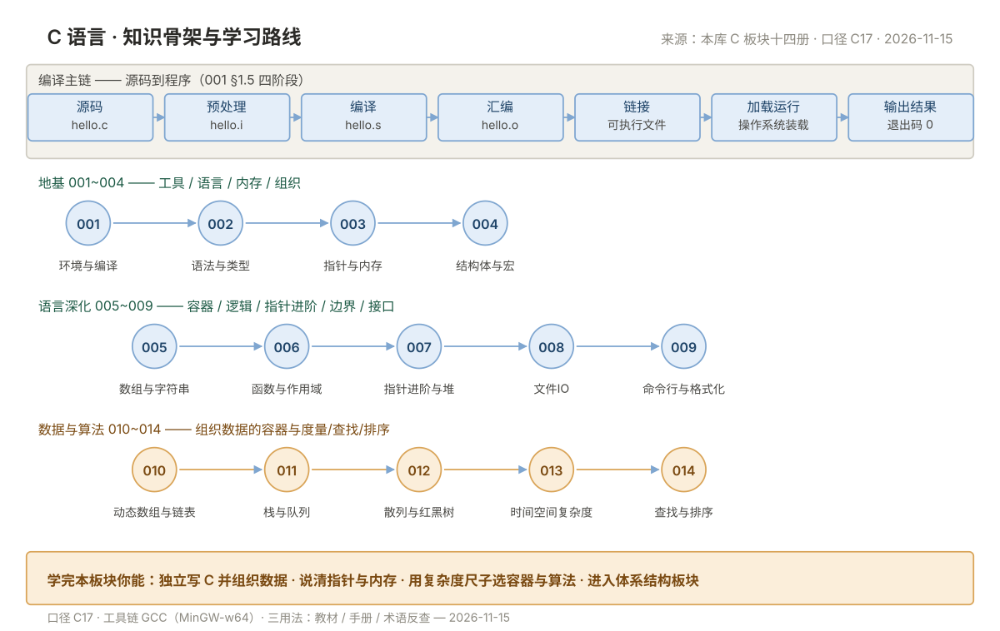

# 000 C 语言全貌

> **一句话**：C 语言 = 一门"看得见内存"的编译型语言——离硬件足够近又足够通用，是嵌入式世界几十年的母语；本板块九册，从跑起第一个程序立到命令行与字符串格式化。  
> **读者**：零基础或语法残缺的嵌入式初学者；从运维/软件方向转行、想补"软硬结合"地基的工程师。  
> **阶段**：地基第一阶段——本板块不需要前置；它的产物（指针与内存直觉）是「计算机体系结构」与「操作系统原理」的入场券。

下图是本板块的知识骨架：一条编译主链、九册学习路线——先记住这张图，再进册。

## 板块地图

| 册 | 一句话 | 回答的问题 | 跟做时长 |
|---|---|---|---|
| [001 环境搭建与第一个程序](001-环境搭建与第一个程序.md) | 工具层：编译四阶段 + 报错定位 + Makefile | 怎么从一份源码得到能跑的程序 | 约 2 小时 |
| [002 基础语法与控制流](002-基础语法与控制流.md) | 语言层：类型/类型细节/运算符/流程/函数 | C 的主干词汇长什么样 | 约 3 小时 |
| [003 指针与内存模型](003-指针与内存模型.md) | 内存层：地址/指针/栈堆/内存错误 | 程序在内存里长什么样、指针为什么是嵌入式第一关 | 约 3 小时 |
| [004 结构体、位域与预处理](004-结构体位域与预处理.md) | 组织层：struct/union/位域/枚举/宏 | 数据怎么摆进内存、宏为什么危险 | 约 2 小时 |
| [005 数组与字符串](005-数组与字符串.md) | 容器层：一维/二维数组与 `\0` 哨兵 | 一组同类型数据怎么装、字符串到底是不是类型 | 约 2.5 小时 |
| [006 函数与作用域](006-函数与作用域.md) | 逻辑层：函数/作用域/static/递归 | 逻辑怎么组织、变量在哪活着、断点调试怎么看程序内部 | 约 3 小时 |
| [007 指针进阶与动态内存](007-指针进阶与动态内存.md) | 进阶层：指针家族/回调/malloc 四函数 | 指针玩熟了能干什么、堆内存怎么手动管 | 约 3 小时 |
| [008 文件IO](008-文件IO.md) | 边界层：标准流/缓冲区/文件读写 | 数据怎么走出内存、文件怎么读怎么写 | 约 2 小时 |
| [009 命令行参数与字符串格式化](009-命令行参数与字符串格式化.md) | 接口层：argc/argv 与 sprintf/sscanf | 程序怎么接命令行输入、字符串与数据怎么互转 | 约 2 小时 |

全板块跟做时长合计约 22 小时；★ 节优先，○ 节时间多再扫。

## 核心概念速览

- **编译四阶段**：预处理→编译→汇编→链接，每阶段有独立产物；报错定位全靠它（001 §1.5）。  
  实测锚点：单步出 hello.i（本机 1041 行）/ hello.s / hello.o / hello.exe，四阶段流水线见 §1.5 配图。
- **类型 = 宽度 + 解释**：`int`/`char` 不只是"种类"，是"占几个字节、按什么格式解释"（002 §2.1）。  
  实测锚点：`INT_MAX + 1` 回绕成 -2147483648、`uint8_t 255+1=0`（002 §2.1 实录）。
- **指针即地址**：内存是一排编址的字节格子，指针存的就是格子号——一切指针问题的原点（003 §3.1）。  
  实测锚点：addr.c 相邻 int 地址差恰好 4（003 §3.1）。
- **未定义行为（UB）**：标准没规定结果的操作——不报错不等于没错。  
  实测锚点：读未初始化变量得垃圾值（002 §2.1 试一试）、有符号溢出、越界读写（003 §3.5）。
- **内存四区**：代码段/数据段/栈/堆，谁管释放决定了写法（003 §3.4）。  
  实测锚点：memzones.c 三个区三段互不相邻的地址（003 §3.4 配图）。

## 相邻板块分界

| 谁管 | 不管 | 误归属澄清 |
|---|---|---|
| 「计算机体系结构」001/002：机器怎么跑 | 代码怎么写 | 编译四阶段的两端：源码到机器码的过程在本板块，机器码怎么执行归那边 002 |
| 「操作系统原理」001/003：printf/malloc 的内核一段 | 库函数怎么用 | 调用链走到内核的部分归 OS 003，本板块停在库函数视角 |
| 规划「005 MCU 与外设」：volatile 与寄存器实操 | 本库只立概念 | 概念在本板块 003 §3.6，实操等 MCU 板块 |

## 学习路径

- **顺序读**：001 → 002 → 003 → 004 → 005 → 006 → 007 → 008 → 009——工具、语言、内存、组织、容器、逻辑、进阶、边界、接口，跳层会缺直觉。
- **按任务找册**：想解析命令行与文本 → 009；想管堆内存 → 007；想读写文件 → 008；想组织数据 → 004/005；想看懂内存 → 003/006。
- **按症状进**：见 [00 术语表](00-术语表.md) 症状反查表——报错了先查表再翻册。
- **有 C 基础者**：直接做 003/007 的检查清单自测，全对就跳去「计算机体系结构」000。

## 误解澄清

| # | 误解 | 实际 |
|---|---|---|
| 1 | C 太"低级"快淘汰了 | 操作系统内核、驱动、固件主体至今是 C；嵌入式绕不开 |
| 2 | 学 C 要先学好数学 | 会算术与"按位思考"就够入门，算法是另一条线 |
| 3 | 指针靠背口诀 | 指针=地址，一切围绕"内存是一排编址的格子"（003 §3.1） |
| 4 | 数组和指针是一回事 | 数组名多数场合退化成地址，但不是指针（003 §3.3） |
| 5 | malloc 完就没事了 | free 必须配对，否则内存泄漏（003 §3.4） |
| 6 | 编译器警告无所谓 | 警告常是真 bug 的预告，第一天就开 -Wall（001 §1.6） |
| 7 | 会 PC 上的 C 就会嵌入式 C | 语言相同，内存规模差千倍，习惯必须改（体系结构 003 §3.4） |
| 8 | 2026 年了该直接学新语言 | 固件存量与教学生态仍以 C 为通用语；新语言是进阶选项不是地基 |
| 9 | C 数组有 length 属性 | 没有——长度靠 `sizeof arr / sizeof arr[0]` 现算，且只在定义处有效（005 §5.1） |
| 10 | 字符串是 C 的一个类型 | 不是——字符串就是以 `\0` 结尾的字符数组（005 §5.3） |

---

> 下一篇：《001 环境搭建与第一个程序》——先把程序跑起来。
