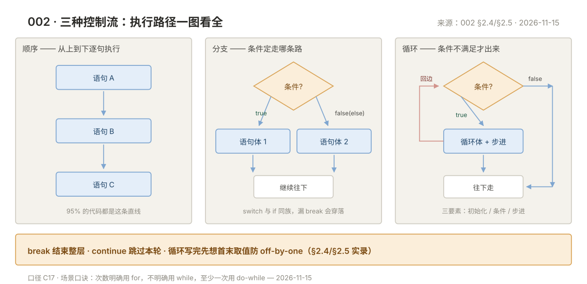
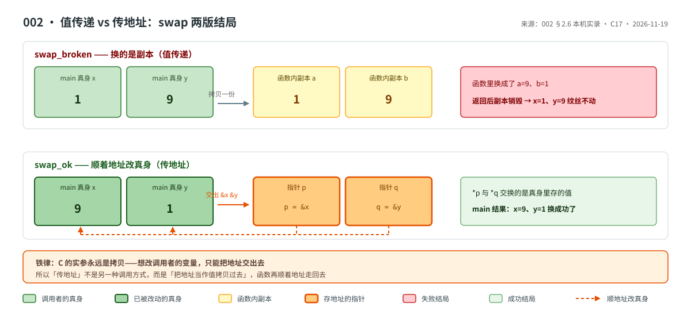

# 002 基础语法与控制流

> **解决**：掌握 C 的主干词汇——类型、运算符、分支、循环、函数；每个概念配一个完整可跑的程序，本册所有输出均为本机实录（GCC 16.2.0，见「C语言」001）。  
> **范围**：变量与类型 · 类型细节（占位符/布尔/转换/进制）· 运算符（含位运算）· 分支 · 循环 · 函数与值传递。  
> **口径**：C17；类型宽度以本机 `sizeof` 实测为准（Windows x64）。  
> **更新**：2026-11-14  
> **本册导读** ── 必会三点：① 类型 = 宽度 + 解释（溢出回绕实测）② 短路求值与位运算四模板 ③ 值传递 vs 传地址（swap 实录） ｜ 跟做时长：约 3 小时 ｜ 前置：001（能编译运行）。  
> **标记**：★ = 必会节；○ = 拓展节。

## 目录

| 节 | 内容 |
|---|---|
| 2.1 | 变量与类型：类型 = 宽度 + 解释方式 ★ |
| 2.2 | 类型细节：占位符、布尔、类型转换与进制 ★ |
| 2.3 | 运算符：除法、短路求值与位运算 ★ |
| 2.4 | 分支：switch 与穿落 ○ |
| 2.5 | 循环：三种形态与 off-by-one ★ |
| 2.6 | 函数初见：实参永远是拷贝（形态与作用域见 004） ★ |
| 2.7 | 坑表 |
| 2.8 | 检查清单（自测 6 题 + 动手任务 3 件） |

---

## 2.1 变量与类型：类型 = 宽度 + 解释方式 ★

**定义**：变量是"命名的内存格子"，类型决定格子**占几个字节、按什么格式解释**——同一串二进制按 int 和按 char 解释结果完全不同。

**完整示例**（`types.c`）：

```c
#include <stdio.h>
#include <limits.h>
#include <stdint.h>

int main(void)
{
    printf("char     = %zu byte(s)\n", sizeof(char));
    printf("short    = %zu\n", sizeof(short));
    printf("int      = %zu\n", sizeof(int));
    printf("long     = %zu\n", sizeof(long));
    printf("long long= %zu\n", sizeof(long long));
    printf("float    = %zu\n", sizeof(float));
    printf("double   = %zu\n", sizeof(double));
    printf("int32_t  = %zu\n", sizeof(int32_t));
    printf("int* ptr = %zu\n", sizeof(void *));

    int big = INT_MAX;              /* 2147483647 */
    printf("INT_MAX        = %d\n", big);
    printf("INT_MAX + 1    = %d   <-- overflow wraps!\n", big + 1);

    uint8_t u = 255;
    printf("uint8_t 255 + 1 = %u\n", (uint8_t)(u + 1));
    return 0;
}
```

**跟做**：保存到工程目录 → `gcc -Wall types.c -o types.exe` → `.\types.exe`。**预期输出（本机实录）**：

```text
char     = 1 byte(s)
short    = 2
int      = 4
long     = 4
long long= 8
float    = 4
double   = 8
int32_t  = 4
int* ptr = 8
INT_MAX        = 2147483647
INT_MAX + 1    = -2147483648   <-- overflow wraps!
uint8_t 255 + 1 = 0
```

**三处必看的机制**：① `long` 在 Windows 是 **4 字节**不是 8（LLP64——Windows 64 位数据模型，long 保持 4 字节）——"long 不用管宽度"的直觉在这里破产，嵌入式代码用 `int32_t` 定宽钉死；② `INT_MAX + 1` 得到 **-2147483648**——溢出不是报错而是**回绕**（有符号溢出严格说是**未定义行为**（UB，见 000 全貌），-O0 实测回绕是真机表现；真代码靠边界检查防溢出，不依赖回绕——「计算机体系结构」001 §1.4 对上）；③ `uint8_t 255+1=0`——8 位无符号 255 再加一回到 0（无符号回绕是标准**保证**的行为），单片机定时器计数器就是这么滚的。

**试一试**：① 声明一个 `int a;` 不初始化直接打印——值是栈上残留（读它是未定义行为，本机那次是 32758，别依赖任何具体值），跑几次对比；② 把 `uint8_t u` 改成从 250 循环加到 258，观察 255→0 的回绕点。

## 2.2 类型细节：占位符、布尔、类型转换与进制 ★

**定义**：三件与类型共处的常用工具——**占位符**（printf/scanf 按"解释方式"取数）、**布尔**（经典 C 没有 boolean 类型：0 假、非零真；C99 起有原生 `_Bool`，C23 起 `bool/true/false` 更是关键字）、**类型转换**（不同宽度类型相遇时的规则：自动提升安全、强制转换有代价）。

**占位符速查**（scanf 里 `%f` 对 float、`%lf` 对 double；printf 里因默认实参提升，float 也用 `%f`）：

| 占位符 | 对应类型 | 例 |
|---|---|---|
| `%d` / `%u` | int / unsigned int | `-42` / `4294967295` |
| `%hd` / `%ld` / `%lld` | short / long / long long | `32767` / `2147483647L` / `9223372036854775807LL` |
| `%lu` / `%llu` | unsigned long / unsigned long long | 嵌入式日志常用（配合 §2.1 定宽类型） |
| `%f` / `%lf` | float / double | `3.14` |
| `%c` / `%s` | 字符 / 字符串 | `'a'` / `"hi"` |
| `%p` / `%zu` | 地址 / sizeof 的结果 | 005 §5.1 实录 |
| `%x` / `%o` | 十六进制 / 八进制 | `0xFF` → `ff` |

**布尔三方案**（C99 起有正式类型；输出一律 `%d`）：

```c
#define BOOL int      /* 方案一：宏（本质） */
#define TRUE 1
#define FALSE 0

_Bool flag = 1;       /* 方案二：_Bool，只装 0/1（不推荐手写） */

#include <stdbool.h>  /* 方案三：bool/true/false（推荐） */
bool ok = true;
```

**类型转换**：转换级别链 `char, short < int < long < long long < float < double < long double`（级别即"谁接收谁不丢信息"——注意级别在本机不等于宽度：§2.1 实测 long 与 int 同为 4 字节）。**自动提升**：大接小无事发生；char/short 参与运算先升 int。**强制转换**：小接大要 `(小类型)` 显式写——代价是精度损失。

**完整示例**（`conv.c`）：

```c
#include <stdio.h>
#include <stdbool.h>

int main(void)
{
    /* 自动提升：大接小，无事发生 */
    short s = 100;
    int num = s;
    printf("num = %d\n", num);

    /* char/short 运算先升 int */
    printf("'0'+'1' = %d (char 运算先升 int)\n", '0' + '1');
    printf("sizeof('0'+'1') = %zu\n", sizeof('0' + '1'));

    /* 强转：丢小数（精度损失） */
    double d = 13.14;
    int t = (int)d;
    printf("(int)13.14 = %d\n", t);

    /* 强转：回绕（精度损失） */
    int big = 200;
    char ch = (char)big;
    printf("(char)200 = %d\n", ch);

    /* 复合赋值隐含强转：a = (int)(a + 20.22) */
    int a = 5;
    a += 20.22;
    printf("a += 20.22 -> a = %d (不是 25.22)\n", a);

    /* bool 输出用 %d */
    bool ok = true;
    printf("bool ok = %d\n", ok);
    return 0;
}
```

**跟做**：`gcc -Wall conv.c -o conv.exe` → `.\conv.exe`。**预期输出（本机实录）**：

```text
num = 100
'0'+'1' = 97 (char 运算先升 int)
sizeof('0'+'1') = 4
(int)13.14 = 13
(char)200 = -56
a += 20.22 -> a = 25 (不是 25.22)
bool ok = 1
```

**三处必看的机制**：① `'0'+'1' = 97`——字符按 ASCII 码值 48+49 参与运算，结果类型 sizeof 实测 4 字节（int）——"char 运算先升 int"不是口诀是实测；② `(char)200 = -56`——200 超出 char 上限 127，补码解释下回绕成 -56（§2.1 溢出回绕的同一物理机制）；③ `a += 20.22` 得 **25** 不是 25.22——复合赋值 `a += x` 的完整展开是 `a = (int)(a + x)`，**隐含了一次强转**，要小数请用 double 变量。

**进制与补码**（一句话版，硬件视角在「计算机体系结构」001 §1.4 展开）：四种字面量写法——十进制 `42`、八进制前缀 `0`（`052`）、十六进制前缀 `0x`（`0x2A`）；二进制字面量 C23 才入标准（GCC 扩展 `0b101010` 可用）。**原码**给人看、**补码**给机器算：正数三码合一；负数补码 = 原码符号位不变、其余取反 +1——§2.1 的 `INT_MAX + 1 = -2147483648` 就是补码回绕的直接后果。

**试一试**：① 把 `bool ok = true;` 改成 `ok = 250;` 打印——_Bool 存储规则非零归一（得 1）；② 手算 `(char)300` 应为 44（300−256），程序验证；③ `printf("%x\n", 255)` 看十六进制输出。

## 2.3 运算符：除法、短路求值与位运算 ★

**完整示例**（`ops.c`）——整数除法、短路求值、位运算四模板一次看全：

```c
#include <stdio.h>

void print_bin(unsigned v)
{
    for (int i = 7; i >= 0; i--)
        putchar((v >> i) & 1u ? '1' : '0');
}

int side_effect(int x)          /* 用来验证短路：被调用会打印 */
{
    printf("    side_effect(%d) called\n", x);
    return x;
}

int main(void)
{
    printf("5 / 2   = %d   (integer division)\n", 5 / 2);
    printf("5.0 / 2 = %f\n", 5.0 / 2);
    printf("5 %% 2   = %d\n", 5 % 2);

    printf("short-circuit test:\n");
    int r = (0 && side_effect(1));   /* 右边根本不会执行 */
    printf("0 && side_effect(1) = %d\n", r);
    r = (1 || side_effect(2));
    printf("1 || side_effect(2) = %d\n", r);

    unsigned reg = 0x00;
    reg |= (1u << 3);  printf("set   bit3: "); print_bin(reg); printf("  (0x%02X)\n", reg);
    reg &= ~(1u << 3); printf("clear bit3: "); print_bin(reg); printf("  (0x%02X)\n", reg);
    reg ^= (1u << 3);  printf("flip  bit3: "); print_bin(reg); printf("  (0x%02X)\n", reg);
    printf("test  bit3 = %u\n", (reg >> 3) & 1u);
    printf("1 << 4 = %u  (shift = *2)\n", 1u << 4);
    return 0;
}
```

**跟做**：`gcc -Wall ops.c -o ops.exe` → `.\ops.exe`。**预期输出（本机实录）**：

```text
5 / 2   = 2   (integer division)
5.0 / 2 = 2.500000
5 % 2   = 1
short-circuit test:
0 && side_effect(1) = 0
1 || side_effect(2) = 1
set   bit3: 00001000  (0x08)
clear bit3: 00000000  (0x00)
flip  bit3: 00001000  (0x08)
test  bit3 = 1
1 << 4 = 16  (shift = *2)
```

**三处必看的机制**：① `5/2=2` 整数除法截断；② **短路求值被证实**——两行 `= 0/1` 输出后**没有**任何 `side_effect called`：左边已定生死，右边根本没执行（判空再使用 `p && *p` 的安全来源）；③ 位运算四模板在寄存器风格的变量上真实生效——`|=` 置位、`&= ~` 清位、`^=` 翻转、`&` 测试。

**试一试**：① 把清位那行删掉，flip 的结果从 00001000 变成 00000000（先清后翻 vs 直接翻的差别）；② 手算 `0x50 | (1u<<3)` 应该是 0x58，写进程序验证。

## 2.4 分支：switch 与穿落 ○

**完整示例**（`grade.c`）：

```c
#include <stdio.h>

int main(void)
{
    int score = 85;
    switch (score / 10) {
        case 10:
        case 9:  printf("A\n"); break;
        case 8:  printf("B\n"); break;
        case 7:  printf("C\n"); break;
        case 6:  printf("D\n"); break;
        default: printf("F\n"); break;
    }
    return 0;
}
```

**跟做**：编译运行 → **预期输出（本机实录）**：`B`（85 的十分位是 8）。

**穿落实验**（`grade_nb.c`，故意漏掉 case 8 的 break）：

```c
switch (score / 10) {
    case 8: printf("B\n");
    case 7: printf("C\n"); break;
    default: printf("F\n");
}
```

**预期输出（本机实录，score=85）**：

```text
B
C
```

**机制**：没有 break，执行完 case 8 **穿落**进 case 7——打了 B 又打了 C。这也是"case 10 空体接 case 9"能共享 A 档的原理：**穿落是机制不是错误，漏写才是错误**。

**试一试**：把 score 改成 65（case 6 有 break）与 59（default）各跑一遍；再删 default 看看 55 分时输出什么（什么都不输出——silent，这是 default 必写的原因）。

## 2.5 循环：三种形态与 off-by-one ★

**完整示例**（`loops.c`）：

```c
#include <stdio.h>

int main(void)
{
    int sum = 0;
    for (int i = 1; i <= 100; i++)      /* for: 次数已知 */
        sum += i;
    printf("1+2+...+100 = %d\n", sum);

    int n = 3;
    while (n > 0) {                     /* while: 先判后做 */
        printf("countdown %d\n", n);
        n--;
    }

    for (int i = 1; i <= 10; i++) {
        if (i % 2 == 0) continue;       /* 跳过偶数 */
        if (i > 7) break;               /* 到 9 就收工 */
        printf("odd=%d ", i);
    }
    printf("\n");

    int i = 0;                          /* off-by-one 对比 */
    printf("i<3 goes: ");
    for (i = 0; i < 3; i++) printf("%d ", i);
    printf("| i<=3 goes: ");
    for (i = 0; i <= 3; i++) printf("%d ", i);
    printf("\n");
    return 0;
}
```

**跟做**：编译运行。**预期输出（本机实录）**：

```text
1+2+...+100 = 5050
countdown 3
countdown 2
countdown 1
odd=1 odd=3 odd=5 odd=7
i<3 goes: 0 1 2 | i<=3 goes: 0 1 2 3
```

**机制**：① `i<3` 打 3 个数、`i<=3` 打 4 个——**差一错误**肉眼可见，写循环先想"第一次 i 是几、最后一次是几"；② `continue` 跳过本轮（偶数没了）、`break` 终止整层（到 9 停）；③ `while (1){}` 死循环是裸机固件主循环的惯用形态——程序不退出，事件靠中断插进来（「计算机体系结构」002 §2.5）。

**试一试**：把第一个循环改成 `i++` 漏写（死循环）——**在终端按 Ctrl+C 救场**（这就是你第一次体验"打断程序"，「操作系统原理」331 会给它正式名字）。

顺序、分支、循环三种控制流的执行路径，一图收拢（循环的红回边就是"反复执行"的来源）：



## 2.6 函数初见：实参永远是拷贝 ★

> **本节只立一个事实**：C 的实参永远是**拷贝**，函数里怎么改都动不了调用者的变量。函数的四种形态、原型、作用域、递归归 004；"怎么让函数改到真身"（传地址）需要 `*` 与 `&`，归 005 §5.2。本节之所以放在这里，是因为不讲清"拷贝"这条，后面的一切传参都会想歪。

**完整示例**（`swap.c`）——失败版与成功版同文件对比：

```c
#include <stdio.h>

void swap_broken(int a, int b)      /* 值传递：换的是拷贝 */
{
    int t = a; a = b; b = t;
}

void swap_ok(int *a, int *b)        /* 传地址 */
{
    int t = *a; *a = *b; *b = t;
}

int main(void)
{
    int x = 1, y = 9;
    swap_broken(x, y);
    printf("after swap_broken: x=%d y=%d   (unchanged!)\n", x, y);
    swap_ok(&x, &y);
    printf("after swap_ok:     x=%d y=%d\n", x, y);
    return 0;
}
```

**跟做**：编译运行。**预期输出（本机实录）**：

```text
after swap_broken: x=1 y=9   (unchanged!)
after swap_ok:     x=9 y=1
```

**机制**：C 的实参永远是**拷贝**——`swap_broken` 里换的是副本，函数返回副本即焚，所以 x、y 纹丝不动。`swap_ok` 之所以成功，靠的不是"传值更用力"，而是它拿到的**不是变量的值、而是变量的地址**（`&x`），函数再顺着这个地址找到真身去改（`*a`）。`&` 与 `*` 是 005 §5.1~5.2 的全部主题，本节只需带走一句结论：**想改真身，就得交地址**。

这一点也解释了后面两册的分工：004 讲函数怎么组织逻辑（形态、原型、作用域、递归），005 讲地址怎么交出去。两处看到"传参"不要以为是两套东西——是同一件事的两半。

两版的内存流画成图——左边的交换发生在副本上，右边琥珀箭头才是"改真身"：



**试一试**：给 `swap_ok` 里加一行 `printf("inside: a=%p b=%p\n", (void*)a, (void*)b);`——打印出来的就是 main 里 x、y 的地址（%p 格式）。

## 2.7 坑表

| # | 现象 | 原因 | 解法 |
|---|---|---|---|
| 1 | `if (a = 5)` 恒为真 | `=` 赋值当比较 | -Wall 有警告；赋值与判断分开写 |
| 2 | switch 打了两个档 | 漏 break 穿落 | 每支 break + default 兜底（§2.4 实录） |
| 3 | `5/2` 得 2 | 整数除法截断 | 浮点运算或显式转型 |
| 4 | 浮点 `==` 不成立 | 二进制精度 | `fabs(a-b) < eps` |
| 5 | `reg & 1 == 0` 恒错 | `==` 优先级高于 `&` | 位运算表达式整体加括号 |
| 6 | 循环多打一个数 | off-by-one | 先想首末取值再写条件（§2.5） |
| 7 | `a += 20.22` 后 a 是 25 不是 25.22 | 复合赋值隐含强转 `(int)(a+20.22)` | 精确累计用 double 变量（§2.2 实录） |
| 8 | `5/2*1.0` 结果还是 2.00 | 从左到右算，`5/2` 已截断 | 先乘 1.0 或写 `5.0/2`（§2.3） |

## 2.8 检查清单（自测 6 题 + 动手任务 3 件）

**自测**：

| # | 问题 | 自测标准 |
|---|---|---|
| 1 | 类型决定什么两件事 | 宽度 + 解释方式 |
| 2 | 本机 long 几字节 | 4（LLP64）——所以用 int32_t |
| 3 | INT_MAX+1 得到什么 | -2147483648，回绕不报错 |
| 4 | 短路求值被谁证明 | side_effect 没打印（ops.c 实录） |
| 5 | 穿落的机制与危害 | 执行进下一支；漏 break 才是错 |
| 6 | swap 两版的差别 | 拷贝 vs 地址 |

**动手任务**：① types.c 跑通并圈出 long 与 ptr 两行；② ops.c 加一段"置位 5、清位 1"并手算预期再对答案；③ 复现 grade_nb 的穿落输出（B、C 两行）。

> 下一篇：《003 数组与字符串》——一组同类型数据怎么装进连续格子：sizeof 长度公式、`\0` 哨兵与 string.h 四函数。
