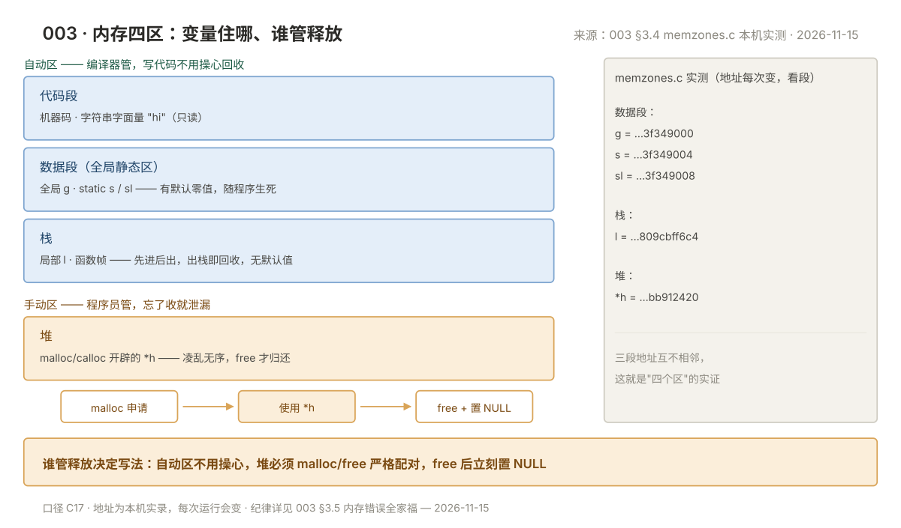

# 003 指针与内存模型

> **解决**：攻下嵌入式第一关——地址、指针、栈堆与常见内存错误；每个概念配可跑实验，内存四区在本机实拍，越界错误的"看不见"亲眼证实。  
> **范围**：地址与取址 · 指针与解引用 · 数组字符串与退化 · 栈堆与内存四区 · 内存错误与工具 · 嵌入式视角。  
> **口径**：C17；地址为本机实录（每次运行会变，形态一致即可）；工具链 w64devkit（不含 ASan 运行库，§3.5 有替代纪律）。  
> **更新**：2026-11-14  
> **本册导读** ── 必会三点：① 指针 = 存地址的变量（步长实测）② 内存四区与释放责任（四区地址实拍）③ 越界不报错的危险（实证） ｜ 跟做时长：约 3 小时 ｜ 前置：002（会写函数与位运算）。  
> **标记**：★ = 必会节；○ = 拓展节。本册是全库第一关，★ 全部要啃透。

## 目录

| 节 | 内容 |
|---|---|
| 3.1 | 内存是一排编址的字节（实验：亲眼看地址） ★ |
| 3.2 | 指针：存地址的变量（实验：swap 的地址版） ★ |
| 3.3 | 数组、字符串与退化（实验：缺 \0 的乱码） ★ |
| 3.4 | 栈、堆与内存四区（实验：四区地址实拍） ★ |
| 3.5 | 常见内存错误与工具（实验：越界竟不报错） ★ |
| 3.6 | 嵌入式视角：指针为什么是第一关 ○ |
| 3.7 | 坑表 |
| 3.8 | 检查清单（自测 6 题 + 动手任务 3 件） |

---

## 3.1 内存是一排编址的字节（实验：亲眼看地址） ★

**定义**：内存是一排从 0 开始编号的字节格子，编号就是**地址**。变量 = 名字 + 地址 + 类型；名字给编译器看，地址才是硬件真相。`&` 是"取地址"的运算符。

**完整示例**（`addr.c`）：

```c
#include <stdio.h>

int main(void)
{
    int    x = 42;
    int    arr[3] = {10, 20, 30};
    char   c = 'A';
    int   *p = &x;

    printf("addr of x       = %p\n", (void*)&x);
    printf("addr of x+field = %p  (next int is +4)\n", (void*)(&x + 1));
    printf("addr of arr[0]  = %p\n", (void*)&arr[0]);
    printf("addr of arr[1]  = %p  (int array step = %zu)\n", (void*)&arr[1], sizeof(int));
    printf("addr of arr[2]  = %p\n", (void*)&arr[2]);
    printf("addr of c       = %p\n", (void*)&c);
    printf("p = %p, *p = %d\n", (void*)p, *p);
    printf("arr[1] via index  = %d ; via *(arr+1) = %d\n", arr[1], *(arr + 1));
    return 0;
}
```

**跟做**：`gcc -Wall addr.c -o addr.exe` → `.\addr.exe`。**预期输出（本机实录，地址每次运行会变，看差值）**：

```text
addr of x       = 00000001f8bffc34
addr of x+field = 00000001f8bffc38  (next int is +4)
addr of arr[0]  = 00000001f8bffc28
addr of arr[1]  = 00000001f8bffc2c  (int array step = 4)
addr of arr[2]  = 00000001f8bffc30
addr of c       = 00000001f8bffc27
p = 00000001f8bffc34, *p = 42
arr[1] via index  = 20 ; via *(arr+1) = 20
```

**读法**：① 相邻 int 的地址差恰好 **4**（差值 = sizeof）——"格子编号"落地了；② `p` 里存的就是 x 的地址，`*p` 顺着地址读出 42；③ `arr[1]` 与 `*(arr+1)` 结果相同——下标就是地址运算的糖衣。

**试一试**：把 `arr` 改成 `char arr[3]` 再看地址差——步长从 4 变 1（指针类型决定步长的证据）。

## 3.2 指针：存地址的变量（实验：swap 的地址版） ★

**定义**：指针就是**存地址的变量**。类型的一部分含义变成"步长"：`int*` 加 1 前进 4 字节（§3.1 实测）。`*p` = 顺着地址读写，`&x` = 拿地址——互逆。

「C语言」002 §2.6 的 swap 失败案，地址版是正确解（`swap.c` 完整示例与实录见那一册 §2.6：`swap_broken` 后 x、y 纹丝不动，`swap_ok` 后 9、1）。**三条纪律**：① 指针不用就置 `NULL`；② 解引用前问"这个地址有效吗"；③ 指针宽度 8 字节（64 位平台，与指向什么无关——types.c 实录 `int* ptr = 8`）。

**试一试**（安全崩溃实验）：`int *p = NULL; printf("%d", *p);` 编译运行——程序崩（段错误）。**这是预期行为**：解引用 NULL 必崩但崩得可定位；野指针崩得毫无规律，所以纪律是"宁可 NULL 不可野"。

## 3.3 数组、字符串与退化（实验：缺 \0 的乱码） ★

**完整示例**（`strdemo.c`）：

```c
#include <stdio.h>
#include <string.h>

int main(void)
{
    char s[] = "hi";               /* h i NUL -> 3 bytes */
    char buf[3] = {'A', 'B', 'C'}; /* NO NUL sentinel! */
    char *t = "hi";                /* read-only literal */
    (void)t;                       /* strcpy(t, "x"); <- 若执行就是写只读区：雷 */

    printf("sizeof s = %zu, strlen(s) = %zu\n", sizeof s, strlen(s));
    printf("s[2] is NUL? -> %d\n", s[2] == 0);
    printf("printing buf (8 raw bytes) -> ");
    for (int i = 0; i < 8; i++) {
        unsigned char ch = (unsigned char)buf[i];
        putchar((ch >= 32 && ch < 127) ? ch : '.');
    }
    printf("   <- ABC plus stack garbage, random each run\n");
    return 0;
}
```

**跟做**：编译运行。**预期输出（本机实录）**：

```text
sizeof s = 3, strlen(s) = 2
s[2] is NUL? -> 1
printing buf (8 raw bytes) -> ABChi...   <- ABC plus stack garbage, random each run
```

**三处机制**：① `sizeof s`=3（含 `\0`）而 `strlen`=2（数到 `\0` 为止）——两个函数量的不是同一个东西；② `buf` 没有结尾哨兵，打印时把**栈上隔壁的残值**也带出来了（本机那次恰好是上次残留的 "hi"）——这就是"打印出乱码"的病根（00-术语表症状反查收录）；③ `char *t = "hi"` 指向只读区，改 `*t` 是未定义行为（代码里那行被注释的 strcpy 就是雷）。

**试一试**：把 `buf` 定义改成 `char buf[4] = {'A','B','C','\0'};` 再跑——垃圾消失，只剩 ABC。

## 3.4 栈、堆与内存四区（实验：四区地址实拍） ★

**定义**：进程内存典型分四区——**代码段**（函数机器码）、**数据段**（全局/static 变量）、**栈**（局部变量，自动回收）、**堆**（malloc/free，手动管理）。

四个区各住什么、谁管释放，先上图：



**完整示例**（`memzones.c`）：

```c
#include <stdio.h>
#include <stdlib.h>

    int g = 1;                          /* data segment */
    static int s = 2;                   /* data segment */

    int main(void)
    {
        int l = 3;                      /* stack */
        static int sl = 4;              /* data segment */
        int *h = malloc(sizeof(int));   /* heap */
        if (h == NULL) { return 1; }    /* malloc 三纪律之一：判 NULL */
        *h = 5;

    printf("global  g  = %d at %p\n", g,  (void*)&g);
    printf("static  s  = %d at %p\n", s,  (void*)&s);
    printf("static sl  = %d at %p\n", sl, (void*)&sl);
    printf("local   l  = %d at %p   <- stack\n", l, (void*)&l);
    printf("heap   *h   = %d at %p   <- heap\n", *h, (void*)h);
    free(h);
    h = NULL;
    return 0;
}
```

**跟做**：编译运行。**预期输出（本机实录）**：

```text
global  g  = 1 at 00007ff63f349000
static  s  = 2 at 00007ff63f349004
static sl  = 4 at 00007ff63f349008
local   l  = 3 at 000000809cbff6c4   <- stack
heap   *h   = 5 at 00000212bb912420   <- heap
```

**读法**（这张地址表是全册的锚）：三个全局/static 挤在**同一段**（`...3f349xxx`，数据段，彼此只差几字节）；局部变量在**完全不同的段**（`...809cbff...`，栈）；malloc 的在**第三个段**（`...bb91...`，堆）。**谁管释放**：数据段/栈自动，堆必须 `free`——malloc 三纪律（判 NULL、必 free、free 后置 NULL）。malloc/free 的完整用法与坑在 007 §7.7 展开，本节只立"谁管释放"的责任观。

**试一试**：在 main 里再声明一个局部变量并打印地址——它与 `l` 相邻（栈上并肩）；把 `malloc(4)` 改成 `malloc(100)`，堆地址仍在同一个堆段。

## 3.5 常见内存错误与工具（实验：越界竟不报错） ★

**完整示例**（`bug_overrun.c`）——一个"写错位置但程序毫无异样"的实证：

```c
#include <stdio.h>

int main(void)
{
    int a[4] = {0};
    a[4] = 12345;              /* out of bounds! compiles fine, runs wild */
    printf("wrote a[4]=12345, a[3]=%d (neighbor may be hit)\n", a[3]);
    return 0;
}
```

**跟做**：`gcc -Wall bug_overrun.c -o bug_overrun.exe` → `.\bug_overrun.exe`。**预期输出（本机实录）**：

```text
wrote a[4]=12345, a[3]=0 (neighbor may be hit)
```

**程序正常退出，没有任何报错**——`a[4]` 越界写入就这样悄无声息地发生了。这就是 C 最危险的特性：**编译器不管、运行时不管，除非踩到要害**。踩到要害时的报错叫**段错误**——机制是操作系统给每个进程划界，访问无权地址时硬件异常、内核终止进程（「操作系统原理」003 §3.3 闭环）。

| 错误 | 典型写法 | 后果 | 预防 |
|---|---|---|---|
| 野指针 | 未初始化就 `*p` | 崩溃或改坏随机内存 | 声明即置 NULL/有效值 |
| 空指针解引用 | `int *p = NULL; *p = 1;` | 必崩，可定位 | 解引用前判 NULL |
| 数组越界 | `a[4]` 对 `int a[4]` | 常常不报错（本册实证） | 边界用 `< len` |
| 使用已释放内存 | `free(p); *p = 1;` | 不可预期 | free 后立刻 `p = NULL` |
| 重复释放 | `free(p); free(p);` | 堆结构损坏 | free 后置 NULL |
| 内存泄漏 | malloc 无 free | 越跑越耗尽 | 每个出口都 free |

**工具纪律**：越界类问题的正规武器是 **AddressSanitizer**（`gcc -fsanitize=address`）与 valgrind——它们需要带运行库的工具链（本库 w64devkit 不含 ASan 运行库，实测 `-lasan` 链接失败）；需要时换装完整版 MinGW-w64（MSYS2）或 Linux 环境再开。**没工具时的替代纪律**：越界逐个检查数组边界、free 全部配对、指针声明即赋值——纪律是工具的替身，不是装饰。

**试一试**：把 `a[4] = 12345` 改成 `a[4] = 0` 再跑——仍然无报错。越界"是否造成可见后果"全看踩到了谁，这正是它危险的原因。

## 3.6 嵌入式视角：指针为什么是第一关 ○

**寄存器也是地址**：嵌入式硬件把外设寄存器"摆"在地址空间固定编号上（内存映射 IO）——读写那个地址就是读写硬件寄存器，而 C 的指针正是触碰地址的工具：

```c
unsigned int *reg = (unsigned int *)0x40020000;  /* 概念示意：某外设寄存器的映射地址 */
*reg |= (1u << 3);                               /* 位操作寄存器（002 §2.3 模板） */
```

⚠️ 示意代码：具体地址查芯片手册；正式工程用芯片库定义的常量。**volatile 预告**：硬件可能在程序背后改内存，需要 `volatile` 告诉编译器"每次都真读真写"——概念立此，实操归规划「005 MCU 与外设」。**为什么面试都考指针**：驱动与固件的日常就是"顺着地址操作内存"；下一册「计算机体系结构」003 的实验将证明：访问模式不同，同一个地址的读取速度差 **100 倍**。

## 3.7 坑表

| # | 现象 | 原因 | 解法 |
|---|---|---|---|
| 1 | 段错误且位置随机 | 野指针 | 声明即置值；free 后置 NULL |
| 2 | 字符串打印带乱码 | 缺 `\0`（strdemo 实录） | 手工组字符串必补 `\0` |
| 3 | 函数里 `sizeof(buf)` 是 8 | 数组传参退化成指针 | 长度另传参数 |
| 4 | 修改 `char *t = "hi"` 崩溃 | 字面量只读 | 用 `char s[] = "hi"` |
| 5 | 程序越跑内存越大 | malloc 无 free | 配对检查 |
| 6 | 越界却无任何报错 | C 不做边界检查 | 边界纪律；换带 ASan 的工具链查 |

## 3.8 检查清单（自测 6 题 + 动手任务 3 件）

**自测**：

| # | 问题 | 自测标准 |
|---|---|---|
| 1 | 变量/地址/指针三者关系 | 变量=名字+地址+类型；指针存地址 |
| 2 | 相邻 int 地址差多少 | 4 字节（addr.c 实录） |
| 3 | sizeof 与 strlen 的差别 | 含 \0 vs 数到 \0（3 vs 2 实录） |
| 4 | 四区各自的释放责任 | 数据段/栈自动，堆手动 |
| 5 | 越界为什么危险 | 编译器运行时都不查（bug_overrun 实录） |
| 6 | free 三纪律 | 判 NULL、必 free、free 后置 NULL |

**动手任务**：① 跑 addr.c 并把三个 `arr` 地址差值写在纸上（应各差 4）；② 跑 memzones.c 并标注哪个地址属于哪个区；③ 复现 strdemo 的乱码，再加 `\0` 修复它。

> 下一篇：《004 结构体、位域与预处理》——把数据"摆进内存"的嵌入式 C 组织层。
