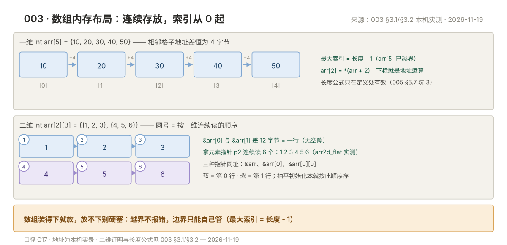
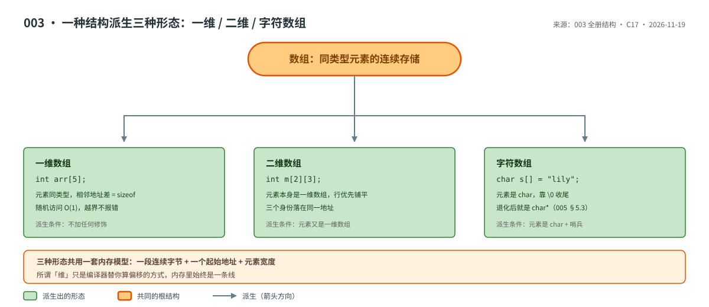
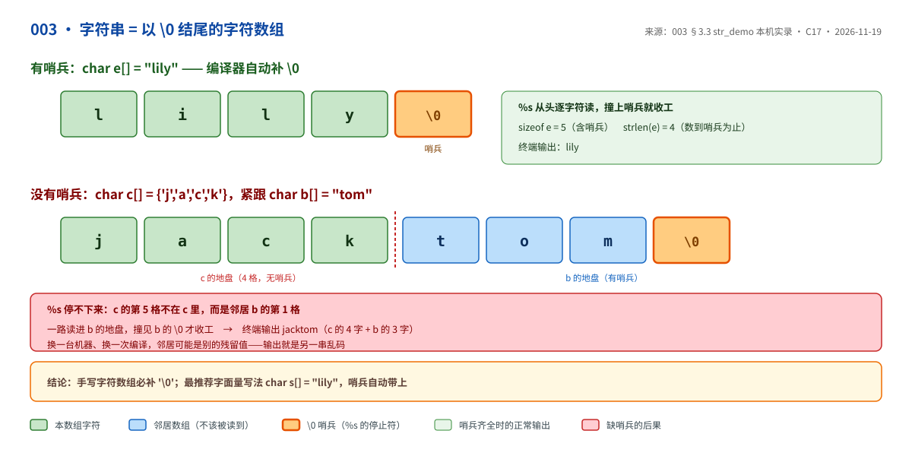

# 003 数组与字符串

> **定位**：把一组同类型数据装进一个容器——连续格子、下标访问、以 `\0` 结尾的字符串。  
> **前置**：002（循环与 sizeof）｜ **口径**：C17，GCC 16.2.0 本机实测 ｜ **示例**：[code/003/](code/003/)

## 3.1 数组：同类型数据的连续格子 ★

数组是一组同类型数据的连续容器。三条约束：**元素类型一致**、**长度与首地址定义后不可变**、**没有 `length` 属性**——长度靠 `sizeof` 现算。



```c
int arr[] = {10, 20, 30, 40, 50};
int length = sizeof arr / sizeof arr[0];   /* 5 */
printf("arr[2] = %d\n", arr[2]);           /* 30 */
```

- **下标从 0 起**，最大索引 = 长度 − 1，`arr[2]` 是第 3 个元素。
- **`int raw[3];` 里是垃圾值**。本机这次打印 0，下次不保证；`-Wall` 会警告 `used uninitialized`，但只警告不拦截。
- **长度公式只在数组出生地有效**。传参后数组名退化成指针，`sizeof` 得 8（005 §5.7 坑 3）。
- **越界不报错**。`arr[5]`、`arr[-1]` 编译通过、运行照常退出——C 不做边界检查，边界只能自己管（005 §5.5 有实证）。

**变长数组**：C99 的 `int arr[len]` 长度到运行期才定，但声明时不能初始化、可能栈溢出，嵌入式规范常禁用，优先静态长度或 malloc。完整示例 [vla_demo.c](code/003/vla_demo.c)。

## 3.2 二维数组：每个元素又是一个一维数组 ○

`int arr[2][3]` 是「2 个元素，每个元素是 `int[3]`」。所以 `arr[i]` 是第 i 行的**地址**，`arr[i][j]` 才是值。

```c
int arr[][3] = {{1, 2, 3}, {4, 5, 6}};
int rows  = sizeof arr / sizeof arr[0];       /* 2：行数 */
int cols  = sizeof arr[0] / sizeof arr[0][0]; /* 3：列数 */
int total = sizeof arr / sizeof arr[0][0];    /* 6：元素总数 */
```

- **三个公式各数各的**：除以 `arr[0]` 数行、除以 `arr[0][0]` 数总数。
- **`arr[1] = ...` 编译报错**：行是地址，地址不可改；改元素用 `arr[1][j]`。
- **拍平写法 `{1,2,3,4,5,6}` 能跑但报 `missing braces`**，因为大括号没有表达"方阵"结构，嵌套写才是正形。

**内存里它是一条线**：指向整个数组、指向第一行、指向首元素这三个身份不同的指针落在同一地址；用元素指针连续走 6 步正好按行铺完，`&arr[1]` 与 `&arr[0]` 恰差 12 字节。完整示例 [arr2d_flat.c](code/003/arr2d_flat.c)。

三种形态其实是同一个结构的三种派生，共用两条判断依据：



## 3.3 字符串：以 `\0` 结尾的字符数组 ★

C 没有 string 类型。`char s[] = "lily"` 就是 `{'l','i','l','y','\0'}` 的缩写——`\0` 是哨兵，告诉 `%s` 读到哪停。



| 写法 | 结果 |
|---|---|
| `char e[] = "lily"` | 自动补 `\0`，最推荐 |
| `char b[4] = {'t','o','m'}` | 长度大于字符数，自动补 `\0` |
| `char a[] = {'a','b','c','d','\0'}` | 手写哨兵，对但麻烦 |
| `char c[] = {'j','a','c','k'}` | **无哨兵，`%s` 越界** |

**没有哨兵会怎样**：`%s` 只拿到一个起始地址、不知道边界，会一路读到撞上任意的 `\0`。本机实测 `c` 后邻着 `b`，打印出 `jacktom`——换编译器或换声明顺序就是别的垃圾值。

**`sizeof` 与 `strlen` 量的不是同一个东西**：`char s[] = "How are you!"` 的 `sizeof` 是 13（含哨兵的总格子），`strlen` 是 12（有效字符）。遍历的边界用 `strlen`，不用 `sizeof`。

完整示例 [str_demo.c](code/003/str_demo.c)。

## 3.4 string.h 四函数 ★

```c
char buf[20] = "hello";
strlen(buf);              /* 5：有效字符数，不含 \0 */
strcmp(buf, "hello");     /* 0：相等 */
strcat(buf, " world");    /* 拼到 buf 尾部，改的是 buf */
strcpy(buf, "world");     /* 覆盖 buf，改的是 buf */
```

- **`strcmp` 返回 0 才相等**，判断写 `strcmp(a,b) == 0`。非 0 只表示不等及方向，具体数值因实现而异（本机给 −1）。
- **`strcat`/`strcpy` 都不检查目标容量**：装不下就是越界写（005 §5.5 的重灾区）。
- **拼接前先算账**：目标容量 ≥ `strlen(dst) + strlen(src) + 1`。

完整示例 [strfunc_demo.c](code/003/strfunc_demo.c)。

## 3.5 随机数：rand / srand 与区间公式 ○

`rand()` 返回 `[0, RAND_MAX]` 的伪随机数。映射到任意区间 `[m, n]`：

```c
srand((unsigned)time(NULL));        /* 换种子：每次运行序列不同 */
int num = rand() % (n - m + 1) + m; /* 先压到 [0, n-m]，再平移到 [m, n] */
```

- **不调 `srand` 时种子默认 0**，每次运行序列完全相同——调试时可复现反而是优点。
- **`rand()` 是教学级伪随机**，产品级随机性靠硬件随机数发生器外设。

完整示例 [rand_demo.c](code/003/rand_demo.c)。

## 3.6 坑表

| # | 现象 | 原因 | 解法 |
|---|---|---|---|
| 1 | 无 `\0` 数组打印出 `jacktom` | 缺哨兵，`%s` 越界读 | 用字面量写法或手写 `\0` |
| 2 | `scanf("%s")` 空格后内容丢失 | `%s` 遇空格即停 | 整行用 `fgets(str, sizeof str, stdin)`（008 §8.1） |
| 3 | 数组传参后求长度得 8 | 数组名退化成指针 | 长度作为独立形参传入 |
| 4 | `arr[5]`、`arr[-1]` 能编译能跑 | C 不做越界检查 | 最大索引 = 长度 − 1 |
| 5 | `arr[1] = ...` 编译报错 | 行是地址，不可改 | 改 `arr[1][j]` |
| 6 | strcat/strcpy 后程序诡异崩溃 | 目标容量不足，越界写 | 先算 `strlen(dst)+strlen(src)+1` |
| 7 | 二维拍平初始化报 `missing-braces` | 大括号不表达方阵结构 | 嵌套写 `{{1,2,3},{4,5,6}}` |

## 3.7 自测与动手

| # | 问题 |
|---|---|
| 1 | 数组的三条约束是什么？ |
| 2 | 长度公式为什么只能在定义处用？ |
| 3 | `"hello"` 的 `sizeof` 与 `strlen` 各是多少？ |
| 4 | 字符串缺 `\0` 会出现什么现象，为什么？ |
| 5 | `strcmp` 怎么判断相等？ |
| 6 | 区间 `[m, n]` 的随机数公式怎么写？ |

**动手**：① 跑 [arr_demo.c](code/003/arr_demo.c)，把"改一个元素"改成循环给所有元素 +1；② 写 3×3 矩阵对角线求和；③ 掷骰子 1000 次统计 6 点次数（应约 167）。

**跑起来**：`cd code/003 && gcc -Wall arr_demo.c -o arr_demo.exe && ./arr_demo.exe`

> 下一篇：《004 函数与作用域》——数组装数据，函数组织逻辑：四种形态、作用域与 static。
