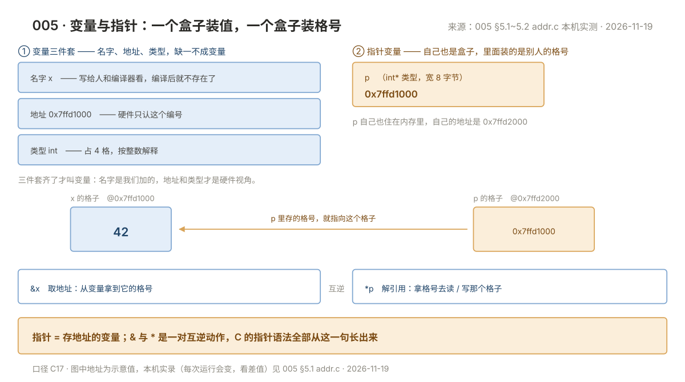
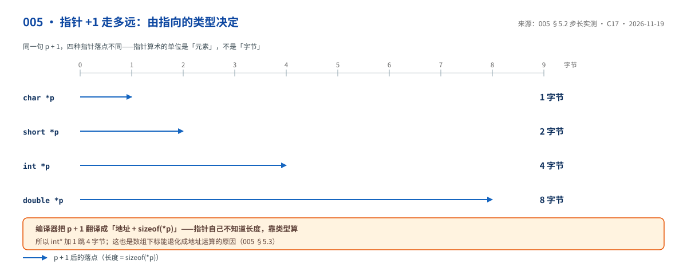
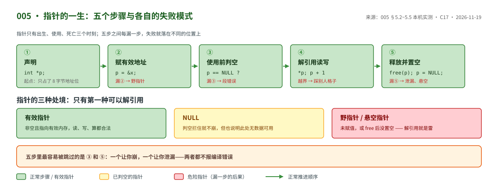
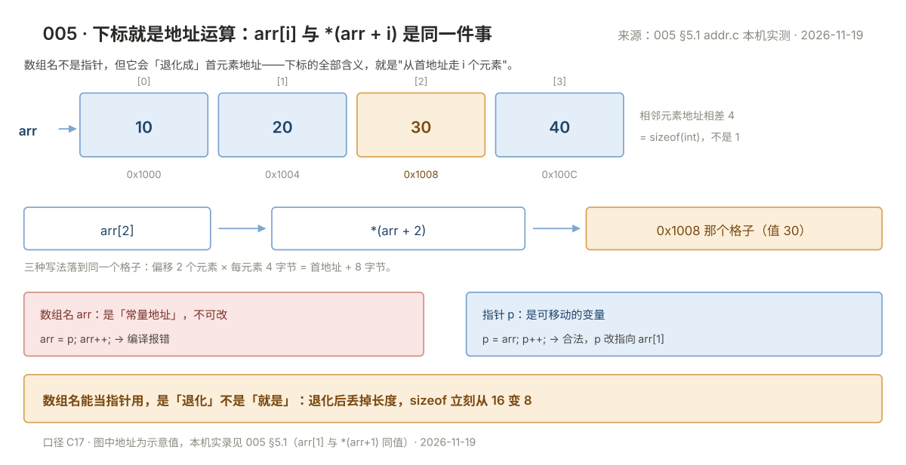
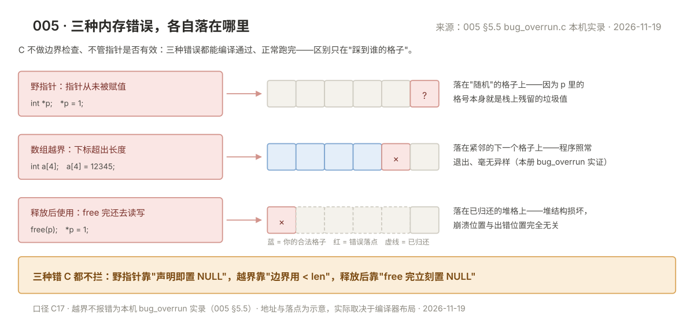

# 005 指针与内存模型

> **定位**：嵌入式第一关——地址、指针、栈堆与四种内存错误。  
> **前置**：003（数组与 sizeof）、004（会写函数）｜ **口径**：C17，地址为本机实录（每次运行会变，看差值）｜ **示例**：[code/005/](code/005/)

## 5.1 内存是一排编址的字节 ★

内存是一排从 0 开始编号的字节格子，编号就是**地址**。变量 = 名字 + 地址 + 类型：名字给编译器看，地址才是硬件真相。`&x` 取地址。



```c
int x = 42;
int *p = &x;              /* p 这个盒子里装的是 x 的格号 */
printf("%d\n", *p);       /* 42：* 是顺着格号把值取出来 */
```

本机实测（[addr.c](code/005/addr.c)）：

```text
addr of x       = 00000001f8bffc34
addr of x+field = 00000001f8bffc38   <- 差 4 = sizeof(int)
addr of arr[1]  = 00000001f8bffc2c
addr of arr[2]  = 00000001f8bffc30
```

- **相邻 int 的地址差恰好 4**，差值就是 `sizeof`——"格子编号"不是比喻。
- **`p` 里存的就是 x 的地址**，`*p` 顺着它读出 42。
- **`arr[1]` 与 `*(arr+1)` 结果相同**：下标就是地址运算的语法糖。

## 5.2 指针：存地址的变量 ★

指针就是**存地址的变量**。它指向的类型决定**步长**：`int*` 加 1 前进 4 字节，`char*` 加 1 前进 1 字节。



002 §2.6 的 swap 已经证明"实参是拷贝，想改真身必须交地址"。本节补上后半句：**地址交出去之后，函数凭什么能改到真身**——因为它拿到的是真身的格号，顺着格号写就是写真身。

- **指针宽度与指向什么无关**：64 位平台恒为 8 字节。
- **不用就置 `NULL`**：解引用 NULL 必崩，但崩得可定位；野指针崩得毫无规律。
- **解引用前先问这个地址有效吗**。

指针从出生到死亡只有五个步骤，每一步漏掉的后果各不相同：



## 5.3 一个地址能走多远 ★

数组下标就是"从首地址走 i 个元素"，走得准，所以安全：



指针没有边界概念——`%s` 只拿到起始地址、不知道终点，只能读到撞上 `\0` 为止。**"没有边界"是指针的常态**，这是本节要带走的第一件事。

```c
char s[] = "hi";      /* 栈上 3 个格子，可写 */
char *t = "hi";       /* 指针，指向只读字面量区 */
strcpy(t, "x");       /* 未定义行为：写只读区，必崩 */
```

- **`s` 与 `t` 长得像、本质不同**：`s` 是可写的 3 个格子，`t` 指向只读区。
- **`sizeof` 量数组得总格子数，量指针得指针宽度**。函数里 `sizeof(buf)` 从 3 变 8 就是这个原因（006 §6.2）。

字符串怎么定义、哨兵怎么让 `%s` 停下来，003 §3.3 已做完整实证，本节不重复。完整示例 [strdemo.c](code/005/strdemo.c)。

## 5.4 栈、堆与内存四区 ★

进程内存分四区：**代码段**（机器码）、**数据段**（全局与 static）、**栈**（局部变量，自动回收）、**堆**（malloc/free，手动管理）。


本机实测（[memzones.c](code/005/memzones.c)）：

```text
global  g  = 1 at 00007ff63f349000
static  s  = 2 at 00007ff63f349004   <- 三者在同一段（数据段）
static sl  = 4 at 00007ff63f349008
local   l  = 3 at 000000809cbff6c4   <- stack
heap   *h   = 5 at 00000212bb912420  <- heap
```

- **同区相邻、跨区远隔**：三个全局/static 彼此只差 4 字节，栈和堆各在完全不同的段。
- **谁管释放**：数据段与栈自动回收，堆必须 `free`。malloc 三纪律——判 NULL、必 free、free 后置 NULL。
- 四函数的完整用法与坑在 006 §6.7，本节只立"谁管释放"这个责任观。

## 5.5 四种内存错误 ★

最反直觉的一个先看：

```c
int a[4] = {0};
a[4] = 12345;              /* 越界写入 */
printf("a[3]=%d\n", a[3]); /* 0——程序正常退出，毫无报错（bug_overrun.c） */
```

**编译器不管、运行时也不管，除非踩到要害。** 踩到要害的报错叫**段错误**：操作系统给每个进程划界，访问无权地址时硬件异常、内核终止进程（「操作系统原理」003 §3.3）。

三种错误落在三种位置，后果完全不同：



| 错误 | 典型写法 | 后果 | 预防 |
|---|---|---|---|
| 野指针 | 未初始化就 `*p` | 崩溃或改坏随机内存 | 声明即置 NULL 或有效值 |
| 空指针解引用 | `int *p = NULL; *p = 1;` | 必崩，可定位 | 解引用前判 NULL |
| 数组越界 | `a[4]` 对 `int a[4]` | 常常不报错 | 边界用 `< len` |
| 使用已释放内存 | `free(p); *p = 1;` | 不可预期 | free 后立刻置 NULL |
| 重复释放 | `free(p); free(p);` | 堆结构损坏 | free 后置 NULL |
| 内存泄漏 | malloc 不 free | 越跑越耗尽 | 每个出口都 free |

**工具**：越界类问题的正规武器是 AddressSanitizer（`gcc -fsanitize=address`）和 valgrind。本库 w64devkit 不含 ASan 运行库（实测 `-lasan` 链接失败），需要时换 MSYS2 完整版或 Linux 环境。**没工具时靠纪律**：逐个查数组边界、free 全配对、指针声明即赋值。

## 5.6 嵌入式视角：寄存器也是地址 ○

外设寄存器被"摆"在地址空间的固定编号上（内存映射 IO），读写那个地址就是读写硬件：

```c
unsigned int *reg = (unsigned int *)0x40020000;  /* 示意：某外设寄存器的映射地址 */
*reg |= (1u << 3);
```

- **具体地址查芯片手册**，正式工程用芯片库定义的常量。
- **`volatile` 预告**：硬件可能在程序背后改内存，需要它告诉编译器每次都真读真写——实操归规划「005 MCU 与外设」。
- **面试必考指针**，因为驱动与固件的日常就是"顺着地址操作内存"。下一板块「计算机体系结构」003 会证明：访问模式不同，同一地址的读取速度差 100 倍。

## 5.7 坑表

| # | 现象 | 原因 | 解法 |
|---|---|---|---|
| 1 | 段错误且位置随机 | 野指针 | 声明即置值；free 后置 NULL |
| 2 | 字符串打印带乱码 | 缺 `\0` | 手工组字符串必补 `\0` |
| 3 | 函数里 `sizeof(buf)` 是 8 | 数组传参退化成指针 | 长度另传参数 |
| 4 | 修改 `char *t = "hi"` 崩溃 | 字面量在只读区 | 改用 `char s[] = "hi"` |
| 5 | 程序越跑内存越大 | malloc 无 free | 配对检查 |
| 6 | 越界却无任何报错 | C 不做边界检查 | 边界纪律；换带 ASan 的工具链查 |

## 5.8 自测与动手

| # | 问题 |
|---|---|
| 1 | 变量、地址、指针三者是什么关系？ |
| 2 | 相邻两个 int 的地址差多少？为什么？ |
| 3 | `sizeof` 与 `strlen` 的差别是什么？ |
| 4 | 四区各自的释放责任归谁？ |
| 5 | 越界写入为什么危险？ |
| 6 | malloc 三纪律是哪三条？ |

**动手**：① 跑 [addr.c](code/005/addr.c)，把三个 `arr` 地址差值记下来（应各差 4）；② 跑 [memzones.c](code/005/memzones.c)，标注每个地址属于哪个区；③ 复现 [strdemo.c](code/005/strdemo.c) 的乱码，再补 `\0` 修好它。

**跑起来**：`cd code/005 && gcc -Wall addr.c -o addr.exe && ./addr.exe`

> 下一篇：《006 指针进阶与动态内存》——指针运算、指针家族（数组指针/函数指针/回调）与 malloc 四函数。
