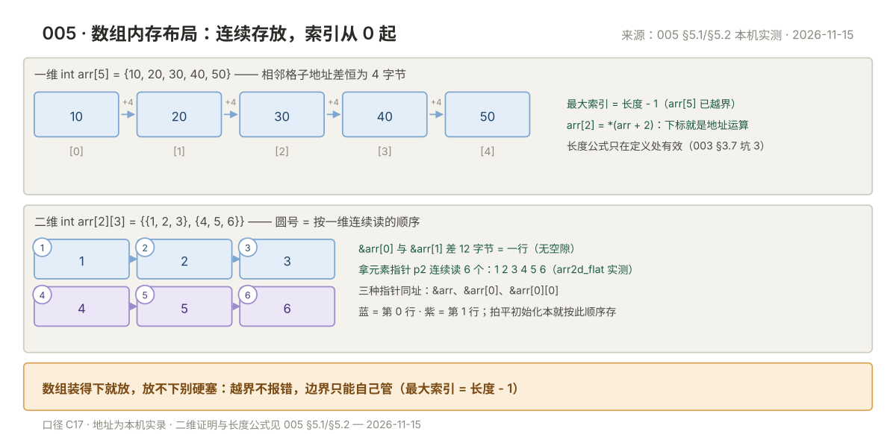
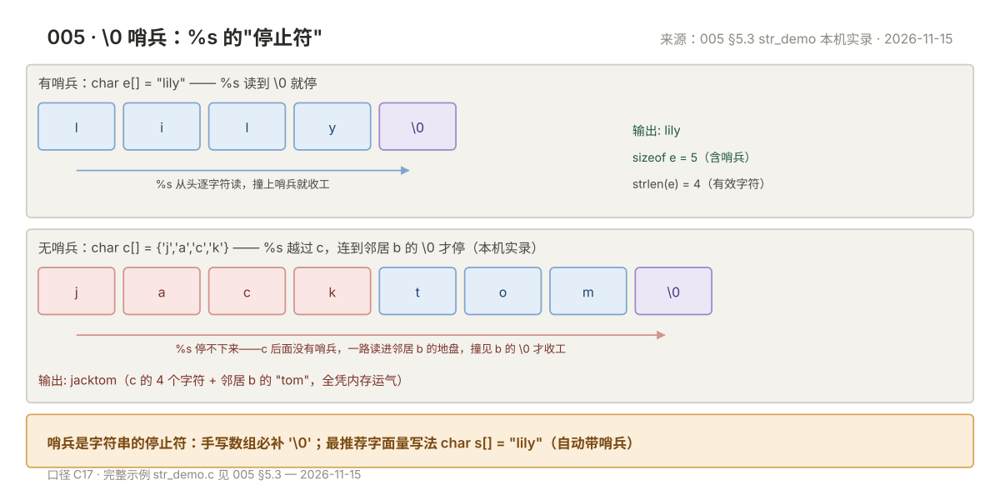

# 005 数组与字符串

> **解决**：把"一组同类型数据"装进一个容器——一维/二维数组的创建、查改、遍历与长度公式，字符数组（字符串）的五种写法与 `\0` 哨兵，string.h 四函数；本册所有输出均为本机实录（GCC 16.2.0，见「C语言」001）。  
> **范围**：一维数组 · 二维数组 · 字符数组与 `\0` · string.h 四函数 · rand/srand 随机数。  
> **口径**：C17；数组行为以本机实测为准（Windows x64，MinGW-w64）。  
> **更新**：2026-11-15  
> **本册导读** ── 必会三点：① 数组三定（类型一致、长度与地址不可变、**没有 .length 属性**——长度靠 sizeof 公式）② `\0` 哨兵（字符串结束符）：sizeof vs strlen（str_demo 实录：无 `\0` 打印串到别人家）③ 越界不报错——C 不会拦你，边界纪律要自己带 ｜ 跟做时长：约 2.5 小时 ｜ 前置：002（循环与 sizeof）、003（数组名是首元素地址）。  
> **标记**：★ = 必会节；○ = 拓展节。

## 目录

| 节 | 内容 |
|---|---|
| 5.1 | 一维数组：连续同类型格子与 sizeof 长度公式 ★ |
| 5.2 | 二维数组：三种长度公式与行地址不可改 ○ |
| 5.3 | 字符数组与字符串：`\0` 哨兵 ★ |
| 5.4 | string.h 四函数：strlen / strcmp / strcat / strcpy ★ |
| 5.5 | 随机数：rand / srand 与区间公式 ○ |
| 5.6 | 坑表 |
| 5.7 | 检查清单（自测 6 题 + 动手任务 3 件） |

---

## 5.1 一维数组：连续同类型格子与 sizeof 长度公式 ★

**定义**：数组（Array）是一组**同类型**数据的连续容器。三条铁律：① 元素类型必须一致；② 定义后**长度与内存地址不可变**（所以没有"增删"操作）；③ **C 数组没有 length 属性**——长度靠 `sizeof 数组 / sizeof 数组[0]` 公式现算。

数组的内存长相（一维是连续格子、二维在内存里仍是一条线）见下图：



**完整示例**（`arr_demo.c`）：

```c
#include <stdio.h>

int main(void)
{
    // 动态初始化：程序员定类型和长度，值是内存里的垃圾值
    int raw[3];
    printf("raw[0] = %d (垃圾值, 每次运行可能不同)\n", raw[0]);

    // 静态初始化：程序员定每个值，长度由计算机自动算
    int arr[] = {10, 20, 30, 40, 50};

    // 查长度：sizeof 公式（C 数组没有 .length 属性）
    int length = sizeof arr / sizeof arr[0];
    printf("length = %d\n", length);

    // 查元素、改元素
    printf("arr[2] = %d\n", arr[2]);
    arr[2] = 99;
    printf("改后 arr[2] = %d\n", arr[2]);

    // 遍历
    for (int i = 0; i < length; i++)
    {
        printf("arr[%d] = %d\n", i, arr[i]);
    }
    return 0;
}
```

**跟做**：`gcc -Wall arr_demo.c -o arr_demo.exe` → `.\arr_demo.exe`。**预期输出（本机实录，连警告一起看——警告本身就是教学点）**：

```text
arr_demo.c: In function 'main':
arr_demo.c:7:5: warning: 'raw' is used uninitialized [-Wuninitialized]
    7 |     printf("raw[0] = %d (垃圾值, 每次运行可能不同)\n", raw[0]);
      |     ^~~~~~~~~~~~~~~~~~~~~~~~~~~~~~~~~~~~~~~~~~~~~~~~~~~~~~~~~~
arr_demo.c:6:9: note: 'raw' declared here
    6 |     int raw[3];
raw[0] = 0 (垃圾值, 每次运行可能不同)
length = 5
arr[2] = 30
改后 arr[2] = 99
arr[0] = 10
arr[1] = 20
arr[2] = 99
arr[3] = 40
arr[4] = 50
```

**三处必看的机制**：① **索引（index，下标）从 0 开始**，最大索引 = 长度 − 1——`arr[2]` 是第 3 个元素，不是第 2 个；② 动态初始化 `int raw[3]` 的格子是**垃圾值**（本机这次是 0，不保证下次）——`-Wall` 会警告 `used uninitialized`，但**只是警告不是拦截**；③ 长度公式 `sizeof arr / sizeof arr[0]` 只能在数组"出生地"用——传参后数组名退化成指针得 8（003 §3.7 坑 3）。

**试一试**：① ⚠️ 在最后加两行 `printf("%d\n", arr[5]); printf("%d\n", arr[-1]);`——编译运行都照常通过：**越界在 C 里不是语法错误**，是运行期隐患（003 §3.5 的 bug_overrun 同款），边界只能自己管；② 把公式除数换成 `sizeof(int)`，结果相同——两种写法等价，选一种统一用。

**C99 VLA 变长数组**（`vla_demo.c`）——长度运行期才确定的数组：

```c
#include <stdio.h>

int main(void)
{
    /* C99 变长数组 VLA：长度运行期才确定 */
    int len = 3;
    int arr[len]; /* 合法：len 是运行期变量 */
    for (int i = 0; i < len; i++)
        arr[i] = (i + 1) * 100;

    int n;
    printf("请输入数组长度: ");
    scanf("%d", &n);
    int user[n]; /* 长度来自用户输入——编译期根本不知道 */
    for (int i = 0; i < n; i++)
        user[i] = i;
    printf("user 长度 = %zu, user[%d] = %d\n", sizeof user / sizeof user[0], n - 1, user[n - 1]);
    printf("arr 长度 = %zu\n", sizeof arr / sizeof arr[0]);
    return 0;
}
```

**预期输出（本机实录，输入 4）**：

```text
请输入数组长度: user 长度 = 4, user[3] = 3
arr 长度 = 3
```

**边界**：VLA 在栈上开辟、长度必须是**运行期的正整数**——声明时**不能初始化**（`int arr[len] = {1,2,3};` 编译报错 `variable-sized object may not be initialized`，本机实录）；长度来自用户输入时要先判合理性（输入 10000000 直接栈溢出）。嵌入式工程里 VLA 常被编码规范禁用（栈用量不可预估），优先静态长度或 malloc（007 §7.7）。

## 5.2 二维数组：三种长度公式与行地址不可改 ○

**定义**：二维数组本质是**每个元素又是一个一维数组**（方阵）；高维的切面就是低维——`arr[i]` 是第 i 个一维数组的**地址**，`arr[i][j]` 才是元素。

**完整示例**（`arr2d_demo.c`）：

```c
#include <stdio.h>

int main(void)
{
    // 二维数组：每个元素又是一维数组（2 行 3 列）
    int arr[][3] = {1, 2, 3, 4, 5, 6};

    // 三种查长度公式
    int total = sizeof arr / sizeof arr[0][0];    // 元素总数
    int rows  = sizeof arr / sizeof arr[0];       // 一维数组个数（行）
    int cols  = sizeof arr[0] / sizeof arr[0][0]; // 每个一维数组的元素数（列）
    printf("total=%d rows=%d cols=%d\n", total, rows, cols);

    // arr[1] 是第 2 个一维数组的地址，地址不可改：arr[1] = ... 编译不过

    // 双重 for 遍历
    for (int i = 0; i < rows; i++)
    {
        for (int j = 0; j < cols; j++)
        {
            printf("arr[%d][%d] = %d\n", i, j, arr[i][j]);
        }
    }
    return 0;
}
```

**跟做**：编译运行。**预期输出（本机实录，含 -Wall 警告）**：

```text
arr2d_demo.c: In function 'main':
arr2d_demo.c:6:20: warning: missing braces around initializer [-Wmissing-braces]
    6 |     int arr[][3] = {1, 2, 3, 4, 5, 6};
      |                    ^
      |                     {      } {      }
total=6 rows=2 cols=3
arr[0][0] = 1
arr[0][1] = 2
arr[0][2] = 3
arr[1][0] = 4
arr[1][1] = 5
arr[1][2] = 6
```

**三处必看的机制**：① 三个公式各数各的：`sizeof arr / sizeof arr[0]` 数**行**、`sizeof arr[0] / sizeof arr[0][0]` 数**列**、`sizeof arr / sizeof arr[0][0]` 数**总数**；② `-Wmissing-braces` 警告在提醒你：按行嵌套写 `{{1,2,3},{4,5,6}}` 才是表达"方阵"的正形；③ `arr[1] = ...` 直接编译报错——行是地址，数组的地址一旦定义不可改；改行内元素用 `arr[1][j]`。

**试一试**：① 把初始化改成嵌套写法 `{{1,2,3},{4,5,6}}`，警告消失；② 手算 `int t[][2] = {1,2,3,4,5,6}` 的 rows/cols（3 行 2 列），改程序验证。

**内存证明：二维数组就是按一维连续存放**（`arr2d_flat.c`）：

```c
#include <stdio.h>

int main(void)
{
    /* 证明：二维数组在内存里就是按一维顺序连续存放的 */
    int arr[2][3] = {{1, 2, 3}, {4, 5, 6}};
    int (*ptr)[2][3] = &arr;  /* 指向整个二维数组的指针（数组指针正式讲解在 007 §7.3） */
    int (*p1)[3] = &arr[0];   /* 数组指针：指向第一行（此处只需知道 p1+1 跨一整行 12 字节） */
    int *p2 = &arr[0][0];     /* 指向第一个元素 */

    printf("ptr = %p\n", (void *)ptr);
    printf("p1  = %p\n", (void *)p1);
    printf("p2  = %p\n", (void *)p2);

    /* 关键证明：p2 当一维数组连续走 6 个元素，正好按行铺完 */
    printf("按一维方式连续读 6 个: ");
    for (int k = 0; k < 6; k++)
        printf("%d ", p2[k]);
    printf("\n");

    /* 每行首地址：行与行只差 3 个 int（12 字节），中间没有空隙 */
    for (int i = 0; i < 2; i++)
        printf("&arr[%d] = %p\n", i, (void *)&arr[i]);
    return 0;
}
```

**预期输出（本机实录，地址每次运行会变，看关系）**：

```text
ptr = 000000203adff6c0
p1  = 000000203adff6c0
p2  = 000000203adff6c0
按一维方式连续读 6 个: 1 2 3 4 5 6 
&arr[0] = 000000203adff6c0
&arr[1] = 000000203adff6cc
```

**读法**：三个"不同身份"的指针落在**同一个地址**（数组起点只有一个）；拿元素指针 `p2` 当一维数组连续走，读出的正是 `1 2 3 4 5 6`——二维只是"逻辑上的方阵"，内存里首尾相接没有空隙（`&arr[1]` 与 `&arr[0]` 恰差 0xC = 12 字节 = 一行）。这也解释了 §5.2 静态初始化为什么允许拍平写法：数据本来就按这个顺序存。

## 5.3 字符数组与字符串：`\0` 哨兵 ★

**定义**：C 没有 string 类型——**字符串就是以 `\0`（哨兵，结束符）结尾的字符数组**。五种定义写法逐个评判：手写 `'\0'`（对但麻烦）、指定长度且大于字符数（对，自动补 `\0`）、不写 `\0`（**危险**）、`{"lucy"}` 双层括号（对不推荐）、`"lily"` 字面量（**最推荐**）。

**完整示例**（`str_demo.c`）：

```c
#include <stdio.h>
#include <string.h>

int main(void)
{
    char a[] = {'a', 'b', 'c', 'd', '\0'}; // 手写哨兵：没问题但麻烦
    char b[4] = {'t', 'o', 'm'};           // 指定长度须 > 字符个数：自动补 \0
    char c[] = {'j', 'a', 'c', 'k'};       // 没有 \0：危险
    char d[] = {"lucy"};                   // 没问题不推荐
    char e[] = "lily";                     // 最推荐

    printf("a=%s b=%s d=%s e=%s\n", a, b, d, e);
    printf("c=%s  <- 无 \\0, 输出连到内存中下一个 \\0 才停\n", c);

    char s[] = "How are you!";
    printf("sizeof s = %zu (含 \\0)\n", sizeof s);
    printf("strlen(s) = %zu (有效字符)\n", strlen(s));
    return 0;
}
```

**跟做**：编译运行。**预期输出（本机实录）**：

```text
a=abcd b=tom d=lucy e=lily
c=jacktom  <- 无 \0, 输出连到内存中下一个 \0 才停
sizeof s = 13 (含 \0)
strlen(s) = 12 (有效字符)
```

**三处必看的机制**：① `c=jacktom` 是本册最值钱的一行——`c` 没有 `\0`，`%s` 一路读到别人家的存储区（本机布局恰好 `c` 后邻 `b`，所以连出了 "tom"；换编译器/声明顺序就未必，**打印到哪全凭内存运气**）；② `sizeof s = 13` vs `strlen(s) = 12`：sizeof 数**含哨兵的总格子**，strlen 数**有效字符**——"How are you!" 12 个字符 + 1 个 `\0`；③ 遍历字符数组时循环边界用 `strlen`（有效区），不是 sizeof（含哨兵）。

哨兵怎么让 %s 停、没哨兵怎么越界，画成图：



**试一试**：① 把 `char b[4]` 改成 `char b[3]`——装不下哨兵，`b` 也变危险数组，重跑看输出串成什么样；② 手算 `"hello"` 的 sizeof 与 strlen（6 与 5），写程序对答案。

## 5.4 string.h 四函数：strlen / strcmp / strcat / strcpy ★

**定义**：四个最常用字符串函数（都在 `<string.h>`）：`strlen(s)` 有效长度；`strcmp(s1,s2)` 比较，**返回 0 才相等**；`strcat(dst,src)` 把 src 拼到 dst 尾部；`strcpy(dst,src)` 用 src 覆盖 dst——后三个**受影响的都是第一个参数**。

**完整示例**（`strfunc_demo.c`）：

```c
#include <stdio.h>
#include <string.h>

int main(void)
{
    char buf[20] = "hello";
    char src[] = "world";

    // strlen：有效字符个数，忽略 \0
    printf("strlen(\"%s\") = %zu\n", buf, strlen(buf));

    // strcmp：返回 0 说明内容一致
    printf("strcmp(buf, \"hello\") = %d\n", strcmp(buf, "hello"));
    printf("strcmp(buf, \"world\") = %d\n", strcmp(buf, "world"));

    // strcat：把 src 拼接到 buf 尾部（受影响的是 buf）
    strcat(buf, " ");
    strcat(buf, src);
    printf("strcat 后: %s\n", buf);

    // strcpy：用 src 覆盖 buf（受影响的还是 buf）
    strcpy(buf, src);
    printf("strcpy 后: %s\n", buf);
    return 0;
}
```

**跟做**：编译运行。**预期输出（本机实录）**：

```text
strlen("hello") = 5
strcmp(buf, "hello") = 0
strcmp(buf, "world") = -1
strcat 后: hello world
strcpy 后: world
```

**三处必看的机制**：① `strcmp` **返回 0 才相等**——判断相等写 `strcmp(a,b) == 0`，不写 `strcmp(a,b) == 1`（非 0 值只表示"不等"及方向，本机给出 -1）；② `strcat`/`strcpy` 都**不检查目标容量**——`buf[20]` 装 "hello world"（11 字符 + `\0`）刚好够，目标区不够就是缓冲区溢出（003 §3.5 内存错误全家福的重灾区）；③ 拼接前先算账：目标容量 ≥ `strlen(dst) + strlen(src) + 1`。

**试一试**：① ⚠️ 把 `buf[20]` 缩成 `buf[8]` 再 strcat——编译照样过，运行已经越界写内存（隐患同 §5.6 坑 6）；② `strcmp("apple", "app")` 手算方向（长串大），跑程序验证符号——具体数值因实现而异（本机 -1），标准只保证符号。

## 5.5 随机数：rand / srand 与区间公式 ○

**定义**：`rand()`（`<stdlib.h>`）生成 `[0, RAND_MAX]` 的伪随机数（pseudo-random number）；映射到小区间用取余——`rand() % n + 1` 得 `[1, n]`，区间 `[m, n]` 用公式 **`rand() % (n - m + 1) + m`**；`srand(种子)` 换种子让每次运行的序列不同（常用当前时间戳）。

**完整示例**（`rand_demo.c`）：

```c
#include <stdio.h>
#include <stdlib.h>
#include <time.h>

int main(void)
{
    // rand() 范围 [0, RAND_MAX]；换种子后每次运行序列不同
    srand((unsigned)time(NULL));

    for (int i = 0; i < 5; i++)
    {
        // 生成 [22, 94] 区间随机数：rand() % (n-m+1) + m
        int num = rand() % 73 + 22;
        printf("num = %d\n", num);
    }
    return 0;
}
```

**跟做**：编译运行。**预期输出（本机实录——每次运行都不同，这正是换种子的效果）**：

```text
num = 25
num = 91
num = 70
num = 30
num = 60
```

**三处必看的机制**：① 不调 `srand` 时种子默认 0——**每次运行序列完全相同**（可复现，调试时反而有用）；② `% (n-m+1)` 把大数压到 `[0, n-m]`，`+ m` 平移到 `[m, n]`——先压宽再平移，顺序别反；③ 嵌入式产品里"crypto 级"随机性来自硬件随机数发生器外设，`rand()` 只是教学级伪随机（后续 MCU 板块展开）。

**试一试**：① 注释掉 `srand` 那行，连跑两次对比输出——序列一模一样；② 写"掷骰子"：`rand() % 6 + 1` 掷 1000 次统计 6 点次数（动手任务 ③ 的原型）。

## 5.6 坑表

| # | 现象 | 原因 | 解法 |
|---|---|---|---|
| 1 | 无 `\0` 数组打印出 `jacktom`（§5.3 实录） | 缺哨兵，`%s` 读到别人家 | 字面量写法 `char s[] = "lily"` 或手写 `'\0'` |
| 2 | `scanf("%s")` 空格后的内容没了 | `%s` 遇空格即停 | 整行录入用 `fgets(str, sizeof str, stdin)`（008 §8.1） |
| 3 | 数组传参后求长度得 8 | 数组名退化成指针（003 §3.7 坑 3、007 §7.2） | 长度作为独立形参传进去 |
| 4 | `arr[5]`、`arr[-1]` 能编译能跑 | C 不做越界检查，是隐患不是语法错 | 最大索引 = 长度 − 1，边界自查 |
| 5 | `arr[1] = ...` 编译报错 | 行是一维数组的地址，地址不可改 | 改行内元素 `arr[1][j] = x` |
| 6 | strcat/strcpy 后程序诡异崩溃 | 目标区容量不足，越界写 | 拼接前算 `strlen(dst)+strlen(src)+1` |
| 7 | 二维初始化报 missing-braces 警告 | 拍平写法不表达方阵结构 | 嵌套大括号 `{{1,2,3},{4,5,6}}` |

## 5.7 检查清单（自测 6 题 + 动手任务 3 件）

**自测**：

| # | 问题 | 自测标准 |
|---|---|---|
| 1 | 数组三条铁律 | 类型一致 / 长度地址不可变 / 无 length 属性 |
| 2 | 长度公式与适用位置 | `sizeof arr / sizeof arr[0]`；只在定义处有效，传参退化 |
| 3 | "hello" 的 sizeof 与 strlen | 6 与 5——哨兵只进 sizeof |
| 4 | 无 `\0` 的后果 | `%s` 越界读到下一个 `\0`（jacktom 实录） |
| 5 | strcmp 怎么判相等 | 返回 0；非 0 只表示不等 |
| 6 | `[m,n]` 随机数公式 | `rand() % (n-m+1) + m` |

**动手任务**：① arr_demo 跑通后把"改一个元素"改成"for 循环全体元素 +1"，贴出运行结果；② 写 3×3 矩阵对角线元素之和的程序（双重遍历迁移）——产出物：可运行程序 + 对角线和输出；③ 掷骰子 1000 次统计 6 点次数——产出物：统计值（约 167 上下浮动）。

> 下一篇：《006 函数与作用域》——数组装数据，函数开始组织逻辑：四种形态、作用域与 static/extern。
