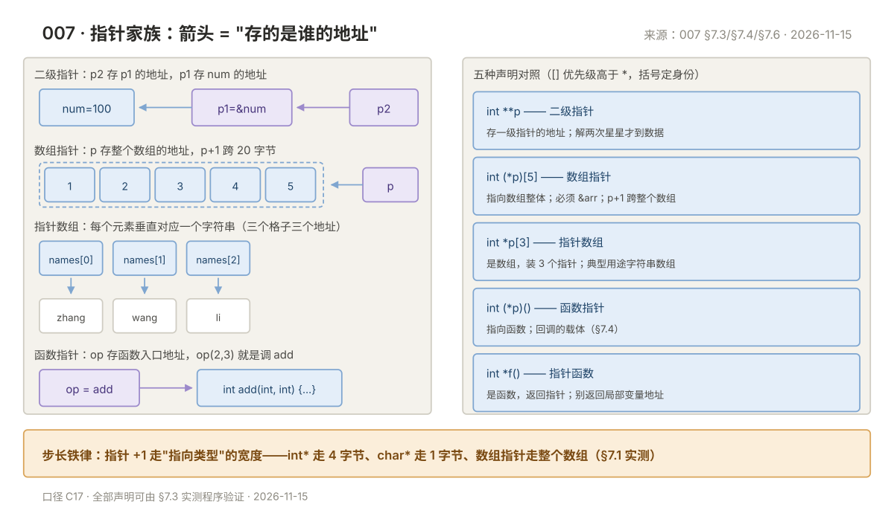

# 007 指针进阶与动态内存

> **解决**：003 建立了"指针是存地址的变量"，本册把它用到工程级——指针运算的步长规则、指针 vs 数组名的本质差异、指针家族（指针数组/数组指针/函数指针与回调）、const 两种锁、多级指针与 void*，最后上 malloc/calloc/realloc/free 四函数操作堆内存；本册所有输出均为本机实录（GCC 16.2.0，见「C语言」001）。  
> **范围**：指针运算 · 指针与数组名 · 指针数组/数组指针 · 函数指针与回调 · const 两位置 · 多级指针 · void* · 动态内存四函数 · 野指针收拢。  
> **口径**：C17；地址宽度以本机实测为准（Windows x64，指针 8 字节）。本册 430+ 行（超 400 基准）：指针家族九类声明与堆内存四函数合并为一册，不拆——机制完整优先于篇幅。  
> **更新**：2026-11-15  
> **本册导读** ── 必会三点：① 指针位移的**单位是"指向类型的宽度"**不是字节（int* +1 实走 4 字节实测）② `sizeof arr`=20 vs `sizeof p`=8，`&arr+1` 跨 20 字节——数组名与指针"像，但不是"③ malloc 垃圾值 / calloc 零值 / realloc 保旧内容，free 三纪律 ｜ 跟做时长：约 3 小时 ｜ 前置：003（指针与内存四区）、006（函数与作用域）。  
> **标记**：★ = 必会节；○ = 拓展节。

## 目录

| 节 | 内容 |
|---|---|
| 7.1 | 指针运算：位移按类型步长 ★ |
| 7.2 | 指针 vs 数组名：像，但不是 ★ |
| 7.3 | 指针数组与数组指针 ○ |
| 7.4 | 函数指针与回调：把"怎么算"当参数传 ★ |
| 7.5 | const 与指针：两种位置两种锁 ○ |
| 7.6 | 多级指针与 void* ○ |
| 7.7 | 动态内存：malloc / calloc / realloc / free ★ |
| 7.8 | 野指针收拢与堆栈分工 ○ |
| 7.9 | 坑表 |
| 7.10 | 检查清单（自测 8 题 + 动手任务 3 件） |

---

## 7.1 指针运算：位移按类型步长 ★

**定义**：指针可做五类运算——`+/-`（位移不赋值）、`+=/-=`（位移并赋值）、`++/--`（位移一格并赋值）、比较（比地址大小）、**同类型指针相减（结果是相差的元素个数）**。核心规则：位移的**一个单元 = 指向类型的宽度**，不是 1 字节。

**完整示例**（`ptr_arith.c`）：

```c
#include <stdio.h>

int main(void)
{
    int arr[] = {10, 20, 30, 40, 50};
    int *p = arr;

    /* 1. +/- 位移（不赋值）：单元 = 指向类型宽度 */
    printf("*(p + 1) = %d (位移后不赋值, p 原地不动)\n", *(p + 1));
    printf("p[0] = %d\n", p[0]);

    /* 2. += 位移（赋值，地址真的变） */
    p += 2;
    printf("p += 2 后 *p = %d\n", *p);

    /* 3. 同类型指针相减 = 相差元素个数 */
    int *q = &arr[4];
    printf("q - p = %td (相差元素个数)\n", q - p);

    /* 4. 比较：比的是地址 */
    printf("p < q : %d\n", p < q);

    /* 5. 步长按类型：int* 加 1 走 4 字节, char* 加 1 走 1 字节 */
    int *pi = arr;
    char *pc = (char *)arr;
    printf("int* +1 实走 %d 字节\n", (int)((char *)(pi + 1) - (char *)pi));
    printf("char* +1 实走 %d 字节\n", (int)((char *)(pc + 1) - (char *)pc));
    return 0;
}
```

**跟做**：`gcc -Wall ptr_arith.c -o ptr_arith.exe` → `.\ptr_arith.exe`。**预期输出（本机实录）**：

```text
*(p + 1) = 20 (位移后不赋值, p 原地不动)
p[0] = 10
p += 2 后 *p = 30
q - p = 2 (相差元素个数)
p < q : 1
int* +1 实走 4 字节
char* +1 实走 1 字节
```

**三处必看的机制**：① `p + 1` 只是算出"下一个格子的地址"，`p` 本身不动；`p += 2` 才把 30 的地址真的写进 p——不赋值与赋值一字之差；② `q - p = 2`：两个地址差 8 字节，除以 int 宽度 4，得**元素个数 2**——这是同类型指针相减的语义；③ 最后两行是步长的铁证：同样"+1"，int* 走 4 字节、char* 走 1 字节——`p[i]` ≡ `*(p + i)`（003 §3.3）在进阶层依然成立。

**试一试**：① 把数组换 `double`，验证 int* 与 double* 的步长（8 字节）；② `++p` 与 `p++` 各跑一遍，打印 `*p` 对比前后置差异（002 §2.3 的规则在指针上同样生效）；③ `p[i] ≡ *(p + i)` 的实证在 003 §3.1（addr.c 的 via index / via *(arr+1)），回去对照一遍。

## 7.2 指针 vs 数组名：像，但不是 ★

**定义**：数组名与指针**能互相模仿**——都存地址、都能 `+/-` 位移、都能 `[]` 取元素；但两者**本质是两个东西**：数组名是"整个数组的门牌"（sizeof 是整个数组、自身不可改），指针是"一个存地址的变量"（sizeof 是 8、可以随便改指）。

**完整示例**（`ptr_vs_arr.c`）：

```c
#include <stdio.h>

int main(void)
{
    int arr[] = {1, 2, 3, 4, 5};
    int *p = arr;

    /* sizeof：数组名 = 整个数组；指针 = 一个地址格子 */
    printf("sizeof arr = %zu\n", sizeof arr);
    printf("sizeof p   = %zu\n", sizeof p);

    /* 数组名可以做 + - 位移（不赋值），但不能被赋值 */
    printf("*(arr + 1) = %d\n", *(arr + 1));
    /* arr += 1;  编译错误：数组地址不可改 */
    p += 1; /* 指针可以 */
    printf("p += 1 后 *p = %d\n", *p);

    /* &arr 与 arr 数值相同但性质不同：+1 跨的宽度不同 */
    printf("arr+1  - arr  = %d 字节\n", (int)((char *)(arr + 1) - (char *)arr));
    printf("&arr+1 - &arr = %d 字节\n", (int)((char *)(&arr + 1) - (char *)&arr));
    return 0;
}
```

**跟做**：编译运行。**预期输出（本机实录）**：

```text
sizeof arr = 20
sizeof p   = 8
*(arr + 1) = 2
p += 1 后 *p = 2
arr+1  - arr  = 4 字节
&arr+1 - &arr = 20 字节
```

**三处必看的机制**：① `sizeof arr = 20`（5 个 int 全家）vs `sizeof p = 8`（一个地址格子）——数组名"知道全家"，指针只知道一格；② 最后两行是本节最值钱的证据：`arr` 和 `&arr` **数值相同**（都是首元素地址），但 `arr+1` 跨 4 字节（一个元素）、`&arr+1` 跨 **20 字节（整个数组）**——`&arr` 的类型是"数组指针"（§7.3）；③ 汇总表：`sizeof`（20 vs 8）、`+=`（不可 vs 可）、`&arr`（数组整体 vs 指针自己的地址）——三条不同点背下来，其余场景可以当同一个东西用。

**试一试**：① 把 `p += 1` 换成 `arr += 1`（解开注释）看编译错误原文；② 写 `int *p2 = &arr;`——GCC 14 起类型不匹配直接**报错**（`initialization of 'int *' from incompatible pointer type`，与 §6.2 隐式声明升 error 同一批变更），别再背"只是警告"的旧结论。

## 7.3 指针数组与数组指针 ○

**定义**：读法决定身份——**指针数组** `int *arr[n]`：是**数组**，装 n 个指针（典型用途：字符串数组）；**数组指针** `int (*p)[n]`：是**指针**，指向整个数组（必须 `&数组名`）。`[]` 优先级高于 `*`，括号决定谁是谁。

**完整示例**（`ptr_array.c`）：

```c
#include <stdio.h>

int main(void)
{
    /* 指针数组：元素都是指针——典型用途字符串数组 */
    const char *names[] = {"zhang", "wang", "li"};
    for (int i = 0; i < 3; i++)
        printf("names[%d] = %s\n", i, names[i]);
    printf("sizeof names = %zu (3 个指针 x 每个占 %zu 字节)\n",
           sizeof names, sizeof(char *));

    /* 数组指针：指向数组整体，必须 &数组名 */
    int arr[] = {1, 2, 3, 4, 5};
    int (*p)[5] = &arr;
    printf("(*p)[2] = %d\n", (*p)[2]);
    printf("p+1 与 p 相差 %d 字节 (跨整个数组)\n",
           (int)((char *)(p + 1) - (char *)p));
    return 0;
}
```

**跟做**：编译运行。**预期输出（本机实录）**：

```text
names[0] = zhang
names[1] = wang
names[2] = li
sizeof names = 24 (3 个指针 x 每个占 8 字节)
(*p)[2] = 3
p+1 与 p 相差 20 字节 (跨整个数组)
```

**三处必看的机制**：① `sizeof names = 24`——指针数组自己的长度是 **3×8**（三个地址格子），不是三个字符串的总长；每个格子里的字符串另住在只读区（003 §3.3）；② `int (*p)[5] = &arr` 的 `p+1` 跨 **20 字节**——与 §7.2 的 `&arr+1` 互相印证：数组指针就是"以整个数组为单位"的指针；③ 二维数组传参时形参就写数组指针 `int (*p)[3]`——列数是类型的一部分。

**试一试**：① `int (*p)[5] = arr;`（漏 &）编译——GCC 14 起直接报错 `incompatible pointer type`；② 给 names 追加第 4 个字符串，长度公式改成 `sizeof names / sizeof names[0]` 自动适配。

**指针声明一览**（一张表认全指针家族——从左往右读：先看 `p` 挨着什么）：

| 声明 | 类型 | 含义 |
|---|---|---|
| `int i` | int | 整型变量 |
| `int *p` | int * | 指向 int 的指针 |
| `int a[5]` | int[5] | 5 个 int 的数组 |
| `int *p[4]` | int *[4] | **指针数组**：装 4 个指针的数组 |
| `int (*p)[4]` | int (*)[4] | **数组指针**：指向 4 个 int 的数组整体 |
| `int f()` | int () | 返回 int 的函数 |
| `int *f()` | int *() | **指针函数**：返回指针的函数 |
| `int (*p)()` | int (*)() | **函数指针**：指向函数的指针 |
| `int **p` | int ** | 二级指针（指向指针的指针） |

辨析口诀：`[]` 优先级高于 `*`——`*p[4]` 先是数组（指针数组），`(*p)[4]` 括号先把指针焊住（数组指针）；`(*p)()` 与 `*p()` 同理分出函数指针与指针函数。

这张表再配一张图，五种声明各配一句"它到底是个啥"：



## 7.4 函数指针与回调：把"怎么算"当参数传 ★

**定义**：函数指针 `返回值类型 (*名)(形参列表) = 函数名;`——存函数的地址、代表函数整体；两大用途：① 通过指针调用函数；② **回调**（callback）——把函数 A 作为参数传给函数 B，B 在合适时机"回头调用" A，让 B 的行为可插拔。

**完整示例**（`callback.c`）：

```c
#include <stdio.h>

int add(int a, int b) { return a + b; }
int mul(int a, int b) { return a * b; }

/* calc 不管具体算什么, 把"怎么算"作为参数传进来——回调 */
int calc(int x, int y, int (*op)(int, int))
{
    return op(x, y);
}

int main(void)
{
    int (*op)(int, int) = add; /* 函数指针：指向函数整体 */
    printf("op(2,3) = %d\n", op(2, 3));
    op = mul;                  /* 换个指向, 同一个指针换行为 */
    printf("op(2,3) = %d\n", op(2, 3));

    printf("calc(6,7,add) = %d\n", calc(6, 7, add));
    printf("calc(6,7,mul) = %d\n", calc(6, 7, mul));
    return 0;
}
```

**跟做**：编译运行。**预期输出（本机实录）**：

```text
op(2,3) = 5
op(2,3) = 6
calc(6,7,add) = 13
calc(6,7,mul) = 42
```

**三处必看的机制**：① 同一个 `op` 指向 add 时算加法、指向 mul 时算乘法——**行为随指向改变**，这就是"函数是一等公民"的第一课；② `calc` 的第三个形参 `int (*op)(int, int)` 是回调的接收端：算法作为数据传入，calc 的代码一行不用改就支持新运算——排序函数的比较器、中断服务函数表（后续 MCU 板块的向量表机制）都是这个模式；③ 函数名本身就是函数入口地址，所以 `= add` 不加 `&` 也合法（`= &add` 等价）。

**试一试**：① 加一个 `int sub(int, int)`，不改 calc 一行代码，验证 `calc(6,7,sub)` 得 -1；② 把 `op(2,3)` 写成 `(*op)(2,3)`（显式解引用），输出一样——两种调用风格等价；③ 纸上推演回调运算题：`func(100, 200, sum)` 其中 `func` 的实现是 `return cb(a, b) / 2;`——先算 `sum(100,200)=300` 再除以 2 得 **150**，写程序验证。

## 7.5 const 与指针：两种位置两种锁 ○

**定义**：const 写在 `*` 前是**常量指针**（锁"值"——不能通过指针改指向的数据，但可以换指向）；const 写在 `*` 后是**指针常量**（锁"指向"——指针焊死在地址上，但可以改那格数据）。读法口诀：const 挨着谁谁被锁。

**完整示例**（`const_ptr.c`）：

```c
#include <stdio.h>

int main(void)
{
    int a = 100, b = 200;

    /* 常量指针 const int *p：指向的值不能通过指针改, 指向可以换 */
    const int *p1 = &a;
    printf("*p1 = %d\n", *p1);
    /* *p1 = 1000;  编译错误: 不能通过 p1 改值 */
    a = 1000; /* 变量自己改, 没问题 */
    p1 = &b;  /* 换指向, 没问题 */
    printf("a=%d  *p1 = %d (已指向 b)\n", a, *p1);

    /* 指针常量 int *const p：指向不能换, 值可以改 */
    int *const p2 = &a;
    *p2 = 77;
    printf("*p2 = %d\n", *p2);
    /* p2 = &b;  编译错误: 指向焊死 */
    printf("p2 焊在 %p 不动\n", (void *)p2);
    return 0;
}
```

**跟做**：编译运行。**预期输出（本机实录）**：

```text
*p1 = 100
a=1000  *p1 = 200 (已指向 b)
*p2 = 77
p2 焊在 000000de4d3ff6cc 不动
```

**三处必看的机制**：① `const int *p1`：`*p1 = 1000` 编译错误、`p1 = &b` 没事——**锁值不锁指向**；`int *const p2` 反过来——**锁指向不锁值**；② 常量指针不等于"数据是常量"：`a` 自己改成 1000 完全合法，锁的只是"走这扇门进去改"这一条路；③ 用途直觉：只读遍历用常量指针（承诺不改）、GPIO 外设句柄用指针常量（地址焊死在寄存器映射上）——嵌入式头文件里 `* const` 随处可见。

**试一试**：① 把两处注释解开分别编译，抄下两个错误原文（`assignment of read-only location '*p1'` 锁值 / `assignment of read-only variable 'p2'` 锁指向）；② `const int *const p3 = &a;` 双锁全开，验证改值换指向都不行。

## 7.6 多级指针与 void* ○

**定义**：二级指针 `int **p2 = &p1;` 存的是**一级指针的地址**——解一次 `*p2` 得到 p1（还是地址），再解一次 `**p2` 才到数据；void* 是"类型未定"的指针——**可以与任何类型指针互转、不可解引用**（解了也不知道按什么宽度读）。

**完整示例**（`multi_void.c`）：

```c
#include <stdio.h>

int main(void)
{
    int num = 100;
    int *p1 = &num;
    int **p2 = &p1; /* 二级指针：存一级指针的地址 */

    printf("num   = %d\n", num);
    printf("*p1   = %d\n", *p1);
    printf("**p2  = %d (数两次星星才到 num)\n", **p2);
    printf("*p2 == p1 ? %d\n", *p2 == p1);

    /* void*：类型未定，不可解引用 */
    void *v = &num;
    printf("v = %p\n", v);
    /* printf("%d\n", *v);  编译错误：void* 不能解引用 */
    int *back = (int *)v; /* 转回具体类型才能用 */
    printf("*back = %d\n", *back);
    return 0;
}
```

**跟做**：编译运行。**预期输出（本机实录）**：

```text
num   = 100
*p1   = 100
**p2  = 100 (数两次星星才到 num)
*p2 == p1 ? 1
v = 000000e52bdff864
*back = 100
```

**三处必看的机制**：① `*p2 == p1` 为 1——二级指针解一次正好回到一级指针，**每解一次星星少一颗**；② void* 的存在意义是"通用容器"：malloc 返回 void*（§7.7）、qsort 的比较回调参数也是 void*——转回具体类型才解引用；③ 嵌入式里二级指针常见于"改指针本身"的函数（如链表头插法 `Node **head`）——想改谁的值，就传谁的地址（006 §6.1 的拷贝规则对指针同样成立）。

**试一试**：① 解开 `*v` 注释编译，抄下错误原文（invalid dereference 类）；② 加三级指针 `int ***p3 = &p2;` 验证 `***p3 = 100`。

## 7.7 动态内存：malloc / calloc / realloc / free ★

**定义**：四个堆内存函数（都在 `<stdlib.h>`，003 §3.4 的堆区）：`malloc(字节数)` 开辟、内容**垃圾值**；`calloc(个数, 每元素字节)` 开辟并**清零**；`realloc(p, 新大小)` 扩缩容（**原内容保留**、新格子垃圾值）；`free(p)` 释放。返回值都是 void*，成功给地址、失败给 NULL——**用前判空**。

**完整示例**（`heap_demo.c`）：

```c
#include <stdio.h>
#include <stdlib.h>

int main(void)
{
    /* malloc：垃圾值；calloc：默认零值 */
    int *pm = malloc(3 * sizeof(int));
    int *pc = calloc(3, sizeof(int));
    if (pm == NULL || pc == NULL)
    {
        printf("分配失败\n");
        return 1;
    }
    printf("malloc: %d %d %d\n", pm[0], pm[1], pm[2]);
    printf("calloc: %d %d %d\n", pc[0], pc[1], pc[2]);

    /* 用起来跟数组一样 */
    for (int i = 0; i < 3; i++)
        pm[i] = (i + 1) * 10;
    printf("malloc 装填后: %d %d %d\n", pm[0], pm[1], pm[2]);

    /* realloc 扩容：原内容保留，新格子无默认值 */
    pm = realloc(pm, 5 * sizeof(int));
    pm[3] = 40;
    pm[4] = 50;
    printf("realloc 后: ");
    for (int i = 0; i < 5; i++)
        printf("%d ", pm[i]);
    printf("\n");

    /* free 纪律：谁申请谁释放、释放后置 NULL、不重复释放 */
    free(pm);
    free(pc);
    pm = NULL;
    pc = NULL;
    printf("释放完成\n");
    return 0;
}
```

**跟做**：编译运行。**预期输出（本机实录，含 -Wall 警告——malloc 的垃圾值连编译器都提醒你）**：

```text
heap_demo.c: In function 'main':
heap_demo.c:14:5: warning: '*<unknown>' may be used uninitialized [-Wmaybe-uninitialized]
   14 |     printf("malloc: %d %d %d\n", pm[0], pm[1], pm[2]);
      |     ^~~~~~~~~~~~~~~~~~~~~~~~~~~~~~~~~~~~~~~~~~~~~~~~~
malloc: 994124400 566 994115920
calloc: 0 0 0
malloc 装填后: 10 20 30
realloc 后: 10 20 30 40 50 
释放完成
```

**三处必看的机制**：① `malloc` 三个格子打印出 `994124400 566 994115920`——堆上的**垃圾值**这次夸张到离谱（上次用过的内存残渣）；`calloc` 整整齐齐 `0 0 0`——需要"确定初值"就用 calloc；② `realloc` 扩到 5 格后 `10 20 30` 原样保留、`40 50` 是我们手动装填的（新格子没默认值）；③ free 三纪律：**谁申请谁释放**（别的指针别越权）、**释放后置 NULL**（防悬空再使用）、**不重复释放**——`free(NULL)` 本身无害，所以置 NULL 后多写一次 free 也不炸。

**试一试**：① 保留判空、把 3 改成 `1000000000000`（超大的数）跑一遍——看"分配失败"分支（本机大概率返回 NULL）；⚠️ 再删掉判空与 `return 1`，让 `pm[0] = 1` 直接对 NULL 解引用——段错误，这就是"用前判空"防的崩溃；② realloc 缩容到 2 格，打印第 3~5 格——缩容外的内容不再属于你（悬空区）。

## 7.8 野指针收拢与堆栈分工 ○

**定义**：野指针（wild pointer）= 指向不明/不可信地址的指针。三个产生场景与对策：① 定义未赋值就用 → 用前赋明确地址；② 函数返回局部成员地址 → 值拷贝或 static 延寿（006 §6.5 段错误实录）；③ 越界访问 → 边界自查（005 §5.6）。堆内存专属的三宗罪：**泄漏**（申请不释放）、**重复释放**（free 两次）、**悬空使用**（free 后接着用）。

**堆 vs 栈分工**（003 §3.4 与 006 §6.5 的合并视角）：

| 维度 | 栈 | 堆 |
|---|---|---|
| 谁在管 | 编译器自动（函数进出栈） | 程序员手动（malloc/free） |
| 默认值 | 无（垃圾值） | malloc 垃圾值 / calloc 零值 |
| 释放时机 | 出栈立刻 | free 才释放，忘了就泄漏 |
| 速度/形态 | 快、连续、先进后出 | 慢、凌乱无序 |
| 大小 | 小（GNU ld 默认保留约 2 MB；MSVC 默认 1 MB） | 大（受物理内存限制） |

**嵌入式视角**：小型 MCU 项目常**禁用 malloc**——堆的碎片化与耗时不确定性对实时性是威胁，静态/栈分配为主；Linux 嵌入式设备上堆才是常态（进程地址空间在「操作系统原理」002 展开）。

**试一试**：写 `leak.c`：循环 1000 次 `malloc(1024)` 都不 free——任务管理器看内存占用爬升（泄漏可视化），Ctrl+C 收场后重写 free 版对比。

## 7.9 坑表

| # | 现象 | 原因 | 解法 |
|---|---|---|---|
| 1 | `p+1` 只挪了一个元素不是一字节 | 步长 = 指向类型宽度（§7.1 实测 4 字节） | 想按字节走用 `char *` |
| 2 | `arr += 1` 编译报错 | 数组名地址不可改 | 用指针变量接住再位移 |
| 3 | `int (*p)[5] = arr` 类型不匹配 | 数组指针必须接 `&数组名` | `= &arr`（§7.3） |
| 4 | 程序越跑内存越大 | malloc 忘 free（泄漏） | 谁申请谁释放；配对审计 |
| 5 | free 后再读数据炸了 | 悬空指针（野指针三场景之一） | free 后立刻置 NULL |
| 6 | `*v` 编译错误 | void* 不可解引用 | 先转回具体类型 |
| 7 | 函数指针声明写反 | `int (*op)(int,int)` 括号决定身份 | 对照"返回值 (*名)(形参)"背格式 |
| 8 | `*p1 = 1000` 编译错 | p1 是常量指针，锁值 | 变量自己改，或换指针常量 |

## 7.10 检查清单（自测 8 题 + 动手任务 3 件）

**自测**：

| # | 问题 | 自测标准 |
|---|---|---|
| 1 | 指针位移的单位 | 指向类型宽度（int* +1 = 4 字节实测） |
| 2 | 同类型指针相减的结果 | 相差的元素个数（不是字节数） |
| 3 | sizeof arr / sizeof p / &arr+1 | 20 / 8 / 跨 20 字节——三者共同证明"像但不是" |
| 4 | const 两种位置各锁什么 | `*` 前锁值（常量指针）、`*` 后锁指向（指针常量） |
| 5 | malloc 与 calloc 的差别 | 垃圾值 vs 零值；realloc 保旧内容 |
| 6 | free 三纪律 | 谁申请谁释放、置 NULL、不重复释放 |
| 7 | `double (*a3)[5]` 是什么 | 数组指针——指向 5 个 double 的数组整体（§7.3 一览表） |
| 8 | `int *f(int,int)` 与 `int (*p)(int,int)` 差在哪 | 指针函数（返回指针）vs 函数指针（指向函数） |

**动手任务**：① ptr_arith 换 `double` 数组验证步长 8 字节——产出物：程序 + 实测输出；② 给 callback 加 `sub` 并新增"按升序/降序打印数组"的程序（比较函数作回调传入）——产出物：程序 + 两序输出；③ ⚠️ heap_demo 复现重复释放：在 `free(pm);` 之后、`pm = NULL;` **之前**补一行 `free(pm);` 看崩溃，再恢复置 NULL 写法验证 `free(NULL)` 无害——产出物：两次运行的对比记录。

> 下一篇：《008 文件IO》——数据走出内存：标准流、缓冲区与磁盘文件的读写。
